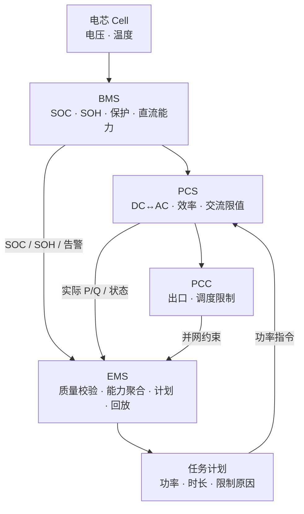
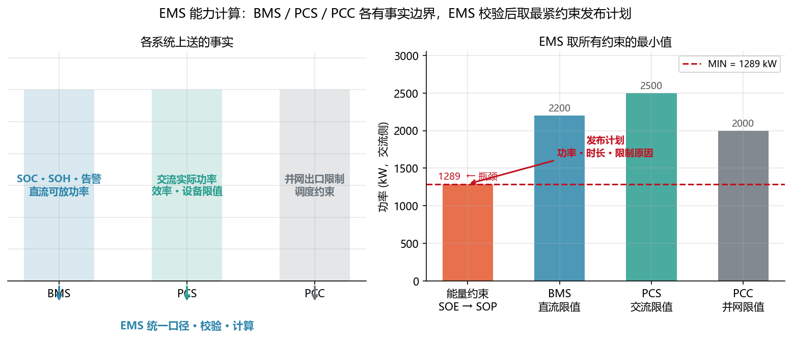

<!-- @AI_GENERATED -->
# 01 系统架构与职责边界

## 1.1 运行场景

17:30，EMS 正在为 18:00 晚峰任务重算能力。BMS 上送堆级 SOC=30%、最低簇 SOC、温度、告警和直流侧可放功率；PCS 上送交流侧实际功率、效率和设备状态；PCC 上送出口功率限制。值班员希望将原计划维持在 2 MW，但发现不同系统给出的"可放能力"并不相同。

BMS 认为部分簇接近运行下限，PCS 显示本机额定有功仍为 2.5 MW，PCC 允许最大出口为 2 MW。若只看 PCS，2 MW 似乎可执行；若忽略 BMS，最低簇可能在任务中提前触限。EMS 必须在这几个看似冲突的事实之间作出计划决策。

## 1.2 系统职责

BMS、PCS、PCC 各自维护不同层面的能力事实。要理解它们为何冲突，先要了解每个系统的责任边界。

- **电芯（Cell）**：最小储能单元，提供电压和温度等原始状态信息。
- **BMS（Battery Management System）**：管理单体和簇的状态、保护、SOC、SOH、告警与直流侧可充放能力。
- **PCS（Power Conversion System）**：完成直流/交流功率变换，提供实际 P/Q、效率和交流侧设备限值。
- **EMS（Energy Management System）**：汇总数据质量、统一测量平面、聚合能力、下发计划并保存运行证据。
- **PCC（Point of Common Coupling）**：电站与电网连接点，提供出口与调度限制。

## 1.3 信息流



## 1.4 决策困难

现在回到 17:30 的矛盾：BMS 说不能放，PCS 说额定 2.5 MW，PCC 限制 2 MW。关键不是"哪个系统更重要"，而是"哪个系统拥有哪一类事实"。

BMS 是否允许继续放电，属于电池保护和直流能力事实；PCS 能否将直流能量转换为交流功率，属于变流设备事实；PCC 能否向电网输出，属于并网和调度事实。EMS 的职责不是选一个系统相信，而是把这些事实统一到同一方向、时刻和测量平面，再生成计划。

如果 EMS 用自己的估计结果覆盖 BMS 的保护状态，或把 PCS 铭牌功率视为实际可交付功率，都会产生越权或错误调度。

## 1.5 算法需求

系统职责决定了后续算法的输入和输出边界：

```text
BMS 原始状态与限制
→ EMS 检查数据是否可用
→ 状态模型估计 SOC 与可信度
→ EMS 计算 SOE/SOP
→ BMS/PCS/PCC 限值取最小
→ PCS 执行，EMS 回放结果
```

因此，SOC 算法可以帮助 EMS 交叉验证状态和计算保守能力，但不能取代 BMS 保护；SOE/SOP 算法可以帮助 EMS 重排计划，但不能抬高 PCS 或 PCC 的物理限制。



## 1.6 业务决策

| 业务问题 | 事实来源 | EMS 动作 |
|---|---|---|
| 最低簇是否允许放电 | BMS | 接受 BMS 限制，记录瓶颈 |
| 交流侧最多能执行多少 | PCS | 采用实时设备能力和效率 |
| PCC 能输出多少 | PCC/调度 | 采用出口限制 |
| 任务应承诺多少 | EMS | 统一口径后取最紧约束 |

17:30 的决策因此不是"选一个系统相信"，而是将 BMS、PCS 和 PCC 的限制统一后取最小值。即使来源正确，若测量平面、时间窗口或数据质量不一致，这些事实仍不能直接计算——这正是第 03–04 章要解决的问题。

## 1.7 自测

1. EMS 能否因独立估计器算出更高 SOC，就突破 BMS 的禁放限制？
2. 为什么 PCS 额定 2.5 MW 不足以证明 2 MW 晚峰任务可执行？
3. EMS 在能力计算中的核心职责是什么？

<details><summary>参考答案</summary>

1. 不能。BMS 拥有保护和直流能力事实，EMS 不能越过保护边界。
2. 还需检查可用能量、BMS 限制和 PCC 出口限制；PCS 铭牌只说明其中一个约束。
3. 校验数据、统一测量平面和方向、聚合 BMS/PCS/PCC 限制，生成带限制原因的计划。

</details>

<!-- @AI_GENERATED: end -->