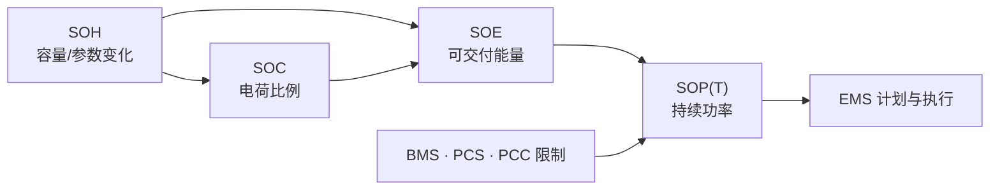

<!-- @AI_GENERATED -->
# 02 SOC / SOE / SOH / SOP 状态体系

## 2.1 运行场景

17:30，BMS 报告堆级 SOC=30%，容量型 SOH=92%；PCS 报告当前可用交流功率不超过 2.0 MW。调度人员只关心一个问题：18:00 是否能以 2 MW 放电 30 min。

三类数据都像"电池还剩多少"，但它们实际回答不同问题。SOC 说明剩余电荷比例；SOH 说明当前容量相对额定容量的变化；PCS 功率限值说明此刻可执行的功率上限。它们都不能直接回答"30 min 内可交付多少交流侧能量"。

## 2.2 状态定义

要理解这些数据之间的关系，先要区分四类核心状态。

| 状态 | 英文/缩写 | 回答的问题 | 单位 | 业务用途 |
|---|---|---|---|---|
| 荷电状态 | State of Charge, SOC | 剩余可放电荷占当前有效容量多少 | 0–1 | 运行窗口、状态估计 |
| 能量状态 | State of Energy, SOE | 当前可交付能量有多少 | kWh 或 0–1 | 电量计划、持续时间 |
| 健康状态 | State of Health, SOH | 容量和动态性能相对参考状态如何 | 0–1 或分项 | 更新容量、参数 |
| 功率状态 | State of Power, SOP | 指定方向和时长下可交付多大功率 | kW | 限幅、调度申报 |

## 2.3 决策困难

回到 17:30 的调度问题：如果把 SOC=30% 直接理解为"还能交付额定能量的 30%"，就会忽略容量衰减、运行下限、路径效率、最低簇差和任务时长。若把 PCS 的 2.0 MW 限值理解为"可持续放 30 min"，又会忽略能量是否足够。

SOC 描述电荷比例，SOE 描述可交付能量，SOH 描述容量变化，SOP 描述可持续功率。四者不是并列名词，出发角度和用途各不相同。EMS 需要把这条链连接起来：先知道剩余电荷比例，再修正有效容量，换算可用能量，最后结合指定时长和设备限制形成可承诺功率。

## 2.4 算法需求

业务任务要求形成以下转换链：

```text
SOC：剩余电荷比例
→ SOH：修正有效容量
→ SOE：得到交流侧可用能量
→ SOP(T)：按任务时长和设备限制形成可承诺功率
```

因此，后续不是"多算几个状态"，而是让 EMS 能回答不同的业务问题：剩余多少、可交付多少、能持续多久、当前该承诺多大功率。



SOH 是整个链条的起点参数。容量从 100% 降到 92%，每一步的数值都会变化：SOC 的分母缩小，SOE 可交付能量收紧，最终 SOP 随之下降。下面的公式将展示这个连锁效应。

## 2.5 状态换算公式

四类状态不是并列名词，而是一条递推链，通用形式如下（详细推导见第 16–17 章）：

```text
E_eff = C_rated × SOH_capacity
E_internal = max(0, SOC − SOC_min) × E_eff
SOE_AC = E_internal × η_DC→AC
P_energy(T) = SOE_AC / (T/3600)
```

| 变量 | 含义 | 单位 |
|---|---|---|
| `C_rated` | 站级额定能量 | kWh |
| `SOH_capacity` | 容量型健康度 | 0～1 |
| `E_eff` | 站级有效能量（单体口径的有效容量记作 `C_eff`） | kWh |
| `SOC_min` | 放电运行下限 | SOC |
| `η_DC→AC` | 直流到交流效率，只乘一次 | 0～1 |
| `T` | 任务持续时间 | s |

## 2.6 手算示例

站级名义能量 `C_rated=5.016 MWh`、`SOH=92%`、`SOC=30%`、运行下限 10%、效率 0.931。

**第 1 步：SOC/SOH 转换为内部可用能量。**

```text
E_eff = 5.016×0.92 = 4.615 MWh
E_internal = (30%−10%)×4.615 = 0.923 MWh
```

**第 2 步：SOE 转换为 30 min 的能量约束功率。**

```text
SOE_AC = 0.923×0.931 = 0.859 MWh
P_energy(30min) = 0.859/0.5 = 1.718 MW
```

即使尚未扣除估计余量和最低簇差，1.718 MW 已低于原 2 MW 计划。第 16–18 章将用完整约束得到最终保守功率。

## 2.7 业务决策

| 若只看 | 会遗漏 | 可能后果 |
|---|---|---|
| SOC | SOH、效率、窗口和簇差 | 高估可交付能量 |
| SOE | BMS/PCS/PCC 功率限制 | 高估可持续功率 |
| PCS 功率 | 任务时长和能量 | 中途触限或降额 |
| 平均 SOC | 最低簇状态 | 低 SOC 簇提前限制整站 |

第 03 章开始处理这些状态的输入条件：原始遥测必须先说明来自哪个测量平面。

## 2.8 自测

1. 为什么 SOP 必须带持续时间？
2. SOH=92% 首先改变哪个量？
3. 15 min 任务下，0.859 MWh 对应的能量约束功率是多少？

<details><summary>参考答案</summary>

1. 相同能量在不同任务时长下可持续功率不同。
2. 有效容量 `C_eff`，随后影响 SOE 和 SOP。
3. `0.859/0.25=3.436 MW`，此时通常转由设备或并网限值成为瓶颈。

</details>

<!-- @AI_GENERATED: end -->