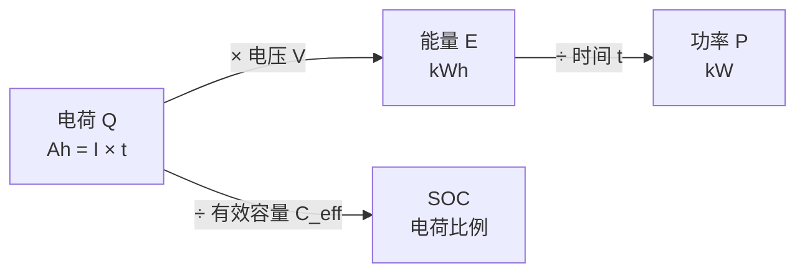

<!-- @AI_GENERATED -->
# 05 容量、电量与能量换算

**一句话**：Ah 是电荷、kWh 是能量、SOC 是比例、kW 是功率。换算时漏掉电压、时间或对象层级，数值再合理也会错位。

## 5.1 运行场景

17:30，BMS 报告当前堆级 SOC 为 30%，同时给出代表性单体额定容量 314 Ah。PCS 值班界面显示 18:00 的任务要求在交流侧输出 2 MW；调度计划要求 30 min 内交付 1 MWh。三个系统使用的单位不同：BMS 主要描述电荷和 SOC，PCS/PCC 主要描述功率和能量。

值班员需要在任务开始前将“剩余电荷比例”转成“可交付多少 kWh”，再将 kWh 转成指定时长内的 kW。若把 30% SOC 直接当作 30% 的交流侧能量，就会忽略工作电压、有效容量、效率和测量平面。

## 5.2 决策困难

电池容量用 Ah 表示可搬运电荷，电站履约用 kWh 表示交付能量，调度指令用 kW 表示持续功率。它们之间存在电压、时间、串并联结构和效率转换。

如果 EMS 将单体的 1.667 Ah 直接当作站级 kWh，或把直流侧能量直接与 PCC 交流侧目标比较，得到的能力会相差数千倍或遗漏效率损失。此时不是参数调得不够好，而是业务量纲尚未统一。

## 5.3 算法需求

后续 SOC、SOE 和 SOP 算法都依赖一条明确换算链：电流与时间得到电荷，电荷与电压得到能量，能量除任务时间得到功率。算法需要这条链，才能将 BMS 状态转换为 EMS 能力决策。

## 5.4 基本量与单位

| 量 | 符号/单位 | 含义 |
|---|---|---|
| 容量 | `C`（单体口径，同附录 `C_cell`），Ah | 满充到满放可搬运的电荷量 |
| 电量（电荷） | `Q`，Ah 或 C | 一段时间搬运的电荷，`Q=∫I dt` |
| 电压 | `V`，V | 电荷的能量势差 |
| 能量 | `E`，kWh | 可做功能力，`E=∫V·I dt` |
| 功率 | `P`，kW | 单位时间能量，`P=V·I` |

核心关系：

```text
Q（Ah） = I（A） × t（h）
E（kWh） = Q（Ah） × V（V） / 1000
P（kW） = E（kWh） / t（h）
SOC 变化 = Q（Ah） / C_eff（Ah）
```

**SOC 建立在电荷 Ah 上，SOE 和能力建立在能量 kWh 上。** 这就是两者不能互换的原因。

## 5.5 手算示例

统一单体：`C=314 Ah`、平均工作电压 `V=3.2 V`。以 100 A 放电 1 分钟为例。

**第 1 步：电流积分为电荷与 SOC 变化。**

```text
Q = 100 A × (60/3600) h = 1.667 Ah
ΔSOC = Q / C = 1.667 / 314 = 0.00531
```

SOC 下降约 0.53 个百分点。

**第 2 步：电荷换算为能量。**

```text
E = Q × V / 1000 = 1.667 × 3.2 / 1000 = 0.00533 kWh（单体）
E_site = 0.00533 × 416 × 12 = 26.6 kWh（站级）
```

同样“放 1 分钟 100 A”，单体和站级能量差约 5000 倍，因为站级有 416 串、12 并联簇。混淆单体与站级口径是常见错误。

## 5.6 换算链



## 5.7 核心实现

下面函数完整实现“电流、持续时间、容量和电压”到电荷、能量、SOC 变化的换算，可直接运行。

```python
from dataclasses import dataclass


@dataclass(frozen=True)
class EnergyResult:
    charge_ah: float
    energy_kwh: float
    soc_change: float


def discharge_result(current_a: float, duration_s: float,
                     capacity_ah: float, average_voltage_v: float) -> EnergyResult:
    """放电电流为正，计算该时间段搬运的电荷、能量与 SOC 变化。"""
    if current_a < 0 or duration_s < 0:
        raise ValueError("本函数只计算放电，电流和持续时间必须非负")
    if capacity_ah <= 0 or average_voltage_v <= 0:
        raise ValueError("容量和平均电压必须为正")

    charge_ah = current_a * duration_s / 3600.0
    energy_kwh = charge_ah * average_voltage_v / 1000.0
    soc_change = charge_ah / capacity_ah
    return EnergyResult(charge_ah, energy_kwh, soc_change)


if __name__ == "__main__":
    cell = discharge_result(100.0, 60.0, 314.0, 3.2)
    site_energy = cell.energy_kwh * 416 * 12

    print(f"电荷: {cell.charge_ah:.3f} Ah")
    print(f"单体能量: {cell.energy_kwh:.5f} kWh")
    print(f"SOC 变化: {cell.soc_change:.3%}")
    print(f"站级能量: {site_energy:.1f} kWh")

    assert round(cell.charge_ah, 3) == 1.667
    assert round(cell.energy_kwh, 5) == 0.00533
    assert round(site_energy, 1) == 26.6
```

预期输出：

```text
电荷: 1.667 Ah
单体能量: 0.00533 kWh
SOC 变化: 0.531%
站级能量: 26.6 kWh
```

## 5.8 充电效率

充电时，存入的可恢复电荷略少于外部送入的电荷，用库仑效率 `η_c` 表示：

```text
存入电荷 = 外部电荷 × η_c
```

电荷侧有库仑效率，交流侧还有 DC→AC 路径效率。二者作用在不同测量平面，分别计算，不重复相乘。

## 5.9 业务决策

17:30 的能力重算必须使用站级、交流侧口径。BMS 的 SOC 与 Ah 先经过有效容量、运行窗口和单体/簇结构换算，再通过 DC→AC 效率形成 SOE。EMS 只有拿到同一平面的 kWh，才能在第 17 章与 30 min 的 1 MWh 目标比较。

因此，单位换算错误不是报表问题：它会直接把不可执行的 2 MW、30 min 任务误判为可执行，或将可执行任务错误降额。

## 5.10 自测

1. 100 A 放电 30 分钟，搬运多少 Ah？单体能量约多少 kWh？
2. 为什么把“SOC 30%”说成“还有 30% 的能量”可能不准？
3. 库仑效率和 DC→AC 效率有何区别？

<details>
<summary>参考答案</summary>

1. `Q=100×0.5=50 Ah`；`E=50×3.2/1000=0.16 kWh`（单体）。
2. SOC 是电荷比例；能量还要乘电压，并受运行窗口、效率和 SOH 影响。
3. 库仑效率作用在电荷侧，DC→AC 效率作用在直流到交流的能量换算，两者分属不同平面、各乘一次。

</details>

<!-- @AI_GENERATED: end -->