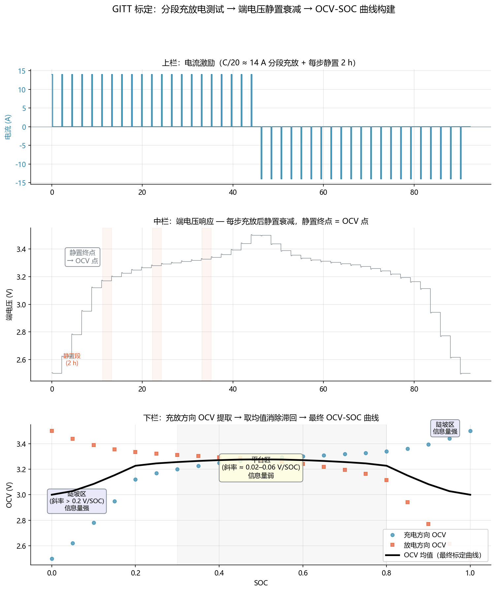

<!-- @AI_GENERATED -->
# 06 OCV-SOC 曲线构建

**一句话**：所有 SOC 估计算法的第一性输入是 OCV-SOC 映射——这条曲线不是"天上掉下来的"，而是通过标准充放电间歇测试标定出来的，标定精度直接决定后续 SOC 的上限。

## 6.1 为什么需要自己标定

前面章节多次使用 `ocv_reference(z)` 返回 3.300 V 对应 50% SOC 这样的映射关系，但从未交代这条曲线从哪来。实际情况是：

- 不同批次的 LFP 电芯，即便同样标称 280 Ah，OCV 平台电压可能差 5–10 mV；
- 不同温度下 OCV 偏移可达 10–15 mV（熵效应）；
- 电池老化后平台电压会逐步下移 3–5 mV。

直接用供应商给的"典型 OCV 表"等于接受不明来源的系统偏差。在 LFP 平台区（dOCV/dSOC ≈ 0.02 V），10 mV 的偏差换算成 SOC 就是 0.5 个百分点——这在 EKF 里会被当作"量测残差"喂给修正器，造成持续偏置。

因此，**OCV-SOC 曲线是所有 SOC 算法的地基，必须先夯实**。

## 6.2 标定方法：间歇充放测试

标准方法称为 GITT（Galvanostatic Intermittent Titration Technique）简化版：以恒定电流对电芯做分段充放，每步之间充分静置，记录静置后的稳定电压作为该点的 OCV。

### 测试步骤

1. 从满放（2.5 V 截止）开始
2. 以 C/20 电流充电，每步充入 1% SOC（约 3.14 Ah）
3. 每个充入步后静置 2 小时，记录静置终点电压 = 充电方向 OCV
4. 重复直到满充（3.65 V）
5. 从满充开始，以 C/20 放电，同样每步 1% SOC 间隔，静置后记录放电方向 OCV
6. 最终 OCV 曲线 = 充电 OCV 与放电 OCV 的均值，消除滞回偏置

## 6.3 从端电压到 OCV：极化衰减

每步静置期间，端电压对时间的衰减曲线承载了 RC 极化消退的全部信息：

```
V(t) = OCV + I·R0·exp(−t/τ)
```

静置 2 小时后（约 4–5 个 τ），偏差衰减到 2% 以下，此时记录的电压可近似视为 OCV。

### 6.3.1 手算示例：一步标定

以 50% SOC 附近的一步为例，R0=0.32 mΩ，τ=20 s，充电电流 15.7 A（C/20 对应 314 Ah）：

- 刚停止充电：V(0) = 3.3000 + 0.0157×0.00032 = 3.3000 + 0.00000502 ≈ 3.3000 V（欧姆压降极小）
- 静置 20 s（1τ）：偏移 = 0.00502×0.368 = 0.00185 V → V=3.3019 V
- 静置 100 s（5τ）：偏移 = 0.00502×0.0067 = 0.000034 V → V ≈ 3.3000 V

C/20 电流下的欧姆压降只有 5.0 μV，极化效应也仅 1.8 mV。这就是为什么标定用小电流——它让极化分量足够小，静置时间不需要太长就能逼近真实 OCV。

### 6.3.2 标定数据表格

| 步骤 | SOC | 充入方向 | I (A) | 静置结束电压 (V) | 充/放均值 OCV (V) |
|:---:|:---:|:---:|:---:|:---:|:---:|
| 1 | 0.00 | 放电起点 | — | 2.500 | 2.500 |
| 2 | 0.05 | 充电后 | 15.7 | 3.185 | 3.183 |
| 3 | 0.10 | 充电后 | 15.7 | 3.220 | 3.218 |
| ... | ... | ... | ... | ... | ... |
| 50 | 0.50 | 充电后 | 15.7 | 3.300 | 3.300 |
| ... | ... | ... | ... | ... | ... |
| 98 | 0.98 | 充电后 | 15.7 | 3.410 | 3.408 |
| 99 | 0.99 | 充电后 | 15.7 | 3.500 | 3.498 |
| 100 | 1.00 | 充电后 | — | 3.650 | 3.650 |

## 6.4 充放平均消除滞回

同一 SOC 点，充电方向 OCV 高于放电方向 OCV，差值在半滞回带 6 mV 左右。取均值 `V_mean = (V_chg + V_dis) / 2` 后，滞回偏置被消除：

```text
V_mean(50%) = (3.3060 + 3.2940) / 2 = 3.3000 V
```

这就是第 07 章（OCV 特性）中 `ocv_reference(0.50) = 3.300` 的**真正来源**——它不是拍脑袋的数字，而是标定数据取均值的结果。

## 6.5 温度分层标定

在 −10°C、25°C、45°C 三个温度点重复上述整套流程，得到三层 OCV 表。三层之间的差值在 50% SOC 处约 10–15 mV：

| SOC | −10°C OCV (V) | 25°C OCV (V) | 45°C OCV (V) |
|:---:|:---:|:---:|:---:|
| 0.10 | 3.212 | 3.218 | 3.226 |
| 0.50 | 3.295 | 3.300 | 3.306 |
| 0.90 | 3.402 | 3.408 | 3.413 |

温度引起的 11 mV 偏移在平台区意味着 0.55 个百分点 SOC——不能忽略。这也解释了为什么 OCV 查表的第 06 章必须按温度插值。

## 6.6 标定质量自检

标定完成后，计算两点间的 dOCV/dSOC 作为自检：

```text
dOCV/dSOC = [V(z+Δz) − V(z)] / Δz
```

健康标定曲线的特征：
- 平台区 (0.3–0.8 SOC)：斜率 0.02–0.05 V/SOC
- 陡坡区 (<0.2 或 >0.9)：斜率 >0.2 V/SOC
- 无局部跳变（跳变 >5 mV/step 表明静置不充分或电芯异常）

### 自检表格

| SOC 区间 | 起始 OCV (V) | 结束 OCV (V) | dOCV/dSOC (V) | 判断 |
|:---:|:---:|:---:|:---:|:---|
| 0.05→0.10 | 3.185 | 3.218 | 0.66 | 陡坡，正常 |
| 0.30→0.50 | 3.280 | 3.300 | 0.10 | 平台，正常 |
| 0.50→0.80 | 3.300 | 3.318 | 0.06 | 平台偏平，正常 |
| 0.90→0.95 | 3.408 | 3.450 | 0.84 | 陡坡，正常 |

对 LFP 来说，平台区斜率 0.06 V/SOC 意味着 5 mV 量测噪声对应 0.083 个 SOC 百分点的不确定度——**这才是第 07 章"可观测性"讨论的物理基础**。

## 6.7 核心实现

```python
import numpy as np

def build_ocv_table_single_temp(
    charge_ocv: list[tuple[float, float]],
    discharge_ocv: list[tuple[float, float]],
    soc_grid: np.ndarray,
) -> np.ndarray:
    """将充/放各自标定点取均值，插值到统一 SOC 网格。"""
    chg_interp = np.interp(soc_grid, *zip(*charge_ocv))
    dis_interp = np.interp(soc_grid, *zip(*discharge_ocv))
    return (chg_interp + dis_interp) / 2.0


def check_ocv_quality(ocv: np.ndarray, soc_grid: np.ndarray) -> dict:
    """自检标定质量：斜率、跳变检测。"""
    dsoc = np.diff(soc_grid)
    docv = np.diff(ocv)
    slope = docv / dsoc
    jumps = np.where(np.abs(np.diff(docv)) > 5e-3)[0]
    return {
        "min_slope": float(np.min(slope)),
        "max_slope": float(np.max(slope)),
        "jump_indices": jumps.tolist(),
        "is_valid": len(jumps) == 0,
    }
```

## 6.8 图与结果



上图展示了完整的标定过程：
- **上栏**：分段电流激励——每步 15.7 A 充入 1% SOC 后静置 2 h
- **中栏**：端电压随时间变化——每一步的指数衰减清晰可见，静置终点即为该点的 OCV 点
- **下栏**：提取的充电 OCV（蓝点）和放电 OCV（橙点），以及取平均后的最终 OCV-SOC 曲线（黑线）

从下栏可以直观看到：平台区（0.3–0.8 SOC）充放 OCV 几乎重合——这个区域的滞回极小，电压信息量最弱；两端陡坡区可观测性远好于中间。

## 6.9 业务决策

| 场景 | OCV 标定有误的后果 |
|---|---|
| LFP 平台区 BMS 上电 | 4 mV 偏差 → 0.2 个百分点 SOC 偏置 → EKF 收敛前晚峰能力被高/低估 |
| 温度补偿缺失 | 冬季 10 mV 偏移 → 0.5% SOC → SOP 高峰期判定错误 |
| 老化后未刷新 OCV | 平台下移 5 mV → 系统偏低估计 SOC → 提前限功率 |

结论：**OCV 标定精度是 SOC 估计的上限。** 标定用 C/20 电流 + 2 h 静置，充放取平均消除滞回，三层温度独立标定，输出需通过斜率自检。

## 6.10 自测

1. 为什么标定必须用小电流（C/20）而非运行电流（0.5C）？
2. 如果不做充放平均，直接使用充电 OCV 表查 SOC，在 50% SOC 处会产生多少 SOC 偏置？（假设半滞回带 6 mV，平台斜率 0.02 V/SOC）
3. 三层温度标定的 25°C → −10°C 间 5 mV 平台偏移，对应多少 SOC 误差？
4. 静置时间减半，OCV 会残留多少极化偏差？（假设 τ=20 s，原静置 2 h，改为 1 h）