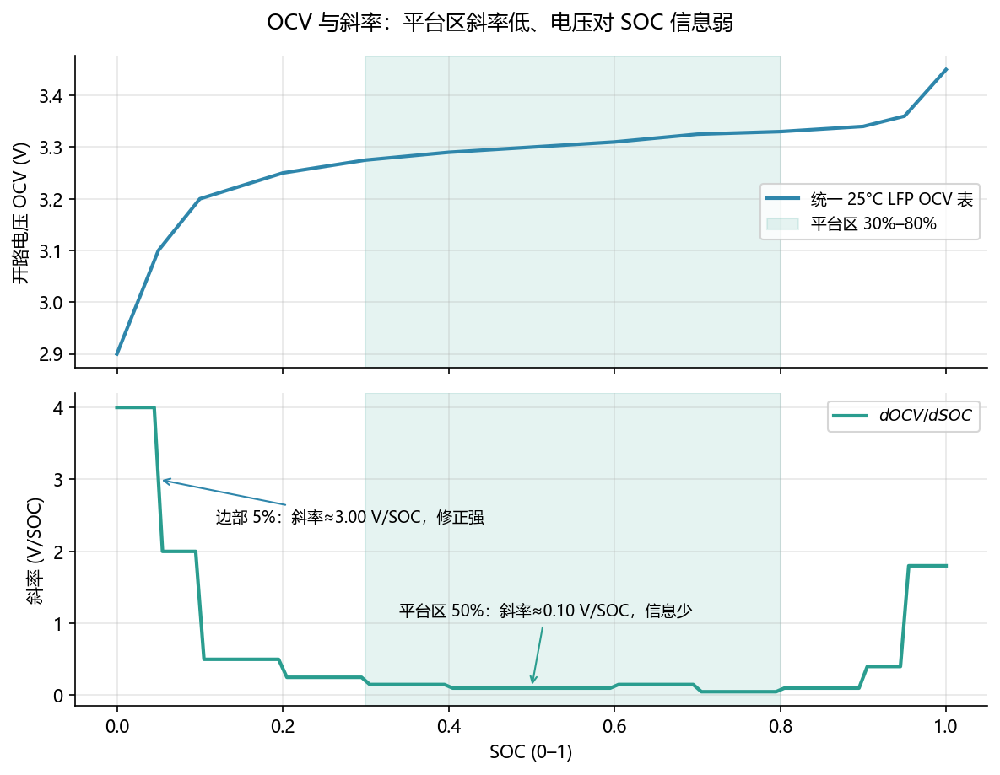
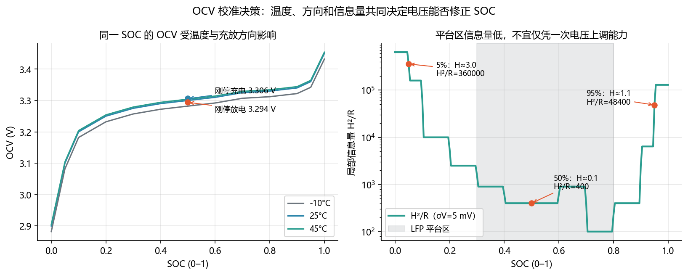

<!-- @AI_GENERATED -->
# 06 OCV 特性与可观测性

**一句话**：电压能提供多少 SOC 信息，不只看 OCV 曲线斜率，还取决于温度、充放历史、静置时间、量测噪声和先验不确定度。

## 6.1 运行场景

11:30，运维人员发现第 4 簇温度比其余簇低，下午仍需要参加短时功率支撑和晚峰削峰。17:20，BMS 上送该簇代表性单体电压为 3.300 V。值班员希望据此确认 SOC 是否仍为 50%，并决定是否将晚峰的可用能量上调。

但该电压既可能来自刚结束充电后的高电压支路，也可能来自刚结束放电后的低电压支路；低温、极化和静置时间也会改变端电压。若 EMS 仅用 25°C 平均 OCV 表反查 SOC，可能把电压历史或温度差误认为电荷变化，进而改变 18:00 的能力申报。

## 6.2 决策困难与算法需求

当前方法只知道“测得 3.300 V”，却不知道这条电压在当前温度、方向历史和静置条件下包含多少 SOC 信息。LFP 平台区的 OCV 斜率很小，5 mV 量测噪声可能对应多个百分点的 SOC 不确定度；此时强制校正 SOC，反而可能比保留积分结果更危险。

因此需要条件 OCV 模型：先根据温度、充放方向和静置时间构造参考电压，再用局部斜率 `H=dOCV/dSOC` 与量测方差 `R` 量化信息量。该算法不只是查一张表，而是判断“此刻是否有足够证据改变晚峰能力”。

## 6.3 关键术语

- **OCV（Open-Circuit Voltage，开路电压）**：指定 SOC、温度、方向历史和静置条件下的参考电压。
- **滞回（Hysteresis）**：同一 SOC 下，刚充电与刚放电的 OCV 不同。
- **松弛（Relaxation）**：停止充放后，方向偏移随静置时间衰减到平均曲线。
- **可观测性（Observability）**：隐藏状态能否由输入输出历史区分，不等于单点斜率。

## 6.4 条件 OCV

共享模型保存 −10°C、25°C、45°C 三层 OCV 表。查询时先按 SOC 插值，再按温度插值：

```text
V_mean(z,T) = interp_T(T, {interp_z(z, OCV_table[T_j])})
V_ref(z,T,d,t_rest) = V_mean + s(d)·H_hys·exp(−t_rest/τ_relax)
s(charge)=+1, s(discharge)=−1, s(rest)=0
```

表外输入必须拒绝，不能静默夹到端点；否则会把超范围的电压伪装成 0% 或 100% SOC。

## 6.5 手算示例：方向与静置

25°C、50% SOC 的平均参考电压为 3.300 V，半滞回带为 6 mV。

**第 1 步：方向支路差。**

```text
刚停充电：3.300 + 0.006 = 3.306 V
刚停放电：3.300 − 0.006 = 3.294 V
支路差值：3.306 − 3.294 = 0.012 V
```

**第 2 步：充电后静置 2 h。** 取 `τ_relax=1800 s`：

```text
偏移 = 0.006 × exp(−7200/1800) = 0.006 × exp(−4) ≈ 0.000110 V
参考 = 3.300 + 0.000110 = 3.3001 V
```

12 mV 的初始支路差已大于 5 mV 量测标准差。忽略方向，平台区反查会产生明显的系统偏差。

## 6.6 核心实现

下面是完整的条件 OCV 查表函数。它支持 SOC 插值、温度层插值、充放滞回、静置松弛和表外拒绝。

```python
from math import exp, inf

SOC_AXIS = (0.00, 0.05, 0.10, 0.20, 0.30, 0.40, 0.50,
            0.60, 0.70, 0.80, 0.90, 0.95, 1.00)
OCV_TABLES = {
    -10.0: (2.882, 3.082, 3.182, 3.232, 3.257, 3.272, 3.282,
            3.292, 3.307, 3.312, 3.322, 3.342, 3.432),
     25.0: (2.900, 3.100, 3.200, 3.250, 3.275, 3.290, 3.300,
            3.310, 3.325, 3.330, 3.340, 3.360, 3.450),
     45.0: (2.904, 3.104, 3.204, 3.254, 3.279, 3.294, 3.304,
            3.314, 3.329, 3.334, 3.344, 3.364, 3.454),
}


def interpolate(x: float, xs: tuple[float, ...], ys: tuple[float, ...]) -> float:
    """分段线性插值；表外输入直接报错。"""
    if x < xs[0] or x > xs[-1]:
        raise ValueError(f"输入 {x} 超出 [{xs[0]}, {xs[-1]}]")
    for i in range(1, len(xs)):
        if x <= xs[i]:
            ratio = (x - xs[i - 1]) / (xs[i] - xs[i - 1])
            return ys[i - 1] + ratio * (ys[i] - ys[i - 1])
    return ys[-1]


def ocv_reference(soc: float, temperature_c: float,
                  direction: str = "rest", rest_s: float = inf) -> float:
    """返回指定 SOC、温度、方向和静置时间下的 OCV 参考值。"""
    temperatures = tuple(sorted(OCV_TABLES))
    if temperature_c < temperatures[0] or temperature_c > temperatures[-1]:
        raise ValueError("温度超出 OCV 表范围")
    if direction not in {"charge", "discharge", "rest"}:
        raise ValueError("direction 必须为 charge、discharge 或 rest")

    by_temperature = tuple(interpolate(soc, SOC_AXIS, OCV_TABLES[t]) for t in temperatures)
    mean_v = interpolate(temperature_c, temperatures, by_temperature)
    if direction == "rest" or rest_s == inf:
        return mean_v

    sign = 1.0 if direction == "charge" else -1.0
    hysteresis_v = sign * 0.006 * exp(-rest_s / 1800.0)
    return mean_v + hysteresis_v


if __name__ == "__main__":
    charge = ocv_reference(0.50, 25.0, "charge", 0.0)
    discharge = ocv_reference(0.50, 25.0, "discharge", 0.0)
    rested = ocv_reference(0.50, 25.0, "charge", 7200.0)
    print(f"刚停充电: {charge:.4f} V")
    print(f"刚停放电: {discharge:.4f} V")
    print(f"充电后静置 2 h: {rested:.4f} V")
    assert round(charge, 4) == 3.3060
    assert round(discharge, 4) == 3.2940
    assert round(rested, 4) == 3.3001
```

## 6.7 信息量

```text
H = dOCV/dSOC            V/SOC
R = Var(noise)           V²
J = H²/R                 局部信息量
K = P·H/(H²P+R)          卡尔曼增益，SOC/V
K·H = H²P/(H²P+R)        先验 SOC 误差修正比例
```

`H` 同时位于 `K` 的分子和分母，不能简单说“斜率越大，K 就按比例越大”。比较可观测性时，应看信息量 `H²/R` 和无量纲修正比例 `K·H`。

## 6.8 手算示例：平台区与陡峭区

取电压标准差 `σ_v=5 mV`，则 `R=25e-6 V²`；先验标准差 2%，则 `P=0.0004`。

**第 1 步：50% 平台区，H=0.1 V/SOC。**

```text
J = 0.1² / 0.000025 = 400
K = 0.0004×0.1 / (0.1²×0.0004+0.000025) = 1.379 SOC/V
K·H = 13.8%
```

**第 2 步：5% 陡峭区，H≈3.0 V/SOC。**

```text
J = 3² / 0.000025 = 360000
K = 0.0004×3 / (9×0.0004+0.000025) = 0.331 SOC/V
K·H = 99.3%
```

陡峭区信息量是平台区 900 倍，`K·H` 从 13.8% 升到 99.3%，但原始 `K` 从 1.379 降到 0.331。这是 `K` 不宜脱离量纲单独比较的原因。

## 6.9 图与结果





对应实验：

```bash
python lab/ch03_ocv_observability.py
```

关键结果：50% SOC 时，刚停充电为 3.3060 V、刚停放电为 3.2940 V、充电后静置 2 h 为 3.3001 V。

## 6.10 业务决策

17:20 的 3.300 V 不能单独成为上调 SOC 或晚峰能力的依据。若温度、方向和静置条件无法确认，EMS 保持已有积分结果和不确定度余量；若条件完整且信息量足够，才允许 EKF 在第 13 章用该量测修正 SOC。这样可避免把温度变化或极化恢复误解释为可交付能量增加。

## 6.11 自测

1. 25°C、50% SOC，刚停充电和刚停放电的参考电压各是多少？
2. 为什么不能只比较两个工况的 `K` 大小来判断谁更可观测？
3. 输入温度 −30°C 而最低温度层为 −10°C，函数应如何处理？

<details>
<summary>参考答案</summary>

1. 3.306 V 和 3.294 V，差 12 mV。
2. `K` 有单位且 `H` 同在分子和分母，应结合 `H²/R`、先验 `P` 和无量纲 `K·H`。
3. 抛出表外错误并保留原因，不能静默使用 −10°C 层。

</details>

<!-- @AI_GENERATED: end -->