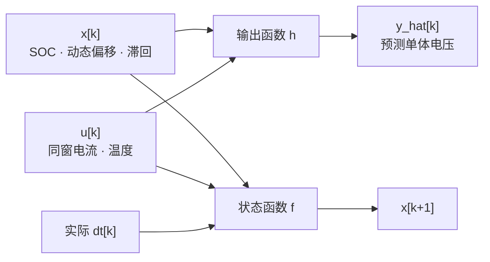
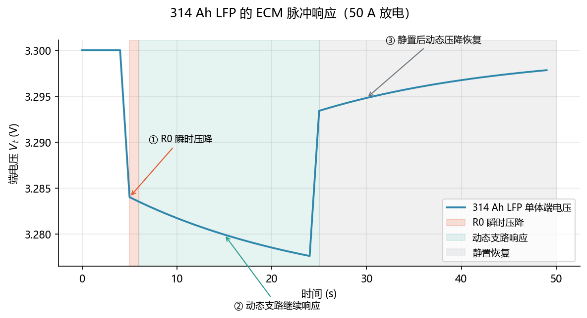

<!-- @AI_GENERATED -->
# 07 等效电路与状态空间建模

**一句话**：把电池写成“状态、输入、输出”的软件递推，再用隔离的真值器注入故障，才能分清估计器是在解决模型问题还是数据问题。

## 7.1 运行场景

14:00，电网侧发出短时功率支撑请求。PCS 可以快速提高交流功率，但 BMS 侧的端电压在电流阶跃后立刻下降，持续数秒后继续缓慢下垂；停止放电后，端电压又逐步回升。值班员需要判断这是 SOC 急剧下降、内阻压降，还是正常极化过程。

如果只把电压变化解释为 SOC 变化，EMS 会在短时支撑期间过度下调能力；如果忽略动态压降，又可能在 BMS 欠压限制前过度承诺功率。短时任务的关键不只是“剩余多少能量”，还包括“电压如何随电流和时间变化”。

## 7.2 决策困难与算法需求

单一的 SOC—OCV 查表不能解释电流阶跃、极化建立和静置恢复。EMS 需要一个既能使用当前电流预测端电压，又能将瞬时压降与慢动态分离的模型，才能判断功率下降来自状态耗尽还是暂态响应。

一阶 RC 等效电路将端电压分解为 OCV、R0 欧姆压降和 RC 动态压降，并以状态空间递推处理真实 `dt`。第 08 章再从脉冲数据辨识其中的参数。

## 7.3 一阶 RC 模型

- **ECM（Equivalent Circuit Model，等效电路模型）**：用少量电阻电容近似电池电压行为的低阶模型。
- **R0**：欧姆内阻，电流变化时立刻产生电压跳变。
- **R1 与 τ（R1·C1）**：极化支路，持续电流使电压缓慢下垂；`τ` 决定恢复速度。

状态、输入和量测：

```text
x[k] = [z, p, h]ᵀ       z=SOC，p=动态电压偏移，h=滞回偏移
u[k] = [I_m, T]         I_m=同窗电流，T=温度
y[k] = 代表性单体端电压
```



## 7.4 状态递推

```text
I* = I_m − b_I
z[k+1] = z[k] − g(I*)·dt/(3600·C_eff)
a = exp(−dt/τ)
p[k+1] = a·p[k] + (1−a)·I*·r_d
y[k] = OCV(z[k],T) + h[k] − I*·r0 − p[k]
```

放电时 `g(I*)=I*`；充电时 `g(I*)=η_c·I*`。量测 `y[k]` 必须使用当前状态 `x[k]`，再推进到 `x[k+1]`。

| 参数 | 含义 | 单位 | 数值 |
|---|---|---:|---:|
| `C_eff` | 有效容量 | Ah | 314 |
| `r0` | 欧姆内阻 | Ω | 0.00032 |
| `r_d` | 动态系数 | Ω | 0.00020 |
| `τ` | 动态时间常数 | s | 20 |
| `η_c` | 充电库仑效率 | — | 0.995 |

## 7.5 手算示例

初始 `z=50%`、`p=0`，测得 315 A，偏置 +1 A，`dt=360 s`。

**第 1 步：先解释当前量测。**

```text
I* = 315 − 1 = 314 A
y[k] = OCV(0.50) − 314×0.00032 − 0
     = 3.30000 − 0.10048 = 3.19952 V
```

**第 2 步：再推进下一状态。**

```text
ΔSOC = 314×360/(3600×314) = 0.10
z[k+1] = 0.50 − 0.10 = 0.40
```

若第 1 步误用 `z[k+1]=0.40`，就把未来状态配给当前量测，残差会平白增加 OCV 差值。

## 7.6 核心实现

下面是一阶 RC 模型的一步完整实现。为聚焦递推，它将条件 OCV 作为输入；第 06 章的 `ocv_reference()` 可以提供该值。

```python
from dataclasses import dataclass
from math import exp


@dataclass(frozen=True)
class State:
    soc: float
    dynamic_v: float = 0.0
    hysteresis_v: float = 0.0


def rc_step(state: State, measured_current_a: float, dt_s: float,
            ocv_v: float, capacity_ah: float = 314.0,
            current_bias_a: float = 0.0, r0_ohm: float = 0.00032,
            rd_ohm: float = 0.00020, tau_s: float = 20.0,
            charge_efficiency: float = 0.995) -> tuple[float, State]:
    """先计算同拍端电压，再用实际 dt 推进 SOC 和动态支路。"""
    if dt_s <= 0 or capacity_ah <= 0 or tau_s <= 0:
        raise ValueError("dt、容量和时间常数必须为正")

    current_a = measured_current_a - current_bias_a
    terminal_v = ocv_v + state.hysteresis_v - current_a * r0_ohm - state.dynamic_v
    weighted_current = current_a if current_a >= 0 else current_a * charge_efficiency
    next_soc = state.soc - weighted_current * dt_s / (3600.0 * capacity_ah)
    a = exp(-dt_s / tau_s)
    next_dynamic = a * state.dynamic_v + (1.0 - a) * current_a * rd_ohm
    return terminal_v, State(next_soc, next_dynamic, state.hysteresis_v)


if __name__ == "__main__":
    voltage, next_state = rc_step(State(0.50), 315.0, 360.0, 3.300, current_bias_a=1.0)
    print(f"同拍端电压: {voltage:.5f} V")
    print(f"下一拍 SOC: {next_state.soc:.3f}")
    assert round(voltage, 5) == 3.19952
    assert round(next_state.soc, 3) == 0.400
```

## 7.7 故障注入

| 注入 | 修改对象 | 验证目标 |
|---|---|---|
| 电压/电流噪声 | 量测加噪 | 滤波与残差统计 |
| 电流偏置 | 遥测电流加偏 | 长期 SOC 漂移 |
| 丢包 | 删除指定序号 | 质量门控与不规则 `dt` |
| 延迟 | 改到达时间 | 迟到、乱序和同窗策略 |
| 参数失配 | 只缩放真值参数 | 模型不完美时的鲁棒性 |

真值 `state_true/params_true` 只用于评分，估计器始终使用独立参数。

## 7.8 图与结果



对应实验：

```bash
python lab/ch02_state_space.py
```

实验验证：360 s 放电按 314 Ah 准确降 10%、量测使用 `x[k]`、同种子可复现、丢包/偏置/失配均进入遥测。

## 7.9 业务决策

短时功率任务中，端电压的瞬时下降不应直接触发“电量耗尽”的判断。RC 模型将 R0 压降、极化动态与 SOC 分开后，EMS 可以判断当前任务是受瞬时电压限制还是受可用能量限制；BMS 继续依据保护阈值限流，EMS 据此调整短时支撑和晚峰计划。

## 7.10 自测

1. 314 Ah 单体以 157 A 放电，相邻样本相隔 4 s，SOC 降多少？
2. 为什么参数失配只能加给真值器，不能把真值参数传给估计器？
3. 生成 `y[k]` 应使用 `p[k]` 还是 `p[k+1]`？

<details>
<summary>参考答案</summary>

1. `157×4/(3600×314)=0.000556`，约 0.056 个百分点。
2. 回填隐藏真值是测试泄漏；失配用于验证模型面对不完美参数时的表现。
3. 使用 `p[k]`，与 `z[k]、h[k]、u[k]` 一起解释同拍 `y[k]`，再推进下一状态。

</details>

<!-- @AI_GENERATED: end -->