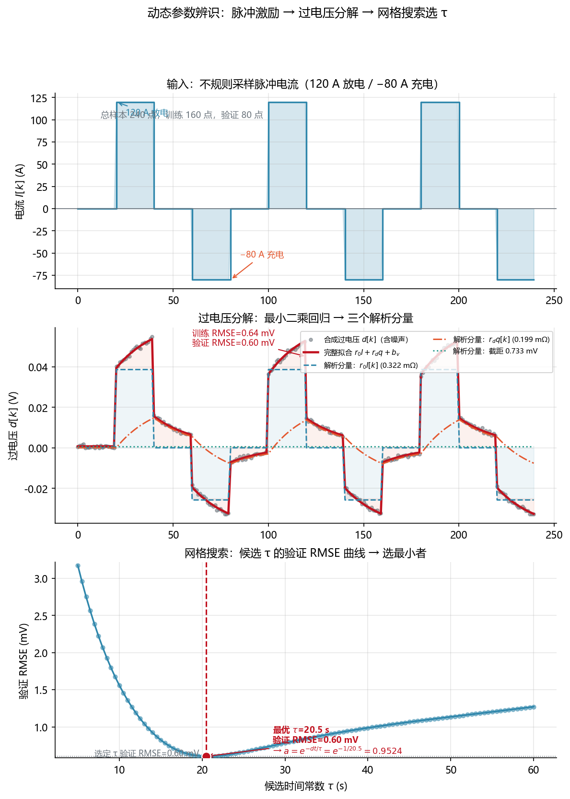

<!-- @AI_GENERATED -->
# 08 模型参数辨识

**一句话**：参数辨识不是把真值器的参数抄给估计器，而是用有激励的带噪数据拟合、用留出数据验证，证据不足时宁可拒绝输出。

## 8.1 运行场景

15:00，EMS 回看前一日的短时支撑数据，发现同一 50 A 功率阶跃下，模型预测端电压比实测高出数毫伏。若将原先的内阻和时间常数继续用于 18:00 晚峰任务，EKF 会把模型误差误解释为 SOC 误差，进而改变能力判断。

运维人员需要回答：当前偏差是电压采样问题、温度变化、容量老化，还是模型参数已经不适用？在没有独立参数证据前，EMS 不应通过“手调一个看起来合理的参数”让曲线贴合。

## 8.2 决策困难与算法需求

RC 模型需要 `R0`、动态系数和时间常数，单靠一段恒流运行数据无法把它们分开。若参数来自真值器或人工回填，仿真会虚假通过，现场仍会出现持续残差。

因此需要有激励的脉冲数据、训练/验证分离、候选时间常数搜索和参数边界。算法的目标不是得到一个漂亮数字，而是判断“这组参数是否足以支撑当前工况下的晚峰能力重算”。

## 8.3 可辨识性

电压降模型：

```text
d[k] = OCV_ref[k] − y[k] = r0·I[k] + r_d·q[k] + b_v + ε[k]
q[k+1] = a[k]·q[k] + (1−a[k])·I[k]
a[k] = exp(−dt[k]/τ)
```

| 参数 | 数据证据 | 辨识条件 |
|---|---|---|
| `r0` | 电流变化与同拍快速压降 | 需要阶跃或足够电流跨度 |
| `r_d` | 持续输入后的动态压降幅度 | 需要持续段与幅值变化 |
| `τ` | 输入变化后的建立/恢复速度 | 需要足够长的动态过程 |
| `b_v` | 近似常值偏差 | 可拟合，但不能直接归因 |

恒流无阶跃时，`I` 与 `q` 高度相关；恢复时间过短时，多组 `τ` 都能解释数据。此时应增加激励或拒绝结果。

## 8.4 辨识流程

对每个候选 `τ_j`：用实际 `dt` 生成 `q_j`，在训练集最小二乘拟合 `d=r0·I+r_d·q+b_v`，丢弃越界候选，在验证集计算残差，选择验证 RMSE 最小的一组。

```text
β = argmin Σ(d[k] − φ[k]ᵀβ)²
φ = [I, q, 1]
β = [r0, r_d, b_v]ᵀ
β̂ = (ΦᵀΦ)⁻¹ Φᵀ d          （无正则时的闭式解）
```

`τ` 由验证误差选取，`r0,r_d,b_v` 由训练集求解；隐藏真值不参与选参，因此不形成循环证明。

## 8.5 手算示例

恢复指数随实际采样间隔变化。

**第 1 步：τ=20 s、dt=1 s。**

```text
a = exp(−1/20) = 0.9512
```

**第 2 步：τ=20 s、dt=2 s。**

```text
a = exp(−2/20) = 0.9048
```

丢包后 `dt` 变大，恢复指数必须重算，不能沿用固定 `a`。

## 8.6 核心实现

下面函数完整实现候选 `τ` 下的动态特征递推。输出的 `q[k]` 与同拍电流 `I[k]` 一起组成最小二乘的特征向量 `[I[k],q[k],1]`。

```python
from math import exp


def dynamic_feature(times_s: list[float], currents_a: list[float], tau_s: float) -> list[float]:
    """根据实际采样间隔构造动态电流特征 q[k]。"""
    if len(times_s) != len(currents_a) or len(times_s) < 2:
        raise ValueError("时间和电流必须等长，且至少有两个样本")
    if tau_s <= 0:
        raise ValueError("时间常数 tau 必须为正")
    if any(t1 <= t0 for t0, t1 in zip(times_s, times_s[1:])):
        raise ValueError("时间必须严格递增")

    q = 0.0
    features = []
    for k, current_a in enumerate(currents_a):
        features.append(q)
        if k < len(currents_a) - 1:
            dt_s = times_s[k + 1] - times_s[k]
            a = exp(-dt_s / tau_s)
            q = a * q + (1.0 - a) * current_a
    return features


if __name__ == "__main__":
    times = [0.0, 1.0, 3.0, 4.0]
    current = [0.0, 100.0, 100.0, 0.0]
    q = dynamic_feature(times, current, tau_s=20.0)
    print([round(value, 3) for value in q])

    # dt=2 s 后，q[2] = (1-exp(-2/20))×100 ≈ 9.516 A
    assert round(q[2], 3) == 9.516
```

完整的网格搜索、最小二乘、参数边界和训练/验证切分见 `lab/ch04_identification.py` 与 `lab/soc_core.py`。

## 8.7 拟合结果

240 个不规则样本由静置、120 A 放电、静置、−80 A 充电组成。候选 `τ` 为 5–60 s，步长 0.5 s：

```text
R0=0.3216 mΩ, Rdyn=0.1988 mΩ, tau=20.50 s, a=0.95239
train RMSE=0.644 mV
validation RMSE=0.603 mV
validation mean=-0.060 mV
```

`R0` 接近隐藏 0.3200 mΩ 但不精确命中，符合带噪数据特征；验证 RMSE 未明显高于训练 RMSE，说明该划分下没有明显过拟合。

## 8.8 拒绝规则

| 条件 | 拒绝原因 |
|---|---|
| 样本过少 | 统计证据不足 |
| 时间不递增或跨窗 | 时序无效 |
| 电流跨度过小 | 无法分离输入系数 |
| 动态段过短 | `τ` 缺少恢复证据 |
| 回归矩阵近奇异 | 参数高度相关 |
| 验证 RMSE/偏差超门限 | 不能泛化 |

平坦 10 A、30 点数据会触发 `insufficient current excitation`，不返回格式正确但没有物理意义的参数。

## 8.9 图与结果



对应实验：

```bash
python lab/ch04_identification.py
```

## 8.10 业务决策

若训练和验证残差均满足边界，参数可进入第 10 章发布审查，并用于 17:30 的状态重算。若激励不足、参数越界或验证误差显著上升，EMS 保留已验证参数并标记当前模型不适用；不得通过人工修改参数掩盖残差。

## 8.11 自测

1. 为什么要同时拟合截距 `b_v`？它能否证明偏差一定来自电压传感器？
2. `dt=1 s、τ=20 s` 时 `a` 约多少？`dt=2 s` 能沿用同一个 `a` 吗？
3. 训练 RMSE 0.5 mV、验证 RMSE 8 mV，参数该发布吗？

<details>
<summary>参考答案</summary>

1. 截距吸收近似常偏差，避免污染 `r0/r_d`；根因也可能来自 OCV、温度、滞回或同步，不能直接归因传感器。
2. `a=exp(−1/20)≈0.9512`；`dt=2 s` 应重算为 `exp(−2/20)≈0.9048`。
3. 不应。明显的泛化差距提示过拟合或工况漂移，应调查并拒绝发布。

</details>

<!-- @AI_GENERATED: end -->