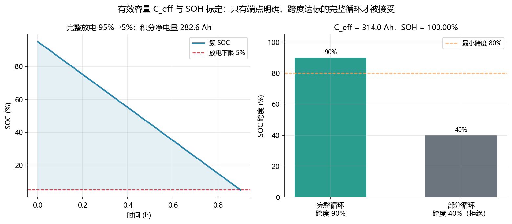

<!-- @AI_GENERATED -->
# 10 有效容量与 SOH 标定

**一句话**：状态模型的分母不能永远用铭牌 314 Ah；有效容量必须从端点明确的完整循环电量辨识，并转成容量型 SOH。

## 10.1 运行场景

11:30，夜间充电结束后的运行数据表明，部分簇在相同放电电流下比历史更早接近下限。BMS 仍以额定 314 Ah 进行 SOC 归一化，EMS 则使用该 SOC 计算 18:00 的可用能量。若电池实际容量已经衰减，两个系统都会把"30% SOC"解释为过多的剩余电荷。

运维计划在低负荷窗口执行一次容量核验。任务不是简单积分一段电流，而是使用起止条件明确的完整充放区间，确认这段电量真实对应多少 SOC 跨度。

## 10.2 关键术语

- **有效容量 C_eff（Effective Capacity）**：在明确温度、倍率和端点下辨识的当前容量，单位 Ah。
- **容量型 SOH（State of Health, capacity）**：`C_eff/C_rated`，表示容量相对额定值的比例。
- **完整循环**：起止端点和工况明确、SOC 跨度达到要求的容量试验区间。

## 10.3 决策困难与算法需求

核验容量时常见的两类错误：用局部放电片段代替完整循环，或继续沿用铭牌容量。

60% 到 20% 的短片段容易受到初始 SOC、温度、反向电流和截止条件影响——把这段的积分结果直接发布为 C_eff，会将局部误差放大到晚峰 SOE。继续沿用铭牌 314 Ah 则持续高估可交付能量和任务时长。

因此需要完整循环积分、独立端点、最小 SOC 跨度和反向电量检查。核验输出 C_eff 和容量型 SOH，后续 SOE 计算用当前容量而非铭牌容量作分母。

## 10.4 完整循环积分

放电循环：

```text
Q_net = Σ I[k]·dt[k]/3600
C_eff = Q_net / (SOC_start − SOC_end)
```

充电循环：

```text
Q_stored = Σ (−I[k])·η_c·dt[k]/3600
C_eff = Q_stored / (SOC_end − SOC_start)
```

| 输入 | 要求 |
|---|---|
| N+1 个边界时间 | 严格递增，单位 s |
| N 个区间平均电流 | A，放电为正、充电为负 |
| 起止 SOC | 来自独立、同口径端点 |
| 方向与 `η_c` | 有明确配置来源 |

端点必须独立确认。若由待验证的 SOC 估计器自己圈定端点，会形成"容量影响 SOC、SOC 又决定容量"的循环。

## 10.5 手算示例

90 个区间、每段 36 s，总时长 3240 s = 0.9 h，SOC 从 95% 放到 5%。

**第 1 步：积分净电量与 SOC 跨度。**

```text
SOC 跨度 = 0.95 − 0.05 = 0.90
Q_net = ΣI·dt/3600 = 282.52 Ah
```

**第 2 步：有效容量与 SOH。**

```text
C_eff = 282.52 / 0.90 = 313.91 Ah
SOH_capacity = 313.91 / 314 = 99.97%
```

若只从 60% 放到 20%，跨度为 40%。本课程按最小 80% 跨度拒绝该结果，不把高不确定度的局部估计当作完整容量标定。

## 10.6 核心实现

下面函数完整计算放电循环的有效容量，并检查时间序列、方向和最小 SOC 跨度。

```python
from dataclasses import dataclass


@dataclass(frozen=True)
class CapacityResult:
    net_charge_ah: float
    soc_span: float
    effective_capacity_ah: float
    soh_capacity: float


def discharge_capacity(times_s: list[float], currents_a: list[float],
                       soc_start: float, soc_end: float,
                       rated_capacity_ah: float = 314.0,
                       min_soc_span: float = 0.80) -> CapacityResult:
    """按区间平均放电电流积分，计算 C_eff 与容量型 SOH。"""
    if len(times_s) != len(currents_a) + 1:
        raise ValueError("N 个电流需要 N+1 个边界时间")
    if any(t1 <= t0 for t0, t1 in zip(times_s, times_s[1:])):
        raise ValueError("时间必须严格递增")
    if any(current < 0 for current in currents_a):
        raise ValueError("放电容量计算要求电流非负")

    soc_span = soc_start - soc_end
    if soc_span < min_soc_span:
        raise ValueError("SOC 跨度不足，拒绝容量标定")
    if rated_capacity_ah <= 0:
        raise ValueError("额定容量必须为正")

    net_charge_ah = sum(
        current * (t1 - t0) / 3600.0
        for current, t0, t1 in zip(currents_a, times_s, times_s[1:])
    )
    effective_capacity_ah = net_charge_ah / soc_span
    return CapacityResult(net_charge_ah, soc_span, effective_capacity_ah,
                          effective_capacity_ah / rated_capacity_ah)


if __name__ == "__main__":
    times = [36.0 * k for k in range(91)]
    currents = [282.52 / 0.9] * 90
    result = discharge_capacity(times, currents, 0.95, 0.05)

    print(f"净电量: {result.net_charge_ah:.2f} Ah")
    print(f"有效容量: {result.effective_capacity_ah:.2f} Ah")
    print(f"容量型 SOH: {result.soh_capacity:.2%}")

    assert round(result.net_charge_ah, 2) == 282.52
    assert round(result.effective_capacity_ah, 2) == 313.91
```

完整的容量辨识与拒绝场景见 `lab/ch04_identification.py`。

## 10.7 图与结果



对应实验：

```bash
python lab/ch04_identification.py
```

## 10.8 参数传播

```text
SOH_capacity = C_eff / C_rated
E_eff（站级） = 5.016 MWh × SOH_capacity
SOE = f(SOC, E_eff, 运行窗口, 效率)
```

晚峰案例的 92% 容量型 SOH 同时影响 SOC 的分母、可用能量和可持续时间。

## 10.9 业务决策

容量核验通过后，EMS 将新 `C_eff` 写入能力计算；若容量低于原发布值，18:00 任务的 SOE 和 SOP 自动收紧。容量试验跨度不足或端点不可靠时，系统不更新参数，继续沿用上一版已验证容量并安排下一次核验。

## 10.10 自测

1. 95% 放到 5%、积分 270 Ah，`C_eff` 是多少？若额定 314 Ah，SOH 是多少？
2. 为什么完整循环端点不能由待验证的 SOC 估计器自己给出？
3. 部分循环（跨度 40%）为什么被基础策略拒绝？

<details>
<summary>参考答案</summary>

1. `C_eff=270/0.90=300 Ah`；`SOH=300/314≈95.5%`。
2. 估计器可能靠错误容量产生 SOC，又用该 SOC 圈定端点，形成自我证明；端点需独立确认。
3. 跨度越小，端点和噪声的相对影响越大，容量估计不确定度高。

</details>

<!-- @AI_GENERATED: end -->