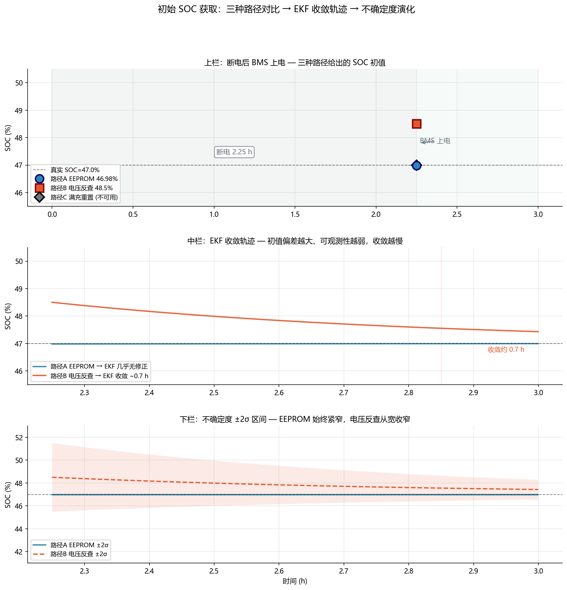

<!-- @AI_GENERATED -->
# 12 初始 SOC 获取

**一句话**：BMS 上电第一拍，SOC 不是算出来的——必须从存储值、静置电压或首次满充中"获取"。错误的初值会让安时积分和 EKF 在起步阶段就跑偏。

## 12.1 运行场景

01:30，电站因检修全站断电。03:45 恢复供电，BMS 重新上电。EMS 需要立即判断当前 SOC 来决定 06:00 的早峰能力——但此时 BMS 尚未积累任何电流积分数据，EKF 也没有量测可以修正。

BMS 的初始 SOC 从哪来？三个选项各有风险：
- **EEPROM 旧值**：上一次下电前存入的 SOC=47%，但断电 2.25 小时内电池静置，自放电让它降到约 46.8%
- **静置电压反查**：BMS 上电后先读取单体电压 3.296 V，查 OCV 表得 SOC ≈ 48%——但 LFP 平台区 6 mV 量测噪声对应 ±0.3% SOC，很不精确
- **等待首次校准**：什么也不做，等到第一次满充事件再重置 SOC 到 100%——但清晨 06:00 之前不可能出现满充

选哪个？选错了，接下来 4 小时的 SOC 跟踪全带着初值偏差。

## 12.2 决策困难与算法需求

三种初值获取方式各有适用条件：

| 方式 | 适用条件 | 误差来源 | 典型偏差 |
|---|---|---|---|
| EEPROM 旧值 | 断电 < 1 天 | 自放电极化恢复后 OCV 不等于存储时刻的 OCV | 0.1–0.5% |
| 静置电压 OCV 反查 | 断电 > 2 h，电压已松弛 | 平台区噪声放大、滞回方向未知 | 0.5–2% |
| 首次满充重置 | 运行中发生满充 | 满充检测逻辑的截止电流阈值 | < 0.1% |

算法需求：**优先选积累的存储信息，其次用电压反查做合理性校验，长期靠校准事件收敛。**

## 12.3 三条获取路径

### 路径 A：EEPROM/CAN 旧值

断电前，BMS 在 EEPROM 中存储最后的 SOC、时间戳和温度。上电后读取：

```text
SOC_init(EEPROM) = SOC_stored − b_self · Δt_off
```

其中 `b_self` 为自放电速率（约 2–5% / 月 → 每小时 0.003–0.007 个百分点）。对 2.25 h 断电，自放电贡献约 0.007–0.016 个百分点，几乎可以忽略。

这条路径的精度最高，前提是下电前 SOC 本身是准确的（经历了校准或 EKF 收敛）。

### 路径 B：静置电压 OCV 反查

上电后立刻读取单体电压。如果静置时间 > 2 h（τ 约 20 s，5τ=100 s 就已松弛充分），可以用 OCV 表反查：

```text
SOC_init(V) = OCV⁻¹(V_measured, T)
```

反转 OCV 表时要区分平台区和陡坡区：

| 电压（25°C） | 落入区域 | dOCV/dSOC | 5 mV 噪声 → SOC 不确定度 |
|---|---|---|---|
| 3.280–3.320 V | 平台区 | 0.02 V | ±0.25% |
| < 3.200 V | 陡坡低端 | 0.5 V | ±0.01% |
| > 3.400 V | 陡坡高端 | 0.3 V | ±0.017% |

平台区的 SOC 分辨能力比陡坡区差 15–25 倍。如果电压落在平台区，OCV 反查只能给出一个宽泛的区间，不能作为精确初值。

### 路径 C：首次满充/满放事件

如果在运行中遇到满充（电压达到截止电压且电流降到截止电流以下），可硬重置 SOC=100%：

```text
满充条件：V_cell ≥ V_max_cutoff 且 I ≤ I_cutoff 且持续 ≥ t_confirm
```

满放同理，SOC=0%。这条路径的精度最高，但需要等待——不一定在需要 SOC 的时刻发生。

## 12.4 决策矩阵：选择哪条路径

实际 BMS 用一个决策树来选路径：

```text
IF 断电前 SOC 有效 AND 断电时间 < 阈值:
    SOC_init = SOC(EEPROM) − b_self × Δt_off         # 路径 A
ELIF 静置时间 > 2h AND 电压不在平台区:
    SOC_init = OCV⁻¹(V_cell, T)                       # 路径 B
ELIF 静置时间 > 2h AND 电压在平台区:
    SOC_init = SOC(EEPROM)  # 路径 A 的旧值，带自放电修正
    SOC_uncertainty_flag = LARGE  # 标记为不可信
ELSE:
    SOC_init = SOC(EEPROM)  # 唯一可用的值
    SOC_uncertainty_flag = LARGE
```

P12.4-1：无论选哪条路径，初始 SOC 的不确定度是可知的，应该输入到后续滤波器（如 EKF）的初始协方差 `P0` 中——平台区取大 `P0`，陡坡区取小 `P0`。

## 12.5 手算示例：三种初值比较

以 314 Ah 电芯为例，真实 SOC=47.0%，断电 2.25 h。

```text
路径 A（EEPROM 旧值）:
  SOC_stored = 47.0%
  b_self = 5%/月 = 0.00694%/h
  ΔSOC_self = 0.00694 × 2.25 = 0.0156%
  SOC_init(A) = 47.0 − 0.0156 ≈ 46.98%  → 偏差 −0.02%

路径 B（电压反查）:
  V_cell = 3.296 V, T = 25°C
  落入平台区，OCV 反查 → SOC_init(B) ≈ 48.5%
  5 mV 噪声不确定度 → ±0.25%
  → 偏差 +1.5% ± 0.25%

路径 C（等待满充）:
  最近一次满充在 17 h 前，不可用
  SOC_init(C) = 不可用
```

在这个场景中，路径 A 最精确（偏差仅 −0.02%），路径 B 偏差 1.5% 且不确定度也大。结论：**EEPROM 旧值是断电恢复的首选路径。**

## 12.6 初值对后续递推的传导

初始 SOC 偏差不会消散——安时积分无修正能力，偏差会永远存在。EKF 可以修正，但收敛速度取决于可观测性（即 dOCV/dSOC）：

| 初值偏差 | 所在区域 | EKF 收敛到 ±1% 需时 | 收敛前影响 |
|---|---|---|---|
| 2% | 陡坡区（SOC < 0.2） | < 5 分钟 | 可忽略 |
| 2% | 平台区（SOC 0.3–0.8） | 30–60 分钟 | 早峰能力被高/低估 |

如果在平台区带着 2% 初值偏差启动，且接下来是持续放电（无电压陡坡让 EKF 快速修正），EKF 的收敛可能需要近 1 小时——而早峰在 2 小时后就要来了。

## 12.7 核心实现

```python
def get_initial_soc(
    soc_stored: float,
    soc_valid: bool,
    v_cell: float,
    temp: float,
    off_time_h: float,
    rest_time_h: float,
    ocv_table,
) -> tuple[float, float]:
    """返回 (SOC_init, P0)——SOC 初值和对应不确定度。"""
    B_SELF = 5.0 / (30 * 24)  # 5%/月 → %/h

    if soc_valid and off_time_h < 24:
        soc_est = soc_stored - B_SELF * off_time_h
        p0 = 0.0001  # 高信心
    elif rest_time_h > 2.0:
        soc_est = ocv_table.inverse(v_cell, temp)
        dOCV = ocv_table.slope(soc_est)
        p0 = (0.005 / dOCV) ** 2 if dOCV > 0 else 0.01
    else:
        soc_est = soc_stored if soc_valid else 50.0
        p0 = 0.01  # 低信心

    return soc_est, p0
```

## 12.8 图与结果



上图展示：
- **上栏**：断电 2.25 h 恢复后，三条路径给出的初值——EEPROM 旧值（46.98%，几乎无偏）、电压反查（48.5%，偏高 1.5%）、参考真值（47.0%）
- **中栏**：三条路径各自启动 EKF——EEPROM 路径几乎不需要修正，电压反查路径在平台区需要约 40 分钟才能收敛到真实 SOC 附近
- **下栏**：不确定度 `±2σ` 区间——EEPROM 路径的区间始终很窄，电压反查路径在收敛前区间宽达 ±3%

这组对比直接展示了"初值选得好，后面都省心；初值选差了，EKF 得跑半小时才能救回来。"

## 12.9 业务决策

| 场景 | 推荐路径 | 风险 |
|---|---|---|
| 短时断电 (< 1 h) | 路径 A（EEPROM） | 几乎为零 |
| 长时断电 (1–24 h) | 路径 A + 自放电修正 | < 0.1% |
| 长时断电且电压在陡坡 | 路径 B（电压反查） | < 0.3% |
| 长时断电且电压在平台 | 路径 A + 标记大 P0 | 偏差 1–2%，靠 EKF 慢慢收敛 |
| 运行中遇到满充 | 路径 C（硬重置） | 重置后精度最高 |

## 12.10 自测

1. BMS 断电 8 小时后上电，EEPROM 存 SOC=65%。自放电 3%/月。8 小时自放电极化恢复后，SOC_init 应该是多少？
2. 电压反查在平台区（dOCV/dSOC=0.02 V）给出 SOC=48.5%，量测噪声 5 mV。该初值的 ±1σ 不确定区间是多少个百分点？
3. 为什么路径 B 在静置时间 < 2 h 时不可靠？
4. EEPROM 路径要求"断电前 SOC 有效"——什么情况下断电前的 SOC 被认为无效？