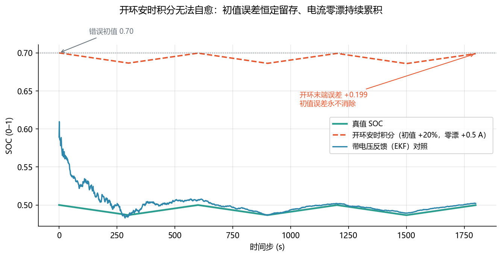
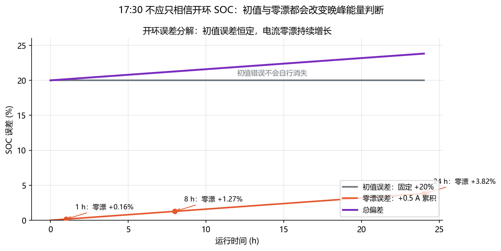

<!-- @AI_GENERATED -->
# 12 开环漂移机理

**一句话**：开环安时积分有两个无法自愈的来源：错误初值会永久保留，电流零漂会持续累积。这就是后续引入电压反馈的原因。

## 12.1 运行场景

16:50，EMS 复核全天 SOC 轨迹。早晨上电时，BMS 从断电前记录恢复的 SOC 可能与真实状态存在差异；白天运行中，电流传感器若有 +0.5 A 零漂，会在充放电、待命和短时支撑的每一拍被重复积分。

17:30 若直接将这条开环 SOC 用于晚峰 SOE，初值误差和零漂可能使剩余能量被高估。值班员需要知道偏差是偶发噪声，还是会随时间稳定累积到必须改变 18:00 计划的程度。

## 12.2 决策困难与算法需求

安时积分无法从自身输出发现初值错误或零漂，因为它只使用电流预测、没有外部反馈。需要先量化两种误差的时间形态：初值误差是常数偏移，零漂是随运行时间增长的斜坡。

这一定量结果解释了为什么 17:30 不能只依赖开环 SOC，也自然引出第 13 章：需要通过端电压残差将状态拉回。

## 12.3 漂移模型

| 来源 | 机理 | 时间形态 |
|---|---|---|
| 初值误差 | 起点 SOC 本身就错 | 常数偏移 |
| 电流零漂 | 传感器偏差 `b_I` 被持续积分 | 线性斜坡 |

```text
SOC_est[k] = SOC_true[k] + ΔSOC_init + ΔSOC_drift[k]
ΔSOC_drift(t) ≈ −b_I·t/(3600·C_eff)
```

初值误差是常数项，零漂是随时间增长的项。

## 12.4 手算示例

统一单体 `C_eff=314 Ah`，零漂 `b_I=+0.5 A`。

**第 1 步：1 小时累积。**

```text
ΔSOC_drift(1h) = 0.5×3600/(3600×314)
                = 0.00159 = 0.16 个百分点
```

**第 2 步：8 小时累积。**

```text
ΔSOC_drift(8h) = 0.5×8×3600/(3600×314)
                = 0.01274 = 1.27 个百分点
```

每小时 0.16 个百分点看似很小，长时间运行后会叠加成百分点级偏差。

## 12.5 核心实现

下面函数计算指定零漂在给定运行时长内造成的 SOC 误差。

```python
def drift_from_bias(current_bias_a: float, duration_s: float,
                    effective_capacity_ah: float) -> float:
    """返回安时积分因电流零漂造成的 SOC 误差；放电方向零漂为正。"""
    if duration_s < 0 or effective_capacity_ah <= 0:
        raise ValueError("持续时间必须非负，有效容量必须为正")
    return -current_bias_a * duration_s / (3600.0 * effective_capacity_ah)


if __name__ == "__main__":
    drift_1h = drift_from_bias(0.5, 3600.0, 314.0)
    drift_8h = drift_from_bias(0.5, 8 * 3600.0, 314.0)
    print(f"1 h 漂移: {drift_1h:.3%}")
    print(f"8 h 漂移: {drift_8h:.3%}")
    assert round(abs(drift_1h), 5) == 0.00159
    assert round(abs(drift_8h), 5) == 0.01274
```

初值误差不需要积分：它从第一拍开始就是常数偏移。零漂函数只计算斜坡项。

## 12.6 结果与图

同一实验从错误初值 0.70 出发，安时积分和 EKF 都使用带 +0.5 A 零漂的电流：

```text
步 0：真值 0.5000，安时积分 0.7000，EKF 0.5893
步 100：真值 0.4956，安时积分 0.6955，EKF 0.5259
步 1799：真值 0.4998，安时积分 0.6990，EKF 0.5020
```





对应实验：

```bash
python lab/ch05_production_ekf.py
```

## 12.7 为什么需要反馈

```text
安时积分 = 纯预测，无量测修正
→ 初值误差保留
→ 零漂持续累积
→ 需要用端电压残差提供反馈
```

第 13 章用扩展卡尔曼滤波把端电压与模型预测比较，并把残差映射回 SOC 修正量。

## 12.8 业务决策

若零漂和初值误差在全天运行中已达到百分点级，EMS 不应按开环 SOC 提高晚峰申报能力。它保留开环轨迹作为预测基线，并使用第 13 章的电压反馈判断是否可以修正状态。

## 12.9 自测

1. 初值误差和零漂导致的漂移，随时间的形态有何不同？
2. `b_I=+1 A、C_eff=314 Ah`，24 小时累计多少个 SOC 百分点？
3. 为什么平台区静置校准对开环漂移帮助有限？

<details>
<summary>参考答案</summary>

1. 初值误差是常数偏移；零漂是随时间线性增长的斜坡。
2. `24/314≈0.0764`，约 7.6 个百分点。
3. 平台区电压对 SOC 不敏感，静置校准信息量低，难以可靠纠正累计误差。

</details>

<!-- @AI_GENERATED: end -->