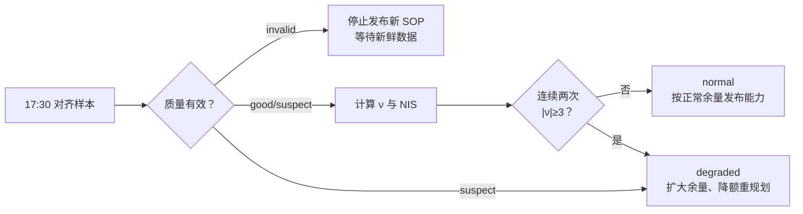

<!-- @AI_GENERATED -->
# 15 在线诊断与可信度降级

**一句话**：协方差小不代表可信；在线诊断用质量状态、标准化残差和连续次数判断 SOC 是否可用，并在异常持续时降低能力口径。

## 15.1 运行场景

16:30 的采集事件处理后，17:30 的 EKF 已完成一次状态重算。此时模型预测电压与实测电压连续两拍不一致：第一拍相差 12 mV，第二拍相差 11 mV。SOC 点值仍看似稳定，协方差也没有明显变大，但值班员需要决定是否还能按 normal 口径发布 18:00 的能力。

如果把两次残差当作普通噪声并继续发布原功率，模型失配或传感器异常可能被带入晚峰计划；如果看到一次异常就立即停止任务，又会让电站对偶发噪声过度敏感。

## 15.2 决策困难与算法需求

业务需要区分“单次波动”“持续不一致”和“数据不可用”。仅看残差伏值无法比较不同噪声条件，必须用创新标准差归一化；仅看单拍又无法过滤偶发尖峰。

因此需要标准化残差 ν、NIS、连续异常计数和质量状态。算法将诊断结果转换为 normal、degraded 或 invalid，使第 18 章可自然选择正常能力、降额能力或停止发布。

## 15.3 关键术语

- **标准化残差 ν**：`ν=e/√S`，以创新标准差归一化残差，使不同噪声条件可比较；用 `ν` 而非 `z` 是为避免与状态符号 `z[k]`（SOC）冲突。
- **NIS（Normalized Innovation Squared）**：`ν²`，无量纲一致性指标。
- **降级**：证据不足时暂停量测修正、扩大余量或停止发布能力。

## 15.4 诊断流程

```text
质量门控 → 预测电压 → e=V测−V预 → ν=e/√S，NIS=ν²
        → 连续异常计数 → 状态与动作 → 风险化能力
```



标准化残差与 NIS 的通用形式（`S` 为创新方差，标量示例即 `S=H²P+R`）：

```text
e = y − H·x⁻                 （电压残差，V）
S = H·P⁻·Hᵀ + R              （创新方差，V²）
ν = e/√S                     （标准化残差，无量纲）
NIS = ν²
```

| 符号 | 含义 | 单位 |
|---|---|---|
| `H` | 电压对 SOC 的灵敏度 `dOCV/dSOC` | V/SOC |
| `P⁻` | 预测状态协方差 | SOC² |
| `R` | 电压量测噪声方差 | V² |
| `e` | 预测电压与实测电压之差 | V |
| `S` | 创新方差 `H·P⁻·Hᵀ+R` | V² |
| `ν` | 标准化残差 `e/√S` | 无量纲 |
| `NIS` | 标准化创新平方 `ν²` | 无量纲 |

测量噪声 2 mV、模型不确定度 3 mV 时，`√S=√(0.002²+0.003²)=3.61 mV`。连续两次 `|ν|≥3` 才进入 `degraded`；`invalid` 直接拒绝本次更新。

| 状态 | 触发 | 动作 |
|---|---|---|
| `normal` | `good` 且未连续超阈 | 接受校正，发布正常不确定度 |
| `degraded` | `suspect`，或连续两次 `|ν|≥3` | 暂停量测校正、扩大余量、降额 |
| `invalid` | 非有限、越界、时序错误 | 拒绝样本，冻结能力刷新 |

## 15.5 手算示例

**第 1 步：首次越限。** `e=0.012 V`：

```text
ν = 0.012/0.00361 = 3.33
NIS = ν² = 11.08
连续计数 = 1 → 记录，不降级
```

**第 2 步：连续第二次越限。** `e=0.011 V`：

```text
ν = 0.011/0.00361 = 3.05
连续计数 = 2 → degraded
```

残差说明“量测与模型不一致”，不能单独证明唯一根因；传感器偏置、模型漂移和错拍都可能产生残差。

## 15.6 核心实现

下面函数完整实现单拍诊断：输入质量、残差、创新标准差和上一拍连续次数，输出状态、`ν`、NIS、连续次数和动作。

```python
from dataclasses import dataclass
from math import isfinite
from typing import Optional


@dataclass(frozen=True)
class Diagnosis:
    state: str
    nu: Optional[float]
    nis: Optional[float]
    consecutive_bad: int
    action: str


def diagnose(quality: str, residual_v: float, innovation_std_v: float,
             previous_bad: int = 0, threshold: float = 3.0) -> Diagnosis:
    """根据质量与标准化残差判定 normal、degraded 或 invalid。"""
    if quality == "invalid" or not isfinite(residual_v):
        return Diagnosis("invalid", None, None, previous_bad,
                         "拒绝样本，冻结能力刷新并请求新鲜数据")
    if innovation_std_v <= 0 or threshold <= 0:
        raise ValueError("创新标准差和阈值必须为正")

    nu = residual_v / innovation_std_v
    nis = nu * nu
    consecutive_bad = previous_bad + 1 if abs(nu) >= threshold else 0
    if quality == "suspect" or consecutive_bad >= 2:
        return Diagnosis("degraded", nu, nis, consecutive_bad,
                         "暂停量测修正，扩大余量并重规划")
    return Diagnosis("normal", nu, nis, consecutive_bad,
                     "接受量测修正并发布正常不确定度")


if __name__ == "__main__":
    first = diagnose("good", 0.012, 0.00361)
    second = diagnose("good", 0.011, 0.00361, first.consecutive_bad)
    invalid = diagnose("invalid", 0.0, 0.00361)
    print(first)
    print(second)
    print(invalid)
    assert first.state == "normal" and first.consecutive_bad == 1
    assert second.state == "degraded" and second.consecutive_bad == 2
    assert invalid.state == "invalid"
```

## 15.7 图与结果


对应实验：

```bash
python lab/ch06_uncertainty_diagnostics.py
```

## 15.8 业务决策

第 1 次异常只记录，避免因偶发噪声中断任务；第 2 次连续异常进入 degraded，EMS 以更大余量重算 18:00 能力；若数据 invalid，则不发布新 SOP。这样诊断状态直接决定计划动作，而不是停留在一条残差告警上。

## 15.9 自测

1. `ν=3.4` 只出现一次时，为什么不立即进入 `degraded`？
2. 输入已 `invalid` 时，为什么不能仅扩大 `σ_E` 后继续发布 SOP？
3. 为什么一次大残差不能直接判为硬件故障？

<details>
<summary>参考答案</summary>

1. 连续计数过滤偶发噪声；该样本仍应记录。
2. `invalid` 表示输入的时序、量程或数值基础不成立，应先取得新鲜对齐数据。
3. 残差是症状，不是唯一根因；偏置、模型漂移和错拍都可能导致残差。

</details>

<!-- @AI_GENERATED: end -->