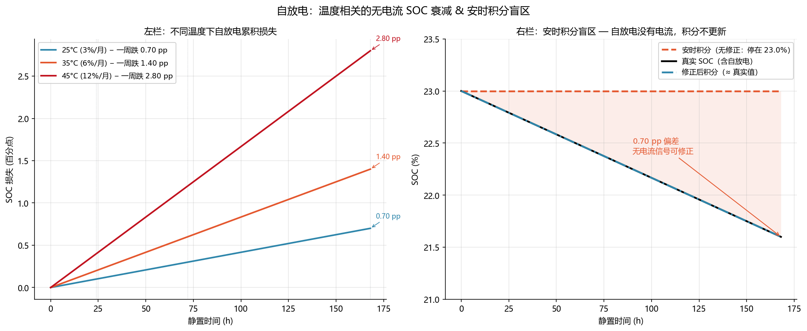

<!-- @AI_GENERATED -->
# 15 自放电

**一句话**：静置期间电池会缓慢自损电荷——这个损失不经过电流传感器，安时积分看不到它，EKF 在无电流激励时也无法修正它。SOC 跟踪的最隐蔽漂移来源，就是自放电。

## 15.1 运行场景

周六 18:00，电站结束晚峰放电，SOC 停在 23%。周日下午 14:00 因电网调压需求突然启机——距上次运行已过 20 小时。BMS 从 EEPROM 读出 SOC=23%，直接以此为基础开始安时积分。

但实际上，LFP 电芯在 25°C 下的自放电率约 3%/月。20 小时静置损失约 20×(3%/720)≈0.083%。但这 0.083 个百分点是 SOC 从 23% 降到 22.92%——**没有电流通过传感器**，安时积分的累积值是 0，EKF 也没有残差可以修正。

BMS 以为的 SOC=23%，真实的 SOC=22.92%。这个 0.08% 的偏差看似微小，但如果在接下来的 20 天里每天都有类似的静置段，累积偏差将达到 1–2 个百分点——进入零漂的领域。

## 15.2 自放电的物理来源

自放电主要来自三个渠道：

| 来源 | 机理 | 速率（25°C LFP） | 温度敏感 |
|---|---|---|---|
| SEI 膜副反应 | 电解液与负极 SEI 的持续还原，消耗 Li⁺ | 1–3% / 月 | 强（每 10°C 翻倍） |
| 内部微短路 | 制造缺陷导致的微弱跨隔膜导电通路 | 0–1% / 月 | 弱 |
| 集流体腐蚀 | 正极铝箔 / 负极铜箔在电位下的溶解 | < 0.1% / 月 | 中等 |

主因是 SEI 副反应——它是电池出厂就存在的持续化学侧通道。温度升高 10°C 会让反应速率约翻倍：

```text
b_self(T) = b_self(25°C) × 2^((T−25)/10)
```

即 35°C 下自放电速率 = 3%/月 × 2^(1) = 6%/月。

## 15.3 自放电对 SOC 算法的冲击

自放电的本质是**无电流的 SOC 变化**，它让 SOC 跟踪的三条防线全部失守：

| 防线 | 为什么失守 |
|---|---|
| 安时积分 | `ΔSOC = ∫ I dt / Q` — I=0 期间积分值为 0，看不到自放电 |
| OCV 修正 | 静置时电压确实在变化，但变化速率极慢（mV/天量级），被噪声淹没 |
| EKF 残差 | 无电流时无激励→无新残差→无修正 |

P15.3-1：**自放电的真值 SOC 减小但安时积分的 SOC 不变，这构成了开环漂移的"隐藏层"——它不是电流传感器的偏置，而是不存在于电流通道中的损失。**

## 15.4 不同温度与时间的累积表

以 280 Ah LFP 电芯、基准自放电 3%/月为例：

| 静置时间 | 25°C 损失 (%SOC) | 35°C 损失 (%SOC) | 45°C 损失 (%SOC) |
|---|---|---|---|
| 1 h | 0.0042 | 0.0083 | 0.0167 |
| 8 h | 0.033 | 0.067 | 0.133 |
| 1 天 | 0.100 | 0.200 | 0.400 |
| 3 天 | 0.300 | 0.600 | 1.200 |
| 7 天 | 0.700 | 1.400 | 2.800 |
| 30 天 | 3.000 | 6.000 | 12.000 |

在标准 25°C 下，1 天的损失是 0.1 个百分点——比电流传感器偏置（+0.5 A 对应约 0.16%/h）小一个数量级。但如果电站在夏季无空调的集装箱内（内部温度可达 45°C），一周损失可达 2.8 个百分点——**温度把自放电放大到了和零漂同数量级**。

## 15.5 修正模型

最简单的修正是在安时积分中增加一个恒速自放电项：

```text
SOC[k+1] = SOC[k] − (I[k]·η_c/Q_nom + b_self(T)) · dt
```

其中 `b_self(T)` 是温度相关的自放电率（单位：s⁻¹，即每秒损失的 SOC 分数）。

也可以放在 EKF 的预测步骤中，作为一个已知的确定性偏移，而不是待估计的随机变量：

```text
x⁻[k+1] = f(x⁺[k], I[k]) − b_self(T) · dt
```

### 修正效果对比

| 场景 | 静置时长 | 无修正偏差 | 加修正后偏差 |
|---|---|---|---|
| 周末停机 2 天 | 48 h | 0.20% | < 0.02% |
| 检修停机 1 周（25°C） | 168 h | 0.70% | < 0.05% |
| 夏季停机 1 周（35°C） | 168 h | 1.40% | < 0.10% |

## 15.6 手算示例

280 Ah 电芯，额定容量 280 Ah = 100% SOC = 280 Ah。自放电速率在 35°C 下 = 6%/月。

```text
b_self(35°C) = 6% / (30天 × 24h/天) = 6% / 720h = 0.00833 %/h

以电荷量计：
  每小时损失 = 280 Ah × 0.00833% = 0.0233 Ah

等效自放电电流（虚拟的持续流出）：
  I_self = 0.0233 Ah / 1 h = 0.0233 A = 23.3 mA
```

23.3 mA 的等效电流远低于电流传感器的分辨率（通常 0.1–0.5 A），因此在物理上无法被传感器捕捉。但它在 7 天里累积到 23.3×24×7 ≈ 3.92 Ah ≈ 1.4 个百分点 SOC——这个偏差进入零漂范围。

## 15.7 核心实现

```python
def self_discharge_rate(temp_c: float, base_rate_per_month: float = 3.0) -> float:
    """返回自放电率（SOC 百分点/小时）。"""
    rate_25c = base_rate_per_month / (30 * 24)  # %/h at 25C
    return rate_25c * (2 ** ((temp_c - 25) / 10))


def soc_with_self_discharge(
    soc: float, current_a: float, q_nom_ah: float,
    temp_c: float, dt_s: float, coulomb_eff: float = 0.998
) -> float:
    """安时积分 + 自放电修正。"""
    ah_change = current_a * coulomb_eff * dt_s / 3600
    soc_coulomb = soc + ah_change / q_nom_ah * 100
    b_self = self_discharge_rate(temp_c) * dt_s / 3600
    return soc_coulomb - b_self
```

## 15.8 图与结果



上图展示：
- **左栏**：三个温度下（25/35/45°C）的 SOC 衰减曲线——25°C 一周跌 0.7%，45°C 一周跌 2.8%
- **右栏**：对比三条 SOC 轨迹——真实值（含自放电衰减）、安时积分值（无自放电修正，停在 23%）、修正后的安时积分值（几乎与真实值重合）

右栏的关键信息：如果不修正自放电，停机一周后安时积分仍显示 23%，但真实 SOC 已降到 22.3%（25°C）——偏差 0.7 个百分点，这就是"无电流损耗"的累积效应。

## 15.9 业务决策

| 场景 | 建议 |
|---|---|
| 短时停机 (< 8 h) | 可忽略自放电，偏差 < 0.03% |
| 周末停机 (1–2 天) | 应用自放电修正，否则累积 0.1–0.2% |
| 检修停机 (> 3 天，高温) | 必须修正 + 重新标定 SOC 初值（OCV 反查） |
| 长期存放 (> 1 月) | 自放电已超 3%，安时积分完全不可信，必须等待满充重置 |

## 15.10 自测

1. 35°C 下停机 3 天，自放电损失多少个百分点？（基准 3%/月）
2. 为什么自放电不能被安时积分捕获？
3. 自放电速率 6%/月换算为等效电流是多少毫安？（280 Ah 电芯）
4. EKF 在无电流静置期间能否修正自放电误差？为什么？