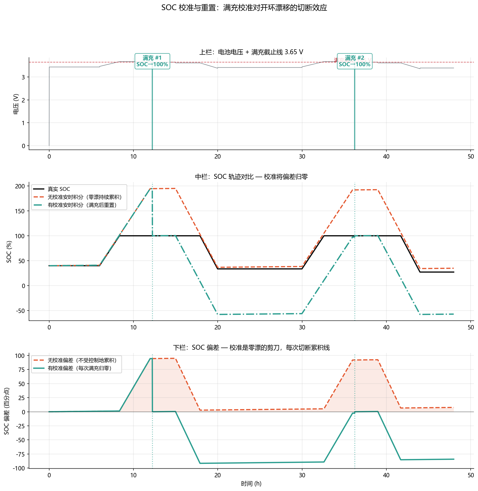

<!-- @AI_GENERATED -->
# 16 SOC 校准与重置

**一句话**：SOC 跟踪不能只靠算法"跑"——真实系统在满充/满放时可获取硬件级的参考点，用这些参考点重置 SOC，切断累积漂移。这比任何滤波器修正都硬。

## 16.1 运行场景

第 14 章讲到开环漂移可以在 24 小时内累积到 7.6 个百分点——如果没有干预，30 天后 SOC 会完全失准。但实际上，真实 BMS 不可能连续 30 天不遇到校准事件。每次满充都会把 SOC 重置到 100%，让零漂从 0 开始重新累积。

问题的关键不是"有没有校准"，而是"校准事件多久来一次"。如果每 12 小时有一次满充，零漂永远无法积累到影响决策的量级；如果每 7 天才满充一次（例如以浅充浅放为主的调频电站），零漂就有足够的时间窗口累积到不可忽略的程度。

## 16.2 什么是校准事件

SOC 可以通过三个硬件级参考点"硬重置"：

| 事件 | SOC 重置值 | 检测条件 | 精度 |
|---|---|---|---|
| 满充 | 100% | V ≥ V_max 且 I ≤ I_cutoff 持续 T_confirm | 极高 |
| 满放 | 0% | V ≤ V_min 且 I ≤ I_cutoff 持续 T_confirm | 高 |
| 部分参考 | 查 OCV | 静置 > 2 h 且电压不在平台区 | 中等 |

满充是最好用的一类，因为：
- 截止条件是硬件层面的——当电压达到 3.65 V 且电流已经下降到 C/50，电池**物理上不能再吸收更多电荷**——这不是算法猜测，是物理事实
- 满充发生后，无论之前的 SOC 偏差有多大，重置后偏差归零
- 电站最常见的满充时间是午间光伏大发时段

## 16.3 满充检测的精确条件

```text
满充标记 = TRUE 当同时满足以下三个条件持续 t_confirm 秒：
  1. V_cell ≥ V_max_cutoff（如 3.65 V）
  2. I_cell ≤ I_cutoff（如 5.6 A = C/50）
  3. 充电方向（I > 0）
```

一旦触发，SOC 重置为 100.0%，SOC 偏差清零，P 协方差重置为极小值。

### 满充检测的陷阱

| 陷阱 | 现象 | 后果 |
|---|---|---|
| 电压尖峰 | BMS 采到一帧 3.66 V 后立即回落 | 假满充重置 SOC=100%，实际只有 97% |
| 截止电流设太高 | I_cutoff=0.1C 而非 0.02C | 提前终止，SOC 只充到 98% |
| 确认时间太短 | t_confirm=1 s | 一个电压毛刺就能触发假校准 |

因此需要三个条件同时持续足够长时间——典型值为 `t_confirm ≥ 30 s`，确保不是瞬态尖峰。

## 16.4 满放检测

满放的条件对称：

```text
满放标记 = TRUE 当：
  1. V_cell ≤ V_min_cutoff（如 2.50 V）
  2. I_cell ≥ −I_cutoff（放电电流小于截止值）
  3. 放电方向（I < 0）持续 t_confirm
```

满放重置 SOC=0%。满放在实际运行中较少用到（电站很少把电池放到 0%），但在标定和容量测试中是必经步骤。

## 16.5 校准对零漂的"切断"效应

下图展示了零漂累积与满充校准之间的关系：

| 时间 | 事件 | 零漂累积 | SOC 偏差（校准前） | SOC 偏差（校准后） |
|---|---|---|---|---|
| 00:00 | 日初送电  | 0 h | +0.32%（初值偏误） | — |
| 08:00 | 持续充电 + 零漂累积 | 8 h | +1.60% | — |
| 12:00 | 满充 → SOC 硬重置 100% | 12 h → 归零 | +2.24% | **0.00%** |
| 12:01 | 新周期开始 | 0 h | 0.00% | 0.00% |
| 20:00 | 持续放电 + 零漂累积 | 8 h | +1.28% | — |
| 24:00 | — | 12 h | +1.92% | — |
| 次日 12:00 | 满充 → 再次重置 | 24 h → 归零 | +4.16% | **0.00%** |

关键信息：**满充像一把剪刀，每隔 12 或 24 小时把零漂的累积线剪断，SOC 偏差永不超过一个校准周期的累积上限。**

## 16.6 校准质量评分

不是每次满充都一样可靠。需要对校准事件做质量评分：

```text
校准质量 Q_calib 由以下因素决定：
  1. 充电结束是否经历完整的 CC→CV 阶段（满分）vs 仅在 CC 阶段触达截止电压（减分）
  2. 截止电流是否真正降到阈值以下保持 t_confirm（减分：电流波动上穿阈值）
  3. 温度是否在正常范围（减分：极端温度下 SOC=100% 的定义会漂移）
```

Q_calib 越低，校准后的 P0 不应完全重置为零，而是保留一个较小的值（如 0.0001），让 EKF 仍有微调空间。

## 16.7 核心实现

```python
def detect_full_charge(
    v_cell: float,
    i_cell: float,
    v_max: float = 3.65,
    i_cutoff: float = 5.6,
    t_confirm: float = 30.0,
) -> tuple[bool, float]:
    """检测满充并评估质量。"""
    global _fc_counter, _fc_quality
    conditions_met = (
        v_cell >= v_max and
        0 < i_cell <= i_cutoff
    )
    if conditions_met:
        _fc_counter += 1
        # 质量：电流越接近 0，校准越可信
        _fc_quality = 1.0 - (i_cell / i_cutoff) * 0.5
    else:
        _fc_counter = 0
        _fc_quality = 0.0

    if _fc_counter >= t_confirm:
        _fc_counter = 0
        return True, _fc_quality

    return False, 0.0


def apply_calibration(
    soc_est: float,
    p_cov: float,
    calibration_quality: float,
    reset_value: float = 100.0,
) -> tuple[float, float]:
    """应用校准重置。"""
    if calibration_quality > 0.9:
        return reset_value, 0.0  # 满分校准 → 完全重置
    elif calibration_quality > 0.5:
        base_p0 = 0.0001 * (1 - calibration_quality)
        return reset_value, max(base_p0, 0.00001)
    else:
        return soc_est, p_cov  # 低质量校准，不应用
```

## 16.8 图与结果



上图展示：
- **上栏**：电池电压轨迹，标注两次满充事件（V=3.65 V, I 降至截止值以下）
- **中栏**：三条 SOC 轨迹——真实 SOC、未校准安时积分（零漂持续累积）、有校准安时积分（每次满充后重置）
- **下栏**：SOC 偏差——未校准路径在 36 h 内偏差累积到 5%以上，有校准路径每次满充后归零，最大偏差不超过一个校准周期的累积上限（约 1.5%）

## 16.9 业务决策

| 场景 | 校准策略 |
|---|---|
| 日循环电站（每天满充 1 次） | 天然安全——零漂永不超过 24 h 积累，一般 < 2% |
| 调频电站（浅充浅放，周满充 1 次） | 风险——一周零漂可达 10%+，需要调整调度策略确保周内至少一次深充 |
| 长时备电（储能未循环，长期静置） | 满充不可用，需依赖 OCV 反查 + 自放电修正 |
| 校准质量 < 0.5 | 不应用重置，避免误校准 |
| 连续两次满充间隔 < 1 h | 可能是假校准，标记异常 |

## 16.10 自测

1. 连续 36 小时未校准，零漂累积到多少个百分点？（b_I=+0.5 A, Q_nom=314 Ah, η_c=0.998）
2. 满充检测仅靠"V ≥ 3.65 V"单一条件有什么风险？举一个假满充的例子。
3. 校准质量 Q_calib=0.7 的情况下，P0 应该重置为多少？（参考代码逻辑）
4. 一个调频电站连续 5 天没有满充，SOC 偏差已约 8%，第 6 天发生满充——满充后偏差归零，对第 6 天晚峰能力申报的影响是什么？