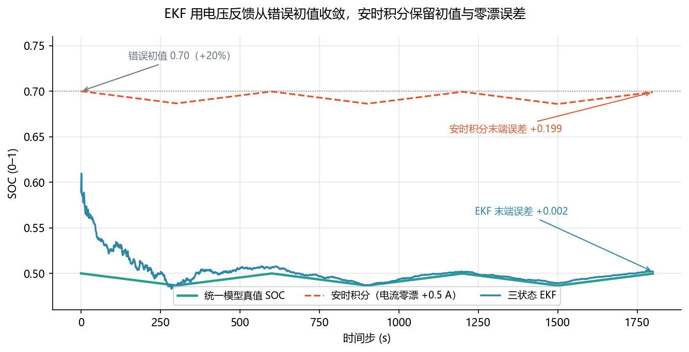
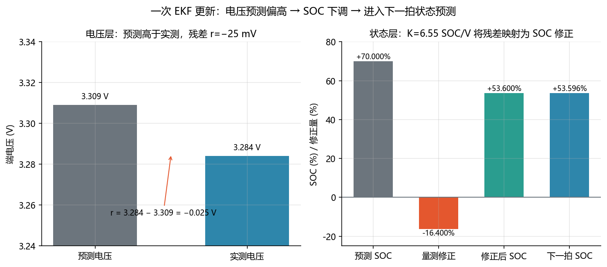

<!-- @AI_GENERATED -->
# 17 扩展卡尔曼滤波

**一句话**：EKF 将电流预测与电压反馈结合：电流给出趋势，电压残差持续修正状态，从而缓解初值误差和电流零漂。

## 17.1 运行场景

17:10，EMS 已完成参数和容量更新，但开环 SOC 仍从早晨恢复的初值开始累计。此时短时支撑结束后，电流回到低负荷，端电压已不再只受大电流压降支配。BMS 持续上送电压，EMS 需要判断这些电压是否能够用于修正白天累计的状态偏差。

如果维持开环 SOC，17:30 的 SOE 可能因初值和零漂被高估；如果不考虑 OCV 斜率、RC 动态和量测噪声而直接把电压映射为 SOC，又会把极化或温度变化误当作电荷变化。

## 17.2 决策困难与算法需求

业务需要一个同时使用电流历史和当前电压的状态估计器：电流负责预测趋势，条件 OCV 和 RC 模型负责预测端电压，实测与预测的残差负责修正 SOC。修正幅度还必须随量测可信度变化，不能每拍固定校正。

扩展卡尔曼滤波因此出现：它将状态、模型、量测斜率和噪声合在同一递推中。第 18 章继续说明它如何量化"这次修正有多大把握"。

## 17.3 关键术语

- **EKF（Extended Kalman Filter）**：对非线性模型局部线性化后，递推执行量测修正和状态预测的估计器。
- **残差/新息 `e`**：`e=V_meas−V_hat`，实测电压与预测电压的差。
- **卡尔曼增益 K**：把残差映射为状态修正量的权重。

## 17.4 单步公式

状态 `x=[SOC,V_dyn,V_hys]`：

```text
V_hat = OCV(SOC,T) + V_hys − I·R0 − V_dyn
e = V_meas − V_hat
H = [dOCV/dSOC, −1, 1]
S = H·P⁻·Hᵀ + R
K = P⁻·Hᵀ/S
x⁺ = x⁻ + K·e

SOC[k+1] = SOC⁺[k] − I·dt/(3600·C_eff)
V_dyn[k+1] = a·V_dyn⁺[k] + (1−a)·I·R_dyn
```

`R` 是电压量测方差，`S` 是创新方差。`H0=dOCV/dSOC` 越小，电压携带的 SOC 信息 `H0²/R` 越少，有效修正 `K0·H0` 越弱。

## 17.5 手算示例

取 `SOC=0.70`、`P_SOC=0.01`、`R=4e-6 V²`、`I=50 A`、`H0=0.15 V/SOC`、`dt=1 s`，预测电压 3.309 V，实测电压 3.284 V。

**第 1 步：量测修正。**

```text
e = 3.284 − 3.309 = −0.025 V
S = H0²·P_SOC + R = 0.15²×0.01 + 0.000004 = 0.000229 V²
K0 = P_SOC·H0/S = 0.01×0.15/0.000229 = 6.55 SOC/V
SOC⁺ = 0.70 + 6.55×(−0.025) = 0.536
```

这里是只保留 SOC 状态的标量手算。完整三状态 EKF 还会将动态和滞回不确定度投影进 `S`。

**第 2 步：推进到下一拍。**

```text
SOC[k+1] = 0.536 − 50×1/(3600×314) = 0.53596
```

负残差表示预测电压偏高，因此 SOC 应下调。

**两步对照**（同上参数，连续两拍修正，展示方差收缩与修正递减）：

| 步 k | SOC⁻ | P⁻ | V_meas | V_hat | e (mV) | S (mV²) | K (SOC/V) | SOC⁺ | P⁺ |
|:---:|------:|-----:|--------|-------|-------:|--------:|----------:|------:|------:|
| 0 | 0.7000 | 1.0×10⁻² | 3.284 | 3.309 | −25 | 0.229 | 6.55 | 0.5362 | 1.75×10⁻⁴ |
| 1 | 0.5362 | 1.75×10⁻⁴ | 3.268 | 3.264 | +4 | 0.008 | 3.31 | 0.5495 | 0.9×10⁻⁴ |

> **解读**：k=0 的 −25 mV 大残差触发 K·H₀≈0.98 的大幅修正，P 从 1.0e-2 骤降至 1.75e-4；k=1 的 +4 mV 小残差仅做小幅回调，P 继续减半。两拍之后，滤波器对自身估计已高度信任，后续修正趋近于零。这就是 EKF "一次大纠偏 + 快速收敛" 的典型节奏。

## 17.6 核心实现

下面是完整的标量 EKF 电压修正函数。它展示 SOC 状态上最核心的残差、创新方差和卡尔曼增益计算。

```python
def ekf_soc_update(prior_soc: float, prior_variance: float,
                   measured_voltage_v: float, predicted_voltage_v: float,
                   ocv_slope_v_per_soc: float,
                   voltage_variance_v2: float) -> tuple[float, float, float]:
    """返回修正后的 SOC、方差和卡尔曼增益。"""
    if prior_variance < 0 or voltage_variance_v2 <= 0:
        raise ValueError("方差必须有效")
    if ocv_slope_v_per_soc == 0:
        raise ValueError("OCV 斜率不能为零")

    residual_v = measured_voltage_v - predicted_voltage_v
    innovation_variance = (ocv_slope_v_per_soc ** 2 * prior_variance
                           + voltage_variance_v2)
    gain = prior_variance * ocv_slope_v_per_soc / innovation_variance
    updated_soc = prior_soc + gain * residual_v
    updated_variance = (1.0 - gain * ocv_slope_v_per_soc) * prior_variance
    return updated_soc, updated_variance, gain


if __name__ == "__main__":
    soc, variance, gain = ekf_soc_update(0.70, 0.01, 3.284, 3.309, 0.15, 4e-6)
    print(f"SOC={soc:.3f}, P={variance:.6f}, K={gain:.2f} SOC/V")
    assert round(soc, 3) == 0.536
    assert variance < 0.01
```

完整三状态 EKF、真实 `dt`、RC 预测和 Joseph 协方差更新见 `lab/ch05_production_ekf.py`。

## 17.7 收敛结果

```text
步 0：真值 0.5000，安时积分 0.7000，EKF 0.5893
步 100：真值 0.4956，安时积分 0.6955，EKF 0.5259
步 1799：真值 0.4998，安时积分 0.6990，EKF 0.5020
```





## 17.8 业务决策

17:30 若电压反馈已将 SOC 从开环偏差拉回，EMS 使用修正后的 SOC 进入协方差计算；若平台区信息不足，EKF 不应强制大幅修正，能力仍需保留较大余量。BMS 持续执行保护，EMS 只依据估计结果重算计划。

## 17.9 自测

1. `e=−0.02 V、K0=3 SOC/V`，SOC 修正多少？方向为何正确？
2. 为什么不能把"OCV 斜率更大"简化为"K0 必按比例更大"？
3. EKF 和安时积分使用同样的带偏电流，为何结果不同？

<details>
<summary>参考答案</summary>

1. `ΔSOC=3×(−0.02)=−0.06`，SOC 下调；负残差表示预测电压高于实测。
2. `K0=P·H0/(H0²P+R)` 的分母也含 `H0²`；应看信息量 `H0²/R` 与修正比例 `K0·H0`。
3. 安时积分是开环，初值与零漂会积累；EKF 用电压残差进行反馈修正。

</details>

<!-- @AI_GENERATED: end -->