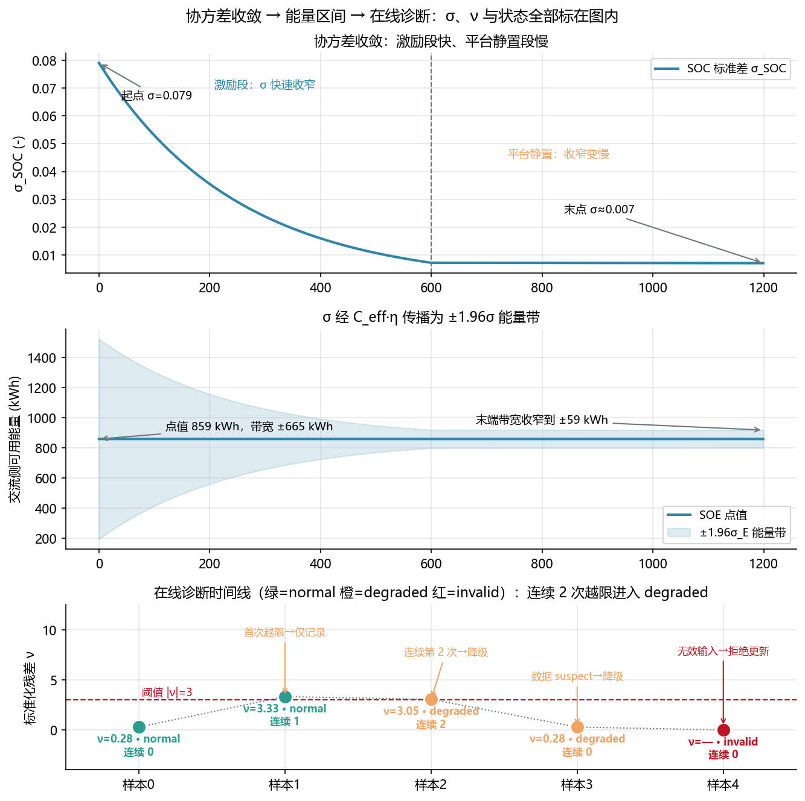

<!-- @AI_GENERATED -->
# 18 协方差与噪声整定

**一句话**：协方差 `P` 量化估计器的不确定度；过程噪声 `Q` 与量测噪声 `R` 决定它更信模型还是更信电压。

> 上一章：[17 扩展卡尔曼滤波](17_扩展卡尔曼滤波.md) · 下一章：[19 在线诊断与可信度降级](19_在线诊断与可信度降级.md)

## 18.0 本章目标与边界【必懂】

学完本章，你能做到：

1. 说明 `P/Q/R` 各自的含义与单位；
2. 复算 `P[0,0]=2.25×10⁻⁴` 时 `σ_SOC=0.015`、`SOC_lower=0.2706`；
3. 解释"假自信"：为什么 `σ` 小不等于估计一定准确。

**边界**：本章只讲协方差与噪声整定及不确定度传播，不展开在线诊断与降级。

- **in-scope**：协方差演化、Q/R 整定、一组风险下界手算、`energy_band` 关键片段、假自信。
- **out-of-scope**：在线诊断与可信度降级（19 章）、SOE 完整计算（20 章）。
- **prerequisites**：已完成 [17 扩展卡尔曼滤波](17_扩展卡尔曼滤波.md)，知道 EKF 单步公式。
- 所有数值均为 `[教学示例]`，以当地规程与合同为准。

## 18.1 运行场景【必懂】

17:30，EKF 已将 SOC 修正为 30%，但值班员仍不能立即按该点值申报晚峰能力。若真实 SOC 可能低 0.5 个百分点，任务余量影响有限；若可能低 5 个百分点，2 MW、30 min 的计划可能完全不可执行。

此时 EMS 需要的不只是一个 SOC，而是状态误差的范围。该范围还会随模型失配、电流噪声、平台区电压信息不足和新的量测修正不断变化。

## 18.2 决策困难与算法需求【必懂】

没有协方差，EMS 无法把"状态是否可信"转换为可扣除的 SOC 余量和可交付能量下界。若过度相信模型，零漂会长期积累；若过度相信电压，平台区噪声会使能力频繁抖动。

因此需要 `P/Q/R`：P 描述当前不确定度，Q 表示预测中模型和输入的误差，R 表示电压量测误差。算法输出的 `σ_SOC` 会在第 20 章传播为 SOE 区间。

> **软件类比**：协方差类似"机器学习预测的置信区间/误差条"——一个点值只有配上 `±σ` 才有决策意义，`Q` 是"模型本身的不确定性"，`R` 是"传感器噪声"，两者共同决定你到底该相信预测还是相信观测。
> **类比失效点**：ML 的置信区间即便错了，通常只是让下游展示"误差条偏窄"；但储能里 `σ` 直接转成可扣除的 SOC 余量和 SOE 下界。若 Q/R 失配或存在共模传感器偏差，协方差会"假自信"地偏小，让 EMS 按过高的能力申报——这不是显示问题，而是可能把晚峰计划做成不可执行。所以 `σ` 小必须再用残差/NIS 去交叉验证，不能只看数字。

## 18.3 协方差演化【必懂】

```text
预测：P⁻ = F·P⁺·Fᵀ + Q
修正：P⁺ = (I − K·H)·P⁻
S = H·P⁻·Hᵀ + R
K = P⁻·Hᵀ/S
```

预测会注入模型和输入的不确定度，修正会利用电压信息收窄不确定度。

| 参数 | 含义 | 单位 |
|---|---|---|
| `P` | 状态估计协方差 | 状态单位的平方 |
| `Q` | 过程噪声协方差 | 状态单位的平方 |
| `R` | 电压量测噪声方差 | V² |
| `σ_SOC` | SOC 标准差 | SOC（0–1） |

## 18.4 Q/R 整定【了解】

| 场景 | Q | R | 结果 |
|---|---:|---:|---|
| 过度信模型 | 低 | 高 | 收敛慢，零漂易积累 |
| 过度信电压 | 高 | 低 | 收敛快，稳态易抖动 |
| 推荐工作点 | 标定值 | 标定值 | 收敛与稳定性平衡 |

`R` 来自电压传感器精度和工况噪声；`Q` 关联电流零漂、容量偏差、模型失配和温度变化。二者都应有标定依据。

## 18.5 手算示例【必懂】

给定 `P[0,0]=2.25×10⁻⁴`、SOC 点值 0.30，风险系数 `k_risk=1.96`（约 95% 单侧覆盖，按配置来源取值，不与采样索引 `k` 混用）。

**第 1 步：方差转标准差。**

```text
σ_SOC = √(2.25×10⁻⁴) = 0.015 = 1.5 个百分点
```

**第 2 步：计算风险下界。**

```text
SOC_lower = 0.30 − k_risk×σ_SOC = 0.30 − 1.96×0.015 = 0.2706
```

`σ_SOC` 是估计器输出，`k_risk` 是业务风险口径，二者不能混用。

## 18.6 核心实现【必懂】

下面函数将 SOC 标准差传播为交流侧可用能量的点值、1σ 能量不确定度和风险下界。代码参数名 `risk_k` 对应公式符号 `k_risk`。

```python
from dataclasses import dataclass


@dataclass(frozen=True)
class EnergyBand:
    energy_kwh: float
    sigma_kwh: float
    lower_kwh: float


def energy_band(soc: float, sigma_soc: float,
                nominal_energy_kwh: float = 5015.96,
                capacity_soh: float = 0.92,
                minimum_soc: float = 0.10,
                discharge_efficiency: float = 0.931,
                risk_k: float = 1.96) -> EnergyBand:
    """将 SOC 标准差传播为交流侧 SOE 点值、1σ 与风险下界。"""
    if not 0.0 <= soc <= 1.0 or sigma_soc < 0:
        raise ValueError("SOC 和标准差必须有效")
    if not 0.0 <= minimum_soc < 1.0 or not 0.0 < capacity_soh <= 1.0:
        raise ValueError("运行窗口或 SOH 无效")
    if not 0.0 < discharge_efficiency <= 1.0 or risk_k < 0:
        raise ValueError("效率或风险系数无效")

    effective_energy_kwh = nominal_energy_kwh * capacity_soh
    energy_kwh = max(0.0, soc - minimum_soc) * effective_energy_kwh * discharge_efficiency
    sigma_kwh = effective_energy_kwh * discharge_efficiency * sigma_soc
    lower_kwh = max(0.0, energy_kwh - risk_k * sigma_kwh)
    return EnergyBand(energy_kwh, sigma_kwh, lower_kwh)


if __name__ == "__main__":
    band = energy_band(0.30, 0.015)
    print(f"SOE={band.energy_kwh:.1f} kWh, 1σ={band.sigma_kwh:.1f} kWh, 下界={band.lower_kwh:.1f} kWh")
    assert round(band.energy_kwh, 1) == 859.3
    assert round(band.sigma_kwh, 1) == 64.4
    assert round(band.lower_kwh, 1) == 732.9
```

## 18.7 假自信【了解】

`σ` 小不等于估计一定准确。Q/R 失配或共模传感器偏差会让协方差偏小、真实误差仍偏大。第 19 章会用残差和 NIS 检查这种情况。

## 18.8 图与结果【了解】



对应实验：

```bash
python lab/ch06_uncertainty_diagnostics.py
```

## 18.9 业务决策【了解】

17:30 的 SOC=30% 只有附带 σ_SOC 才能形成可审计能力。EMS 将 SOC 下界传播为 SOE 下界：不确定度扩大时，30 min 可承诺功率下降；不确定度收窄时，仍需由第 19 章确认模型与实测是否一致。

## 18.10 自测【必懂】

1. 预测和修正分别让 `P` 变大还是变小？为什么？
2. `P[0,0]=9×10⁻⁴` 时，`σ_SOC` 是多少？
3. 为什么 `σ` 小不能直接当作"估计很准"？

<details>
<summary>参考答案</summary>

1. 预测增大，因为加入 `Q`；修正减小，因为吸收新的量测信息。
2. `σ_SOC=√(9×10⁻⁴)=0.03`，即 3 个百分点。
3. Q/R 失配或共模偏差可能造成假自信，仍须用残差、NIS 和回放检验。

</details>

**下一站**：进入 [19 在线诊断与可信度降级](19_在线诊断与可信度降级.md)，用残差和 NIS 识别"假自信"并降级。

<!-- @AI_GENERATED: end -->