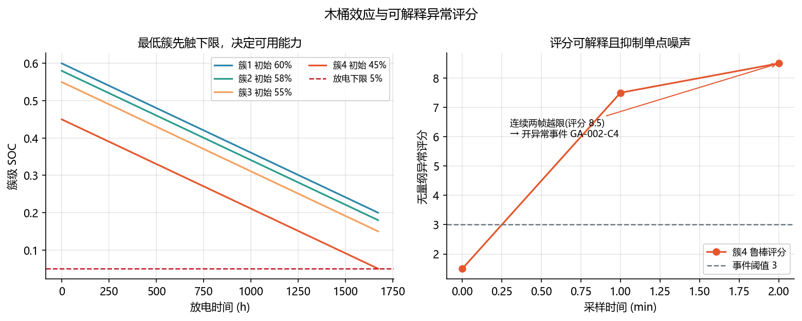
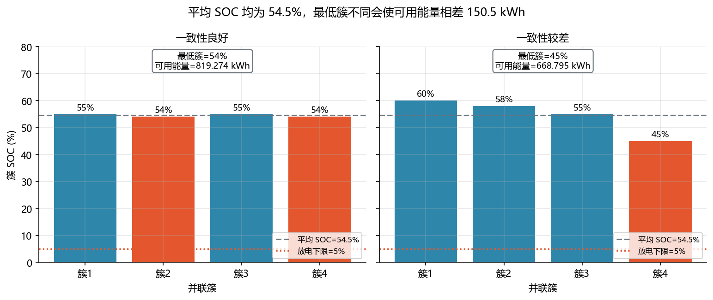

<!-- @AI_GENERATED -->
# 19 成组一致性与异常检测

**一句话**：平均 SOC 不能代表可用能力；放电时最低簇先触下限。异常检测要先量化木桶损失，再对持续偏离的簇开事件。

## 19.1 运行场景

18:20，晚峰任务已经执行 20 min。堆级平均 SOC 仍处于可运行范围，但 BMS 连续报告第 4 簇为最低 SOC 簇，且该簇端电压接近放电下限。若继续根据平均 SOC 维持原计划，最低簇可能先触发保护，使全站提前降额或停止放电。

值班员需要知道：第 4 簇只是一次采样波动，还是持续偏离？其他簇中剩余的电量能否用于当前任务？这决定 EMS 是继续按当前能力执行，还是提前收紧功率并安排夜间维护。

## 19.2 决策困难与算法需求

平均 SOC 只描述总量，不描述谁先到边界。单次最低值也可能来自噪声或通信异常——如果第 4 簇只是偶发低一帧、下一帧恢复正常，为此触发降额会无谓损失功率。

但反过来，如果忽略持续偏离，风险会逐层放大：最低簇差先收紧 SOE，再通过能量约束压低 SOP。18:20 的晚峰任务还在执行中——如果第 4 簇已持续偏低，当前能力口径（无论 normal 还是 degraded）都不再有意义，必须在发布前用真实的簇差重算。

因此需要两项能力配合：最低簇能力算法把簇差传播到 SOE/SOP，给出"簇差使得可用能量从 X 缩到 Y"的具体数值；中位数/MAD 异常评分用连续 good 数据判断偏离是否持续到应创建事件。前者重算能力，后者决定是否通知运维进入均衡或修复流程。

## 19.3 木桶效应

并联簇近似均分电流时，最低 SOC 簇最先触下限，BMS 停止整组放电；高 SOC 簇中的余电暂时无法交付。

```text
E_cl = C_cell·V_cell·N_s/1000      （每簇名义能量，见附录 A.8）
r = max(SOC_i) − min(SOC_i)      （极差）
μ = (Σ SOC_i)/N                  （簇均值）
E_min = N·max(0, min(SOC_i)−SOC_min)·E_cl
E_avg = N·max(0, μ−SOC_min)·E_cl
```

| 变量 | 含义 | 单位 |
|---|---|---|
| `C_cell` | 单体额定容量 | Ah |
| `V_cell` | 单体标称电压 | V |
| `N_s` | 每簇串联单体数，本教程 416 | 串 |
| `N` | 参与统计的簇数 | 簇 |
| `SOC_i` | 第 `i` 簇 SOC | 0～1 |
| `SOC_min` | 放电运行下限 | 0～1 |
| `E_cl` | 每簇名义能量 | kWh |
| `E_min` | 最低簇决定的可用能量 | kWh |
| `E_avg` | 平均 SOC 口径的可用能量 | kWh |

`E_avg−E_min` 是平均口径高估的能量。注意 `E_cl` 是整簇能量（314 Ah×3.2 V×416 串/1000=417.9968 kWh），不是单体能量；漏乘 `N_s` 会让结果缩小 416 倍。

## 19.4 手算示例

4 簇 SOC=`[0.60,0.58,0.55,0.45]`，每簇能量 `E_cl=314×3.2×416/1000=417.9968 kWh`，`SOC_min=0.05`。

**第 1 步：最低簇能力。**

```text
μ=0.545，r=0.15
E_min=4×(0.45−0.05)×417.9968=668.8 kWh
```

**第 2 步：平均口径高估。**

```text
E_avg=4×(0.545−0.05)×417.9968=827.6 kWh
高估=827.6−668.8=158.8 kWh=23.8%
```

## 19.5 异常评分

用中位数 `m` 作为同组基线，用中位数绝对偏差 MAD `d` 表示通常离散：

```text
m = median(SOC_i)
d = median(|SOC_i − m|)
score_i = |SOC_i − m| / max(d, δ)
开事件：score_i ≥ 3，且连续两帧质量为 good
```

`δ=0.01` 防止同组几乎一致时除零；连续确认可抑制单点噪声。阈值 `3` 是鲁棒尺度倍数，不是概率分位，所以评分只能用于组内排序和告警，不能当作绝对可信度。

## 19.6 核心实现

```python
from statistics import median


def anomaly_scores(socs: list[float], floor: float = 0.01) -> tuple[float, list[float]]:
    """以中位数/MAD 计算各簇的鲁棒异常评分。"""
    if len(socs) < 3 or any(not 0.0 <= soc <= 1.0 for soc in socs):
        raise ValueError("至少需要三个 0–1 SOC")
    center = median(socs)
    mad = median(abs(soc - center) for soc in socs)
    scale = max(mad, floor)
    return center, [abs(soc - center) / scale for soc in socs]


if __name__ == "__main__":
    first_center, first = anomaly_scores([0.60, 0.59, 0.58, 0.51])
    second_center, second = anomaly_scores([0.60, 0.59, 0.58, 0.50])
    print(f"首次：中心={first_center:.3f}，簇4评分={first[3]:.1f}")
    print(f"第二次：中心={second_center:.3f}，簇4评分={second[3]:.1f}")
    assert round(first[3], 1) == 7.5
    assert round(second[3], 1) == 8.5
```

第 1 帧评分 7.5，只记录；第 2 帧评分 8.5，连续计数达到 2 后生成 `GA-002-C4`。

## 19.7 图与事件





| 事件字段 | 示例 |
|---|---|
| 事件 | `GA-002-C4` |
| 对象 | 簇 4 |
| 证据 | SOC=0.50、基线=0.585、评分=8.5 |
| 动作 | BMS 复核，EMS 预留维护窗口 |

## 19.8 自测

1. 为什么平均 SOC 不能作为均分放电的直接承诺值？
2. 簇 4 首次评分 7.5，为什么不立刻开事件？
3. 采样质量为 `invalid` 时正确动作是什么？

<details><summary>参考答案</summary>

1. 最低簇先触下限，平均值掩盖高 SOC 簇暂不可交付的能量。
2. 要求连续两帧 good 越限，以抑制单次噪声或不同步。
3. 记录数据质量原因并待复测，不确认、关闭或驱动均衡。

</details>

<!-- @AI_GENERATED: end -->