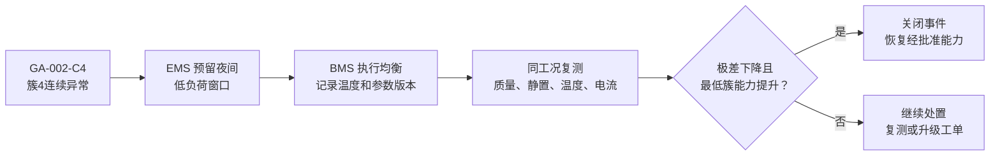
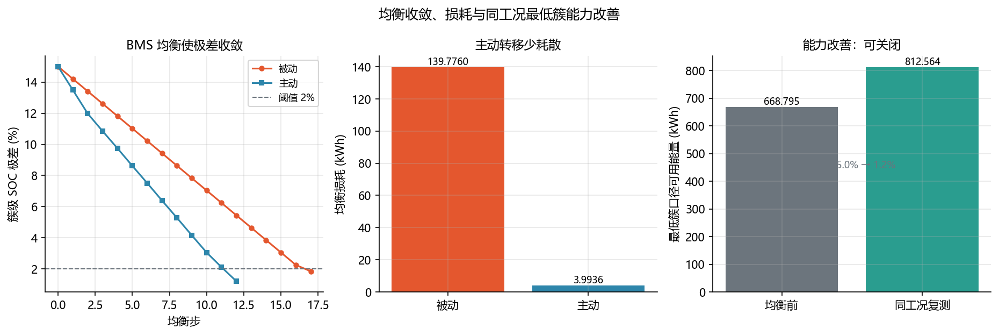

<!-- @AI_GENERATED -->
# 20 均衡评估与运维闭环

**一句话**：均衡效果不能只看极差变小；必须在可比工况下证明最低簇能力改善，才能关闭异常事件。

## 20.1 运行场景

20:00，晚峰任务结束。第 19 章已将第 4 簇标记为持续异常，EMS 为次日任务预留夜间低负荷窗口。BMS 可以执行均衡，但值班员不能仅因“均衡已运行”就恢复第 4 簇相关的能力计划。

均衡前后如果温度、静置时间、电流或参数版本不同，极差变化可能来自工况，而不是均衡。次日能否恢复原计划，取决于最低簇可用能量是否在可比条件下真正改善。

## 20.2 决策困难与算法需求

被动均衡和主动均衡的能量去向不同；极差下降也不等于可交付能量提升。业务需要一套前后可比规则，并将最低簇 SOC 转为可用能量，才能决定异常事件是关闭、继续处置还是升级工单。

因此需要均衡损耗计算、同工况准入和能力改善评估。算法结果直接决定 EMS 是否恢复经批准的能力计划。

| 方式 | 原理 | 代价 |
|---|---|---|
| 被动均衡 | 高 SOC 簇泄放，多余电荷变热 | 耗能、发热 |
| 主动均衡 | 高 SOC 向低 SOC 转移 | 转换损耗、控制更复杂 |

```text
ΔSOC = I_bal·Δt/C
E_loss,passive = ΔSOC·C·V/1000
E_loss,active = ΔSOC·(1−η)·C·V/1000
ΔE = E_min,after − E_min,before
```

BMS 执行均衡与保护，EMS 只预留低负荷窗口、消费能力结果并保存记录。

## 20.3 可比性准入

前后数据均应满足：质量为 `good`、温差≤2°C、电流绝对值≤5 A、静置≥1800 s、BMS 参数版本和 EMS 维护窗口相同。任一条件不满足，结果为“待复测”。

## 20.4 手算示例

每簇能量口径 `314×3.2/1000=1.0048 kWh`，`SOC_min=0.05`。

**第 1 步：均衡前能力。**

```text
E_before=4×(0.45−0.05)×1.0048=1.608 kWh
极差=15.0%
```

**第 2 步：复测后能力。** 最低簇 SOC=0.536：

```text
E_after=4×(0.536−0.05)×1.0048=1.953 kWh
ΔE=1.953−1.608=0.345 kWh
```

## 20.5 核心实现

```python
from dataclasses import dataclass


@dataclass(frozen=True)
class EffectReview:
    status: str
    capability_before_kwh: float
    capability_after_kwh: float
    gain_kwh: float


def evaluate_effect(before_soc: list[float], after_soc: list[float],
                    before_temperature_c: float, after_temperature_c: float,
                    current_a: float, rest_s: float,
                    quality: str, same_version: bool) -> EffectReview:
    """按可比性准入，评价均衡前后最低簇能力。"""
    if quality != "good" or abs(before_temperature_c-after_temperature_c) > 2:
        return EffectReview("待复测", 0.0, 0.0, 0.0)
    if abs(current_a) > 5 or rest_s < 1800 or not same_version:
        return EffectReview("待复测", 0.0, 0.0, 0.0)
    energy_per_cluster = 314.0 * 3.2 / 1000.0
    before = len(before_soc) * max(0.0, min(before_soc)-0.05) * energy_per_cluster
    after = len(after_soc) * max(0.0, min(after_soc)-0.05) * energy_per_cluster
    status = "可关闭" if max(after_soc)-min(after_soc) < max(before_soc)-min(before_soc) and after > before else "继续处置"
    return EffectReview(status, before, after, after-before)


if __name__ == "__main__":
    review = evaluate_effect([.60,.58,.55,.45], [.54,.54,.536,.536], 25.0, 25.5, 0.0, 1800, "good", True)
    print(review)
    assert review.status == "可关闭" and review.gain_kwh > 0
```

## 20.6 运维闭环

```text
告警 → BMS 处置 → 同工况复测 → EMS 关闭或继续处置
```



关闭条件：工况可比、均衡收敛、极差降低、最低簇能力改善。否则保留事件，安排复测或升级工单。



## 20.7 自测

1. 为什么极差下降不足以直接恢复 EMS 能力计划？
2. 温差 4°C 的前后日志能否直接计算均衡效果？
3. 达到最大均衡步数仍未收敛，应该如何结束闭环？

<details><summary>参考答案</summary>

1. 还需确认最低簇能力改善、质量合格且前后工况和版本可比。
2. 不能，应标为待复测，不能把温度影响算作均衡效果。
3. 不关闭事件，保留继续处置/升级工单和未收敛原因。

</details>

<!-- @AI_GENERATED: end -->