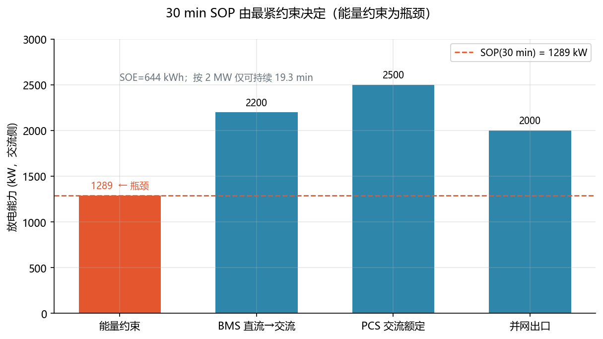
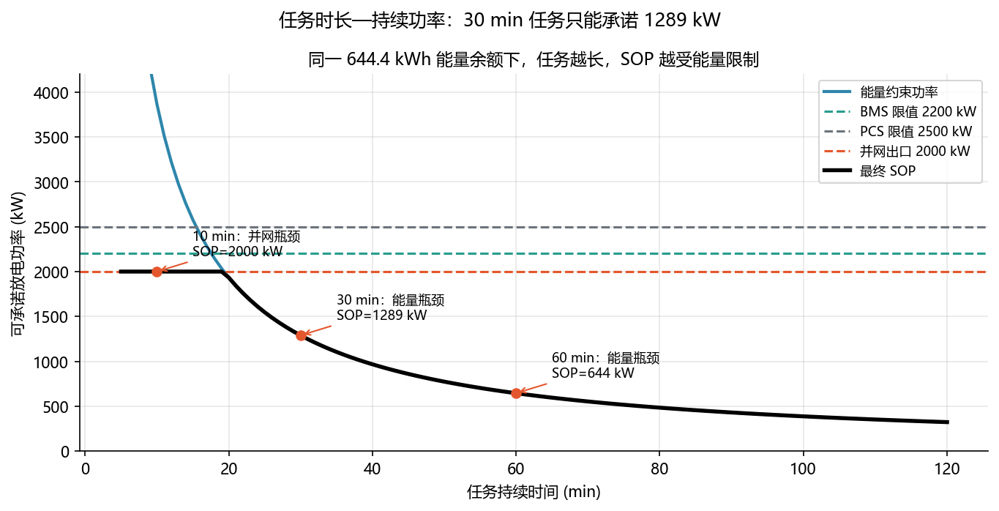

<!-- @AI_GENERATED -->
# 21 持续功率 SOP 评估

**一句话**：SOP(T) 是指定方向、持续时间 T 下可交付的最大功率。它等于能量约束、BMS、PCS 和并网限值中的最小值。

## 21.1 运行场景

17:40，EMS 已得到交流侧 SOE=644.4 kWh。原计划仍是 18:00 开始、持续 30 min 的 2 MW 放电。PCS 额定 2.5 MW，BMS 当前允许 2.2 MW，并网出口限制 2.0 MW。单看每一条设备限制，任务似乎可执行。

但 30 min 任务需要 1000 kWh，而当前可交付 SOE 只有 644.4 kWh。值班员必须区分"设备瞬时最多能放多大功率"和"当前能量能将该功率维持多久"。

## 21.2 决策困难与算法需求

PCS 铭牌和 BMS 限流回答的是功率上限，SOE 回答的是能量余额，PCC 限制回答的是出口边界。它们没有任何一个能单独形成任务承诺。

因此需要 SOP(T)：先把 SOE 除以指定任务时长得到能量约束功率，再与 BMS、PCS、PCC 同一平面的限制取最小。该算法明确告诉 EMS 是能量、设备还是并网出口阻止原计划。

## 21.3 SOP 公式

```text
P_energy(T) = SOE_AC / (T/3600)
SOP_discharge(T) = min(P_energy(T), P_BMS, P_PCS, P_grid)
```

`T` 是必填维度。5 min SOP 不能替代 30 min SOP；所有限值必须是同一时刻、同一方向、同一测量平面。

## 21.4 手算示例

接第 20 章：`SOE_AC=644.4 kWh`（未取整 644.44 kWh）、`P_BMS=2200 kW`、`P_PCS=2500 kW`、`P_grid=2000 kW`。

**第 1 步：能量约束功率。**

```text
P_energy(1800 s) = 644.44/(1800/3600) = 1288.9 kW
```

**第 2 步：取最小值。**

```text
SOP(30 min) = min(1288.9, 2200, 2500, 2000) = 1288.9 kW
按 2000 kW 可持续 = 644.44/2000×60 = 19.3 min
```

原计划需要 1000 kWh，能量不足。正确动作是降至约 1.289 MW、缩短时长或补能后重排。

## 21.5 核心实现

```python
from dataclasses import dataclass


@dataclass(frozen=True)
class SopResult:
    energy_limit_kw: float
    sop_kw: float
    bottleneck: str
    duration_at_grid_limit_min: float


def continuous_power(soe_ac_kwh: float, duration_s: float,
                     bms_limit_kw: float, pcs_limit_kw: float,
                     grid_limit_kw: float) -> SopResult:
    """计算放电方向、交流侧口径的指定时长 SOP。"""
    if soe_ac_kwh < 0 or duration_s <= 0:
        raise ValueError("SOE 必须非负，持续时间必须为正")
    limits = {
        "energy": soe_ac_kwh / (duration_s / 3600.0),
        "BMS": bms_limit_kw,
        "PCS": pcs_limit_kw,
        "grid": grid_limit_kw,
    }
    if any(value < 0 for value in limits.values()):
        raise ValueError("功率限值必须非负")
    bottleneck = min(limits, key=limits.get)
    sop_kw = limits[bottleneck]
    grid_duration_min = soe_ac_kwh / grid_limit_kw * 60.0 if grid_limit_kw > 0 else 0.0
    return SopResult(limits["energy"], sop_kw, bottleneck, grid_duration_min)


if __name__ == "__main__":
    result = continuous_power(644.44, 1800.0, 2200.0, 2500.0, 2000.0)
    print(f"能量约束={result.energy_limit_kw:.1f} kW")
    print(f"SOP={result.sop_kw:.1f} kW，瓶颈={result.bottleneck}")
    print(f"按 2 MW 可持续={result.duration_at_grid_limit_min:.1f} min")
    assert round(result.sop_kw, 1) == 1288.9
    assert result.bottleneck == "energy"
```

完整站级能力计算见 `lab/ch07_soe_sop.py`。

## 21.6 时长切换

同一 SOE_AC=644.44 kWh，不同任务时长下瓶颈切换：

| 任务时长 T | P_energy (kW) | P_BMS | P_PCS | P_grid | SOP (kW) | 瓶颈 |
|:---:|:---:|:---:|:---:|:---:|:---:|:---:|
| 5 min | 7733.3 | 2200 | 2500 | 2000 | **2000** | 并网 |
| 15 min | 2577.8 | 2200 | 2500 | 2000 | **2000** | 并网 |
| 30 min | 1288.9 | 2200 | 2500 | 2000 | **1288.9** | 能量 |
| 60 min | 644.4 | 2200 | 2500 | 2000 | **644.4** | 能量 |

> 短时任务 P_energy 远大于设备/并网限值→卡在涉外限制；长时任务 P_energy 降至设备限值以下→卡在自身能量。这就是 SOP 必须带持续时间 T 的根本原因。

## 21.7 图与结果





| 约束项 | 本例值 | 含义 |
|---|---:|---|
| 能量约束 | 1288.9 kW | 当前瓶颈 |
| BMS | 2200 kW | 实时放电能力 |
| PCS | 2500 kW | 交流额定能力 |
| 并网出口 | 2000 kW | 出口/调度限制 |

## 21.8 自测

1. 为什么 SOP 必须带持续时间 T？
2. 并网限值降到 900 kW 时，30 min SOP 是多少？瓶颈是什么？
3. 为什么四个限值要在同一测量平面比较？

<details>
<summary>参考答案</summary>

1. 同样能量在不同时长下可持续功率不同；不带 T 的功率无法用于调度申报。
2. `min(1288.9,2200,2500,900)=900 kW`，瓶颈是并网出口。
3. 不同平面的数值口径不同，直接取最小会把不可比的量混在一起。

</details>

<!-- @AI_GENERATED: end -->