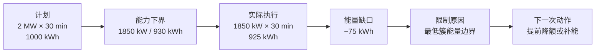
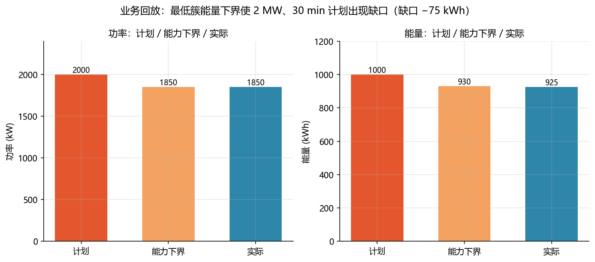

<!-- @AI_GENERATED -->
# 25 业务回放与履约验证

**一句话**：冻结任务输入、能力和实际执行，比较计划与交付量，才能判断一次储能调度是否完成。

## 25.1 运行场景

18:30，晚峰任务结束。原计划要求 PCC 持续输出 2 MW、30 min，目标 1000 kWh；实际执行期间，最低簇能量边界使可用功率维持在 1850 kW，最终交付 925 kWh。值班员需要向调度和运维说明：任务为何未完成，问题来自执行偏差、状态估计、设备限制，还是任务开始前的能力判断。

如果只回看一个 SOC 或一个 RMSE，无法回答这个问题。履约判断必须把计划、数据质量、参数版本、能力下界、实际功率和限制原因放到同一条时间线上。

## 25.2 决策困难与算法需求

实时状态下 EMS 收到的遥测是流式的，任务期间参数可能被更新、诊断状态可能变化、设备可能限制。而事后复盘时如果只用新参数重新跑一遍算法，得到的结论和当时实时计算的可能完全不同——算法没变，但输入、诊断状态、设备限值全变了。

因此复盘不能靠"用新参数重跑"。必须冻结任务开始前的所有条件：遥测快照、能力参数版本、诊断状态、配置版本和算法版本。在这份冻结快照上重新生成 17:45 的能力下界，再与实际执行功率积分比较，才能把偏差归因到三个层面：能力判断偏差（当时该判多少与实际交付差多少）、执行偏差（设备限值与能力下界差多少）、外部限制（PCC 限值与计划差多少）。

回放不是为了算一个 RMSE 或 KPI，而是为了给下一次重排提供事实证明——这次低估了容量衰减、下次该放宽还是收紧余量。所以回放输出必须是冻结的输入→冻结的能力→实际功率/能量偏差→归因→重排建议，形成可追溯的闭环。

## 25.3 回放对象

| 项目 | 值 |
|---|---:|
| 回放标识 | `ch10-evening-peak-001` |
| 配置版本 | `teaching-dispatch-config-v1.0` |
| 能力参数版本 | `soe-sop-teaching-params-v1.0` |
| 算法版本 | `business-replay-v1.0` |
| 计划 | 2000 kW × 1800 s = 1000 kWh |
| 能力下界 | 1850 kW、930 kWh |

## 25.4 关键指标

- **业务回放**：用时间顺序固定的输入重算状态、能力和调度结论。
- **能力下界**：考虑不确定度和最低簇后的可承诺功率或能量。
- **RMSE/最大误差/收敛步**：描述估计质量，不直接判定计划是否完成。

```text
E_plan = P_plan·t/3600
E_actual = Σ(P_actual,i·Δt/3600)
ΔP = P_available,min − P_plan
ΔE = E_actual − E_plan
```

## 25.5 手算示例

**第 1 步：计划能量。**

```text
E_plan = 2000×1800/3600 = 1000 kWh
```

**第 2 步：实际交付与偏差。** 六段均为 1850 kW、每段 300 s：

```text
E_actual = 6×1850×300/3600 = 925 kWh
ΔP = 1850−2000 = −150 kW
ΔE = 925−1000 = −75 kWh
```

能力下界低于计划，30 min 实际交付 925 kWh，未完成 1000 kWh 目标。

## 25.6 核心实现

```python
from dataclasses import dataclass


@dataclass(frozen=True)
class ReplayResult:
    planned_energy_kwh: float
    actual_energy_kwh: float
    power_gap_kw: float
    energy_gap_kwh: float
    completed: bool


def replay_dispatch(planned_power_kw: float, duration_s: float,
                    available_power_kw: float,
                    actual_powers_kw: list[float], interval_s: float) -> ReplayResult:
    """比较计划、能力和实际功率，输出履约结果。"""
    if duration_s <= 0 or interval_s <= 0:
        raise ValueError("任务和区间时长必须为正")
    if len(actual_powers_kw) * interval_s != duration_s:
        raise ValueError("实际功率段数与任务时长不一致")
    if any(power < 0 for power in actual_powers_kw):
        raise ValueError("本示例仅处理放电功率")

    planned_energy = planned_power_kw * duration_s / 3600.0
    actual_energy = sum(actual_powers_kw) * interval_s / 3600.0
    return ReplayResult(planned_energy, actual_energy,
                        available_power_kw-planned_power_kw,
                        actual_energy-planned_energy,
                        actual_energy >= planned_energy and available_power_kw >= planned_power_kw)


if __name__ == "__main__":
    result = replay_dispatch(2000.0, 1800.0, 1850.0, [1850.0]*6, 300.0)
    print(result)
    assert result.planned_energy_kwh == 1000.0
    assert result.actual_energy_kwh == 925.0
    assert result.energy_gap_kwh == -75.0
    assert not result.completed
```

## 25.7 估计指标

收敛后误差 `[0.019,0.008,0.008,0.008,0.007]`：

```text
RMSE = √(0.000602/5) = 1.10%
最大误差 = 1.90%
```

这些指标描述估计质量；计划完成与否由实际功率和能量对计划的偏差决定。

## 25.8 回放报告



| 项目 | 结果 |
|---|---:|
| 数据质量 | good |
| 计划 | 2000 kW / 1000 kWh |
| 能力下界 | 1850 kW / 930 kWh |
| 实际 | 925 kWh |
| 功率偏差 | −150 kW |
| 能量偏差 | −75 kWh |
| 限制原因 | minimum_cluster_energy_bound |
| 结论 | 未完成计划 |



对应实验：

```bash
python lab/ch10_business_replay.py
```

## 25.9 课程收口

```text
确认数据 → 建模与标定 → 状态估计与诊断 → 风险化能力
→ 成组与运维 → 业务回放与履约结论
```

## 25.10 自测

1. 业务回放为什么必须冻结输入、配置、算法版本和随机种子？
2. 本例未完成计划的直接原因是什么？
3. 为什么计划完成不能只用 RMSE 或收敛步判断？

<details><summary>参考答案</summary>

1. 只有冻结才能复现当时结论，区分算法误差与数据故障。
2. 能力下界为 1850 kW，低于 2000 kW 计划；实际交付 925 kWh，低于 1000 kWh 目标。
3. RMSE 和收敛步描述估计质量；履约由实际交付功率/能量与计划对比决定。

</details>

<!-- @AI_GENERATED: end -->