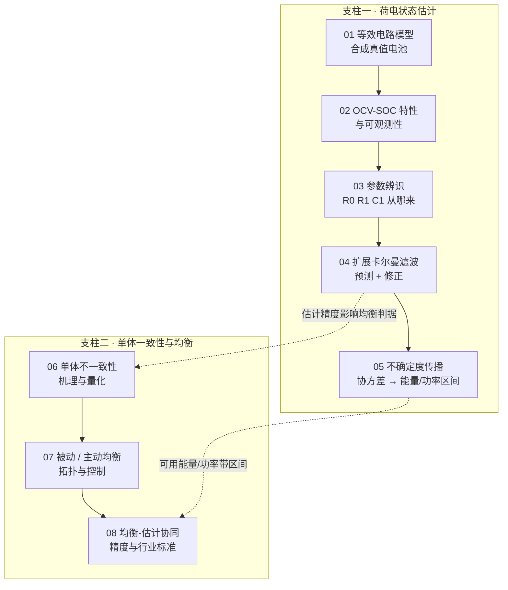
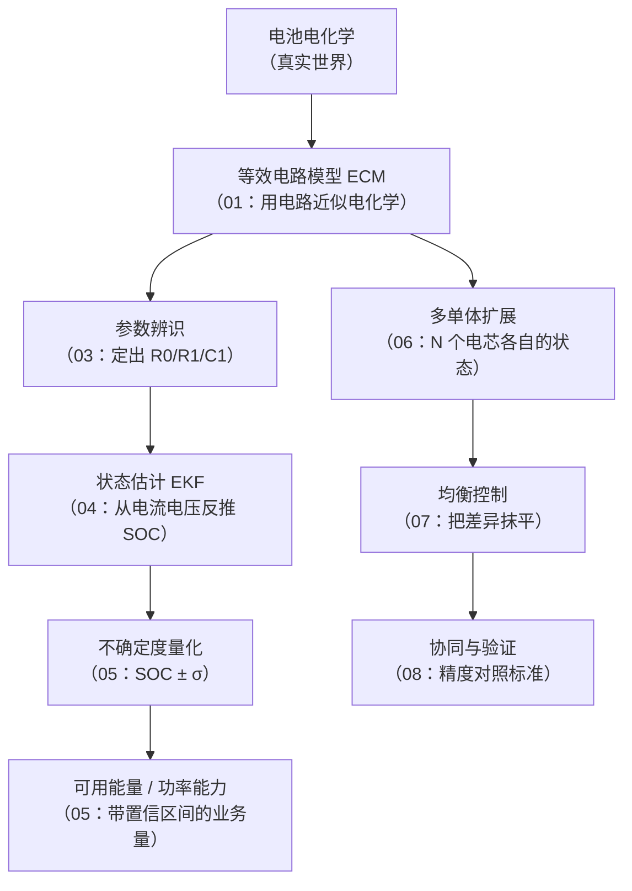

<!-- @AI_GENERATED -->
# 00 导读：荷电状态估计与均衡技术体系

**一句话**：储能里有两件事常被当成不用管的黑盒——SOC（State of Charge，荷电状态，电池当前还能放出的电荷占满充时的比例）到底怎么估出来、电芯之间的差异怎么被"均衡"抹平；这份教程用零依赖的合成仿真，把这两个黑盒逐一打开。

## 本教程要解决什么

如果你做过储能 EMS（Energy Management System，能量管理系统）或电池软件，大概率已经会用**安时积分**（把电流对时间累加来推算 SOC）加上**规则校准**（静置时用电压查表、充满时归零）这套方法。它简单、可解释，但有两个它自己解决不了的问题，工程现场往往直接"交给 BMS"：

1. **估计算法本身**：安时积分会越积越偏，静置电压在磷酸铁锂（LFP）电池的平台区又几乎读不出 SOC。真正的 BMS（Battery Management System，电池管理系统）靠的是**基于模型的状态估计**——等效电路模型加卡尔曼滤波。这部分通常被当成"BMS 内部的事"。
2. **单体均衡**：一组电芯里总有跑得快和跑得慢的，BMS 会做"均衡"把它们拉齐。被动均衡、主动均衡到底是什么电路、按什么策略动作、代价差多少，往往也只是一个"均衡中"的状态位。

这份教程把这两个黑盒打开。不是为了让你去写 BMS 固件，而是为了**看懂里面在算什么**——当 BMS 报出一个 SOC、一个"均衡中"，你知道它经历了什么、可信到什么程度、什么时候该怀疑它。

## 本教程的边界与前置

- **定位是学习资料**，不是生产级 BMS 实现。所有模型、噪声、阈值都为讲清原理而简化。
- **前置**：会读 Python、理解安时积分和 SOC 的基本概念、知道欧姆定律和一阶 RC 电路即可。卡尔曼滤波、等效电路模型等会在用到时从零讲起。
- **方法**：全程用**合成数据**。我们先用一个物理模型造一个"真值电池"，让它按已知的 SOC 轨迹运行、吐出带噪声的电流电压；再让估计器从一个**故意设错的初值**出发，看它能不能收敛回真值。真值已知，所以每一步都能用 `assert` 验证对错。离线、可复现、不联网。
- **代码零依赖**：每篇的教学代码只用 Python 标准库，裸 Python 3 就能跑，复制整段即可复现。

## 现场场景：两种"必懂"方法同时失灵

一座 LFP 储能站，傍晚收工后电池停在 SOC 显示 50% 附近静置。运维想确认这个 50% 准不准，试了两条路：

- **查安时积分的历史**：这组电池两周没满充过，安时积分从上次校准到现在已经累计了约 4% 的漂移，显示的 50% 实际可能是 46%，也可能是 54%，没法确定方向。
- **用静置电压校准**：静置到位了，测到端电压。可 LFP 在 30%～80% 这段平台区，电压随 SOC 几乎不变——差 5 mV（电压表的正常误差）对应的 SOC 能差 5 个百分点。查出来的 SOC 还不如安时积分可信。

两种在基础课程里被列为"必懂"的方法，在这个最常见的工况下**同时失灵**。安时积分不知道自己偏了多少，静置电压在平台区又分辨不出来。这不是操作失误，是方法本身的局限。

真正的 BMS 怎么办？它不靠单一方法，而是用一个**模型**同时利用电流和电压：电流负责"推算趋势"（像安时积分），电压负责"修正偏差"（像校准），并且**时刻评估这次电压信息有多可信**——平台区就少信、陡峭区就多信。这就是扩展卡尔曼滤波（EKF）。它正是本教程第一个要打开的黑盒。

## 全教程技术体系地图

整份教程围绕一条主线：造真值电池 → 产生带噪量测 → 估计器还原状态 → 量化不确定度 → 推广到多单体 → 均衡 → 验证。

一句话串起来：**01 造电池、02 看清为什么难、03 定出模型参数、04 把 SOC 估出来、05 给估计值配上误差范围；06 发现单体会各走各路、07 用均衡把它们拉回来、08 把估计与均衡合到一起对照行业精度要求。**

## SOC 技术栈分层

从"电池物理"到"EMS 能用的数字"，中间隔着好几层，每一层本教程都有对应篇目：

## 统一示例：九篇共用同一个电芯

为了让九篇不是各讲各的，全教程**围绕同一个物理对象**展开。所有公式手算、代码、图表里出现的数字，都来自下面这一组参数——你在 01 篇看到的 R0，就是 04 篇 EKF 里用的 R0，就是 08 篇验证的那块电池。

| 参数 | 值 | 含义 |
|---|---|---|
| C | 100 Ah | 单体额定容量 |
| R0 | 1.0 mΩ | 欧姆内阻（电流一变、电压立刻跳的那部分） |
| R1 | 0.8 mΩ | 极化电阻（RC 环节，电压缓慢变化的那部分） |
| C1 | 20000 F | 极化电容，时间常数 τ = R1·C1 = 16 s |
| OCV-SOC | LFP 13 点表 | 平台区约 1 mV/1% SOC，陡峭区约 20 mV/1% SOC |
| 真值初值 | SOC = 50% | 仿真起点（"真相"） |
| 估计器初值 | SOC = 70% | 故意设错 +20%，用来考察估计器能否收敛 |
| 电池组 | 4 单体 60/58/55/45% | 均衡篇用，每簇 100 Ah |

这些数值都是 `[教学示例]`，方便手算对照。真实工程中以电芯规格书、BMS 定值单和项目配置为准。

> **约定**：本教程电流、功率一律**放电为正、充电为负**；SOC 在代码里用 0～1、正文里用百分比。每篇末尾的教学代码都可以整段复制运行，运行后会打印一张数值追踪表并以 `assert` 自检，最后输出"自检通过"。

读完导读，你已经知道这趟要去哪。下一篇从造一个"真值电池"开始——没有它，后面的估计器就没有可对照的真相。

<!-- @AI_GENERATED: end -->
