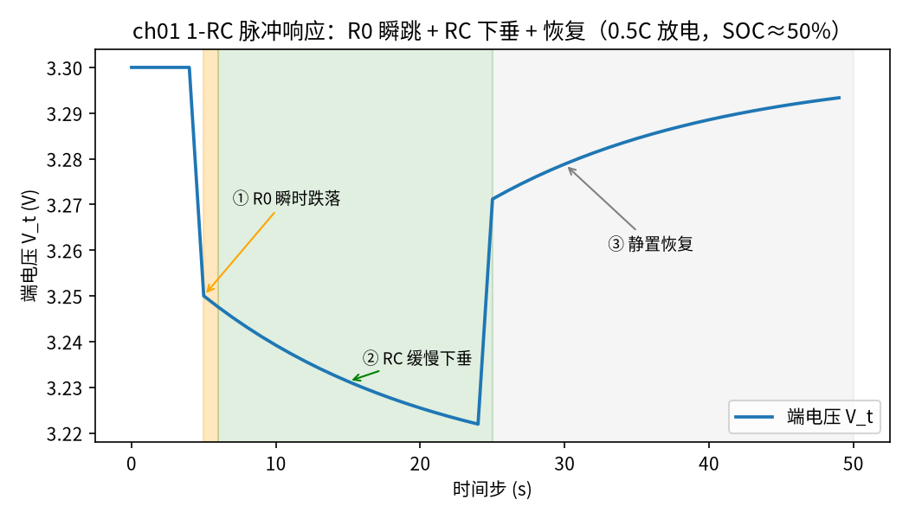
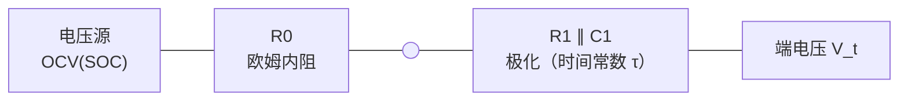

<!-- @AI_GENERATED -->
# 01 等效电路模型与合成数据仿真平台

**一句话**：用一个电压源加两个电阻和一个电容，就能把电池"电流进出 → 端电压怎么变"模拟得足够准；有了这个模型，我们就能造一个"知道真实 SOC 的电池"，作为后面所有估计器的考官。

## 本章目标

读完本章，你应能：

1. 说清等效电路模型（ECM，Equivalent Circuit Model）里 R0、R1、C1 各自对应电池的什么行为；
2. 按离散递推公式一步步推进模型状态，手算出放电脉冲下的端电压；
3. 用这个模型写出一个"真值电池"仿真器，按给定电流序列产生 SOC 真值轨迹和端电压；
4. 理解为什么要先有真值电池，才能验证估计算法。

## 本章边界与前置

本章只讲**正向建模**——给定电流，模型吐出电压和 SOC。至于反过来"给定电压电流、反推 SOC"（也就是估计），是第 04 篇的事。本章用到的 OCV（Open-Circuit Voltage，开路电压：电池静置、无电流时的端电压）曲线细节放在第 02 篇展开，这里先当成一张"SOC → 电压"的查表用。前置只需要理解欧姆定律和一阶 RC 充放电。

## 现场场景：为什么仿真里必须先有"真值"

你要验证一个 SOC 估计算法好不好，最大的难处是：**真实电池里，SOC 本身就没人知道**。你拿现场数据去跑估计器，算出来一条 SOC 曲线，可你没有"标准答案"能对照——真实 SOC 是多少，没有仪器能直接测（这正是要估计它的原因）。

合成仿真绕开了这个死结：我们用一个物理模型，**人为规定**电池从 50% 出发、按某条电流曲线运行，于是每一时刻的真实 SOC 我们自己算得出来。再把这个模型产生的电压电流喂给估计器，估计器并不知道真值，它估出来的曲线和我们手里的真值一比，对错一目了然。

所以这一篇造的不是"又一个估计器"，而是估计器的**考官**——一块我们完全掌握其内部状态的电池。

## 原理直觉：电池 = 一个会"拖后腿"的电压源

把电池接上负载放电，端电压会立刻掉一截、然后继续慢慢往下滑。这两段掉法对应两种物理：

- **立刻掉的那一截**：电流流过电池内部的欧姆电阻（金属、电解液的纯电阻），`U = I·R0`，电流一变电压立刻跟着跳。这就是 **R0**。
- **慢慢滑的那部分**：电化学极化、浓度扩散等过程不是瞬间完成的，像一个电容在慢慢充放。用一个**电阻 R1 并联电容 C1** 来近似：它的电压 V1 不会瞬间到位，而是以时间常数 τ = R1·C1 逐渐逼近稳态。

合起来就是最常用的 **1-RC Thevenin 等效电路**：一个随 SOC 变化的电压源 OCV(SOC)，串一个 R0，再串一个 RC 并联环节。端电压就是电压源减去这两段压降。

> **软件类比**：R0 像同步调用的固定延迟，请求一来立刻产生；RC 环节像一个带时间常数的指数退避缓冲，负载变化后要过几个 τ 才稳定下来。τ 越大，系统对负载变化的响应越"肉"。

## 公式与符号

1-RC 模型的离散递推（采样周期 Δt）：

```text
SOC[k] = SOC[k−1] − I·Δt / (3600·C)                放电为正，安时积分
V1[k]  = V1[k−1]·a + I·R1·(1−a)                     a = exp(−Δt/τ)，RC 递推
V_t[k] = OCV(SOC[k−1]) − I·R0 − V1[k−1]             端电压（用本步起点状态）
```

| 符号 | 含义 | 单位 | 示例值 |
|---|---|---|---|
| `C` | 额定容量 | Ah | 100 |
| `R0` | 欧姆内阻 | Ω | 0.001（1 mΩ） |
| `R1` | 极化电阻 | Ω | 0.0008（0.8 mΩ） |
| `C1` | 极化电容 | F | 20000 |
| `τ` | 时间常数 R1·C1 | s | 16 |
| `Δt` | 采样周期 | s | 1 |
| `I` | 电流，放电为正 | A | 50（0.5C） |
| `a` | RC 衰减因子 exp(−Δt/τ) | — | exp(−1/16)=0.9394 |

公式要点：

- **`a = exp(−Δt/τ)` 是 RC 的核心**。它决定 V1 每一步朝稳态走多少。Δt 远小于 τ 时 a 接近 1，V1 变化很慢；
- **V1 的稳态是 `I·R1`**。恒流 I 持续足够久，V1 → I·R1，此时 RC 环节等效成一个电阻 R1；
- **端电压用"本步起点"的 SOC 和 V1**，再推进状态——这和真实采样"先测量、后更新"的顺序一致。

## step-by-step 数值校核：0.5C 放电脉冲的端电压

统一示例电芯静置在 SOC = 50%，从某一步开始以 50 A（0.5C）放电。先算衰减因子，再走两步 RC 看 V1 怎么累积。

**第 0 步：衰减因子**

```text
a = exp(−Δt/τ) = exp(−1/16) = exp(−0.0625) = 0.93941
V1 稳态 = I·R1 = 50 × 0.0008 = 0.040 V
```

**第 1 步（放电第一拍，起点 V1=0）**

```text
① 端电压  V_t = OCV(0.50) − I·R0 − V1
              = 3.300 − 50×0.001 − 0        = 3.300 − 0.050 = 3.250 V
② 推进 V1 V1 = 0×0.93941 + 50×0.0008×(1−0.93941)
              = 0 + 0.040×0.06059           = 0.002424 V
③ 推进 SOC SOC = 0.50 − 50×1/(3600×100)   = 0.50 − 0.0001389 = 0.499861
```

**第 2 步（放电第二拍，起点 V1=0.002424）**

```text
① 端电压  V_t = OCV(0.499861) − 50×0.001 − 0.002424
              ≈ 3.300 − 0.050 − 0.002424    ≈ 3.247576 V
② 推进 V1 V1 = 0.002424×0.93941 + 0.040×0.06059
              = 0.002277 + 0.002424         = 0.004701 V
```

两步就能看出规律：**R0 的 0.05 V 压降一上来就是满的、不变；V1 则从 0 开始，每一步累加约 0.002424×(衰减后) 往 0.04 V 的稳态爬。** 放电瞬间端电压掉 0.05 V（纯 R0），之后再缓慢多掉最多 0.04 V（RC 爬到稳态）——正是"立刻掉一截、再慢慢滑"。

**再往后 16 步（一个 τ）**：V1 爬到稳态的 63.2%，即 0.040 × 0.632 = 0.02528 V。这是 RC 环节的定义性质（经过一个时间常数达到稳态的 1−e⁻¹≈63.2%），也是本篇代码的自检点。

## 多步状态追踪：脉冲 + 恢复

把"静置 5 s → 50 A 放电 20 s → 静置 20 s"喂进模型，看端电压怎么走（下面就是教学代码的真实输出）：

```text
  步   I(A)      SOC   V_t(V)
  0    0.0   0.5000   3.3000
  4    0.0   0.5000   3.3000
  5   50.0   0.4999   3.2500
  6   50.0   0.4997   3.2476
 10   50.0   0.4992   3.2392
 24   50.0   0.4972   3.2219
 25    0.0   0.4972   3.2712
 30    0.0   0.4972   3.2788
 44    0.0   0.4972   3.2910
```

逐行读：

- **步 0–4 静置**：I=0，V_t = OCV(50%) = 3.300 V，没有任何压降；
- **步 5 放电瞬间**：V_t 跳到 3.250，正好掉 0.05 V——纯 R0，此刻 V1 还没起来；
- **步 6→24 持续放电**：V_t 从 3.2476 继续滑到 3.2219，这多掉的约 0.026 V 是 V1 在往稳态爬；
- **步 25 停止放电**：V_t 从 3.2219 跳回 3.2712，跳回的 0.05 V 正是 R0 压降瞬间消失；此刻还比 OCV 低，因为 V1 还没放完电；
- **步 25→44 恢复**：V_t 从 3.2712 慢慢回到 3.2910，接近 OCV——V1 以 τ=16 s 的节奏衰减掉。

这张"掉—滑—跳回—恢复"的曲线，就是所有锂电池脉冲测试的典型形状。第 03 篇正是用它来反推 R0、R1、C1。



图中标注对照表：

| 编号 | 位置 | 标注 | 对应正文 |
|---|---|---|---|
| ① | 第 5 步跳变处 | R0 瞬时跌落 | 放电瞬间端电压掉 0.05 V = I·R0 |
| ② | 第 6–24 步下滑段 | RC 缓慢下垂 | V1 以 τ=16 s 向稳态 0.04 V 爬升 |
| ③ | 第 25 步后 | 静置恢复 | 电流归零、R0 压降消失，V1 缓慢衰减 |

电路拓扑：



## 教学闭环代码

零依赖，整段复制即可运行。核心是 `ecm_step`（推进一步）和 `simulate`（跑一段电流序列），末尾 `assert` 验证 63.2% 性质与静置时端电压等于 OCV。

```python
import math

# ── 统一示例参数（§4A，全教程通用，每篇照抄）─────────────
C_AH = 100.0          # 额定容量 Ah
R0_OHM = 1.0e-3       # 欧姆内阻 Ω
R1_OHM = 0.8e-3       # 极化电阻 Ω
C1_F = 20000.0        # 极化电容 F
TAU_S = R1_OHM * C1_F # τ = 16 s
DT_S = 1.0            # 采样周期 s
OCV_SOC = (0.00, 0.05, 0.10, 0.20, 0.30, 0.40, 0.50, 0.60, 0.70, 0.80, 0.90, 0.95, 1.00)
OCV_V   = (2.90, 3.10, 3.20, 3.25, 3.275, 3.29, 3.30, 3.31, 3.325, 3.33, 3.34, 3.36, 3.45)


def interp(x, xs, ys):
    """分段线性插值；表外取端点。"""
    if x <= xs[0]:
        return ys[0]
    for i in range(1, len(xs)):
        if x <= xs[i]:
            return ys[i - 1] + (x - xs[i - 1]) / (xs[i] - xs[i - 1]) * (ys[i] - ys[i - 1])
    return ys[-1]


def ocv_from_soc(soc):
    return interp(soc, OCV_SOC, OCV_V)


def ecm_step(soc, v1, current_a, dt_s=DT_S,
             c_ah=C_AH, r0=R0_OHM, r1=R1_OHM, tau_s=TAU_S):
    """推进一步 1-RC 模型。current_a 放电为正。返回 (v_terminal, soc_next, v1_next)。"""
    a = math.exp(-dt_s / tau_s)
    v1_next = v1 * a + current_a * r1 * (1.0 - a)        # RC 极化电压递推
    soc_next = soc - current_a * dt_s / (3600.0 * c_ah)  # 安时积分
    v_terminal = ocv_from_soc(soc) - current_a * r0 - v1 # 端电压（用本步 soc/v1）
    return v_terminal, soc_next, v1_next


def simulate(current_profile, soc0, dt_s=DT_S):
    """给定电流序列，输出真值轨迹 (soc_true[], i[], v_terminal[])。"""
    soc, v1 = soc0, 0.0
    soc_log, v_log = [], []
    for i_a in current_profile:
        v_t, soc, v1 = ecm_step(soc, v1, i_a, dt_s)
        soc_log.append(soc)
        v_log.append(v_t)
    return soc_log, list(current_profile), v_log


def test_ch01():
    # 结论 1：对恒定放电阶跃，经 τ 秒（16 步）V1 达稳态 I·R1 的 63.2%
    i_step = 50.0  # 0.5C 放电（50 A on 100 Ah）
    v1 = 0.0
    for _ in range(int(TAU_S / DT_S)):           # 16 步 = 1 个 τ
        _, _, v1 = ecm_step(0.5, v1, i_step)
    v1_steady = i_step * R1_OHM                   # = 0.04 V
    assert abs(v1 / v1_steady - 0.632) < 0.01, (v1, v1_steady)
    # 结论 2：静置（I=0）时端电压 = OCV（无 R0 压降、V1 衰减）
    v_t, _, _ = ecm_step(0.5, 0.0, 0.0)
    assert abs(v_t - ocv_from_soc(0.5)) < 1e-12


def main():
    # 教学剖面：静置 5 s → 0.5C 放电脉冲 20 s → 静置恢复
    profile = [0.0] * 5 + [50.0] * 20 + [0.0] * 20
    soc_log, i_log, v_log = simulate(profile, soc0=0.50)
    print(f"{'步':>3}{'I(A)':>7}{'SOC':>9}{'V_t(V)':>9}")
    for k in (0, 4, 5, 6, 10, 24, 25, 30, 44):
        print(f"{k:>3}{i_log[k]:>7.1f}{soc_log[k]:>9.4f}{v_log[k]:>9.4f}")
    test_ch01()
    print("自检通过")


if __name__ == "__main__":
    main()
```

运行输出：

```text
  步   I(A)      SOC   V_t(V)
  0    0.0   0.5000   3.3000
  4    0.0   0.5000   3.3000
  5   50.0   0.4999   3.2500
  6   50.0   0.4997   3.2476
 10   50.0   0.4992   3.2392
 24   50.0   0.4972   3.2219
 25    0.0   0.4972   3.2712
 30    0.0   0.4972   3.2788
 44    0.0   0.4972   3.2910
自检通过
```

动手改一改：

- 把 `C1_F` 调到 40000（τ=32 s），脉冲下垂段会更"肉"、恢复更慢；
- 把放电电流改成 100 A（1C），R0 瞬跳变成 0.1 V、V1 稳态变成 0.08 V，压降整体翻倍；
- 把放电时长拉到 100 步，V1 会非常接近稳态 0.04 V，之后端电压几乎只随 SOC 缓慢下降。

## 工程实现与边界

- 本模型是 **1 阶 RC**（一个 RC 环节）。真实电池常用 2 阶（快、慢两个极化过程各一个 RC），精度更高，代价是多两个参数要辨识。教学上 1-RC 已足够看清机理。
- 这里的参数是恒定的 `[教学示例]`。真实 R0、R1、C1 随 SOC、温度、老化变化，严谨的模型会按 SOC/温度查表取参数。
- 端电压公式用了"本步起点状态"，与采样"先测后更"一致；若改成"先更新再算电压"会引入半步偏差，长期仿真要注意统一约定。

## 常见误区

| 误区 | 正确理解 |
|---|---|
| R0 和 R1 是一回事 | R0 是瞬时欧姆压降（电流一变立刻到位），R1 是极化电阻（经 RC 缓慢建立）；脉冲测试里一个是跳变、一个是爬升 |
| RC 环节有电容就会一直充 | V1 的稳态是 I·R1，恒流下爬到就不再涨；电流归零后按 τ 衰减回零 |
| 端电压就是 OCV | 只有静置（I=0 且 V1 衰减完）时端电压才等于 OCV；有电流时端电压被 R0 和 V1 拉低（放电）或抬高（充电） |

## 本章自测

1. 统一示例电芯以 100 A（1C）放电，放电瞬间端电压相对 OCV 掉多少？持续很久后 V1 的稳态是多少？
2. τ=16 s，经过 2 个 τ（32 s）恒流放电，V1 达到稳态的百分之多少？
3. 为什么合成仿真能验证估计算法，而拿真实现场数据反而不能直接验证？

<details>
<summary>参考答案</summary>

1. 放电瞬间掉 I·R0 = 100×0.001 = 0.1 V（纯 R0）；V1 稳态 = I·R1 = 100×0.0008 = 0.08 V。总压降最终约 0.18 V。
2. 经过 n 个 τ 达到 1−e⁻ⁿ。2 个 τ 即 1−e⁻² ≈ 86.5%。
3. 合成仿真里真实 SOC 是我们人为设定的、完全已知，可作为标准答案对照估计结果；真实现场数据里真实 SOC 无法直接测量（否则就不需要估计了），没有标准答案，只能间接验证（如满充满放标定）。

</details>

下一篇：OCV-SOC 曲线长什么样、为什么 LFP 平台区让 SOC 变得几乎"不可观测"——这决定了估计到底难在哪。

<!-- @AI_GENERATED: end -->
