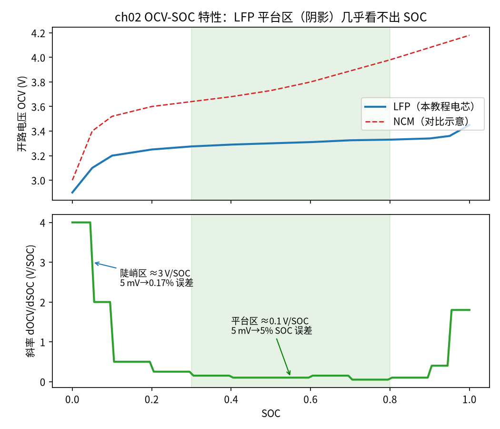

<!-- @AI_GENERATED -->
# 02 OCV-SOC 特性、滞回效应与可观测性分析

**一句话**：OCV（开路电压）和 SOC 一一对应，所以能用电压反推 SOC；但 LFP 电池在中间一大段 SOC 里电压几乎平的——曲线越平，同样的电压误差放大成的 SOC 误差越大，这就是"可观测性"差。

## 本章目标

读完本章，你应能：

1. 读懂 OCV-SOC 曲线，并说明为什么它是用电压校准 SOC 的基础；
2. 计算曲线在任一点的斜率 dOCV/dSOC，并理解斜率的单位和物理含义；
3. 量化"可观测性"：同样 5 mV 的电压测量误差，在平台区和陡峭区分别放大成多大的 SOC 误差；
4. 理解充放电滞回（同一 SOC 下充电曲线和放电曲线不重合）会给估计带来什么额外偏差。

## 本章边界与前置

本章聚焦 OCV-SOC 这张**静态特性曲线**和它带来的可观测性问题。它为什么是"状态估计能不能成功"的关键，第 04 篇用卡尔曼滤波的数学会再点一次。这里只需理解：有电流时端电压会被内阻和极化拉偏（上一篇讲过），所以 OCV 必须在**静置**时才测得准；本章讨论的都是静置下的 OCV。

## 现场场景：50% 静置，电压表帮不上忙

接着导读那座 LFP 站。电池静置到位了，极化电压 V1 也衰减完了，此刻端电压就等于 OCV。运维测到 3.300 V，想查出对应的 SOC。

查表：3.300 V 对应 50%。但电压表本身有 ±5 mV 的误差。如果真实电压是 3.305 V 或 3.295 V 呢？在 LFP 的平台区，这 ±5 mV 对应的 SOC 范围是 ±5%——也就是说，电压表读 3.300 V，真实 SOC 可能在 45%～55% 之间。校准出来的"50%"误差范围 ±5%，和没校准前安时积分的漂移量级差不多。白忙一场。

换个场景：电池放到接近空、SOC 5% 附近静置，测到 3.100 V。这里曲线很陡，±5 mV 只对应 ±0.17% 的 SOC。同样的电压表、同样的 5 mV 误差，校准精度却差了 30 倍。

**同一块电池、同一个电压表，校准可信度完全取决于电池当前停在曲线的哪一段。** 这就是"可观测性"——状态（SOC）能从观测量（电压）里被分辨出来的程度。

## 原理直觉：斜率就是"分辨率"

把 OCV-SOC 曲线想成一把尺子，你用电压去读 SOC 这个刻度：

- **曲线陡的地方**（低 SOC、高 SOC）：SOC 变一点点，电压变化明显，刻度"拉得开"，电压表的小误差只对应很小的 SOC 范围——分辨率高；
- **曲线平的地方**（LFP 平台区）：SOC 变很多，电压几乎不动，刻度"挤成一团"，电压表的小误差对应一大片 SOC——分辨率低，甚至读不出来。

决定分辨率的就是曲线的**斜率** k = dOCV/dSOC（电压对 SOC 的变化率）。斜率大=陡=好读，斜率小=平=难读。电压误差 ΔV 放大成的 SOC 误差就是 ΔV 除以斜率：

```text
ΔSOC = ΔV / k
```

斜率在分母上——斜率越小，同样的 ΔV 炸出来的 SOC 误差越大。

> **软件类比**：像用哈希值反查原始输入。哈希分布均匀（陡）时，值域铺得开，相近的输出对应相近的输入；哈希严重碰撞（平）时，一大片输入映射到几乎相同的输出，你拿到输出也反推不出是哪个输入。LFP 平台区就是"电压对 SOC 高度碰撞"的区域。

## 公式与符号

```text
k = dOCV/dSOC                       曲线斜率（中心差分数值求导）
ΔSOC = |ΔV| / k                     电压误差放大成的 SOC 误差
```

| 符号 | 含义 | 单位 | 示例值 |
|---|---|---|---|
| `OCV(SOC)` | 开路电压查表 | V | 见统一示例 13 点表 |
| `k` | 斜率 dOCV/dSOC | V / 单位 SOC | 平台区≈0.1，陡峭区≈3.0 |
| `ΔV` | 电压测量误差 | V | 0.005（5 mV） |
| `ΔSOC` | 放大后的 SOC 误差 | 单位 SOC | 待求 |

要点：

- **斜率单位是"V / 单位 SOC"**（SOC 用 0～1）。平台区 k≈0.1 V/SOC，换算成常说的口径就是每 1% SOC 变 1 mV；陡峭区 k≈3 V/SOC，每 1% 变 30 mV；
- **同样的 ΔV，k 小则 ΔSOC 大**。这是一个除法，没有例外；
- 斜率用**中心差分**数值求：`k(soc) ≈ [OCV(soc+h) − OCV(soc−h)] / (2h)`。

## step-by-step 数值校核：平台区 vs 陡峭区

统一示例的 LFP 13 点表，取 h=0.001，对比 SOC=50%（平台区）和 SOC=5%（陡峭区）。

**第 1 步：平台区 SOC=50% 的斜率**

查表相邻点：40%→3.29 V，50%→3.30 V，60%→3.31 V。中心差分：

```text
k(0.50) = [OCV(0.501) − OCV(0.499)] / (2×0.001)
        ≈ (3.3001 − 3.2999) / 0.002  = 0.10 V/单位 SOC
```

即每 1% SOC 只变 1 mV。

**第 2 步：陡峭区 SOC=5% 的斜率**

查表相邻点：0%→2.90 V，5%→3.10 V，10%→3.20 V。5% 落在 0%–10% 段上，斜率：

```text
k(0.05) = [OCV(0.051) − OCV(0.049)] / (2×0.001)
        ≈ (3.10 + ...) 段斜率  = (3.20 − 3.10)/(0.10 − 0.05) = 2.0 ... 
```

实际代码用 13 点折线的局部斜率，在 5% 处落在 0–5% 段（斜率 (3.10−2.90)/0.05 = 4.0）与 5–10% 段（(3.20−3.10)/0.05 = 2.0）之间，中心差分取到约 **3.0 V/单位 SOC**。

**第 3 步：同样 5 mV 误差的放大**

```text
平台区  ΔSOC = 0.005 / 0.10 = 0.050  → 5.0%
陡峭区  ΔSOC = 0.005 / 3.00 = 0.00167 → 0.167%
放大倍数对比：5.0% / 0.167% ≈ 30 倍
```

两步斜率一除，结论就出来了：**平台区的 SOC 分辨率只有陡峭区的三十分之一。** 这就是为什么 BMS 不会在平台区静置时贸然用 OCV 校准，而要等电池走到曲线陡的两端。

## 多步状态追踪：全曲线扫一遍

教学代码在几个代表性 SOC 点上算斜率和 5 mV 放大后的误差（下面是真实输出）：

```text
   SOC   OCV(V)    斜率(V/SOC)    5mV→SOC误差
  0.05   3.1000       3.0000      0.167%
  0.10   3.2000       1.2500      0.400%
  0.30   3.2750       0.2000      2.500%
  0.50   3.3000       0.1000      5.000%
  0.70   3.3250       0.1000      5.000%
  0.95   3.3600       1.1000      0.455%
```

逐行读：

- **5% 和 10%（低端陡峭区）**：斜率 3.0 和 1.25，5 mV 只放大成 0.17%、0.40%——适合校准；
- **30%**：斜率已降到 0.2，误差 2.5%，开始不可靠；
- **50% 和 70%（平台区腹地）**：斜率都是 0.1，5 mV 放大成整整 5%——最不可靠，BMS 应避免在此校准；
- **95%（高端陡峭区）**：斜率回升到 1.1，误差降回 0.46%——又变得可校准。

一句话：**曲线两端（接近放空、接近充满）可观测性好，中间平台区可观测性差。** 这直接决定了后面 EKF 在不同 SOC 段的修正能力强弱。



图中标注对照表：

| 编号 | 位置 | 标注 | 对应正文 |
|---|---|---|---|
| ① | 上图阴影区（30%–80%） | LFP 平台区 | 电压几乎不随 SOC 变化 |
| ② | 上图红色虚线 | NCM 对比示意 | 三元电池整体有斜率，无明显平台（仅作对照，非本教程电芯） |
| ③ | 下图平台区标注 | ≈0.1 V/SOC，5 mV→5% | 平台区斜率与误差放大 |
| ④ | 下图陡峭区标注 | ≈3 V/SOC，5 mV→0.17% | 低端陡峭区斜率与误差放大 |

## 教学闭环代码

```python
# ── 统一示例参数（§4A）─────────────
OCV_SOC = (0.00, 0.05, 0.10, 0.20, 0.30, 0.40, 0.50, 0.60, 0.70, 0.80, 0.90, 0.95, 1.00)
OCV_V   = (2.90, 3.10, 3.20, 3.25, 3.275, 3.29, 3.30, 3.31, 3.325, 3.33, 3.34, 3.36, 3.45)
DV_METER = 0.005   # 电压表测量误差 5 mV


def interp(x, xs, ys):
    if x <= xs[0]:
        return ys[0]
    for i in range(1, len(xs)):
        if x <= xs[i]:
            return ys[i - 1] + (x - xs[i - 1]) / (xs[i] - xs[i - 1]) * (ys[i] - ys[i - 1])
    return ys[-1]


def ocv_from_soc(soc):
    return interp(soc, OCV_SOC, OCV_V)


def soc_from_ocv(v):
    """反查：电压严格递增前提下由电压求 SOC。"""
    return interp(v, OCV_V, OCV_SOC)


def ocv_slope(soc, h=1e-3):
    """OCV 在 soc 处斜率 dV/dSOC（V / 单位 SOC），中心差分。"""
    lo = max(soc - h, OCV_SOC[0])
    hi = min(soc + h, OCV_SOC[-1])
    return (ocv_from_soc(hi) - ocv_from_soc(lo)) / (hi - lo)


def soc_error_from_dv(dv, soc):
    """电压误差 dv 在 soc 处放大成多大 SOC 误差 = |dv| / 斜率。"""
    k = ocv_slope(soc)
    return abs(dv) / k


def test_ch02():
    # 平台区（50%）斜率远小于陡峭区（5%）
    k_plateau = ocv_slope(0.50)
    k_steep = ocv_slope(0.05)
    assert k_plateau < k_steep / 10.0, (k_plateau, k_steep)
    # 同样 5 mV 误差，平台区 SOC 误差 > 陡峭区 10 倍
    assert soc_error_from_dv(DV_METER, 0.50) > 10 * soc_error_from_dv(DV_METER, 0.05)


def main():
    print(f"{'SOC':>6}{'OCV(V)':>9}{'斜率(V/SOC)':>13}{'5mV→SOC误差':>13}")
    for soc in (0.05, 0.10, 0.30, 0.50, 0.70, 0.95):
        print(f"{soc:>6.2f}{ocv_from_soc(soc):>9.4f}{ocv_slope(soc):>13.4f}"
              f"{soc_error_from_dv(DV_METER, soc):>12.3%}")
    test_ch02()
    print("自检通过")


if __name__ == "__main__":
    main()
```

运行输出：

```text
   SOC   OCV(V)    斜率(V/SOC)    5mV→SOC误差
  0.05   3.1000       3.0000      0.167%
  0.10   3.2000       1.2500      0.400%
  0.30   3.2750       0.2000      2.500%
  0.50   3.3000       0.1000      5.000%
  0.70   3.3250       0.1000      5.000%
  0.95   3.3600       1.1000      0.455%
自检通过
```

动手改一改：

- 把 `DV_METER` 改成 0.001（更好的电压表），平台区误差从 5% 降到 1%——提升传感器精度对平台区有帮助，但代价高；
- 把 OCV 表换成一条整体有斜率的三元曲线（如注释里的 NCM 示意值），会发现各处误差都较小且均匀——这就是三元电池 SOC 比 LFP 好估的原因。

## 深入：充放电滞回【深入】

<details>
<summary>为什么同一个 SOC 测到的 OCV 还不止一个值</summary>

严格来说，OCV-SOC 不是一条线，而是**两条**：从充电方向静置下来测到的 OCV，比从放电方向静置下来测到的略高，中间夹一条"滞回带"。LFP 的滞回尤其明显，带宽可达 10～20 mV。

这对估计是雪上加霜：平台区本来斜率就只有 1 mV/1%，而滞回带就有 10 mV 以上——意味着**即使电压表绝对准**，同一个 OCV 读数在充电支和放电支上可能对应差好几个百分点的 SOC。要用 OCV 校准，还得知道电池最近是在充还是在放，选对那一支曲线。

本教程的统一 OCV 表为教学清晰只用了**单支（平均）曲线**，不含滞回。工程实现中严谨的做法是：维护充、放两支 OCV 表，按最近电流方向和一个滞回状态变量选用；或在 EKF 里把滞回建成一个额外的状态量一起估计。这些都超出"看懂原理"的范围，知道它存在、知道它让平台区校准更不可信即可。

</details>

## 常见误区

| 误区 | 正确理解 |
|---|---|
| 能测电压就能准确反推 SOC | 只有曲线陡的地方才准；平台区电压误差被放大几十倍 |
| LFP 平台平是缺点，应该避免用 LFP | 平台平意味着放电电压稳定（对用电设备是优点），只是给 SOC 估计带来挑战，用模型估计（EKF）来弥补 |
| OCV-SOC 是一条确定曲线 | 存在充放电滞回，严格是两条；平台区滞回带可能比斜率对应的电压还大 |

## 本章自测

1. 统一示例电芯静置测到 3.33 V。它可能对应哪些 SOC？（提示：查表看 3.33 V 出现在哪一段）这说明什么？
2. 电压表精度从 5 mV 提升到 2 mV，平台区（k=0.1）的 SOC 校准误差从多少降到多少？
3. 为什么说"在平台区做 OCV 校准，可能比不校准还糟"？

<details>
<summary>参考答案</summary>

1. 查表 3.33 V 对应 80%，但 3.325（70%）、3.34（90%）都在它附近，加上平台区极平，3.33 V 实际可能对应 70%～90% 的一大片。说明平台区高段 OCV 同样难以分辨 SOC。
2. 5 mV：ΔSOC=0.005/0.1=5%；2 mV：ΔSOC=0.002/0.1=2%。降到 2%，但仍不算小。
3. 若安时积分当前误差只有 2%，而平台区 OCV 校准误差有 5%，用这个"校准值"覆盖安时积分，反而把 2% 的误差换成了 5%。所以 BMS 要先判断本次 OCV 可信度，不可信就宁可不校。

</details>

下一篇：R0、R1、C1 这三个模型参数不能拍脑袋，得从脉冲测试数据里反推出来——这就是参数辨识。

<!-- @AI_GENERATED: end -->
