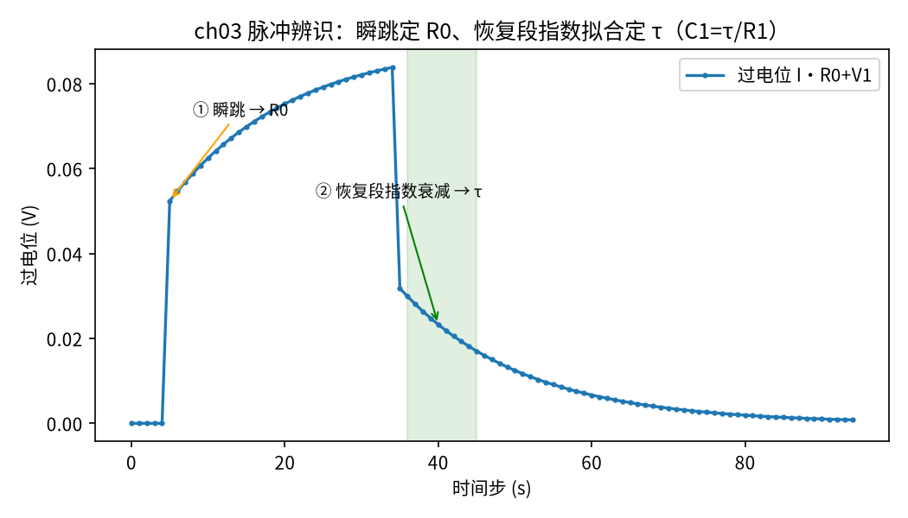
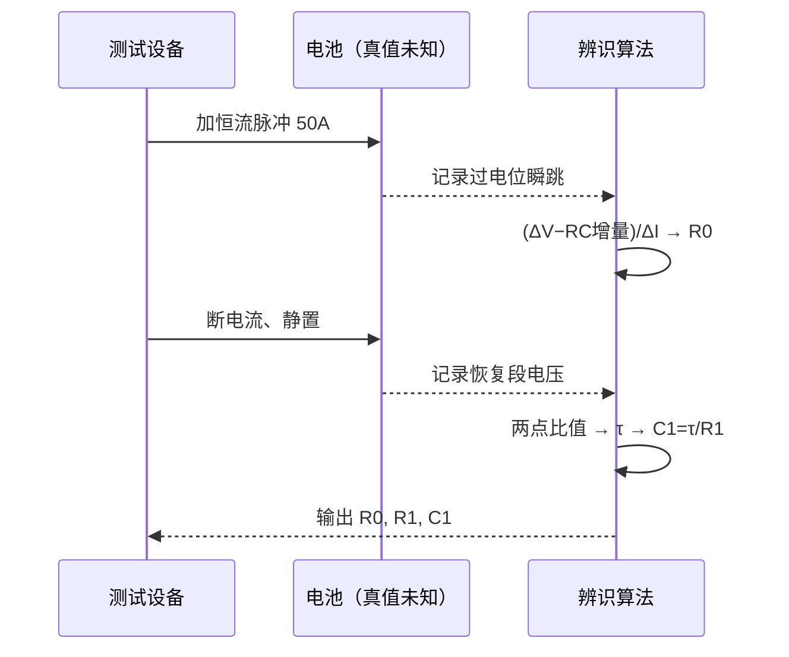

<!-- @AI_GENERATED -->
# 03 等效电路模型参数辨识

**一句话**：R0、R1、C1 不能拍脑袋，要从一次脉冲测试的电压响应里反推——瞬跳段定 R0、恢复段的指数衰减定时间常数 τ，再由 τ 和 R1 算出 C1。

## 本章目标

读完本章，你应能：

1. 设计一次脉冲测试，并说明它为什么能同时暴露 R0 和 RC 两种时间尺度；
2. 从电压瞬跳反推欧姆内阻 R0（注意扣除同一步内 RC 的贡献）；
3. 从恢复段的指数衰减，用两个采样点的电压比值解出时间常数 τ，再得 C1；
4. 了解递推最小二乘（RLS）这种在线辨识思路，为什么工程上更常用。

## 本章边界与前置

本章用第 01 篇造的 1-RC 模型**正向生成**一段脉冲响应（相当于"做实验采数据"），再**反推**参数，看能不能还原出当初设定的真值。前置是第 01 篇的 1-RC 公式和"端电压 = OCV − I·R0 − V1"。为聚焦辨识本身，脉冲期间假设 SOC 变化很小、OCV 近似恒定，于是我们直接盯住"过电位"（端电压相对 OCV 的偏离）。

## 现场场景：BMS 的参数从哪来

你要在仿真里跑一个 EKF 估计器（第 04 篇），它内部需要 R0、R1、C1。这些数从哪来？规格书上可能只给个"内阻典型值 1 mΩ"，而且是全新电芯、某个温度下的。实际那颗电芯、那个温度、老化到这个程度的真实参数，得自己测。

标准做法是**脉冲测试**：让电池静置稳定，突然加一个恒定电流脉冲（比如 0.5C 放电）持续几十秒，再突然断电静置恢复。全程高速记录端电压。这条"阶跃—下垂—跳回—恢复"的曲线（就是第 01 篇那条）里，藏着 R0、R1、C1 的全部信息。本章就是把它们解出来。

## 原理直觉：两种时间尺度，分开抓

脉冲响应里有两种"快慢"完全不同的过程，正好对应两个待辨识对象：

- **瞬间的跳变**（加电流/断电流那一刹那）：只有 R0 能瞬间响应，电容 C1 两端电压来不及变。所以**电压的瞬跳 = I·R0**，一减一除就得 R0。
- **缓慢的爬升/衰减**（脉冲持续段、恢复段）：这是 RC 环节在以 τ=R1·C1 的节奏充放。恢复段最干净——电流归零后，V1 按纯指数 `e^(−t/τ)` 衰减，拿两个时间点的电压一比值，就能解出 τ。

有了 R0（瞬跳）、τ（恢复段），再加上 R1（可从稳态下垂量 I·R1 得到，或规格书给定），C1 = τ/R1 就出来了。**关键是"分开抓"：用瞬间抓 R0，用慢过程抓 τ，不要混在一起。**

> **软件类比**：像给一个服务做压测来反推它的内部参数。阶跃加压瞬间的延迟跳变告诉你固定开销（R0）；之后响应时间按指数曲线趋于稳态，这条曲线的时间常数告诉你缓冲/队列的容量（RC）。

## 公式与符号

```text
R0  = (ΔV_over − V1 本步增量) / ΔI        瞬跳段，扣除同步 RC 贡献
τ   = −Δt / ln(V_b / V_a)                 恢复段两点，V1 ∝ e^(−t/τ)
C1  = τ / R1                              已知 R1 反推
```

| 符号 | 含义 | 单位 | 示例值 |
|---|---|---|---|
| `V_over` | 过电位 = I·R0 + V1（端电压相对 OCV 的偏离） | V | — |
| `ΔI` | 脉冲起始的电流阶跃 | A | 50 |
| `V_a, V_b` | 恢复段两个采样点的 V1（过电位） | V | 释放后第 1、第 10 步 |
| `Δt` | 这两点的时间间隔 | s | 9 |
| `R1` | 极化电阻（本例已知） | Ω | 0.0008 |

要点：

- **瞬跳算 R0 要扣除同一步内 RC 的贡献**。离散采样下，脉冲起始那一步里 V1 已经涨了一点点（`I·R1·(1−a)`），不扣掉会把 R0 算偏。连续时间下这一项趋于 0，离散下必须处理；
- **τ 用恢复段**（电流=0）最干净，因为此时过电位里只剩 V1 的纯指数衰减，没有 R0 分量干扰；
- **两点比值法**：`V_b/V_a = e^(−Δt/τ)`，取对数即得 τ，不需要拟合整条曲线。

## step-by-step 数值校核：从脉冲响应解出三个参数

统一示例真值 R0=1 mΩ、R1=0.8 mΩ、C1=20000 F（τ=16 s）。脉冲 50 A，a=exp(−1/16)=0.93941。

**第 1 步：瞬跳定 R0**

脉冲起始那一步，过电位从 0 跳到 `I·R0 + I·R1·(1−a)`：

```text
ΔV_over = 50×0.001 + 50×0.0008×(1−0.93941) = 0.050 + 0.002424 = 0.052424 V
扣除本步 RC 增量：  V1 本步增量 = 50×0.0008×(1−0.93941) = 0.002424 V
R0 = (0.052424 − 0.002424) / 50 = 0.050 / 50 = 0.001 Ω  ✓
```

**第 2 步：恢复段定 τ**

电流归零后，V1 从某个值按 `e^(−t/τ)` 衰减。取释放后第 1 步（V_a）和第 10 步（V_b），间隔 Δt=9 s：

```text
V_b / V_a = e^(−9/16) = e^(−0.5625) = 0.56978
τ = −9 / ln(0.56978) = −9 / (−0.5625) = 16.00 s  ✓
```

**第 3 步：由 τ 和 R1 得 C1**

```text
C1 = τ / R1 = 16.0 / 0.0008 = 20000 F  ✓
```

三步各自解出一个参数，环环相扣：R0 靠瞬跳、τ 靠恢复段指数、C1 靠 τ÷R1。因为是无噪声合成数据、反推公式解析可逆，三个值都精确命中真值。

## 多步状态追踪：辨识结果对照真值

教学代码生成脉冲响应后反推，真实输出：

```text
    参数          真值         辨识值      相对误差
 R0(Ω)    1.00e-03    1.00e-03   +0.00%
  τ(s)       16.00       16.00   +0.00%
 C1(F)       20000       20000   +0.00%
自检通过
```

三个参数相对误差都是 0.00%。**这正是合成数据验证的价值**：真值已知，辨识算法对不对、公式推没推错，一个 `assert 相对误差 < 5%` 就卡住了。真实测试数据带噪声，辨识会有几个百分点误差，但方法骨架一样。



图中标注对照表：

| 编号 | 位置 | 标注 | 对应正文 |
|---|---|---|---|
| ① | 第 5 步瞬跳处 | 瞬跳 → R0 | 电流阶跃瞬间过电位跳变，扣除 RC 后除以 ΔI 得 R0 |
| ② | 第 36–45 步恢复段阴影 | 恢复段指数衰减 → τ | 电流归零后 V1 按 e^(−t/τ) 衰减，两点比值解 τ |

辨识数据流：



## 教学闭环代码

```python
import math

# ── 统一示例参数（§4A）─────────────
C_AH = 100.0
R0_OHM = 1.0e-3       # 真值，辨识目标
R1_OHM = 0.8e-3       # 真值
C1_F = 20000.0        # 真值
TAU_S = R1_OHM * C1_F # 16 s
DT_S = 1.0


def _gen_pulse(i_amp=50.0, rest=5, pulse=30, recover=60):
    """合成脉冲响应：静置→放电脉冲→静置恢复。返回 (t[], i[], v_over[])。
    v_over = 过电位 = I·R0 + V1（相对 OCV 的压降，恒 SOC 近似下 OCV 视为常数）。"""
    a = math.exp(-DT_S / TAU_S)
    v1 = 0.0
    t, i_log, v_over = [], [], []
    k = 0
    for phase_i, n in ((0.0, rest), (i_amp, pulse), (0.0, recover)):
        for _ in range(n):
            v1 = v1 * a + phase_i * R1_OHM * (1.0 - a)
            v_over.append(phase_i * R0_OHM + v1)   # 过电位
            i_log.append(phase_i)
            t.append(k)
            k += 1
    return t, i_log, v_over


def identify_r0(i_log, v_over, k_step):
    """脉冲起始瞬跳：扣除本步 V1 增量后，纯 R0 阶跃 / Δi = R0。"""
    di = i_log[k_step] - i_log[k_step - 1]
    dv = v_over[k_step] - v_over[k_step - 1]
    a = math.exp(-DT_S / TAU_S)
    v1_jump = i_log[k_step] * R1_OHM * (1.0 - a)   # 本步 RC 电压增量
    return (dv - v1_jump) / di


def identify_tau(t, v_over, k_release):
    """恢复段（电流归零后）V1 按 e^(−t/τ) 衰减：用两点比值解 τ。"""
    v_a = v_over[k_release + 1]           # 释放后第 1 步
    v_b = v_over[k_release + 10]          # 释放后第 10 步
    dt = (t[k_release + 10] - t[k_release + 1])
    return -dt / math.log(v_b / v_a)      # v_b/v_a = e^(−dt/τ)


def test_ch03():
    t, i_log, v_over = _gen_pulse()
    k_step = 5                             # 脉冲在第 5 步起
    k_release = 35                         # 第 35 步电流归零（5+30）
    r0_hat = identify_r0(i_log, v_over, k_step)
    tau_hat = identify_tau(t, v_over, k_release)
    c1_hat = tau_hat / R1_OHM              # 已知 R1 反推 C1
    assert abs(r0_hat / R0_OHM - 1) < 0.05, r0_hat
    assert abs(tau_hat / TAU_S - 1) < 0.05, tau_hat
    assert abs(c1_hat / C1_F - 1) < 0.05, c1_hat


def main():
    t, i_log, v_over = _gen_pulse()
    r0_hat = identify_r0(i_log, v_over, 5)
    tau_hat = identify_tau(t, v_over, 35)
    print(f"{'参数':>6}{'真值':>12}{'辨识值':>12}{'相对误差':>10}")
    print(f"{'R0(Ω)':>6}{R0_OHM:>12.2e}{r0_hat:>12.2e}{r0_hat/R0_OHM-1:>+9.2%}")
    print(f"{'τ(s)':>6}{TAU_S:>12.2f}{tau_hat:>12.2f}{tau_hat/TAU_S-1:>+9.2%}")
    print(f"{'C1(F)':>6}{C1_F:>12.0f}{tau_hat/R1_OHM:>12.0f}{(tau_hat/R1_OHM)/C1_F-1:>+9.2%}")
    test_ch03()
    print("自检通过")


if __name__ == "__main__":
    main()
```

运行输出：

```text
    参数          真值         辨识值      相对误差
 R0(Ω)    1.00e-03    1.00e-03   +0.00%
  τ(s)       16.00       16.00   +0.00%
 C1(F)       20000       20000   +0.00%
自检通过
```

动手改一改：

- 给 `v_over` 每点加一点随机噪声（`+random.gauss(0, 0.0005)`），辨识误差会从 0 变成几个百分点——这更接近真实；
- 改 `identify_tau` 取的两点（如第 1 和第 30 步），看估计是否更稳（点拉得越开、受噪声影响越小，但要确保仍在衰减段内）。

## 深入：递推最小二乘（RLS）在线辨识【深入】

<details>
<summary>为什么工程上不只用一次脉冲，而是在线持续辨识</summary>

脉冲法要专门安排一次"停机做实验"，而且参数随 SOC、温度、老化变，测一次只代表那一刻。工程上更实用的是**递推最小二乘（RLS，Recursive Least Squares）**：把 1-RC 模型写成"当前输出 = 参数 × 历史输入输出"的线性回归形式，每来一个采样点就更新一次参数估计，不用存全部数据。

最简形式：模型 `y[k] = φ[k]ᵀ·θ`，其中 θ 是待辨识参数向量、φ 是由历史电压电流组成的回归向量。RLS 每步更新：

```text
增益   K = P·φ / (λ + φᵀ·P·φ)
参数   θ = θ + K·(y − φᵀ·θ)
协方差 P = (P − K·φᵀ·P) / λ
```

λ 是遗忘因子（略小于 1），让算法更看重近期数据、跟得上参数慢变。你会发现这和第 04 篇的卡尔曼滤波结构惊人地像——都是"预测残差 × 增益 → 修正"，因为 RLS 本就是卡尔曼滤波在"状态即参数、无过程动态"下的特例。

本教程为聚焦主线，RLS 只给思路、不展开完整实现。知道它存在、知道它和脉冲法互补（脉冲法准、RLS 实时）即可。

</details>

## 常见误区

| 误区 | 正确理解 |
|---|---|
| 瞬跳电压直接除以电流就是 R0 | 离散采样下，瞬跳那一步里 RC 也涨了一点，要先扣除再除，否则 R0 偏大 |
| τ 要拟合整条恢复曲线 | 纯指数衰减用两点比值取对数即可解出 τ，无需最小二乘拟合（无噪声时）；有噪声时多点拟合更稳 |
| 辨识一次就一劳永逸 | 参数随 SOC、温度、老化变，严谨实现要么分工况辨识、要么用 RLS 在线跟踪 |

## 本章自测

1. 脉冲 50 A，瞬跳过电位测到 0.052 V，已知本步 RC 增量 0.002 V。R0 是多少？
2. 恢复段释放后第 2 s 测到过电位 0.038 V、第 18 s 测到 0.013 V（间隔 16 s）。τ 大约多少？
3. 为什么用"恢复段"而不用"脉冲持续段"来定 τ 更干净？

<details>
<summary>参考答案</summary>

1. R0 = (0.052 − 0.002) / 50 = 0.050/50 = 0.001 Ω = 1 mΩ。
2. τ = −16 / ln(0.013/0.038) = −16 / ln(0.342) = −16 / (−1.072) ≈ 14.9 s（接近真值 16 s，差异来自读数精度）。
3. 恢复段电流为 0，过电位里只剩 V1 的纯指数衰减；脉冲持续段里过电位 = I·R0 + V1，混着 R0 的恒定分量，要先减掉 I·R0 才能看 V1，多一步、也更易受 R0 误差污染。

</details>

下一篇：有了模型和参数，终于可以造估计器了——扩展卡尔曼滤波，本教程的核心。

<!-- @AI_GENERATED: end -->
