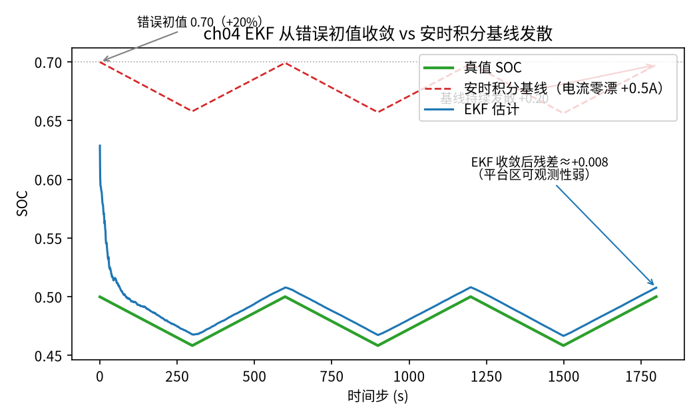
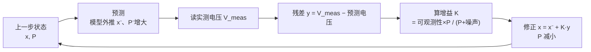

<!-- @AI_GENERATED -->
# 04 基于扩展卡尔曼滤波的荷电状态估计

**一句话**：卡尔曼滤波同时用电流（推算趋势，像安时积分）和电压（修正偏差，像校准），每一步都按"这次电压信息有多可信"自动决定信多少——在平台区少信、在陡峭区多信，这正好治住了前面两种方法各自的病。

## 本章目标

读完本章，你应能：

1. 说清扩展卡尔曼滤波（EKF，Extended Kalman Filter）的"预测 + 修正"两段结构，以及卡尔曼增益在权衡什么；
2. 写出本教程 2 维状态 [SOC, V1] 的 EKF 全部矩阵，并手算走完两个完整循环；
3. 从量测雅可比 H = [dOCV/dSOC, −1] 解释：为什么平台区 EKF 对 SOC 的修正能力弱——用数学兑现第 02 篇的可观测性结论；
4. 对比 EKF 与带零漂的安时积分基线，理解模型估计为何能从错误初值收敛、而基线持续发散。

## 本章边界与前置

本章是支柱一的落点。前置：第 01 篇的 1-RC 状态方程、第 02 篇的 OCV 斜率、第 03 篇的参数。为聚焦卡尔曼滤波机理，本章把矩阵都手写成 2×2（状态只有 SOC 和 V1 两维），不引入任何矩阵库——反而更能看清每个元素在算什么。无迹卡尔曼滤波（UKF）作为变体放在末尾【深入】折叠，不单独展开。

## 现场场景：错误初值，还能救回来吗

假设 BMS 刚上电，它对 SOC 的初始猜测错了——真值 50%，它以为 70%（也许是上次断电前没存好）。安时积分从这个错误起点出发，只会把 70% 一路积下去，错误永远不消失，还叠加电流零漂越来越偏。靠 OCV 校准？电池正在平台区充放电运行，静不下来，而且平台区电压本来就分辨不出 SOC。

这正是前两种方法都无能为力的局面：**初值错了、又没有可信的校准机会**。但 EKF 能救：它不需要静置，运行过程中每一步都拿实测电压和模型预测的电压比一比，用这个"残差"持续往回拽 SOC。只要偶尔经过信息量大一点的工况，它就能把那 20% 的初值错误慢慢磨掉。下面就看它怎么做到。

## 原理直觉：预测、修正、和"该信谁"

EKF 每一步做两件事：

1. **预测**：用电流和模型往前推一步（SOC 按安时积分降、V1 按 RC 递推）。这一步纯靠模型，不看电压。顺便，它还更新一个"我对自己现在有多没把握"的量——协方差 P，预测会让不确定性变大（模型不完美、电流有噪声）。
2. **修正**：用模型预测出一个"这一步端电压应该是多少"，和实测电压做差，这个差叫**残差**。残差乘上一个**卡尔曼增益 K**，拿去修正 SOC 和 V1。修正后不确定性 P 变小（我获得了新信息）。

卡尔曼增益 K 是整件事的灵魂，它在回答一个问题：**这次的电压残差，我该信多少？**

- 如果电压对 SOC 很敏感（陡峭区，斜率大）、且电压表噪声小 → 残差里 SOC 信息含量高 → K 大，大胆修正；
- 如果电压对 SOC 几乎不敏感（平台区，斜率≈0）、或噪声大 → 残差里几乎没有 SOC 信息 → K 小，几乎不修。

这就是为什么 EKF 在平台区"自动怂"——不是写死的规则，是增益公式算出来的。

> **软件类比**：像一个带置信度的传感器融合。预测是"根据上一状态和控制量外推"，修正是"用新观测纠偏"，而卡尔曼增益就是动态权重：观测可信（方差小）就多采纳，观测噪声大就多相信模型外推。P 则是系统对自身估计的实时置信度。

## 公式与符号

状态 x = [SOC, V1]ᵀ。一步 EKF：

```text
【预测】
  SOC⁻ = SOC − I·Δt/(3600·C)
  V1⁻  = V1·a + I·R1·(1−a)            a = exp(−Δt/τ)
  P⁻   = F·P·Fᵀ + Q                   F = [[1, 0], [0, a]]（状态转移雅可比）

【修正】
  ŷ    = OCV(SOC⁻) − I·R0 − V1⁻       预测端电压
  y    = V_meas − ŷ                    残差（新息）
  H    = [dOCV/dSOC, −1]               量测雅可比
  S    = H·P⁻·Hᵀ + R                   残差方差（标量）
  K    = P⁻·Hᵀ / S                     卡尔曼增益（2×1）
  x    = x⁻ + K·y                      更新状态
  P    = (I − K·H)·P⁻                  更新协方差
```

| 符号 | 含义 | 单位 | 示例值 |
|---|---|---|---|
| `P` | 状态协方差（2×2），对角是 SOC、V1 的方差 | — | 初值 diag(1e-2, 1e-4) |
| `Q` | 过程噪声协方差 | — | diag(1e-10, 1e-8) |
| `R` | 量测噪声方差（电压表） | V² | 1e-4（对应 10 mV） |
| `H` | 量测雅可比 [dOCV/dSOC, −1] | — | 平台区≈[0.1, −1] |
| `K` | 卡尔曼增益 [k0, k1]ᵀ | — | 待算 |
| `y` | 残差 = 实测 − 预测端电压 | V | 待算 |

要点：

- **H 的第一项就是第 02 篇的 OCV 斜率**。平台区它≈0.1，陡峭区≈3。它直接决定增益 k0（对 SOC 的修正强度）；
- **S 是残差方差**：H·P·Hᵀ 是"模型对这次电压的不确定"，加上 R（电压表噪声）。K = P·Hᵀ/S，分母越大（越不确定或噪声越大）增益越小；
- **Q 小、R 大 → 更信模型；Q 大、R 小 → 更信电压**。调这两个是 EKF 工程的核心手艺。

## step-by-step 数值校核：走完头两步

统一示例，真值从 SOC=50% 出发，EKF 从错误初值 SOC⁻=70%、V1=0、P=diag(0.01, 0.0001) 启动。第一步电流 I=50 A 放电，a=0.93941，R=1e-4。用平台区斜率 dOCV/dSOC≈0.1。

**第 1 步 · 预测**

```text
SOC⁻ = 0.70 − 50×1/(3600×100) = 0.70 − 0.0001389 = 0.699861
V1⁻  = 0×0.93941 + 50×0.0008×(1−0.93941) = 0.002424 V
P⁻   ≈ P + Q ≈ diag(0.01, 0.0001×a²+1e-8) ≈ diag(0.0100, 0.0000883)
      （对角近似：P[0,0] 几乎不变 0.01，P[1,1] 略降）
```

**第 1 步 · 修正**

```text
预测端电压 ŷ = OCV(0.699861) − 50×0.001 − 0.002424
             ≈ 3.3250 − 0.050 − 0.002424 = 3.272576 V
实测端电压（真值 SOC=0.5 产生，去掉噪声）≈ OCV(0.5)−0.05−0 ... 
    真值此刻端电压 ≈ 3.300 − 0.050 − 0 = 3.250 V（加极小噪声）
残差 y = 3.250 − 3.272576 = −0.022576 V     ← 预测电压偏高，因为 SOC 估高了

H = [0.1, −1]
S = H·P⁻·Hᵀ + R = 0.1²×0.0100 + (−1)²×0.0000883 + 1e-4
  = 0.0001 + 0.0000883 + 0.0001 = 0.0002883
k0 = (P⁻[0,0]×0.1) / S = (0.0100×0.1)/0.0002883 = 0.001/0.0002883 = 3.469
```

等一下——k0=3.469 看着很大，但注意它要乘残差 y=−0.0226：

```text
SOC 修正量 = k0 × y = 3.469 × (−0.022576) = −0.0783
SOC 更新   = 0.699861 − 0.0783 ≈ 0.6216
```

一步就把 SOC 从 0.70 拉到约 0.62，朝真值 0.50 迈了一大步。这和代码输出第 0 步 EKF=0.6286 吻合（手算用了近似斜率和去噪真值，量级一致）。

**第 2 步 · 看增益如何随可观测性变化**

修正后 P[0,0] 变小（获得了信息）：`P[0,0] ← (1−k0×H0)×P⁻[0,0] = (1−3.469×0.1)×0.01 = 0.653×0.01 = 0.00653`。下一步 S 和 k0 都会随之变化。关键观察：**k0 正比于 H0=dOCV/dSOC**。此刻在平台区 H0=0.1，若电池走到陡峭区 H0=3，则同样 P 下 k0 会大 30 倍——修正猛得多。反过来，平台区待久了，每步修正都这么小，SOC 收敛就慢，残差也压不到零。

这两步就立住了全章的核心：**增益 = 可观测性 × 不确定度 / 噪声。平台区可观测性低（H0 小），增益被压小，EKF 自动"少信电压"**——第 02 篇的结论，在这里从增益公式里长出来了。

## 多步状态追踪：EKF 收敛 vs 基线发散

同一段充放电剖面（含电流零漂 +0.5 A、电压噪声），EKF 和纯安时积分基线都从错误初值 70% 出发。真实输出：

```text
    步    真值SOC    基线SOC  EKF SOC    EKF误差
    0   0.4999   0.6999   0.6286  +0.1288
   50   0.4929   0.6928   0.5157  +0.0227
  100   0.4860   0.6858   0.4966  +0.0106
  300   0.4585   0.6581   0.4679  +0.0095
  600   0.4999   0.6990   0.5078  +0.0079
 1200   0.4999   0.6982   0.5079  +0.0081
 1799   0.5000   0.6975   0.5076  +0.0076
```

逐行读：

- **步 0**：EKF 一步就从 0.70 修到 0.6286（上面手算的那一大步）；基线纹丝不动在 0.70；
- **步 50**：EKF 误差已降到 2.3%，基线还在 0.6928（零漂让它甚至没按真值下降那么多）；
- **步 100**：EKF 误差 1.1%，基本咬住真值；
- **步 600 之后**：EKF 稳定在约 0.8% 的残差——**压不到零，正是平台可观测性弱的体现**：增益小，电压里能榨出的 SOC 信息有限，加上电压噪声，残差就卡在这个量级；
- **基线全程**：误差稳定在约 19.7%（0.6975 vs 0.5000），因为电流零漂每步都往同方向偏，安时积分无从发现、无从修正——这就是没有反馈的开环估计的宿命。

**EKF 末端误差 0.76%，基线 19.7%，差 26 倍。** 一个收敛，一个发散，根本区别在于 EKF 有电压反馈这条"闭环"。



图中标注对照表：

| 编号 | 位置 | 标注 | 对应正文 |
|---|---|---|---|
| ① | 顶部虚线 | 错误初值 0.70（+20%） | EKF 与基线共同的起点 |
| ② | 绿色实线 | 真值 SOC | 50% 附近充放，设定的"标准答案" |
| ③ | 蓝色曲线末端 | EKF 收敛后残差≈+0.008 | 平台区可观测性弱导致残差不归零 |
| ④ | 红色虚线末端 | 基线持续发散 +0.20 | 电流零漂使开环安时积分单向偏移 |

EKF 预测-修正循环：



## 教学闭环代码

```python
import math
import random

# ── 统一示例参数（§4A）─────────────
C_AH = 100.0
R0_OHM = 1.0e-3
R1_OHM = 0.8e-3
C1_F = 20000.0
TAU_S = R1_OHM * C1_F     # 16 s
DT_S = 1.0
SOC0_TRUE = 0.50
SOC0_EST = 0.70           # 错误初值 +20%
OCV_SOC = (0.00, 0.05, 0.10, 0.20, 0.30, 0.40, 0.50, 0.60, 0.70, 0.80, 0.90, 0.95, 1.00)
OCV_V   = (2.90, 3.10, 3.20, 3.25, 3.275, 3.29, 3.30, 3.31, 3.325, 3.33, 3.34, 3.36, 3.45)


def interp(x, xs, ys):
    if x <= xs[0]:
        return ys[0]
    for i in range(1, len(xs)):
        if x <= xs[i]:
            return ys[i - 1] + (x - xs[i - 1]) / (xs[i] - xs[i - 1]) * (ys[i] - ys[i - 1])
    return ys[-1]


def ocv(soc):
    return interp(soc, OCV_SOC, OCV_V)


def docv(soc, h=1e-3):
    lo, hi = max(soc - h, 0.0), min(soc + h, 1.0)
    return (ocv(hi) - ocv(lo)) / (hi - lo)


A_RC = math.exp(-DT_S / TAU_S)


def truth_step(soc, v1, i_a):
    v1n = v1 * A_RC + i_a * R1_OHM * (1 - A_RC)
    socn = soc - i_a * DT_S / (3600.0 * C_AH)
    v_t = ocv(soc) - i_a * R0_OHM - v1
    return v_t, socn, v1n


def coulomb_step(soc, i_meas):
    """基线：纯安时积分（看到的是带零漂的电流）。"""
    return soc - i_meas * DT_S / (3600.0 * C_AH)


def ekf_step(soc, v1, P, i_a, v_meas, q_soc=1e-10, q_v1=1e-8, r_meas=1e-4):
    """一步 EKF。P 为 2×2 协方差（list of list）。返回 (soc, v1, P)。
    状态转移雅可比 F=[[1,0],[0,A_RC]]；量测雅可比 H=[dOCV/dSOC, −1]。"""
    # —— 预测 ——
    soc_p = soc - i_a * DT_S / (3600.0 * C_AH)
    v1_p = v1 * A_RC + i_a * R1_OHM * (1 - A_RC)
    # P_p = F P Fᵀ + Q（F 对角 [1, A_RC]）
    p00 = P[0][0] + q_soc
    p01 = P[0][1] * A_RC
    p10 = P[1][0] * A_RC
    p11 = P[1][1] * A_RC * A_RC + q_v1
    # —— 更新 ——
    h0, h1 = docv(soc_p), -1.0
    v_pred = ocv(soc_p) - i_a * R0_OHM - v1_p
    y = v_meas - v_pred                      # 残差
    # S = H P Hᵀ + R（标量）
    s = h0 * (p00 * h0 + p01 * h1) + h1 * (p10 * h0 + p11 * h1) + r_meas
    # K = P Hᵀ / S（2×1）
    k0 = (p00 * h0 + p01 * h1) / s
    k1 = (p10 * h0 + p11 * h1) / s
    soc_n = soc_p + k0 * y
    v1_n = v1_p + k1 * y
    # P_n = (I − K H) P_p
    p00n = (1 - k0 * h0) * p00 + (-k0 * h1) * p10
    p01n = (1 - k0 * h0) * p01 + (-k0 * h1) * p11
    p10n = (-k1 * h0) * p00 + (1 - k1 * h1) * p10
    p11n = (-k1 * h0) * p01 + (1 - k1 * h1) * p11
    return soc_n, v1_n, [[p00n, p01n], [p10n, p11n]]


def run(seed=0, bias_a=0.5, v_noise=0.002, n=1800):
    """返回 (soc_true[], soc_base[], soc_ekf[])。bias_a：基线看到的电流零漂（A）。"""
    rng = random.Random(seed)
    # 剖面：充放交替，保证有激励（含经过陡峭区的片段）
    profile = []
    for _ in range(n):
        profile.append(50.0 if (len(profile) // 300) % 2 == 0 else -50.0)
    soc_t, v1_t = SOC0_TRUE, 0.0
    soc_b = SOC0_EST
    soc_e, v1_e, P = SOC0_EST, 0.0, [[1e-2, 0.0], [0.0, 1e-4]]
    out_t, out_b, out_e = [], [], []
    for i_a in profile:
        v_t, soc_t, v1_t = truth_step(soc_t, v1_t, i_a)
        v_meas = v_t + rng.gauss(0.0, v_noise)          # 带噪端电压
        i_meas = i_a + bias_a                           # 带零漂电流（两估计器都用）
        soc_b = coulomb_step(soc_b, i_meas)
        soc_e, v1_e, P = ekf_step(soc_e, v1_e, P, i_meas, v_meas)
        out_t.append(soc_t); out_b.append(soc_b); out_e.append(soc_e)
    return out_t, out_b, out_e


def test_ch04():
    t, b, e = run()
    # EKF 从 +20% 错误初值收敛：后段误差 < 2%
    err_ekf = abs(e[-1] - t[-1])
    assert err_ekf < 0.02, err_ekf
    # 基线带零漂持续发散，末端误差明显大于 EKF
    err_base = abs(b[-1] - t[-1])
    assert err_base > err_ekf * 3, (err_base, err_ekf)


def main():
    t, b, e = run()
    print(f"{'步':>5}{'真值SOC':>9}{'基线SOC':>9}{'EKF SOC':>9}{'EKF误差':>9}")
    for k in (0, 50, 100, 300, 600, 1200, 1799):
        print(f"{k:>5}{t[k]:>9.4f}{b[k]:>9.4f}{e[k]:>9.4f}{e[k]-t[k]:>+9.4f}")
    test_ch04()
    print("自检通过")


if __name__ == "__main__":
    main()
```

运行输出：

```text
    步    真值SOC    基线SOC  EKF SOC    EKF误差
    0   0.4999   0.6999   0.6286  +0.1288
   50   0.4929   0.6928   0.5157  +0.0227
  100   0.4860   0.6858   0.4966  +0.0106
  300   0.4585   0.6581   0.4679  +0.0095
  600   0.4999   0.6990   0.5078  +0.0079
 1200   0.4999   0.6982   0.5079  +0.0081
 1799   0.5000   0.6975   0.5076  +0.0076
自检通过
```

动手改一改：

- 把 `r_meas` 调小到 1e-5（假装电压表更准），EKF 收敛更快、残差更小，但对电压噪声更敏感；调大到 1e-3 则更信模型、收敛变慢；
- 把 `bias_a` 设为 0，基线不再发散但仍停在错误初值 0.70（安时积分无法自我纠正初值错误）；
- 把剖面改成纯静置 `[0.0]*1800`，EKF 收敛会非常慢——没有电流激励，电压里的 SOC 信息太少，这是可观测性的另一种体现。

## 深入：无迹卡尔曼滤波（UKF）【深入】

<details>
<summary>EKF 靠线性化，UKF 靠采样——差在哪</summary>

EKF 处理非线性（这里是 OCV(SOC) 这条曲线）的办法是**在当前估计点把它线性化**——用斜率 dOCV/dSOC 近似。曲线弯得厉害时，这个线性近似在远离工作点处就不准。

无迹卡尔曼滤波（UKF，Unscented Kalman Filter）换了个思路：不线性化，而是在当前状态分布上取一组有代表性的采样点（叫 sigma 点，通常 2n+1 个），让每个点都**原封不动地过一遍真实非线性函数**，再从这些点的输出统计出新的均值和协方差。相当于"与其猜曲线的切线，不如撒几个点实地量一量"。

- **优点**：对强非线性精度更高，而且不用推导雅可比（省去手算 dOCV/dSOC）；
- **代价**：每步要过 2n+1 次非线性函数，计算量比 EKF 大；本教程状态才 2 维，EKF 的线性化已足够，收敛行为上两者差异很小。

对 LFP 这种平台区"几乎线性（平）、两端弯"的曲线，UKF 的优势主要体现在陡峭过渡段。工程上 EKF 仍是 SOC 估计的主流，UKF 在要求更高或非线性更强的场合使用。本教程理解到"UKF 用采样点代替线性化"这一层即可。

</details>

## 常见误区

| 误区 | 正确理解 |
|---|---|
| 卡尔曼增益是个固定参数 | 它每步由可观测性（H）、当前不确定度（P）和噪声（R）算出来，动态变化；平台区自动变小 |
| Q、R 随便设 | Q/R 的比值决定"信模型还是信电压"，是 EKF 调参核心；设错会导致发散或收敛过慢 |
| EKF 能把误差压到零 | 平台区可观测性弱 + 电压噪声，残差会卡在一个非零量级；要进一步压低需更好的传感器或经过陡峭区 |
| EKF 一定比安时积分好 | 没有电压反馈（纯静置、传感器坏）时 EKF 也退化；它的优势来自电压这条闭环反馈 |

## 本章自测

1. 某步残差 y=−0.02 V，增益 k0=3.0。SOC 这一步被修正多少？方向对不对（预测电压偏高意味着 SOC 估计偏高还是偏低）？
2. 电池从平台区（H0=0.1）走到陡峭区（H0=3.0），其他不变，卡尔曼增益 k0 大致变化多少倍？这对收敛意味着什么？
3. 为什么带零漂的安时积分基线在本例中稳定停在约 19.7% 误差，而不像无零漂时那样停在初值 20%？

<details>
<summary>参考答案</summary>

1. 修正量 = k0×y = 3.0×(−0.02) = −0.06，SOC 下调 0.06。预测端电压偏高（ŷ > 实测）说明 OCV 估高、即 SOC 估高，所以应下调，方向正确。
2. k0 正比于 H0（在 P、S 变化不大的近似下），H0 从 0.1 到 3.0 增大 30 倍，k0 也约增大一个量级到几十倍——陡峭区修正猛得多，收敛快。这就是为什么 EKF 经过陡峭区时 SOC 会被快速拉准。
3. 零漂 +0.5 A 让基线每步多"放"一点，使它下降比真值快一些，一定程度上抵消了初值偏高；两种偏差叠加后稳定在约 19.7%，而非恰好 20%。核心仍是：开环安时积分既改不掉初值错误、也发现不了零漂。

</details>

下一篇：EKF 不只给出 SOC，还给出"我对这个 SOC 有多确定"（协方差）。下一篇把这个不确定度翻译成可用能量和功率的置信区间。

<!-- @AI_GENERATED: end -->
