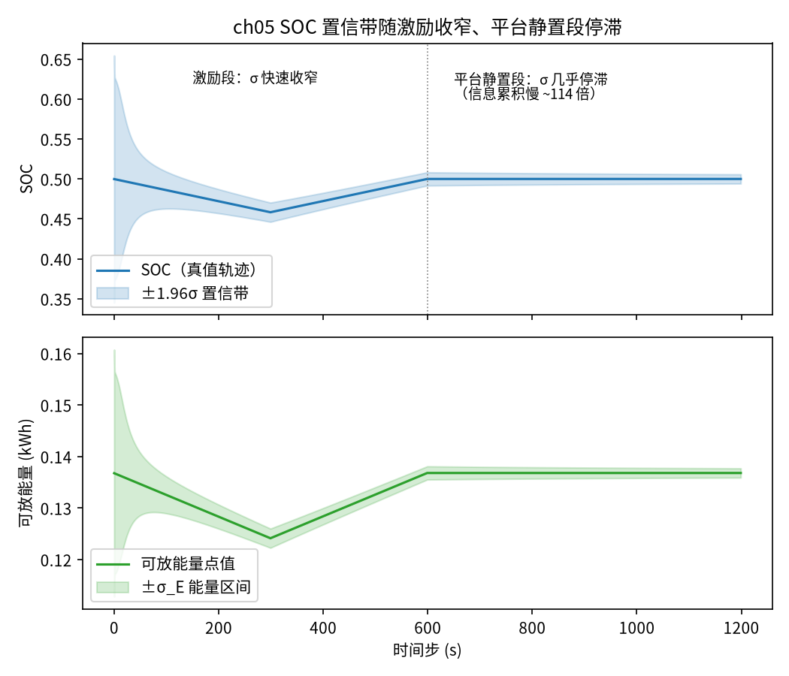

<!-- @AI_GENERATED -->
# 05 估计不确定度量化及其向可用能量与功率的传播

**一句话**：EKF 不只给一个 SOC 数字，还给一个"我有多确定"的协方差；把它开方成 SOC 的标准差，再乘容量和效率，就得到可用能量的误差范围——于是调度申报可以用"有把握的下界"，而不是赌一个单点值。

## 本章目标

读完本章，你应能：

1. 从 EKF 协方差矩阵 P 取出 SOC 的标准差 σ_SOC，理解它代表什么；
2. 把 σ_SOC 传播到可用能量，得到能量的 ±σ 置信区间；
3. 理解为什么调度申报应该用"置信下界"而不是点估计；
4. 用"σ 每步收窄速率"刻画可观测性：激励段 σ 快速收窄，平台静置段几乎停滞。

## 本章边界与前置

本章紧接第 04 篇的 EKF——它输出的协方差 P 是本章的原料。前置：第 04 篇的 EKF 结构、第 02 篇的可观测性。本章把"可用能量""功率能力"这些 EMS 概念当作已知的业务目标（它们是"当前 SOC 能对外提供多少 kWh / kW"），重点是给这些量**配上误差范围**，而不是重新推导它们本身。

## 现场场景：报一个数，还是报一个范围

调度要储能申报"晚峰能放多少电"。运维看 BMS：SOC 估计 50%，按容量算可放约 0.137 kWh（单体口径示例）。于是报 0.137。

但这个 50% 是 EKF 估出来的，它自己"心里"清不清楚有多准？如果此刻 EKF 的 σ_SOC 是 0.5%（刚经过陡峭区，很有把握），那 0.137 基本可信；如果 σ_SOC 是 8%（刚上电、还没收敛），那真实可放量可能在 0.11～0.16 kWh 之间晃——报 0.137 就是在赌。

成熟的做法是**把不确定度一起报**：不是"能放 0.137"，而是"能放 0.137 ± 0.024，有把握的下界是 0.113"。调度按下界安排，就不会因为 SOC 估高了而在晚峰放不出申报的量（那是要考核的）。这一篇就是把 EKF 的协方差，翻译成这个"±"和"下界"。

## 原理直觉：方差开方是标准差，误差按链路放大

EKF 的协方差 P 是个 2×2 矩阵，对角线是两个状态各自的方差：P[0,0] 是 SOC 的方差，P[1,1] 是 V1 的方差。方差开方就是标准差：

```text
σ_SOC = √P[0,0]
```

σ_SOC 就是"EKF 认为 SOC 真值大约在 估计值 ± σ_SOC 范围内"（一倍标准差约 68% 置信，1.96 倍约 95%）。

可用能量是 SOC 乘一串系数（容量、效率、减去下限）。SOC 有个 ±σ_SOC 的抖动，能量就有个对应的 ±σ_E 抖动，按同样的系数放大：

```text
E     = (SOC − SOC_min) × C_kWh × η       能量点值
σ_E   ≈ C_kWh × η × σ_SOC                  能量标准差（线性传播）
```

这就是**不确定度传播**最朴素的形式：输出的标准差 = 输入的标准差 × 这条链路的放大系数。

> **软件类比**：像给一个计算结果带上误差棒。上游测量有 ±ε 的误差，经过一个线性变换 y=k·x，误差就变成 ±k·ε。监控里报 P99 延迟而不只报均值，是同一个思想——决策要看分布，不能只看点。

## 公式与符号

```text
σ_SOC = √P[0,0]
E     = max(0, SOC − SOC_min) × C_kWh × η_dis
σ_E   = C_kWh × η_dis × σ_SOC
申报下界 = E − σ_E   （或 E − 1.96·σ_E 要更高置信）
```

| 符号 | 含义 | 单位 | 示例值 |
|---|---|---|---|
| `P[0,0]` | EKF 协方差中 SOC 的方差 | — | 随收敛下降 |
| `σ_SOC` | SOC 标准差 | 单位 SOC | 0.079→0.003 |
| `C_kWh` | 单体能量口径容量 = 100Ah×3.2V/1000 | kWh | 0.32 |
| `η_dis` | 放电路径效率 | — | 0.95 |
| `SOC_min` | 放电下限 | — | 0.05 |
| `σ_E` | 可放能量标准差 | kWh | 随 σ_SOC 缩放 |

要点：

- **σ_SOC 来自 EKF 自身**，不是外部假设——这是卡尔曼滤波比规则法强的地方：它一边估状态、一边估"自己有多准"；
- **传播是线性缩放**：能量误差 = SOC 误差 × (C_kWh×η)。这里 C_kWh×η ≈ 0.304，所以 σ_SOC=0.003 对应 σ_E≈0.0009 kWh；
- **申报用下界**是风险控制：宁可报少、不可报多放不出。

## step-by-step 数值校核：从协方差到申报下界

取收敛后某步 P[0,0]=9e-6（EKF 输出），SOC 估计=0.50，C_kWh=0.32，η=0.95，SOC_min=0.05。

**第 1 步：协方差 → SOC 标准差**

```text
σ_SOC = √P[0,0] = √(9e-6) = 0.003  （即 ±0.3% SOC）
```

**第 2 步：SOC → 可用能量点值**

```text
E = (0.50 − 0.05) × 0.32 × 0.95 = 0.45 × 0.304 = 0.1368 kWh
```

**第 3 步：标准差传播到能量**

```text
σ_E = C_kWh × η × σ_SOC = 0.32 × 0.95 × 0.003 = 0.304 × 0.003 = 0.000912 kWh
```

**第 4 步：保守申报下界**

```text
下界 = E − σ_E = 0.1368 − 0.0009 = 0.1359 kWh   （1σ）
更保守（1.96σ）= 0.1368 − 1.96×0.0009 = 0.1350 kWh
```

四步从一个方差标量，一路算到"敢向调度承诺的数"。σ_SOC 越小（EKF 越有把握），下界越贴近点值、可申报的越多；σ_SOC 大时下界明显缩水，自动变保守。

## 多步状态追踪：σ 随工况的变化

剖面是"充放激励 600 步 → 平台区静置 600 步"。看 σ_SOC 和能量区间怎么变（真实输出）：

```text
    步    真值SOC     σ_SOC    可放(kWh)     ±σ_E
    0   0.4999   0.07887     0.1368   0.0240
   50   0.4929   0.01990     0.1346   0.0061
  299   0.4583   0.00614     0.1241   0.0019
  599   0.5000   0.00424     0.1368   0.0013
  900   0.5000   0.00343     0.1368   0.0010
 1199   0.5000   0.00297     0.1368   0.0009
σ 每步收窄：激励段 2.42e-04 / 步，平台静置段 2.12e-06 / 步（慢 114 倍）
```

逐行读：

- **步 0→50**：σ_SOC 从 0.079 暴跌到 0.020，能量区间 ±σ_E 从 0.024 缩到 0.006——充放电激励期间，电压不断带来 SOC 信息，EKF 迅速变有把握；
- **步 50→299**：继续收窄到 0.006，放缓但仍在降；
- **步 599→1199（平台静置段）**：σ_SOC 从 0.0042 缓慢挪到 0.0030，600 步才降这么一点点；
- **最后一行是关键**：σ 每步收窄速率，激励段 2.42e-4、平台静置段 2.12e-6——**慢了 114 倍**。

这就是可观测性的量化刻画，比"σ 停住了"更准确：**平台静置时信息不是完全不累积，而是累积得极慢（慢两个数量级）。** 对应第 02 篇平台区斜率只有陡峭区 1/30 的结论——斜率小，每步电压里的 SOC 信息就少，σ 自然降得慢。所以：想让 SOC 估得更准，要么用更好的传感器，要么安排电池经过陡峭区或充分充放，干等静置没用。



图中标注对照表：

| 编号 | 位置 | 标注 | 对应正文 |
|---|---|---|---|
| ① | 上图阴影带 | ±1.96σ 置信带 | SOC 估计的 95% 置信范围 |
| ② | 上图左段 | 激励段 σ 快速收窄 | 充放电期间电压信息丰富 |
| ③ | 上图右段 | 平台静置段 σ 几乎停滞 | 每步收窄速率慢 114 倍 |
| ④ | 下图能量带 | ±σ_E 能量区间 | σ_SOC 经 C×η 缩放得到 |

## 教学闭环代码

```python
import math
import random

# ── 统一示例参数（§4A）─────────────
C_AH = 100.0
R0_OHM = 1.0e-3
R1_OHM = 0.8e-3
C1_F = 20000.0
TAU_S = R1_OHM * C1_F
DT_S = 1.0
SOC0_TRUE = 0.50
SOC0_EST = 0.70
SOC_MIN = 0.05            # 放电下限
V_NOMINAL = 3.2           # LFP 标称单体电压（能量口径换算用）
ETA_DIS = 0.95            # 放电路径效率
OCV_SOC = (0.00, 0.05, 0.10, 0.20, 0.30, 0.40, 0.50, 0.60, 0.70, 0.80, 0.90, 0.95, 1.00)
OCV_V   = (2.90, 3.10, 3.20, 3.25, 3.275, 3.29, 3.30, 3.31, 3.325, 3.33, 3.34, 3.36, 3.45)
C_KWH = C_AH * V_NOMINAL / 1000.0   # 单体能量口径容量 ≈ 0.32 kWh


def interp(x, xs, ys):
    if x <= xs[0]:
        return ys[0]
    for i in range(1, len(xs)):
        if x <= xs[i]:
            return ys[i - 1] + (x - xs[i - 1]) / (xs[i] - xs[i - 1]) * (ys[i] - ys[i - 1])
    return ys[-1]


def ocv(soc):
    return interp(soc, OCV_SOC, OCV_V)


def docv(soc, h=1e-3):
    lo, hi = max(soc - h, 0.0), min(soc + h, 1.0)
    return (ocv(hi) - ocv(lo)) / (hi - lo)


A_RC = math.exp(-DT_S / TAU_S)


def truth_step(soc, v1, i_a):
    v1n = v1 * A_RC + i_a * R1_OHM * (1 - A_RC)
    socn = soc - i_a * DT_S / (3600.0 * C_AH)
    return ocv(soc) - i_a * R0_OHM - v1, socn, v1n


def ekf_step(soc, v1, P, i_a, v_meas, q_soc=1e-10, q_v1=1e-8, r_meas=1e-4):
    soc_p = soc - i_a * DT_S / (3600.0 * C_AH)
    v1_p = v1 * A_RC + i_a * R1_OHM * (1 - A_RC)
    p00 = P[0][0] + q_soc
    p01 = P[0][1] * A_RC
    p10 = P[1][0] * A_RC
    p11 = P[1][1] * A_RC * A_RC + q_v1
    h0, h1 = docv(soc_p), -1.0
    y = v_meas - (ocv(soc_p) - i_a * R0_OHM - v1_p)
    s = h0 * (p00 * h0 + p01 * h1) + h1 * (p10 * h0 + p11 * h1) + r_meas
    k0 = (p00 * h0 + p01 * h1) / s
    k1 = (p10 * h0 + p11 * h1) / s
    soc_n = soc_p + k0 * y
    v1_n = v1_p + k1 * y
    p00n = (1 - k0 * h0) * p00 + (-k0 * h1) * p10
    p01n = (1 - k0 * h0) * p01 + (-k0 * h1) * p11
    p10n = (-k1 * h0) * p00 + (1 - k1 * h1) * p10
    p11n = (-k1 * h0) * p01 + (1 - k1 * h1) * p11
    return soc_n, v1_n, [[p00n, p01n], [p10n, p11n]]


def soc_sigma(P):
    """SOC 标准差 = √P[0,0]。"""
    return math.sqrt(max(0.0, P[0][0]))


def energy_band(soc, sigma_soc):
    """可放能量点值与 ±σ 区间（kWh）。σ_E ≈ C_kWh·η·σ_SOC。"""
    e = max(0.0, soc - SOC_MIN) * C_KWH * ETA_DIS
    se = C_KWH * ETA_DIS * sigma_soc
    return e, se


def run(seed=0, v_noise=0.002):
    """前段充分激励（充放），后段平台区静置，观察 σ 变化。返回逐步 (soc_true, sigma)。"""
    rng = random.Random(seed)
    profile = ([50.0] * 300 + [-50.0] * 300) + [0.0] * 600   # 激励 → 静置
    soc_t, v1_t = SOC0_TRUE, 0.0
    soc_e, v1_e, P = SOC0_EST, 0.0, [[1e-2, 0.0], [0.0, 1e-4]]
    sig_log, soc_log = [], []
    for i_a in profile:
        v_t, soc_t, v1_t = truth_step(soc_t, v1_t, i_a)
        v_meas = v_t + rng.gauss(0.0, v_noise)
        soc_e, v1_e, P = ekf_step(soc_e, v1_e, P, i_a, v_meas)
        sig_log.append(soc_sigma(P))
        soc_log.append(soc_t)
    return soc_log, sig_log


def test_ch05():
    soc_log, sig = run()
    # 激励段 σ 大幅下降（初值不确定被充放电期间的电压信息快速压缩）
    assert sig[299] < sig[0] * 0.5, (sig[0], sig[299])
    # 平台区静置段：σ 仍在降，但"每步收窄速率"比激励段骤降 10 倍以上——
    # 这才是可观测性差的正确刻画：平台静置时信息累积极慢，而非 σ 完全不动。
    rate_excite = (sig[0] - sig[299]) / 300.0    # 激励段每步平均降幅
    rate_rest = (sig[599] - sig[1199]) / 600.0   # 平台静置段每步平均降幅
    assert rate_rest < rate_excite / 10.0, (rate_rest, rate_excite)
    # 能量区间非负、下界 ≤ 点值
    e, se = energy_band(soc_log[-1], sig[-1])
    assert e >= 0 and e - se <= e


def main():
    soc_log, sig = run()
    print(f"{'步':>5}{'真值SOC':>9}{'σ_SOC':>10}{'可放(kWh)':>11}{'±σ_E':>9}")
    for k in (0, 50, 299, 599, 900, 1199):
        e, se = energy_band(soc_log[k], sig[k])
        print(f"{k:>5}{soc_log[k]:>9.4f}{sig[k]:>10.5f}{e:>11.4f}{se:>9.4f}")
    rate_excite = (sig[0] - sig[299]) / 300.0
    rate_rest = (sig[599] - sig[1199]) / 600.0
    print(f"σ 每步收窄：激励段 {rate_excite:.2e} / 步，平台静置段 {rate_rest:.2e} / 步"
          f"（慢 {rate_excite / rate_rest:.0f} 倍）")
    test_ch05()
    print("自检通过")


if __name__ == "__main__":
    main()
```

运行输出：

```text
    步    真值SOC     σ_SOC    可放(kWh)     ±σ_E
    0   0.4999   0.07887     0.1368   0.0240
   50   0.4929   0.01990     0.1346   0.0061
  299   0.4583   0.00614     0.1241   0.0019
  599   0.5000   0.00424     0.1368   0.0013
  900   0.5000   0.00343     0.1368   0.0010
 1199   0.5000   0.00297     0.1368   0.0009
σ 每步收窄：激励段 2.42e-04 / 步，平台静置段 2.12e-06 / 步（慢 114 倍）
自检通过
```

动手改一改：

- 把静置段 SOC 改到低端陡峭区（例如先放到 10% 再静置），会发现 σ 在静置段也能继续明显下降——陡峭区即使静置，电压里仍有 SOC 信息；
- 把 `v_noise` 调大到 0.01，σ 的地板抬高，能量区间变宽——传感器越差，不确定度越大。

## 工程实现与边界

- 本章用**线性传播**（σ_E = 系数 × σ_SOC），只在系数近似恒定时准确。若把 OCV 非线性也算进能量，严格做法是用协方差经雅可比传播，教学上线性已够；
- σ_SOC 的可信度取决于 Q、R 设得合不合理。Q/R 失调时，EKF 可能"过度自信"（σ 偏小但实际误差大）——工程上要用真实数据回归校验 Q、R；
- 向调度申报用几倍 σ（1σ/1.96σ/3σ）是风险偏好问题，按考核规则和项目要求定。

## 常见误区

| 误区 | 正确理解 |
|---|---|
| EKF 只输出 SOC 一个数 | 它同时输出协方差 P，代表对估计的置信度；σ_SOC=√P[0,0] |
| σ 变小就一定估得准 | Q/R 失调时 EKF 会"假自信"，σ 小但真实误差大；要用真实数据校验 |
| 静置久一点 SOC 就能估准 | 平台区静置时 σ 收窄极慢（本例慢 114 倍）；要准得靠激励或经过陡峭区 |
| 申报用点估计就行 | 点估计赌 SOC 恰好准；用置信下界才能避免放不出申报量被考核 |

## 本章自测

1. EKF 某步 P[0,0]=4e-4。σ_SOC 是多少？按 C_kWh=0.32、η=0.95，σ_E 是多少 kWh？
2. 为什么平台区静置时 σ_SOC 收窄得特别慢？用第 02 篇的斜率解释。
3. 调度考核"申报了放不出要罚"，你会用点估计 E 还是下界 E−1.96σ_E 申报？为什么？

<details>
<summary>参考答案</summary>

1. σ_SOC = √(4e-4) = 0.02（2%）。σ_E = 0.32×0.95×0.02 = 0.304×0.02 = 0.00608 kWh。
2. σ 的收窄靠电压带来的 SOC 信息，信息量正比于量测雅可比 H0=dOCV/dSOC。平台区斜率只有陡峭区约 1/30，每步能榨出的 SOC 信息极少，所以 σ 降得极慢（本例慢 114 倍）。
3. 用下界 E−1.96σ_E。点估计 E 有约一半概率偏高，偏高就放不出、要被罚；用 95% 置信下界申报，放不出的概率降到约 2.5%，更稳妥。代价是申报量略少，但避免考核损失。

</details>

下一篇：进入支柱二。前面都把电池当成一个整体，现在拆开看——一组电芯里，它们的 SOC 会各走各路，这就是单体不一致性。

<!-- @AI_GENERATED: end -->
