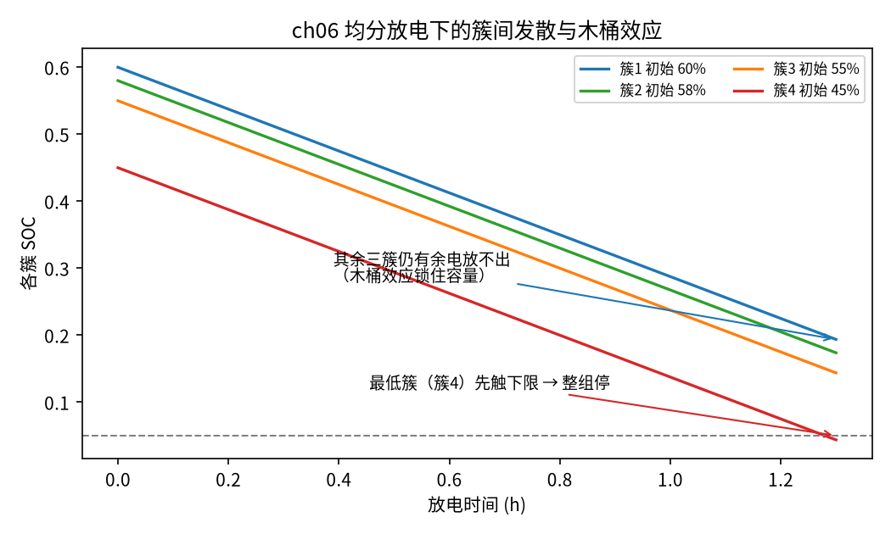
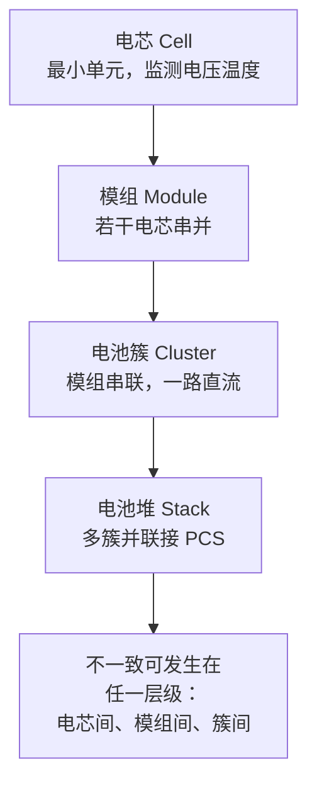

<!-- @AI_GENERATED -->
# 06 电池组单体不一致性机理与量化评估

**一句话**：一组串并联的电芯不会步调一致——容量、内阻、自放电各有差异，放电时最低的那一簇先到下限、整组就得停，于是一大部分电量被"锁"在其他簇里放不出来，这就是木桶效应。

## 本章目标

读完本章，你应能：

1. 说出单体不一致性的主要来源（容量分散、内阻分散、自放电、温度分布）；
2. 用极差、标准差量化一组电芯的 SOC 离散程度；
3. 计算木桶效应下的实际可用容量，并说明"按平均 SOC 估"会高估多少；
4. 理解为什么放电规划要看最低簇、充电规划要看最高簇。

## 本章边界与前置

前五篇把电池当成**一个**对象估 SOC；本章开始拆开看**一组**电芯。前置：SOC 概念、安时积分。本章只讲不一致性的**机理和量化**——它为什么发生、怎么度量、对可用容量有多大影响；至于怎么"治"（均衡），是第 07 篇的事。本章不涉及单体级的 SOC 估计（每个单体理论上都能跑一个第 04 篇的 EKF，但工程上通常只在簇级估计、单体级看电压），聚焦"差异"本身。

## 现场场景：平均 50%，却提前放空

一个电池簇，BMS 报堆级平均 SOC 54.5%，运维按"还能放到下限 5%"估算可放电量，安排了晚峰放电。结果放到一半，BMS 报某个单体欠压、禁止放电，整簇停机——实际放出的电量比估算少了近 1/4。

复盘发现：这组电芯 SOC 并不齐，最低的一簇只有 45%，最高的 60%。放电时四簇电流均分、掉得一样快，最低那簇最先触到 5% 下限，BMS 为保护它就停了整簇——此时其他三簇还各剩百分之十几的电，放不出来。**用平均 54.5% 估算，等于假装这些电都能用，必然高估。** 这一篇把这个高估量算清楚。

## 原理直觉：一串水桶，最矮的那块板决定水位

把并联的电芯组想成几个底部连通的水桶一起放水：

- 它们一起放、水位一起降（电流均分，SOC 掉得一样快）；
- 但起始水位不同（初始 SOC 不同）；
- **最低的那个桶先见底**（最低簇先到放电下限），此刻连通阀门必须关（BMS 停整簇），否则那个桶会被抽干（单体过放损坏）；
- 关阀时，其他桶里还有水，但放不出来了。

所以"整组还能放多少"由**最低的那一簇**决定，不是平均。充电时反过来——**最高的那一簇**先到充电上限，决定还能充多少。平均值只描述"总共有多少水"，不描述"能连续放出多少"。

不一致从哪来？容量不同（有的桶大有的桶小）、内阻不同（放电时压降不同，掉得快慢有别）、自放电不同（有的桶底在漏水）、温度分布不均（舱内不同位置温度不同，影响容量和内阻）。这些差异会随循环累积、放大。

> **软件类比**：像一个并行任务屏障（barrier）。N 个 worker 并行跑，整批的完成时间由**最慢的那个**决定，不是平均耗时；最快的几个早早跑完也只能干等。把"最慢 worker"换成"最低 SOC 簇"，就是木桶效应。

## 公式与符号

```text
极差     = max(SOC_i) − min(SOC_i)
标准差   = √( Σ(SOC_i − 均值)² / N )
按最低簇可放 = N × max(0, min(SOC_i) − SOC_min) × C_each    ← 木桶效应的实际值
按平均可放   = N × max(0, 均值 − SOC_min) × C_each          ← 高估
```

| 符号 | 含义 | 单位 | 示例值 |
|---|---|---|---|
| `SOC_i` | 第 i 簇 SOC | — | 0.60, 0.58, 0.55, 0.45 |
| `N` | 簇数 | — | 4 |
| `C_each` | 每簇能量口径容量 | kWh | 0.32 |
| `SOC_min` | 放电下限 | — | 0.05 |

要点：

- **电流均分假设下**，可放电量由 `min(SOC_i)` 决定，可充电量由 `max(SOC_i)` 决定；
- **平均值描述"总储量"，不描述"可连续放出量"**——两者的差就是被木桶效应锁住的电量；
- 极差和标准差都量化离散度，极差对单个异常簇更敏感，标准差反映整体分散。

## step-by-step 数值校核：高估量从哪来

统一示例 4 单体组 SOC=[0.60, 0.58, 0.55, 0.45]，每簇 C=0.32 kWh，下限 0.05。

**第 1 步：离散度指标**

```text
均值 = (0.60+0.58+0.55+0.45)/4 = 2.18/4 = 0.545
极差 = 0.60 − 0.45 = 0.15（15%）
标准差 = √[((0.055)²+(0.035)²+(0.005)²+(0.095)²)/4]
       = √[(0.003025+0.001225+0.000025+0.009025)/4]
       = √(0.0133/4) = √0.003325 = 0.0577（5.77%）
```

**第 2 步：两种口径的可放电量**

```text
按最低簇 = 4 × (0.45 − 0.05) × 0.32 = 4 × 0.40 × 0.32 = 0.512 kWh
按平均   = 4 × (0.545 − 0.05) × 0.32 = 4 × 0.495 × 0.32 = 0.6336 kWh
```

**第 3 步：高估量**

```text
高估 = 0.6336 − 0.512 = 0.1216 kWh
高估比例 = 0.1216 / 0.512 = 23.8%
```

两步一减就看清：按平均估比按最低簇估多出 23.8%。这 0.12 kWh 不是真放不出的电，而是**被锁在高 SOC 簇里、因最低簇先触限而放不出**的电。要释放它，就得做均衡（第 07 篇）。

## 多步状态追踪：均分放电到停机

4 簇均分放电，每步掉得一样快，看谁先触限（真实输出）：

```text
初始：极差 15.0%  标准差 5.77%  平均 54.5%
按最低簇可放 0.512 kWh | 按平均可放 0.634 kWh（高估）
实际放出 0.520 kWh，停机时各簇 SOC = [0.194, 0.174, 0.144, 0.044]
```

逐项读：

- **实际放出 0.520 kWh**，和"按最低簇估"的 0.512 几乎一致（0.008 的差是离散步长的过冲）——证明木桶效应下实际可放确实由最低簇决定；
- **停机时各簇 SOC = [0.194, 0.174, 0.144, 0.044]**：最低的簇 4 掉到 0.044 触下限停机，而簇 1 还剩 0.194——**三簇合计约 0.14+0.17+0.19=0.5 的 SOC 空间放不出**；
- 按平均估的 0.634 比实际多报 0.11 kWh，正是这些被锁住的电。

这解释了现场场景：平均 54.5% 看着能放很多，实际最低簇一拖后腿，放出的比预期少近 1/4。



图中标注对照表：

| 编号 | 位置 | 标注 | 对应正文 |
|---|---|---|---|
| ① | 四条下行曲线 | 簇1–簇4 SOC 轨迹 | 均分放电，各簇平行下降但起点不同 |
| ② | 最低曲线触及虚线 | 最低簇（簇4）先触下限 | 簇 4 到 5% 时整组停 |
| ③ | 其余三簇终点 | 仍有余电放不出 | 木桶效应锁住的电量 |
| ④ | 底部虚线 | 放电下限 5% | BMS 停整组的保护线 |

成组结构（不一致可能出现在任一层级）：



## 教学闭环代码

```python
# ── 统一示例参数（§4A）─────────────
PACK_SOC0 = [0.60, 0.58, 0.55, 0.45]   # 4 单体初始 SOC（与木桶效应示例呼应）
CAP_KWH_EACH = 0.32                     # 每簇能量口径容量（100 Ah × 3.2 V）
SOC_MIN = 0.05
P_EACH_KW = 0.1                         # 每簇放电功率（均分）
DT_H = 0.1                              # 仿真步长 h


def spread(socs):
    """极差与标准差。"""
    n = len(socs)
    mean = sum(socs) / n
    rng = max(socs) - min(socs)
    std = (sum((s - mean) ** 2 for s in socs) / n) ** 0.5
    return rng, std, mean


def usable_by_min(socs):
    """木桶效应：电流均分时整组可放 = 最低簇决定。"""
    return len(socs) * max(0.0, min(socs) - SOC_MIN) * CAP_KWH_EACH


def usable_by_mean(socs):
    """错误口径：按平均 SOC 估（高估）。"""
    _, _, mean = spread(socs)
    return len(socs) * max(0.0, mean - SOC_MIN) * CAP_KWH_EACH


def simulate():
    """均分放电到最低单体触限。返回 (delivered_kwh, 停机时各簇 SOC)。"""
    socs = list(PACK_SOC0)
    delivered = 0.0
    while min(socs) > SOC_MIN + 1e-9:
        socs = [s - P_EACH_KW * DT_H / CAP_KWH_EACH for s in socs]
        delivered += P_EACH_KW * len(socs) * DT_H
    return delivered, socs


def test_ch06():
    # 木桶效应：按平均估 > 按最低簇估（高估）
    assert usable_by_mean(PACK_SOC0) > usable_by_min(PACK_SOC0)
    # 实际放出 ≈ 按最低簇估（电流均分，最低簇先到下限）
    delivered, _ = simulate()
    assert abs(delivered - usable_by_min(PACK_SOC0)) < 0.05 * usable_by_min(PACK_SOC0)
    # 极差与均值正确
    rng, std, mean = spread(PACK_SOC0)
    assert abs(rng - 0.15) < 1e-9 and abs(mean - 0.545) < 1e-9


def main():
    rng, std, mean = spread(PACK_SOC0)
    print(f"初始：极差 {rng:.1%}  标准差 {std:.2%}  平均 {mean:.1%}")
    print(f"按最低簇可放 {usable_by_min(PACK_SOC0):.3f} kWh"
          f" | 按平均可放 {usable_by_mean(PACK_SOC0):.3f} kWh（高估）")
    delivered, socs_stop = simulate()
    print(f"实际放出 {delivered:.3f} kWh，停机时各簇 SOC = "
          f"{[round(s, 3) for s in socs_stop]}")
    test_ch06()
    print("自检通过")


if __name__ == "__main__":
    main()
```

运行输出：

```text
初始：极差 15.0%  标准差 5.77%  平均 54.5%
按最低簇可放 0.512 kWh | 按平均可放 0.634 kWh（高估）
实际放出 0.520 kWh，停机时各簇 SOC = [0.194, 0.174, 0.144, 0.044]
自检通过
```

动手改一改：

- 把初始 SOC 改成全部相等 `[0.55]*4`，按平均和按最低簇的估算会完全一致——没有不一致就没有木桶损失；
- 把极差拉大到 `[0.70, 0.60, 0.50, 0.40]`，高估比例会更大——离散越严重，锁住的电越多，越需要均衡；
- 给每簇不同容量（模拟容量分散），改 `usable` 用各簇自己的容量，观察充电方向由最高簇决定。

## 工程实现与边界

- 本章用**电流均分**假设（各簇并联、分流相等）。真实系统中内阻不同会导致分流不均，低内阻簇分到更多电流、掉得更快，使情况更复杂；
- 实际 BMS 的堆级 SOC 算法各厂不同（有的报平均、有的接近满充时报最高簇、接近放空时报最低簇），接入时要问清口径；
- 本章只量化"差异有多大、锁住多少电"，不涉及单体级 SOC 估计——工程上单体通常只监测电压，簇级才跑估计器。

## 常见误区

| 误区 | 正确理解 |
|---|---|
| 堆级 SOC 用平均值规划放电 | 电流均分时放电看最低簇、充电看最高簇；平均值会高估可放/可充 |
| 不一致只是容量问题 | 容量、内阻、自放电、温度分布都会造成不一致，且相互影响 |
| 极差小就一定一致 | 极差只看最高最低两个；要配合标准差看整体分散，并结合工况（大电流下压差会放大） |
| 被锁住的电是损失掉了 | 它只是暂时放不出，通过均衡把簇间 SOC 拉齐就能释放——这是第 07 篇的事 |

## 本章自测

1. 4 簇 SOC=[0.70, 0.65, 0.60, 0.50]，每簇 0.32 kWh，下限 0.05。按最低簇和按平均各可放多少？高估比例？
2. 为什么充电规划要看最高簇而不是最低簇？
3. 木桶效应锁住的电量是永久损失吗？怎么释放？

<details>
<summary>参考答案</summary>

1. 按最低簇 = 4×(0.50−0.05)×0.32 = 4×0.45×0.32 = 0.576 kWh；均值 = (0.70+0.65+0.60+0.50)/4 = 0.6125，按平均 = 4×(0.6125−0.05)×0.32 = 4×0.5625×0.32 = 0.720 kWh。高估比例 = (0.720−0.576)/0.576 = 25%。
2. 充电时最高簇最先到充电上限，BMS 为保护它停整组充电，此时其他簇还没充满；所以"还能充多少"由最高簇决定。方向和放电相反。
3. 不是永久损失。它只是因为簇间 SOC 不齐、最低簇拖后腿而暂时放不出。通过均衡把各簇 SOC 拉齐（降低极差），最低簇不再过早触限，就能释放这部分电量。

</details>

下一篇：既然不一致锁住了电量，就要把它治好——被动均衡和主动均衡，两种拓扑、两种代价。

<!-- @AI_GENERATED: end -->
