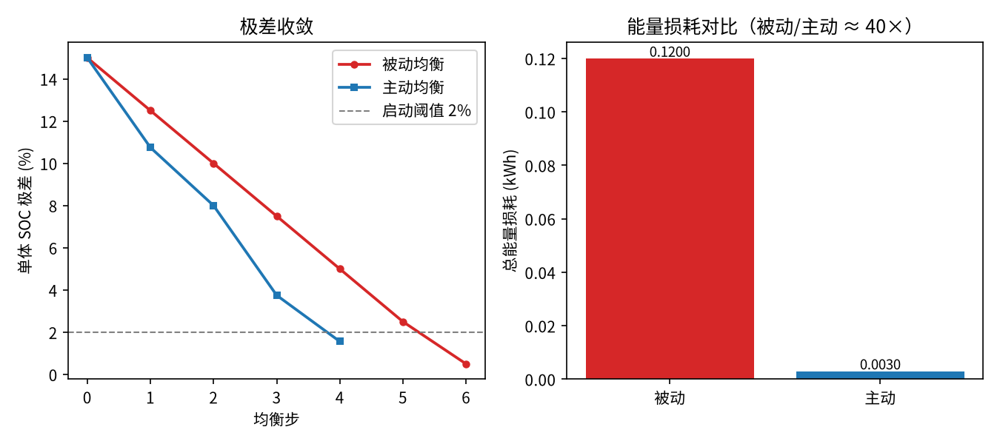
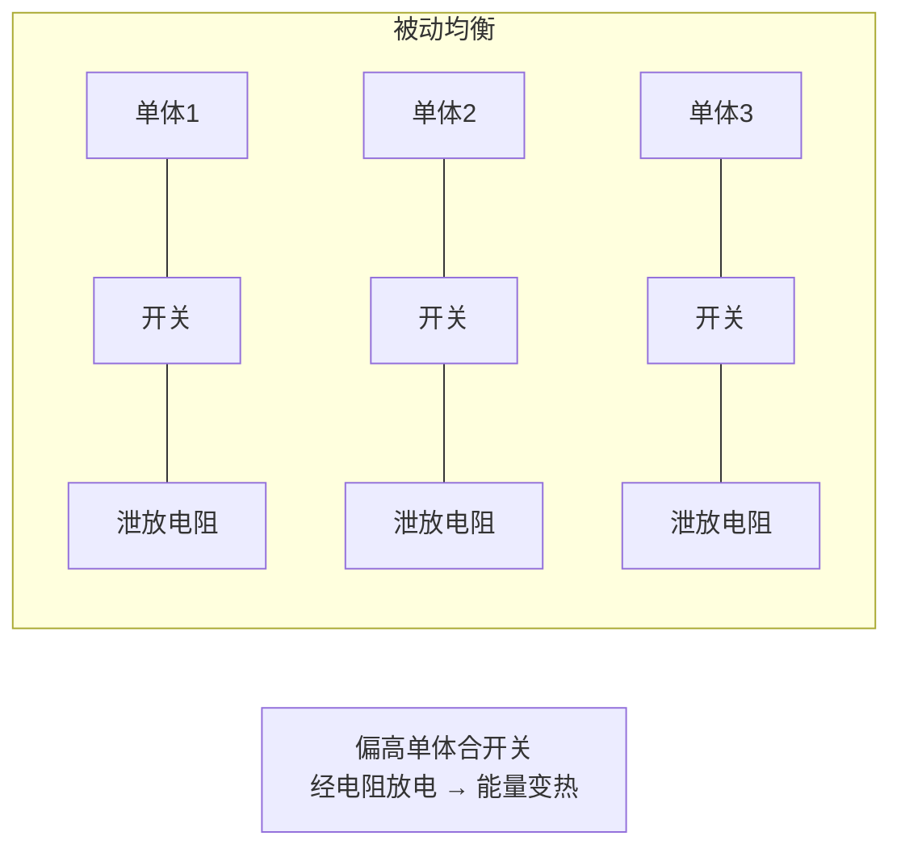
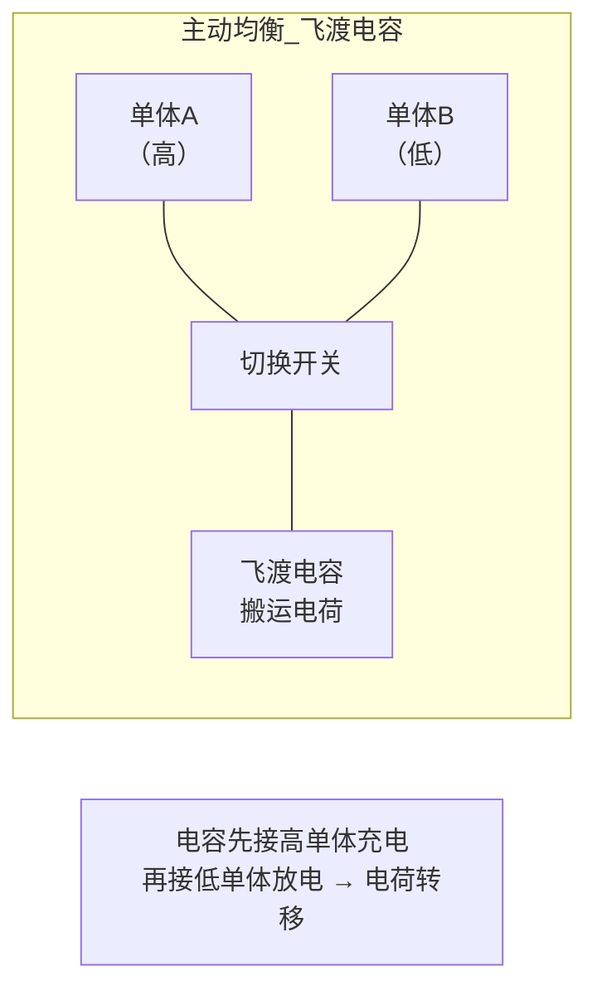
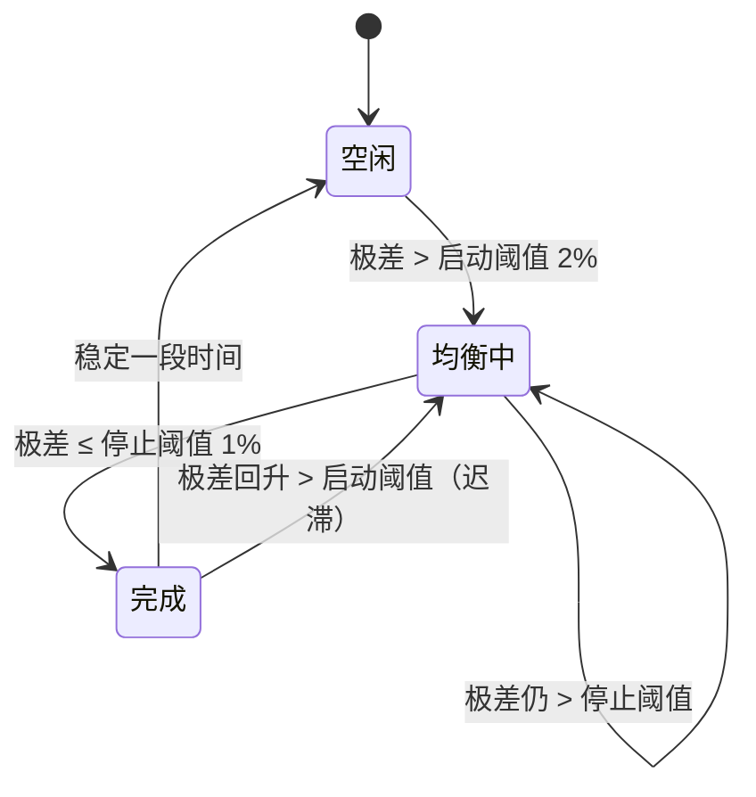

<!-- @AI_GENERATED -->
# 07 被动均衡与主动均衡：拓扑、控制策略与仿真

**一句话**：被动均衡给偏高的单体挂电阻把多余电荷烧成热，简单便宜但费电；主动均衡把高单体的电荷搬到低单体，只损失搬运途中的一点效率，省电但电路复杂——两者都能把 SOC 差拉齐，代价差一个数量级。

## 本章目标

读完本章，你应能：

1. 说清被动均衡和主动均衡的电路原理与本质区别（耗散 vs 转移）；
2. 用均衡判据（极差超过阈值才动作）和均衡电流，估算均衡所需时间；
3. 仿真对比两种均衡把 SOC 极差收敛到阈值的过程，并算出各自的能量损耗；
4. 理解均衡控制为什么要带状态机（启动、执行、完成、迟滞）。

## 本章边界与前置

前置：第 06 篇的单体不一致性与木桶效应。本章讲 EMS/BMS 如何**主动缩小**簇间或单体间的 SOC 差。注意职责边界：真实系统里单体级均衡由 BMS 执行，EMS 一般不直接控制单体通道；本章用仿真展示两种均衡的**机理和代价**，是为了"看懂 BMS 在做什么"，不是让你去写均衡控制器。均衡电流、阈值等都是 `[教学示例]`，现场以电芯特性和厂家定值为准。

## 现场场景：均衡一晚上，为什么只好了一点

第 06 篇那组电池，夜间 BMS 显示"均衡中"。第二天早上看，簇间极差从 15% 降到了 12%——只好了一点点。运维纳闷：均衡了一整晚怎么效果这么小？

答案藏在均衡方式和均衡电流里。如果是**被动均衡**，它只能给偏高的单体放电（挂电阻烧掉），不能给偏低的单体充电，而且均衡电流通常很小（几十到几百 mA，受散热限制）——给一个 100 Ah 的单体降 1% SOC 要搬走 1 Ah，小电流下得好几个小时。四个单体的差异要逐步抹平，一晚上确实只能走一小步。

如果换**主动均衡**、或加大均衡电流，会快得多、也省电得多。这一篇就把两种方式的收敛速度和能量代价仿真出来，让"均衡一晚只好一点"变成可计算的东西。

## 原理直觉：烧掉 vs 搬运

两种均衡的根本区别在于对"多余的电荷"怎么处理：

- **被动均衡（耗散式）**：给 SOC 偏高的单体并联一个电阻，让它单独放一点电，电能变成热散掉。相当于"削高就峰"——把冒头的削平，但削下来的电**浪费了**。电路极简（每单体一个电阻+开关），成本低，是绝大多数储能 BMS 的默认方案。代价是均衡的电都变成热，还增加散热负担。
- **主动均衡（转移式）**：用电容、电感或 DC-DC 变换器，把 SOC 高的单体的电荷**搬到** SOC 低的单体。相当于"劫富济贫"——高的降、低的升，电荷守恒，只损失搬运途中的转换效率（通常 10% 左右）。电路复杂、成本高，但省电、均衡快（可双向、可用大电流）。

一句话：**被动均衡扔掉多余的电，主动均衡把它搬给需要的单体。** 前者简单费电，后者复杂省电。

> **软件类比**：负载均衡里处理热点节点的两种策略。被动均衡像"给过热节点限流/丢弃请求"——简单，但被丢的请求白白损失；主动均衡像"把热点节点的请求迁移到空闲节点"——整体吞吐不浪费，但需要迁移机制和协调开销。

## 公式与符号

```text
均衡判据   极差 = max(SOC_i) − min(SOC_i) > 启动阈值 → 均衡
单步 SOC 变化量  ΔSOC = I_bal·Δt / C          均衡电流搬动的 SOC
被动：高单体 SOC_i −= ΔSOC，耗散能量 = ΔSOC·C·V
主动：高单体 −= ΔSOC，低单体 += ΔSOC·η，损耗 = ΔSOC·(1−η)·C·V
均衡时间 ≈ 待消除的 SOC 差 / (I_bal / C)
```

| 符号 | 含义 | 单位 | 示例值 |
|---|---|---|---|
| `I_bal` | 均衡电流 | A | 5 |
| `C` | 单体容量 | Ah | 100 |
| `V` | 标称电压（能量换算） | V | 3.2 |
| `启动阈值` | 极差超过它才均衡 | — | 0.02（2%） |
| `η` | 主动均衡转移效率 | — | 0.90 |
| `Δt` | 均衡步长 | h | 0.5 |

要点：

- **被动只减不加**：只能把高单体往下拉到最低单体的水平，总电量减少（差额全耗散）；
- **主动有增有减**：高单体放出的电，低单体收到 η 倍，差额 (1−η) 是转移损耗；
- **均衡时间 ∝ SOC 差 / (I_bal/C)**：电流越大、容量越小，均衡越快。小均衡电流是"均衡一晚只好一点"的直接原因。

## step-by-step 数值校核：两种均衡各走一步

统一示例 4 单体 SOC=[0.60, 0.58, 0.55, 0.45]，I_bal=5 A，C=100 Ah，Δt=0.5 h，η=0.90，阈值 2%。单步 ΔSOC = 5×0.5/100 = 0.025（2.5%）。

**第 1 步：被动均衡一步**

最低单体 0.45。高于 0.45+0.02=0.47 的单体（0.60、0.58、0.55）各泄放 ΔSOC=0.025：

```text
簇1: 0.60 − 0.025 = 0.575
簇2: 0.58 − 0.025 = 0.555
簇3: 0.55 − 0.025 = 0.525
簇4: 0.45（最低，不动）
本步耗散能量 = 3 × 0.025 × 100 × 3.2 / 1000 = 3 × 0.008 = 0.024 kWh（全变热）
```

**第 2 步：主动均衡一步（从头开始，对照）**

最高簇1(0.60)、最低簇4(0.45)，差 0.15 > 阈值。转移量 ΔSOC = min(0.025, 0.15/2) = 0.025：

```text
簇1: 0.60 − 0.025 = 0.575      （放出）
簇4: 0.45 + 0.025×0.90 = 0.4725 （收到 90%）
本步损耗 = 0.025 × (1−0.90) × 100 × 3.2 / 1000 = 0.025×0.1×0.32 = 0.0008 kWh
```

两步一对比就看清本质差异：被动一步耗散 0.024 kWh（三个高单体放出的电全烧掉），主动一步只损耗 0.0008 kWh（仅转移途中损失 10%）——**同样朝均衡走一步，被动的能量代价是主动的约 30 倍**。而且主动是"高降低升"，低单体真的被抬起来了；被动只能把高的往下削。

## 多步状态追踪：收敛到阈值的全过程

两种均衡各自反复执行到极差 ≤2%，真实输出：

```text
    方式    步数     总损耗(kWh)      末态极差
    被动     6      0.12000     0.50%
    主动     4      0.00300     1.56%
被动/主动 损耗比 ≈ 40.0×
```

逐项读：

- **被动：6 步、损耗 0.12 kWh**。它只能把 0.60/0.58/0.55 三簇逐步削到最低簇 0.45 附近，削下来的电全变成热——0.12 kWh 没了；
- **主动：4 步、损耗 0.003 kWh**。高簇降、低簇升，两头往中间靠，所以步数更少（双向逼近），损耗只有转移效率那 10%；
- **损耗比 40 倍**：这就是主动均衡贵但值的理由——频繁均衡的场景下，被动均衡烧掉的电费和散热成本会很可观；
- 末态极差被动 0.5%、主动 1.56%，都在 2% 阈值内（离散步长导致停在阈值附近的不同位置，均达标）。



图中标注对照表：

| 编号 | 位置 | 标注 | 对应正文 |
|---|---|---|---|
| ① | 左图红线 | 被动均衡极差曲线 | 6 步收敛，只削高不抬低 |
| ② | 左图蓝线 | 主动均衡极差曲线 | 4 步收敛，高降低升双向逼近 |
| ③ | 左图虚线 | 启动阈值 2% | 极差降到此线以下停止均衡 |
| ④ | 右图柱状 | 总损耗对比（≈40×） | 被动 0.12 kWh vs 主动 0.003 kWh |

被动均衡拓扑（每单体一个泄放电阻+开关）：



主动均衡拓扑（飞渡电容：电容在相邻单体间来回搬电荷）：



均衡控制状态机（带迟滞，防止在阈值附近反复启停）：



## 教学闭环代码

```python
# ── 统一示例参数（§4A）─────────────
PACK_SOC0 = [0.60, 0.58, 0.55, 0.45]
CAP_AH_EACH = 100.0
V_NOMINAL = 3.2
START_THRESHOLD = 0.02     # 极差 > 2% 启动均衡
BAL_CURRENT_A = 5.0        # 均衡电流幅值（A）
DT_H = 0.5                 # 步长 h
ACTIVE_EFF = 0.90          # 主动均衡转移效率


def spread(socs):
    return max(socs) - min(socs)


def passive_step(socs):
    """被动：对高于 (min+阈值) 的单体泄放，电荷变热耗散。返回本步耗散能量 kWh。"""
    lo = min(socs)
    dissipated_kwh = 0.0
    dsoc = BAL_CURRENT_A * DT_H / CAP_AH_EACH    # 本步泄放的 SOC 量
    for i, s in enumerate(socs):
        if s > lo + START_THRESHOLD:
            drop = min(dsoc, s - lo)             # 不低于当前最低
            socs[i] = s - drop
            dissipated_kwh += drop * CAP_AH_EACH * V_NOMINAL / 1000.0
    return dissipated_kwh


def active_step(socs):
    """主动：最高单体电荷转移到最低单体，转移效率 ACTIVE_EFF。返回本步损耗能量 kWh。"""
    hi = max(range(len(socs)), key=lambda i: socs[i])
    lo = min(range(len(socs)), key=lambda i: socs[i])
    if socs[hi] - socs[lo] <= START_THRESHOLD:
        return 0.0
    dsoc = min(BAL_CURRENT_A * DT_H / CAP_AH_EACH, (socs[hi] - socs[lo]) / 2)
    socs[hi] -= dsoc                              # 高单体放出 dsoc
    socs[lo] += dsoc * ACTIVE_EFF                 # 低单体收到 dsoc·η，差额为损耗
    loss_kwh = dsoc * (1 - ACTIVE_EFF) * CAP_AH_EACH * V_NOMINAL / 1000.0
    return loss_kwh


def run(step_fn, max_steps=2000):
    """反复均衡到极差 ≤ 阈值。返回 (步数, 总损耗 kWh, 末态极差)。"""
    socs = list(PACK_SOC0)
    total_loss, steps = 0.0, 0
    while spread(socs) > START_THRESHOLD and steps < max_steps:
        total_loss += step_fn(socs)
        steps += 1
    return steps, total_loss, spread(socs)


def test_ch07():
    s_p, loss_p, rng_p = run(passive_step)
    s_a, loss_a, rng_a = run(active_step)
    # 两者都收敛到阈值以下
    assert rng_p <= START_THRESHOLD + 1e-9 and rng_a <= START_THRESHOLD + 1e-9
    # 被动总损耗 > 主动（能量全耗散 vs 仅转移损耗）
    assert loss_p > loss_a, (loss_p, loss_a)


def main():
    s_p, loss_p, rng_p = run(passive_step)
    s_a, loss_a, rng_a = run(active_step)
    print(f"{'方式':>6}{'步数':>6}{'总损耗(kWh)':>13}{'末态极差':>10}")
    print(f"{'被动':>6}{s_p:>6}{loss_p:>13.5f}{rng_p:>10.2%}")
    print(f"{'主动':>6}{s_a:>6}{loss_a:>13.5f}{rng_a:>10.2%}")
    print(f"被动/主动 损耗比 ≈ {loss_p / max(loss_a, 1e-12):.1f}×")
    test_ch07()
    print("自检通过")


if __name__ == "__main__":
    main()
```

运行输出：

```text
    方式    步数     总损耗(kWh)      末态极差
    被动     6      0.12000     0.50%
    主动     4      0.00300     1.56%
被动/主动 损耗比 ≈ 40.0×
自检通过
```

动手改一改：

- 把 `BAL_CURRENT_A` 从 5 调到 1（更接近真实被动均衡的小电流），步数会大增——这就是"均衡一晚只好一点"的直接原因；
- 把 `ACTIVE_EFF` 从 0.90 降到 0.70（劣质 DC-DC），主动均衡损耗上升，但通常仍远小于被动；
- 把初始极差拉大 `[0.80, 0.60, 0.50, 0.30]`，对比两种方式收敛步数和损耗的差距如何放大。

## 深入：主动均衡的几种拓扑【深入】

<details>
<summary>飞渡电容、电感式、DC-DC 各自的权衡</summary>

主动均衡按"搬运工具"分几类，本章代码用的是最易理解的电荷转移模型，对应现实中：

- **飞渡电容（switched-capacitor）**：一个电容在相邻单体间来回切换，自动把电荷从高单体搬向低单体。电路简单、无需复杂控制，但只能相邻转移、速度受限，适合单体差异不大的场景；
- **电感式（inductor-based）**：用电感做储能中介，可在意两单体间转移，速度快，但每对单体需要开关管，成本上升；
- **DC-DC 变换器式**：每个单体（或模组）接一个双向 DC-DC，能和母线或任意单体交换能量，最灵活、效率可做到较高（90%+），但成本最高，多用于高价值或大容量系统。

共同点：都是"转移"而非"耗散"，损耗来自开关和磁性元件的转换效率（本章用 η=0.90 概括）。选哪种是成本、速度、效率的三方权衡。储能行业目前被动均衡仍占多数（便宜、够用），主动均衡在对寿命和效率要求高的项目中逐渐增多。

</details>

## 常见误区

| 误区 | 正确理解 |
|---|---|
| 均衡就是把所有单体充到一样 | 均衡是缩小 SOC 差；被动只能削高（放电），主动能削高补低（转移） |
| 被动均衡不费电 | 被动均衡把削下来的电全变成热，本例 6 步烧掉 0.12 kWh，还增加散热负担 |
| 主动均衡一定更好 | 主动省电快速但电路复杂、成本高；差异小、均衡不频繁时被动更划算 |
| 均衡阈值越小越好 | 阈值太小会在噪声附近反复启停；要带迟滞（启动阈值 > 停止阈值） |
| 均衡能瞬间完成 | 均衡电流受散热限制通常很小，时间 ∝ SOC 差 / (I_bal/C)，可能要数小时 |

## 本章自测

1. 单体 100 Ah，均衡电流 0.5 A，要消除 3% 的 SOC 差，大约需要多久？
2. 被动均衡把一个单体从 60% 削到 50%（容量 100 Ah、3.2 V），烧掉多少能量？主动均衡把这些电搬给另一单体（η=0.9），损耗多少？
3. 为什么均衡控制状态机的"启动阈值"要大于"停止阈值"？

<details>
<summary>参考答案</summary>

1. 要搬动的电荷 = 3%×100 = 3 Ah，电流 0.5 A，时间 = 3/0.5 = 6 小时。小均衡电流下均衡很慢。
2. 削掉 10% SOC = 10 Ah = 10×3.2/1000 = 0.032 kWh。被动全烧掉 0.032 kWh；主动转移损耗 = 0.032×(1−0.9) = 0.0032 kWh，另 0.0288 kWh 搬给了低单体。
3. 形成迟滞：极差在阈值附近因噪声或小扰动上下波动时，若启动=停止阈值，均衡会频繁开关；启动阈值（2%）高于停止阈值（1%）后，要降到 1% 才停、回升到 2% 才再启，避免抖动。

</details>

下一篇：把估计和均衡合到一起——均衡如何恢复可用容量、估计精度如何影响均衡判据，并对照行业标准看精度要求。

<!-- @AI_GENERATED: end -->
