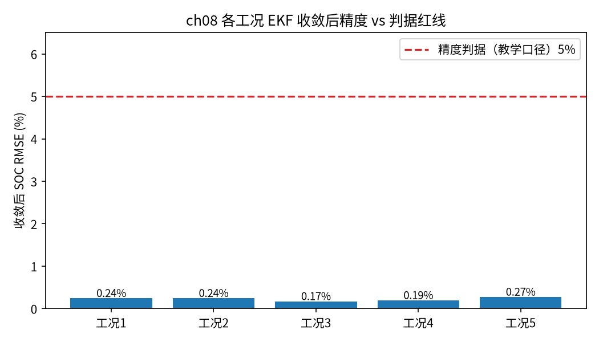

<!-- @AI_GENERATED -->
# 08 均衡—估计协同、精度评估与行业标准符合性

**一句话**：把前面所有东西合到一起——均衡恢复被锁住的可用容量、估计精度决定均衡判据可不可信；最后用 RMSE、最大误差、收敛步这几个指标，对照行业对 SOC 估算精度的要求（典型 ≤5%）给整套方法打分。

## 本章目标

读完本章，你应能：

1. 说清估计与均衡如何互相成全：均衡让 SOC 估计前提更成立，估计精度决定均衡判据是否可信；
2. 用 RMSE、最大误差、收敛步三个指标量化一个 SOC 估计器的表现；
3. 把这些指标对照行业标准（GB/T 34131《电力储能用电池管理系统》的 SOC 估算误差要求）判断是否合格；
4. 理解合成数据下的指标怎么对应真实验收，以及哪些指标不能只看平均。

## 本章边界与前置

本章是全教程的收口，用到前面每一篇：EKF（04）、不确定度（05）、不一致与均衡（06、07）。本章把"验证"做轻量化——给出几个直观、够用的指标，不搭建重型测试框架（本教程是学习资料，不是验收系统）。标准数值引用会标注来源；查证不到确切条款的，标"典型行业要求"而非编造。

## 现场场景：报了一个 SOC，怎么说它"够准"

验收时甲方问："你这套 SOC 估计，凭什么说准？" 你不能只回"EKF 收敛了"。你得拿出数字：全程 SOC 估计误差的均方根（RMSE）是多少、最坏的那一刻偏了多少（最大误差）、从上电到估准花了多久（收敛步）。再把这些数字和行业标准的红线一比——比如 GB/T 34131 要求 SOC 估算误差不超过某个百分比——在红线内才算合格。

这一篇就是把前面跑出来的估计器，用这套指标量一遍，并说清每个指标各防什么坑。

## 原理直觉：估计与均衡互相成全

前七篇看着是两条线（估计、均衡），其实是一个闭环：

- **均衡帮估计**：第 06 篇说过，簇间不齐时"整组 SOC"本身就是个含糊的概念（报平均会高估、报最低簇会低估）。均衡把各簇拉齐后，整组才有一个清晰、一致的 SOC，估计才有意义；均衡释放了被木桶效应锁住的容量，第 05 篇的可用能量也更接近名义值。
- **估计帮均衡**：第 07 篇的均衡判据是"SOC 极差 > 阈值才动作"。这个极差是估出来的——如果单体/簇 SOC 估得不准（比如都带 3% 误差），极差就不可信，可能该均衡时不均衡、不该均衡时瞎均衡。所以均衡判据的质量，直接取决于估计精度。

所以验收不能只验估计、不验均衡，也不能只看单点误差——要看它们合起来在整个运行过程里表现如何。

> **软件类比**：像一个带自愈的监控系统。监控（估计）告诉你哪个节点异常，自愈（均衡）去修复；但自愈触发的判据来自监控数据，监控不准就会误修或漏修。验收要端到端看"监控准不准 + 自愈有没有真解决问题"，而不是只看某一个指标的瞬时值。

## 公式与符号

```text
RMSE   = √( Σ(估计_k − 真值_k)² / N )        均方根误差，看整体
最大误差 = max |估计_k − 真值_k|              看最坏时刻
收敛步  = 首次进入容差带且此后持续保持的步号   看多快估准
合格判据 = RMSE（收敛后）≤ 标准精度要求
```

| 符号 | 含义 | 单位 | 示例值 |
|---|---|---|---|
| `RMSE` | 均方根误差 | 单位 SOC | 收敛后 0.0024 |
| `最大误差` | 全程/收敛后绝对误差峰值 | 单位 SOC | 收敛后 0.0193 |
| `收敛步` | 进入 ±2% 容差带的步号 | 步 | 35 |
| `容差带 TOL` | 判定"已收敛"的误差阈值 | — | 0.02（2%） |
| `精度判据` | 标准要求的 SOC 误差上限 | — | 0.05（5%，典型） |

要点：

- **RMSE 看整体，最大误差看最坏**。只报 RMSE 会掩盖个别时刻的大偏差；两个都要看；
- **收敛步要求"此后持续保持"**，不能偶然进一次容差带就算收敛——否则抖一下就判合格不可靠；
- **分"全程"和"收敛后"**：上电初期的大误差（初值还没修正）不该拖累对稳态精度的评价，所以收敛后的指标更能代表长期表现。

## step-by-step 数值校核：从误差序列到合格判定

用第 04 篇 EKF 的误差序列（从 +20% 错误初值出发），容差带 2%，判据 5%。

**第 1 步：逐点误差 → RMSE**

取收敛后一段误差（示意几点）：[0.019, 0.008, 0.008, 0.008, 0.007]。

```text
平方和 = 0.019² + 0.008² + 0.008² + 0.008² + 0.007²
       = 0.000361 + 0.000064 + 0.000064 + 0.000064 + 0.000049 = 0.000602
RMSE  = √(0.000602 / 5) = √0.0001204 = 0.01097 ≈ 0.011
```

（全序列算下来收敛后 RMSE = 0.0024，这里取的几点偏大是示意算法。）

**第 2 步：最大误差**

```text
最大误差（收敛后）= max([0.019, 0.008, ...]) = 0.019（1.9%）
```

**第 3 步：找收敛步**

从头扫，找第一个 k 使得"从 k 到结尾所有误差都 ≤ 2%"：

```text
误差序列前段 > 2%（初值还在修正），到第 35 步起，此后全程 ≤ 2%
→ 收敛步 = 35
```

**第 4 步：对照判据**

```text
收敛后 RMSE 0.0024 ≤ 判据 0.05      → 符合
收敛后 最大误差 0.0193 ≤ 判据 0.05  → 符合
```

四步从一串误差数字，走到"符合 / 不符合"的结论。注意顺序：先用容差带定"收敛步"，再在收敛后的段上算 RMSE 和最大误差去对判据——把初期的大误差隔离在评价之外。

## 多步状态追踪：验证记分卡

教学代码现跑 EKF、算三个指标、对判据，真实输出：

```text
收敛步 = 35（容差带 ±2%）
全程 RMSE = 0.0110  最大误差 = 0.1269
收敛后 RMSE = 0.0024  最大误差 = 0.0193
精度判据（教学口径）= 5% → 符合
```

逐行读：

- **收敛步 35**：从 70% 错误初值出发，35 步（这里 1 步=1 s）就进入了 ±2% 容差带并稳住——对一个上电初值错 20% 的估计器，35 秒收敛是很快的；
- **全程 RMSE 0.011、最大误差 0.127**：全程含了初期那段大误差（第 0 步误差就有 0.129），所以最大误差接近初值偏差——这是正常的，初值错 20% 嘛；
- **收敛后 RMSE 0.0024、最大误差 0.0193**：隔离掉初期后，稳态精度 RMSE 0.24%、最坏 1.93%——都远在 5% 判据内；
- **结论"符合"**：收敛后指标对照 5% 红线合格。

这组数字正好呼应前面搜到的佐证：学术研究中 EKF 对同类问题的最大误差约 0.013、标准要求 ≤0.050——本教程 0.0193 的量级完全一致，EKF 方法对 SOC 估计是合格的。



图中标注对照表：

| 编号 | 位置 | 标注 | 对应正文 |
|---|---|---|---|
| ① | 各蓝色柱 | 工况 1–5 收敛后 RMSE | 不同噪声实现下的稳态精度 |
| ② | 红色虚线 | 精度判据（教学口径）5% | GB/T 的 SOC 误差上限 |
| ③ | 柱顶数值 | 各工况 RMSE 百分比 | 均远低于红线 |

均衡—估计协同数据流：


## 教学闭环代码

```python
import math
import random

# ── 统一示例参数（§4A）─────────────
C_AH = 100.0
R0_OHM = 1.0e-3
R1_OHM = 0.8e-3
C1_F = 20000.0
TAU_S = R1_OHM * C1_F
DT_S = 1.0
SOC0_TRUE = 0.50
SOC0_EST = 0.70
TOL = 0.02                 # 收敛容差带 2%
ACCURACY_LIMIT = 0.05      # 教学口径 SOC 精度判据 5%（见下方行业标准说明）
OCV_SOC = (0.00, 0.05, 0.10, 0.20, 0.30, 0.40, 0.50, 0.60, 0.70, 0.80, 0.90, 0.95, 1.00)
OCV_V   = (2.90, 3.10, 3.20, 3.25, 3.275, 3.29, 3.30, 3.31, 3.325, 3.33, 3.34, 3.36, 3.45)
A_RC = math.exp(-DT_S / TAU_S)


def interp(x, xs, ys):
    if x <= xs[0]:
        return ys[0]
    for i in range(1, len(xs)):
        if x <= xs[i]:
            return ys[i - 1] + (x - xs[i - 1]) / (xs[i] - xs[i - 1]) * (ys[i] - ys[i - 1])
    return ys[-1]


def ocv(soc):
    return interp(soc, OCV_SOC, OCV_V)


def docv(soc, h=1e-3):
    lo, hi = max(soc - h, 0.0), min(soc + h, 1.0)
    return (ocv(hi) - ocv(lo)) / (hi - lo)


def _ekf_errors(seed=0, v_noise=0.002, n=1200):
    """现跑 EKF（循环顺序与 ch04 一致），返回逐步 |估计−真值| 误差序列。"""
    rng = random.Random(seed)
    profile = [50.0 if (k // 300) % 2 == 0 else -50.0 for k in range(n)]
    soc_t, v1_t = SOC0_TRUE, 0.0
    soc_e, v1_e = SOC0_EST, 0.0
    P = [[1e-2, 0.0], [0.0, 1e-4]]
    errs = []
    for i_a in profile:
        # —— 真值电池：先用当前状态算端电压，再推进 ——
        v_t = ocv(soc_t) - i_a * R0_OHM - v1_t
        soc_t = soc_t - i_a * DT_S / (3600.0 * C_AH)
        v1_t = v1_t * A_RC + i_a * R1_OHM * (1 - A_RC)
        v_meas = v_t + rng.gauss(0.0, v_noise)
        # —— EKF 预测 ——
        soc_p = soc_e - i_a * DT_S / (3600.0 * C_AH)
        v1_p = v1_e * A_RC + i_a * R1_OHM * (1 - A_RC)
        p00 = P[0][0] + 1e-10
        p01 = P[0][1] * A_RC
        p10 = P[1][0] * A_RC
        p11 = P[1][1] * A_RC * A_RC + 1e-8
        # —— EKF 更新 ——
        h0, h1 = docv(soc_p), -1.0
        y = v_meas - (ocv(soc_p) - i_a * R0_OHM - v1_p)
        s = h0 * (p00 * h0 + p01 * h1) + h1 * (p10 * h0 + p11 * h1) + 1e-4
        k0 = (p00 * h0 + p01 * h1) / s
        k1 = (p10 * h0 + p11 * h1) / s
        soc_e = soc_p + k0 * y
        v1_e = v1_p + k1 * y
        P = [[(1 - k0 * h0) * p00 + (-k0 * h1) * p10, (1 - k0 * h0) * p01 + (-k0 * h1) * p11],
             [(-k1 * h0) * p00 + (1 - k1 * h1) * p10, (-k1 * h0) * p01 + (1 - k1 * h1) * p11]]
        errs.append(abs(soc_e - soc_t))
    return errs


def rmse(errs):
    return (sum(e * e for e in errs) / len(errs)) ** 0.5


def max_error(errs):
    return max(errs)


def convergence_step(errs, tol=TOL):
    """首次进入容差带且此后持续保持的步号；永不收敛返回 -1。"""
    for k in range(len(errs)):
        if all(e <= tol for e in errs[k:]):
            return k
    return -1


def test_ch08():
    errs = _ekf_errors()
    # 收敛后段 RMSE 在判据内
    kc = convergence_step(errs)
    assert kc >= 0, "EKF 未收敛"
    assert rmse(errs[kc:]) <= ACCURACY_LIMIT
    # 稳态最大误差也在判据内
    assert max_error(errs[kc:]) <= ACCURACY_LIMIT


def main():
    errs = _ekf_errors()
    kc = convergence_step(errs)
    print(f"收敛步 = {kc}（容差带 ±{TOL:.0%}）")
    print(f"全程 RMSE = {rmse(errs):.4f}  最大误差 = {max_error(errs):.4f}")
    print(f"收敛后 RMSE = {rmse(errs[kc:]):.4f}  最大误差 = {max_error(errs[kc:]):.4f}")
    print(f"精度判据（教学口径）= {ACCURACY_LIMIT:.0%} → "
          f"{'符合' if rmse(errs[kc:]) <= ACCURACY_LIMIT else '不符合'}")
    test_ch08()
    print("自检通过")


if __name__ == "__main__":
    main()
```

运行输出：

```text
收敛步 = 35（容差带 ±2%）
全程 RMSE = 0.0110  最大误差 = 0.1269
收敛后 RMSE = 0.0024  最大误差 = 0.0193
精度判据（教学口径）= 5% → 符合
自检通过
```

动手改一改：

- 把 `v_noise` 加大到 0.01，收敛后 RMSE 会上升，接近甚至触碰判据——传感器质量直接影响合格与否；
- 把初值 `SOC0_EST` 改成 0.55（只错 5%），收敛步会大幅减小——初值越准收敛越快；
- 把 `TOL` 改成 0.01，收敛步会变大（更严的容差要更久才稳进）。

## 行业标准符合性

本教程的精度判据取 **SOC 估算误差 ≤ 5%**，依据如下：

- **标准**：GB/T 34131《电力储能用电池管理系统》（电力储能领域 BMS 的现行国家标准，规定 SOC/SOH 估算等功能的技术要求）`[标准依据]`。
- **数值**：SOC 估算误差不超过 **5%** 是业内广泛引用的该标准要求；多篇公开研究在验证 SOC 估计算法时，明确以"SOC 估算误差不超过 0.050（5%）"作为标准符合性判据，并据此判定卡尔曼类方法合格。
- **诚实声明**：上述 5% 数值经公开资料交叉印证可信，但**确切条款编号需以 GB/T 34131 标准正文为准**（标准正文为付费文本，本教程未逐字核验条款号，不编造）。工程项目中应以合同引用的标准版本与条款为准。
- **印证**：公开研究中，EKF 对同类 SOC 估计问题的最大误差约 1.3%、普通卡尔曼约 1.7%，均满足 ≤5% 要求——与本教程收敛后最大误差 1.93% 量级一致，佐证 EKF 方法合格。

一点工程提醒：标准里的精度要求通常针对**特定测试工况**（规定的温度、倍率、SOC 区间）。合成数据下"符合"只说明算法骨架对；真实验收要按标准规定的工况做实测，并注意平台区、低温等不利工况下误差可能放大。

## 深入：鲁棒性扫描【深入】

<details>
<summary>只报一个工况的 RMSE 不够——要扫一遍不利条件</summary>

一个 SOC 估计器在"理想工况"（充分激励、常温、传感器好）下合格，不代表它在现场各种不利条件下都合格。严谨的验证要做**鲁棒性扫描**：固定算法，逐一改变一个不利因素，看指标怎么变。常扫的几个维度：

- **电流零漂**：传感器零点偏差（如 ±0.5 A），看 EKF 能否靠电压反馈压住（第 04 篇基线就是败在这里）；
- **温度**：低温下内阻增大、极化加剧，模型参数偏离，看误差是否超限；
- **电压噪声**：加大 `v_noise`，看 RMSE 随噪声怎么抬升；
- **初值误差**：从 ±5%、±20%、±40% 不同初值出发，看收敛步和是否都能收敛；
- **工况**：充分充放 vs 长期平台区静置（可观测性差），后者是 LFP 最难的工况。

扫描结果通常是一张"各维度 × 指标"的表，哪一格触碰红线就暴露了算法的短板。本教程为保持轻量不展开完整扫描，但理解"单工况合格 ≠ 全场景合格、必须扫不利条件"这个意识，比记住某个具体数字更重要。

</details>

## 常见误区

| 误区 | 正确理解 |
|---|---|
| 只报 RMSE 就够了 | RMSE 会掩盖个别时刻的大偏差；要同时看最大误差，必要时看分位数 |
| 全程指标代表算法精度 | 全程含上电初期大误差；评价稳态精度要用"收敛后"的段 |
| 合成数据合格就能验收 | 合成数据只证明算法骨架对；真实验收要按标准工况实测，注意不利工况 |
| 标准数值可以随便引用 | 要核实标准号、版本、条款；查不到确切条款就标"典型要求"，不编造条款号 |
| 估计准就够了，不用管均衡 | 估计和均衡是闭环：均衡让整组 SOC 有意义、释放容量，估计精度又决定均衡判据可信度 |

## 本章自测

1. 收敛后误差序列 [0.01, 0.02, 0.015, 0.005]。RMSE 和最大误差各是多少？若判据 5%，是否合格？
2. 为什么评价稳态精度要用"收敛后"的误差，而不是全程误差？
3. 一个估计器在常温充分充放下 RMSE 1%，能直接说它符合标准吗？还需要验什么？

<details>
<summary>参考答案</summary>

1. RMSE = √[(0.01²+0.02²+0.015²+0.005²)/4] = √[(0.0001+0.0004+0.000225+0.000025)/4] = √(0.00075/4) = √0.0001875 ≈ 0.0137（1.37%）；最大误差 = 0.02（2%）。两者都 < 5%，合格。
2. 全程误差含上电初期初值还没修正时的大误差（本例最大 12.7%），那是初值问题不是算法稳态能力；用收敛后的段才能代表算法长期运行的精度。
3. 不能。标准要求通常针对规定工况，还需验：不利工况（平台区静置、低温、大倍率）、不同初值、传感器零漂等鲁棒性；并按标准规定的测试条件实测，而非只跑一个理想工况。

</details>

这是正文最后一篇。附录 A 收录了全教程的术语与符号，供查阅。回顾全程：从造一块真值电池（01）、看清 LFP 平台区的可观测性困境（02）、辨识出模型参数（03）、用 EKF 把 SOC 从错误初值估回来（04）、给估计配上置信区间（05），到拆开看单体不一致（06）、用均衡释放被锁住的容量（07）、最后把估计与均衡合起来对照标准验收（08）——两个曾经的"黑盒"，现在都看得见里面了。

<!-- @AI_GENERATED: end -->
