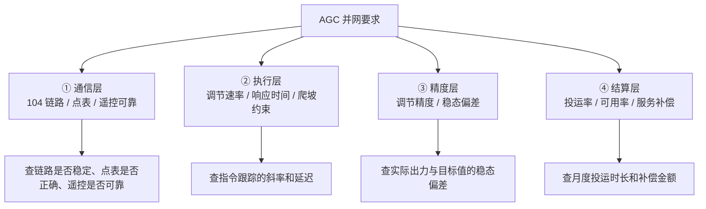
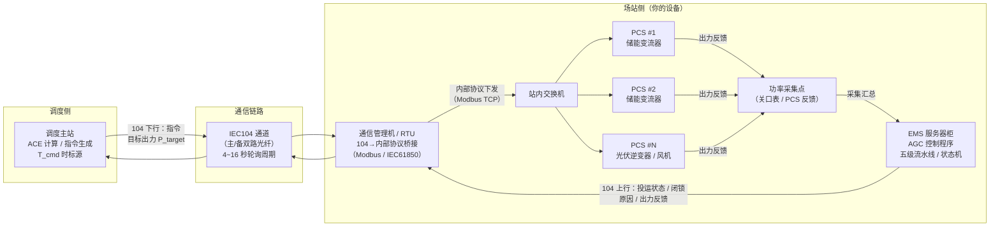

<!-- @AI_GENERATED -->
# 00 AGC二次调频：从调度ACE到全场出力的闭环控制链路

> 所属层面：导航层 · 全课程地图
> [课程首页](README.md) · 下一章：[01 ACE怎么算、AGC控什么](01_ACE与AGC控制模式.md)

**一句话**：AGC 是电网的"自动配平器"——调度发现频率偏了，给每个场站发一条"你现在该出多少"的指令，场站照做，做得快不快、准不准决定了你的考核分数和收入。

> **从控制理论看**：一次调频是比例有差调节（P），虚拟惯量是微分瞬时支撑（D），AGC 是积分无差调节（I）——三者构成电网频率的分布式 PID 控制体系。（如果这三个词不熟，点开下面的"前置知识自检"花 30 秒看一下。）

<details>
<summary>📋 前置知识自检（30 秒，不会也没关系，点开看看）</summary>

如果你看到"AGC 是 I（积分无差）"这句话感到陌生，先花 30 秒过一遍下面三个概念：

| 概念 | 直觉解释 | 在本课程中的对应 |
|---|---|---|
| **P — 比例（有差）** | "偏差越大，出力越大"，但永远剩一点偏差归不了零。 | **一次调频**：频率偏差 → 出力增量，但频率回不到 50.00 Hz。 |
| **I — 积分（无差）** | "只要还有偏差，我就一直加码，直到偏差消失"。 | **AGC**：调度主站根据 ACE 持续计算累加量，直到频率与联络线功率都回到计划值。 |
| **D — 微分（瞬时）** | "变化越快，反应越猛"，只在变化的瞬间起作用。 | **虚拟惯量**：频率跌落速度越快，瞬时支撑越大。 |

```text
电网频率偏差持续存在

一次调频（P）：出力增量 = K_p × Δf          → 频率回不到 50 Hz（有差）
AGC（I）：     出力增量 = K_i × ∫Δf dt      → 最终频率回到 50 Hz（无差）
虚拟惯量（D）： 出力增量 = K_d × df/dt       → 仅在频率变化瞬间起作用
```

> 💡 **读完之后继续。全书需要你真正记住的"控制理论"只有这一件事：**AGC 是通过持续修正来消除偏差的，所以考核不查"频率恢复了没有"（那归一次调频管），而查"你跟调度给的目标跟得快不快、准不准"。

</details>

> ⏱ **三段速读**：
> - 3 分钟：读"考核不合格事件"故事 → 知道这门课要解决什么问题
> - 10 分钟：加读"四个层面"→ 理解 AGC 的通信/执行/精度/结算四层串联结构
> - 30 分钟：完整通读 + 自测 → 建立全课程骨架，决定从哪里开始精读

## 本章目标

读完本章，你应能：

1. 说出 AGC 在并网验收中被检查的四个层面（通信、执行、精度、结算）；
2. 区分"104 通了"和"考核通过了"这两件不同的事；
3. 建立本课程的整体学习地图，知道每一章解决哪个环节。

## 本章边界与假设

本章是**导航章**：用一个真实的考核不合格事件，把"调度主站 → 远动通道 → EMS → PCS → 并网点 → 考核结算"这条闭环串起来，并给出全课程学习地图。

不实现任何具体算法（ACE 计算、功率分配、评分公式分别由 01/03/07 章实现），也不覆盖一次调频的整定细节（见[一次调频课程](../ems-primary-frequency-regulation/README.md)）。

**前置**：无（本章是入口章）。建议先具备一次调频（P 控制）的基本概念，若没有，本章开头的"前置知识自检"已给出 30 秒补课。

本章所有数字均为 `[教学示例]`，用于说明量级与因果关系，不能作为现场整定值。

## 从一个考核不合格事件说起【必懂】

某 100 MW / 200 MWh 储能电站，AGC 功能上线首月，调度下发的月考核结果如下：

| 考核项 | 结果 | 现场初判 |
|---|---|---|
| AGC 投运率 | 合格 | 全月 98.7% |
| 调节速率 K1 | 合格 | 平均 1.2 Pn/min |
| 响应时间 K2 | **不合格** | "104 通信是通的啊" |
| 调节精度 K3 | **不合格** | "目标值和实际值偏差不大" |

现场工程师查了两天，发现三件互不相干的事：

1. **指令死区设置过大**：EMS 配置了"AGC 指令变化小于 2 MW 不跟踪"，但调度考核系统按"指令每 4 秒更新一次、每次变化 0.5~1 MW"来统计。大量小步长的指令被 EMS 忽略，导致响应时间 K2 统计出来是"永远不响应"。
2. **通信延迟未被考虑**：104 通道的轮询周期设为 5 秒，加上指令解析、分配计算、PCS 通信，从调度发出指令到 PCS 开始执行平均 8 秒。考核系统按"指令发出后 30 秒内达到目标 ±3% 精度"来计时——光是链路就吃了近 1/3 的时间预算。
3. **反馈数据不匹配**：EMS 上送调度的实际出力是"场站总加功率的 1 分钟均值"，而调度考核用的是"指令发出后 1 分钟内的秒级数据"。同一个场站、同一段时间，"均值"和"秒级"算出来的 K3 差了近 1%。

这三件事没有一件属于"算法难"，全部属于**时序与口径**问题。

> **软件类比**：这很像对接支付回调——签名校验和金额计算从来不是问题，问题在于回调间隔是 50ms 还是 5s、累计退款是 T+1 还是 T+0、订单状态的并发更新有没有加锁。**时序不对，逻辑再对也是错的**。

---

## AGC 被检查的四个层面【必懂】

把并网要求拆开看，调度与试验单位其实在检查四件不同的事：



| 层面 | 谁在查 | 典型证据 | 常见失败原因 |
|---|---|---|---|
| 通信层 | 调度 / 自动化 | 104 链路日志、点表核对表 | 轮询周期过长、t1 超时导致频繁重连 |
| 执行层 | 调度（月度考核） | 目标出力与实际出力的时序对比 | 指令死区过大、爬坡速率限制过严 |
| 精度层 | 调度（月度考核） | 稳态出力与目标值的偏差 | 反馈数据粒度不匹配、分配策略导致偏差 |
| 结算层 | 调度（结算中心） | 投运率统计表 | 频繁闭锁、可用率不达标 |

**这四层是串联的**：通信层断了，执行层和精度层没有数据来源；执行层的延迟直接影响精度层；精度层不稳则结算层的补偿会被削减甚至变罚款。

---

## 物理部署全景图【了解】

在你深入任何一章之前，先把"信号在哪里跑、设备在哪里放"看清楚——很多排障时的困惑，本质上是不知道哪个环节断了：



**图中关键点**：

| 环节 | 常出问题的地方 | 影响 |
|---|---|---|
| 104 通道 | t1 超时导致重连（06 章） | 投运率扣分 |
| 通信管理机桥接 | 协议转换延时 + 采样周期不一致（08 章症状一） | K2/K3 计算偏差 |
| EMS 分配流水线 | 指令死区 / 多级限速（02/03 章） | K1/K2/K3 全面失分 |
| PCS 本地执行 | ramp rate 不一致 / SOC 约束（02 章） | K1 不达标 |
| 功率反馈回路 | 采集点 vs 调度采样点的时标错位（04/08 章） | 自己算的 K3 和调度算的不一样 |

> 💡 **口诀**：调度发指令 → 104 光纤到机柜 → 通信管理机翻译 → EMS 分配 → PCS 干活 → 功率反馈回传。任一环断了，AGC 全链路失效。

---

## 为什么单独立一门课【必懂】

AGC 的基本原理，在[入门课程第 16 章](../ems-python-learning/16_AGC与调度考核.md)已经讲过。但那一章讲的是**"物理上应该怎么调"**，而工程上真正卡住人的是**"调度怎么考核你、用什么口径算你合格"**。

两者的差别可以用一句话概括：

| 视角 | 关心的问题 |
|---|---|
| 物理视角（入门课程） | 联络线偏差怎么算、ACE 怎么分解、控制信号怎么生成 |
| 并网视角（本课程） | 104 周期多少、指令死区多少、调节速率怎么算、K1/K2/K3 怎么对账 |

同一个 PI 控制公式，在两种视角下的"正确"标准完全不同。物理上合理的响应，可能因为**反馈数据粒度**或**指令死区口径**被判不合格。

---

## AGC 与一次调频的本质区别【必懂】

在深入各章之前，先搞清楚 AGC 和一次调频在考核层面的本质区别：

| 维度 | 一次调频 | AGC（二次调频） |
|---|---|---|
| 谁发指令 | 场站自己（响应本地频率） | 调度主站（响应区域 ACE） |
| 指令形式 | 连续计算（每个控制周期重算） | 离散下发（每 4~16 秒一次） |
| 控制目标 | 频率偏差 | 计划值 + ACE 修正 |
| 考核方式 | 积分电量（W_theory vs W_actual） | K1 调节速率 + K2 响应时间 + K3 调节精度 |
| 服务性质 | 义务型（考核罚款为主） | 市场型（补偿收益为主） |
| 时间尺度 | 秒级 | 分级（30 秒~分钟级） |

> **一句话区分**：一次调频考的是"频率掉了你出了多少力"，AGC 考的是"调度让你出力，你跟得快不快、准不准"。

---

## 学习地图【必懂】


| 章节 | 如果你只想解决一个问题 | 建议读法 |
|---|---|---|
| 01 | 不理解 AGC 为什么突然被重视 | 通读 |
| 02 | 要写代码实现 AGC 跟踪 | 精读 + 手算 |
| 03 | 场站同时有风电和光伏和储能 | 精读 |
| 04 | K1/K2/K3 总是不达标 | 精读 + 做时序预算 |
| 05 | 项目在特定省份 | 对照查阅 |
| 06 | 要做架构设计 | 精读 |
| 07 | 月度考核被扣钱 | 精读 |
| 08 | 要做 AGC 联调 | 精读 |
| 09 | 上线前做自查 | 通读，逐条对照 |

---

## 🔥 紧急通道：我只想快速解决一个问题

| 你的症状 | 直接跳到这里 | 预计时间 |
|---|---|---|
| K2 周期性不合格，但链路没断 | [02 章：指令死区→K2 的杀手](02_AGC调节速率瓶颈与整定.md) | 8 min |
| K3 抖动，上个月 90 这个月 70 | [04 章：K3 统计口径](04_AGC考核指标与统计口径.md) + [09 章：误区五](09_AGC典型误区与故障诊断.md) | 12 min |
| 多资源场站总出力总差一点 | [03 章：动态补差逻辑](03_AGC功率分配与动态补差.md) | 10 min |
| 被调度扣了钱，不知道原因 | [07 章：评分公式](07_AGC月度考核与结算模型.md) | 15 min |
| 马上要做联调，怕漏项 | [08 章：五大试验+三个症状](08_AGC并网联调与验收证据链.md) | 20 min |
| 同一场站在东北和华东考核不一样 | [05 章：三区域参数对照](05_AGC跨区调度细则适配.md) | 10 min |
| 不知道从哪开始 | 往下读"考核不合格事件"故事 → 那是全课程的 ground zero | 5 min |

---

## 本课程的统一约定【必懂】

为了避免混淆，全课程采用以下约定（与一次调频课程附录 A 一致）：

| 项目 | 约定 | 说明 |
|---|---|---|
| 额定频率 fn | 50 Hz | 国内同步电网 |
| 功率方向 | 放电 / 向电网送电为正 | 与一次调频一致 |
| 调节速率 | Pn/min（额定功率每分钟） | 如 1.0 Pn/min |
| AGC 指令 | 由调度主站通过 104 规约下发 | 计划值或增量指令 |
| 时间 | 秒（s），统一时钟 | 指令时标与反馈时标必须统一 |

> **注意**：不同厂家资料里，"调节速率"有时写"爬坡速率"、"爬坡率"，"响应时间"有时写"纯滞后时间"。**读到任何一份细则，第一步都是先确认它用的是哪套术语、以什么为基准**。附录 A 给出了对照表。

---

## 自测

1. AGC 的并网要求可以拆成哪四个层面？各自最常见的失败原因是什么？
2. "104 通了"和"考核通过了"为什么可能不一致？请举一个具体例子。
3. AGC 的 K1/K2/K3 分别衡量什么？与一次调频的积分电量考核有什么本质区别？
4. 如果你接手一个省网的 AGC 改造项目，第一件要拿到的资料是什么？

<details>
<summary>参考答案</summary>

1. 通信层（104 链路不稳定、轮询周期过长）、执行层（指令死区过大、爬坡速率限制过严）、精度层（反馈数据粒度不匹配）、结算层（频繁闭锁、投运率不足）。
2. 因为 104 通了只保证"指令能到达"，但考核看的是"指令到达后多快执行、执行到多准"。例如指令死区设为 2 MW，而调度每次只下发 0.5~1 MW 的变化量，EMS 全部判为"不跟踪"——链路是通的，但考核全不合格。
3. K1 调节速率 = 出力变化的速度（MW/min），K2 响应时间 = 从指令发出到开始变化的时间（s），K3 调节精度 = 稳态出力与目标的偏差（% Pn）。一次调频考的是 W_theory vs W_actual（积分后比较），AGC 考的是瞬时跟踪性能。
4. 项目所在电网的**现行调度规程与 AGC 并网协议**，以及 104 远动通道的点表与参数清单。这不是国标，是省网细则。

</details>

---

## 🧭 下一站

本章只做了"贴标签"——把 AGC 的四个层面和全课程地图摆在你面前，一个公式都没算。接下来按**数据流的方向**逐层深入：

下一章 [01 ACE怎么算、AGC控什么](01_ACE与AGC控制模式.md) 站在**调度主站**这一侧，回答"这条 AGC 指令是怎么算出来的"：ACE 由频率偏差和联络线功率偏差合成，再经 TBC/FFC/FTC 三种控制模式转成各场站的目标出力。**理解了 ACE，你才会知道为什么调度有时要求"快"、有时要求"准"。**

> 只想先救火？跳 [09 AGC考核不合格的根因在哪](09_AGC典型误区与故障诊断.md)，那里有十大自查清单，按症状直接定位。

<!-- @AI_GENERATED: end -->