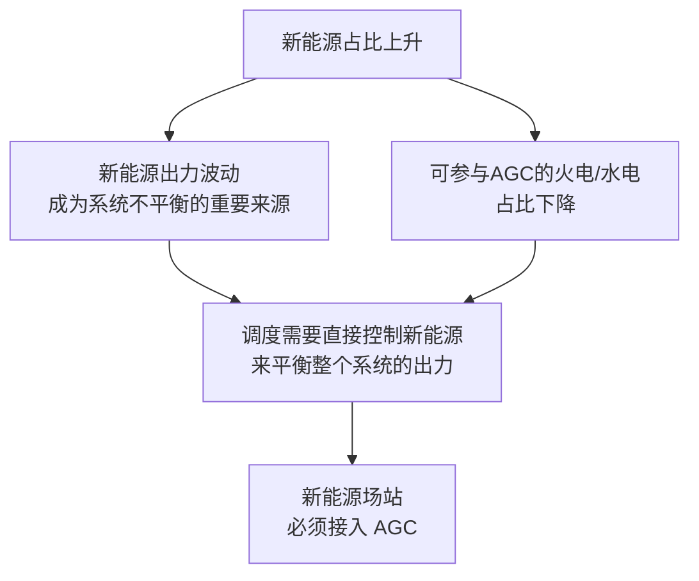
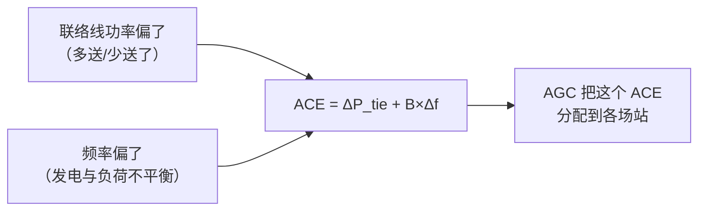
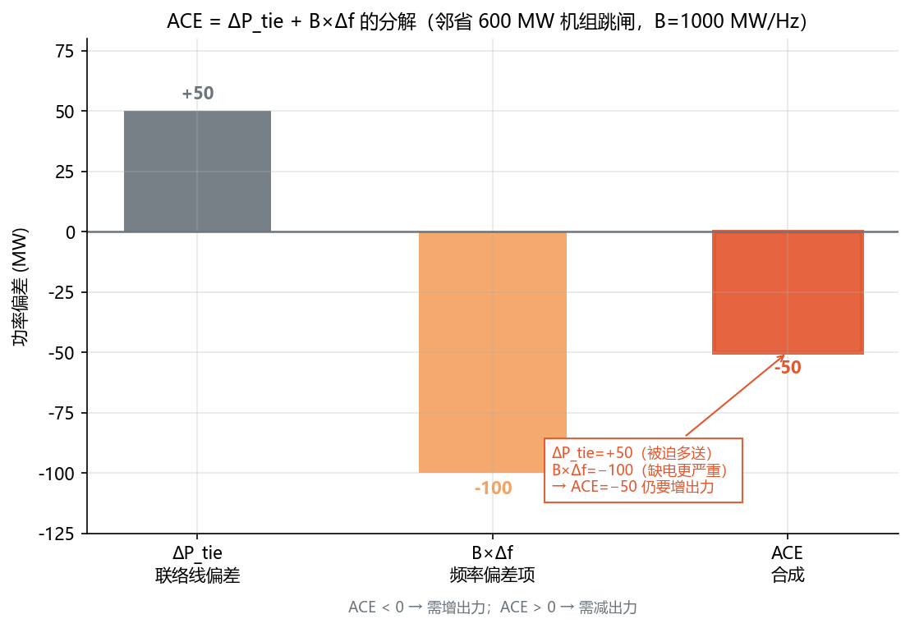
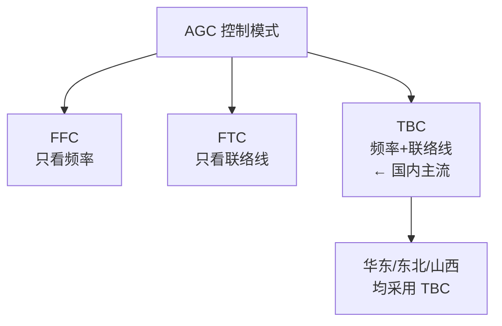
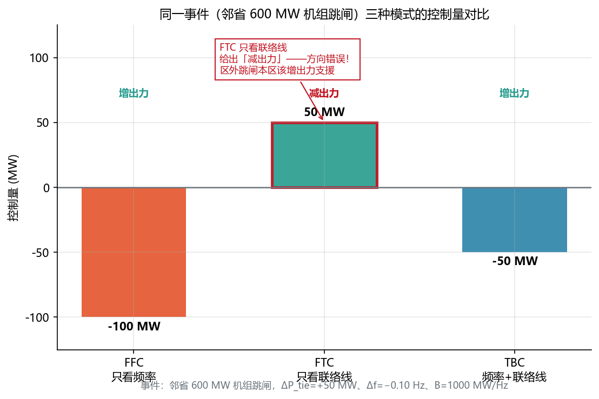
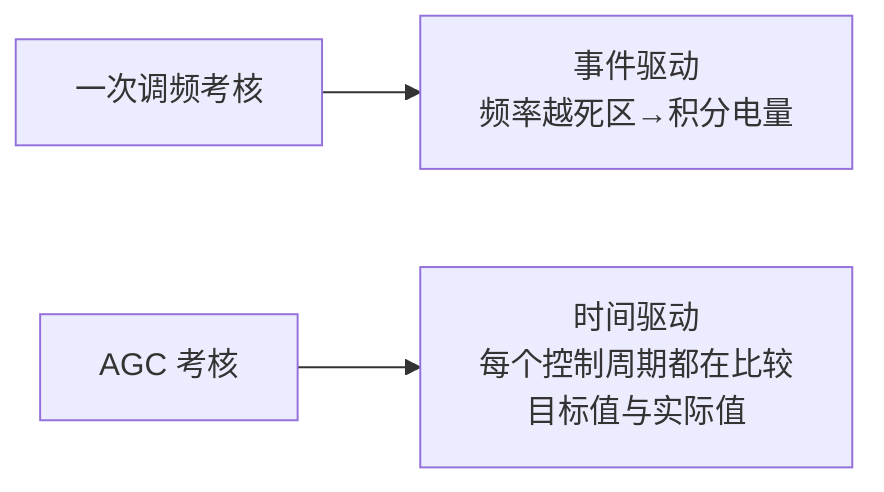

<!-- @AI_GENERATED -->
# 01 ACE怎么算、AGC控什么——TBC/FFC/FTC三种控制模式的工程选型逻辑

> 所属层面：全四层概述（通信层→执行层→精度层→结算层的基础逻辑）
> [课程首页](README.md) · 上一章：[00 AGC二次调频：从调度ACE到全场出力的闭环控制链路](00_AGC闭环控制链路.md) · 下一章：[02 AGC的K1为什么不达标](02_AGC调节速率瓶颈与整定.md)

**一句话**：AGC 以前是火电的"标配"，现在是新能源场站的"必修课"——因为新能源多了以后，电网的调节节点从几十个大机组变成了几千个分布式场站。每个场站都需要听懂调度的指令，而指令的原始输入叫 ACE（区域控制偏差）。

> ⏱ **三段速读**：
> - 5 分钟：读现场场景 + "为什么 AGC 突然被强调" → 理解行业背景
> - 15 分钟：加读 ACE 公式 + 手算 + 三模式对比 → 会算 ACE，看懂 TBC 为什么主流
> - 30 分钟：精读概念实现代码 + 一次调频分工 + 自测 → 打通控制理论骨架

## 现场场景【必读】

你在一家 EMS 厂商负责华东某 **100 MW / 200 MWh 储能电站**的 AGC 接入。某日上午 11:00，邻省一台 600 MW 机组跳闸。

你调出调度下发的两份数据：

1. 本区联络线功率比计划**多送了 50 MW**（`ΔP_tie = +50 MW`）——本区被迫向缺电的邻省"送电支援"；
2. 系统频率跌到 49.90 Hz（`Δf = −0.10 Hz`）——整个互联系统发电不足。

你心想："联络线都多送电了，本区发电不是过剩了吗？"结果省调给你场站的 AGC 指令**依然是"上调 50 MW"**——你差点以为调度搞反了。

调度把这两个信号合成**一个数**（ACE），再按各场站的可调容量分下去，你的储能电站就分到了"增出力"。

**本章回答三个问题**：

1. 调度那条 AGC 指令的原始输入 ACE 是怎么算出来的？
2. 为什么联络线明明多送电了（ΔP_tie 为正），调度还让本区"增出力"？
3. TBC/FFC/FTC 三种模式有什么区别，为什么国内用 TBC？

## 本章目标

读完本章，你应能：

1. 说清楚新能源场站为何必须接入 AGC，以及 AGC 解决的系统级问题；
2. **手算** ACE = ΔP_tie + B × Δf，并判断该增出力还是减出力；
3. 用同一组（ΔP_tie, Δf）**复算**出 TBC/FFC/FTC 三种模式给出的不同控制量，解释 TBC 成为主流的量化原因；
4. 区分"AGC 调节过程"与"AGC 考核评价"两个维度及其时间尺度差异。

## 本章边界与假设

本章实现**调度主站侧 ACE 的代数计算**与 TBC/FFC/FTC 三种控制模式的工程选型，把"指令从哪来"讲清楚。

不实现调度主站把 ACE 分解给各场站的真实优化分配算法（那是调度侧的实时优化问题，场站侧只需理解指令是"全局优化后的结果"），也不实现 104 通信链路（见[06 章](06_AGC的IEC104链路与状态机.md)）与 K1/K2/K3 评分（见[04 章](04_AGC考核指标与统计口径.md)）。

**前置**：[00 章](00_AGC闭环控制链路.md)（闭环全链路）、[一次调频课程](../ems-primary-frequency-regulation/README.md)（P 控制概念）。

> ⚠️ **简化假设声明**：本章教学取频率偏差系数 `B = 1000 MW/Hz`。真实区域 B 值量级在数千 MW/Hz（华东约 2000~4000），且由**调度统一整定**，场站侧不自行取值。`B = 1000` 只是为了让手算数字干净、便于你验算——它不是任何真实省网的整定值。

## 为什么新能源场站需要 AGC【必懂】

### 从"只管出力"到"可控出力"

传统电网中，AGC 主要控制火电和水电机组——这些是电网的"主干"调节资源。新能源在很长一段时间里是"有多少发多少"的被动角色。

但新能源占比上升后，两件事同时发生：



**关键逻辑**：新能源不仅是"需要被平衡"的波动源，它也可以变成"主动平衡系统"的参与者——前提是它必须接受调度 AGC 的控制。一个满发的光伏场站，如果能接收并执行 AGC 的"减出力"指令，就等于为系统提供了下调空间。

### AGC 要解决的核心问题

AGC 解决的不是"频率掉了瞬间怎么办"（那是秒级一次调频的止血动作），而是：

| 问题 | AGC 如何解决 |
|---|---|
| 发电计划与实际偏差 | AGC 按调度主站的 ACE 修正场站出力 |
| 大范围功率波动 | AGC 通过分钟级指令平滑新能源出力 |
| 跨区功率交换 | AGC 控制联络线功率在计划值附近 |
| 一次调频后的频率恢复 | AGC 把频率从准稳态拉回 50.00 Hz |

---

## 区域控制偏差（ACE）【必懂】

AGC 的核心输入不是本地的频率偏差，而是**区域控制偏差（Area Control Error, ACE）**——一个同时考虑频率偏差和联络线功率偏差的复合量。

```text
ACE = ΔP_tie + B × Δf
```

| 符号 | 含义 | 单位 |
|---|---|---|
| ACE | 区域控制偏差 | MW |
| ΔP_tie | 联络线实际交换功率与计划值的偏差（送出为正） | MW |
| B | 频率偏差系数（区域的自然频率响应特性） | MW/Hz |
| Δf | 频率偏差（f − fn，fn = 50 Hz） | Hz |

### ACE 的物理含义



**先记住符号规则，后面手算全靠它**：`ΔP_tie` 以"送出为正"（多送为正、少送为负）；`Δf = f − 50`（频率偏高为正、偏低为负）；`ACE > 0` 表示本区**发电过剩需减出力**，`ACE < 0` 表示**发电不足需增出力**。

### 手算：ACE 代入【必懂】

手算对象承接现场场景（邻省 600 MW 机组跳闸），取 `B = 1000 MW/Hz`。只做两步：先算频率项 `B×Δf`，再与 `ΔP_tie` 相加。

**第一步：算频率项**

```text
B × Δf = 1000 × (−0.10) = −100 MW（系统缺电，频率跌落 → 负）
```

**第二步：合成 ACE**

```text
ΔP_tie = +50 MW（本区被迫向邻省多送电 → 正）
B × Δf = −100 MW（频率项，负）
ACE    = +50 + (−100) = −50 MW  →  负，需增出力
```

一张表把这个事件的每一步列清楚：

| 步骤 | 量 | 数值 | 符号含义 |
|---|---|---|---|
| ① 联络线项 | ΔP_tie | +50 MW | 本区被迫向缺电的邻省多送 |
| ② 频率项 | B×Δf = 1000×(−0.10) | −100 MW | 系统缺电，频率跌落到 49.90 Hz |
| ③ 合成 | ACE = ① + ② | **−50 MW** | 负 → 需增出力 |

**关键点**：联络线是"多送"（正），但频率项负得更多（|−100| > |+50|），所以 ACE 还是负——调度让你增出力，不是搞反了，而是因为**整个互联系统缺电，本区得多发支援邻省**。

### 概念实现

```python
def ace(dp_tie: float, b: float, df: float) -> float:
    """ACE = ΔP_tie + B × Δf（区域控制偏差，单位 MW）"""
    return dp_tie + b * df

B = 1000.0   # MW/Hz，教学示例

ace(50.0, B, -0.10)   # +50 + (-100) = -50 → 增出力（本课程唯一业务事件）
```

#### 最小运行示例

上面这个 `ace()` 是本课程模块层 [agc_core.py](lab/ems_lab/agc_core.py) 里真实函数的教学简化版。把它连同本课程唯一业务事件跑起来，就是 [ch01_ace.py](lab/examples/ch01_ace.py)：

```python
from ems_lab.agc_core import ace

B = 1000.0                     # MW/Hz，教学示例
dp_tie, df = 50.0, -0.10       # 邻省 600 MW 机组跳闸：ΔP_tie=+50、Δf=−0.10

ace_val = ace(dp_tie, B, df)
print(f"ACE = {dp_tie:+.0f} + {B:.0f}×({df:+.2f}) = {ace_val:+.0f} MW")
```

上面 4 行即 [ch01_ace.py](lab/examples/ch01_ace.py) 的核心逻辑，单独运行会打印 `ACE = +50 + 1000×(-0.10) = -50 MW`。完整脚本还包含三种模式对比与自测断言，运行 `python lab/examples/ch01_ace.py` 的关键输出如下（与上面手算逐字一致）：

```text
【② ACE 手算】
  ACE = ΔP_tie + B×Δf = +50 + 1000×(-0.10)
      = +50 + (-100) = -50 MW
  → ACE < 0，本区缺电，需「增出力」50 MW
```

> 🔍 **为什么这段要"跑起来"**：正文手算（−50 MW）＝ 概念实现 `ace(50, 1000, −0.10)` 的返回值 ＝ [ch01_ace.py](lab/examples/ch01_ace.py) 运行输出（−50.0 MW）＝ 下方配图标注（−50）。四处是**同一个数**，任何一处对不上，就是代码或图出了问题——这正是"最小运行示例"存在的意义：让每个数字都能被复现。

> **软件类比**：调度主站的角色像一个**集群级调度器**——ACE 是它监控的"全局资源池水位偏差"：频率偏差 Δf 是"全局水位偏离额定值"，联络线偏差 ΔP_tie 是"与邻集群之间的借还流量"。水位偏低或借了邻集群的流量，调度器就调整各 worker（场站）的出力配额。
>
> **类比失效点**：K8s 的副本扩缩是**离散整数**（3 → 5 个 pod），AGC 的功率调节是**连续实数**（−50 MW）；更关键的是，K8s 各服务实例之间**没有物理耦合**，而电网里所有场站共享**同一个频率**——一个场站多出力会同时改变全局频率，这种强耦合是软件集群里没有的。所以"场站各自独立调功率"这个直觉在电网里不成立，必须由调度主站统一算 ACE、统一分配。

### 配图：单一事件的 ACE 分解



| 编号 | 位置 | 标注 | 对应正文 |
|---|---|---|---|
| ① | 上柱 | ΔP_tie = +50 MW（朝上） | 手算第 ① 步：联络线项 |
| ② | 下柱 | B×Δf = −100 MW（朝下） | 手算第 ② 步：频率项 |
| ③ | 合成柱 | ACE = −50 MW（朝下，加粗） | 手算第 ③ 步：合成 |
| ④ | 标注框 | "ΔP_tie=+50、B×Δf=−100 → ACE=−50 仍增出力" | 关键结论：频率项主导 |
| ⑤ | 水平零线 | ACE>0 减出力 / ACE<0 增出力 | 符号规则段 |

> 👁 **怎么看这张图**：先看柱子的**正负**，再看**高度**。联络线柱朝上（+50）、频率柱朝下（−100），两根柱**一正一负**；合成柱朝下（−50），方向由"更长的频率柱"决定。这就是"为什么联络线多送、调度还让你增出力"的答案。

---

## 三种 AGC 控制模式【必懂】

不同区域采用不同的 AGC 控制模式，这直接影响 EMS 收到的指令含义：

| 模式 | 全称 | 控制量 | 说明 |
|---|---|---|---|
| **FFC** | Flat Frequency Control（定频率控制） | 仅 B×Δf | 只控制频率，不管联络线——适合孤网或对联络线不敏感的区域 |
| **FTC** | Flat Tie-line Control（定联络线控制） | 仅 ΔP_tie | 只控制联络线功率，不管频率——国内极少单独使用 |
| **TBC** | Tie-line Bias Control（联络线偏差控制） | ΔP_tie + B × Δf | 同时控制频率和联络线，**国内主流** |



### 手算：三种模式对同一事件给出什么控制量【必懂】

用现场场景的**唯一业务事件（邻省 600 MW 机组跳闸）**——`ΔP_tie = +50 MW`、`Δf = −0.10 Hz`——把三种模式各算一遍：

```text
FFC 控制量 = B × Δf        = 1000 × (−0.10) = −100 MW  → 增出力（方向对，但只看频率）
FTC 控制量 = ΔP_tie        = +50 MW                 → 减出力（方向错！）
TBC 控制量 = ΔP_tie + B×Δf = +50 + (−100) = −50 MW   → 增出力（方向对、量合适）
```

| 模式 | 控制量 (MW) | 动作 | 对错 |
|---|---|---|---|
| FFC（只看频率） | −100 | 增出力 | 方向对，但忽略了"本区已多送 50 MW"，会过度增发 |
| FTC（只看联络线） | +50 | **减出力** | **方向错**——区外缺电时本区反而减发，加剧缺电 |
| TBC（频率+联络线） | −50 | 增出力 | 方向对、量合理 |

这段手算同样落在 [ch01_ace.py](lab/examples/ch01_ace.py) 里，运行输出的关键一段：

```text
【③ 同一事件下三种控制模式的控制量】
  FFC（只看频率）          -100.0 MW  → 增出力
  FTC（只看联络线）           50.0 MW  → 减出力  ← 方向错误！
  TBC（频率+联络线）         -50.0 MW  → 增出力
```

**这就是"为什么 TBC 是主流"的量化答案**：省间互联电网里，区外事故会同时改变本区的 ΔP_tie 和 Δf。FTC 只看联络线，会在这个最需要支援的事件给出**完全错误的动作**；FFC 只看频率，会**忽略本区已经通过联络线支援的部分**，重复发力。只有 TBC 把两项都算进去，才既不漏、也不重。

### 配图：三种模式控制量对比



| 编号 | 位置 | 标注 | 对应正文 |
|---|---|---|---|
| ① | 左柱 | FFC = −100 MW → 增出力 | 手算：FFC 只看频率 |
| ② | 中柱（红框） | FTC = +50 MW → 减出力 | 手算：FTC 只看联络线，方向错误 |
| ③ | 右柱 | TBC = −50 MW → 增出力 | 手算：TBC 两项合成，正确 |
| ④ | 中柱标注框 | "FTC 给出减出力——方向错误" | 三种模式对比表 FTC 行 |
| ⑤ | 顶部文字 | 增出力（绿）/ 减出力（红） | 各模式控制量符号对应的动作 |

> 👁 **怎么看这张图**：只看**中间那根柱的方向**——FTC 柱朝上（+50），意味着它会让本区"减出力"。而现场场景告诉你，区外跳闸时本区必须增出力支援。这根"反方向"的柱就是 FTC 被淘汰的原因，也是"为什么 EMS 收到的指令是 TBC 算出来的 ACE，而不是联络线功率本身"。

> 🔑 **TBC 是主流的工程原因（一句话）**：中国各省之间靠联络线互联，调度考核**同时**查"你省的频率贡献"（B×Δf）和"你省和外省的交换功率偏差"（ΔP_tie）。TBC 两个都管，FFC/FTC 各管一个——在省间互联电网中，只管一个等于把另一半责任甩给邻省，没人同意。

### TBC 模式下的指令链路

```
调度主站计算 ACE → 分解为各场站的目标出力 → 通过 104 下发 → EMS 接收 → 执行
```

**对 EMS 的含义**：在 TBC 模式下，AGC 指令是一个**目标出力值**（或有功增量），不是"频率修正量"。EMS 不需要自己算 ACE，但需要理解指令的来源——它是调度对全局平衡做了一次优化分配后的结果。

---

## AGC 与一次调频的精确分工【必懂】

这是最容易混淆的概念。它们在同一条功率链上、使用同一个控制对象（场站出力），但时间尺度和目标完全不同：

| 维度 | 一次调频（PFR） | 二次调频（AGC） |
|---|---|---|
| 输入 | 本地频率 f | 调度 ACE（含频率 + 联络线） |
| 时间尺度 | 秒级（2~30 s） | 分钟级（30 s~分钟级） |
| 指令来源 | 场内自己算 | 调度主站下发 |
| 控制性质 | 比例有差（P） | 积分无差（I） |
| 能否消除频率偏差 | 不能，必须留有稳态偏差 | **能**，通过持续修正消除 |
| 在 EMS 中的形态 | 增量 ΔP，叠加在基点上 | 目标值 P_target，覆盖型指令 |
| 对通信的依赖 | 不依赖远动通道 | **强依赖** 104 通道 |

### 功率合成公式【必懂】

```text
P_total = clamp(P_agc_base + ΔP_primary, P_min, P_max)
```

| 分量 | 来源 | 更新频率 | 作用 |
|---|---|---|---|
| P_agc_base | 调度 AGC 指令 | 4~16 s | 跟踪计划值，消除稳态偏差 |
| ΔP_primary | 本地一次调频计算 | ≤1 s | 响应频率事件，秒级支撑 |

**关键规则**：
- AGC 指令下发间隔远大于一次调频周期，两者不会在每个控制周期同时更新；
- 当 AGC 指令到来时，EMS 需要把它作为**新的基点**，然后一次调频增量继续叠加在这个基点上；
- 不能出现"AGC 指令覆盖一次调频增量"的情况，因为那等于在频率事件中主动放弃了已作出的调频贡献。

---

## AGC 考核的基本框架【必懂】

AGC 的考核围绕三个核心指标（详见[04 章](04_AGC考核指标与统计口径.md)）：

| 指标 | 代号 | 衡量什么 | 典型要求 |
|---|---|---|---|
| 调节速率 | K1 | 出力变化的速度 | ≥1.0 Pn/min（储能），≥0.5 Pn/min（光伏） |
| 响应时间 | K2 | 从指令下达到开始执行的时间 | ≤30 s |
| 调节精度 | K3 | 稳态出力与目标的偏差 | ≤±3% Pn |

这三项指标的综合得分决定了 AGC 服务的月度补偿金额（详见[07b 章](07b_AGC辅助服务经济性决策.md)）。

### 考核与一次调频的根本不同



一次调频只在频率越死区时才产生考核依据，AGC 是**每个控制周期都在产生考核数据**。这意味着：
- AGC 的考核数据量远大于一次调频（每天 24 小时 × 每分钟若干次）
- 单次超差不会导致考核失败，但**长期统计不达标会影响月度评分**
- 通信断链期间的缺失数据通常按"不合格"统计

---

## 国内 AGC 要求的标准脉络【了解】


| 阶段 | 标志 | 对 EMS 的影响 |
|---|---|---|
| 火电时代 | AGC 是火电的"标准配置" | 新能源 EMS 没有 AGC 模块 |
| 新能源试点 | 2015 年前后，西北/华东试点 | 需要从零搭建 AGC 通信与控制模块 |
| 标准化 | GB/T 19964 / GB/T 19963 明确要求 | AGC 变成 EMS 的"必选功能" |
| 储能加入 | 储能 AGC 补偿单价高于火电 | EMS 需要支持储能的 SOC 约束分配 |

> 注：同一时期的 DL/T 1870《电力系统网源协调技术规范》第 6.3.4 条明确的是新能源应具备**一次调频**能力（与 AGC 相邻但不相同），AGC 能力则出自接入规定 GB/T 19964（光伏）/ GB/T 19963（风电）。第 02 章会讲一次调频与 AGC 的功率合成关系。

---

## 自测

1. ACE 由哪两部分组成？TBC 模式和 FFC 模式有什么区别？
2. AGC 和一次调频在功率合成时是什么关系？为什么不能互相覆盖？
3. AGC 的 K1/K2/K3 分别衡量什么？
4. 为什么 AGC 能消除频率偏差而一次调频不能？
5. 【算】复算本章唯一业务事件：ΔP_tie = +50 MW、Δf = −0.10 Hz、B = 1000 MW/Hz，求 ACE 并判断调度动作。
6. 【算】同一事件下，若调度把该区域的 B 整定为 1500 MW/Hz（其余不变），ACE 变为多少？这说明了 B 的什么作用？

<details>
<summary>参考答案</summary>

1. ACE = ΔP_tie（联络线偏差）+ B × Δf（频率偏差×系数）。TBC 同时控制频率和联络线，FFC 只控制频率。国内以 TBC 为主。
2. 是相加关系：`P_total = P_agc_base + ΔP_primary`。不能互相覆盖的原因：AGC 是调度调节经济分配，一次调频是本地响应电网事故。如果在频率事故中 AGC 覆盖了一次调频增量，等于放弃了事故支撑，会加剧频率恶化。
3. K1 调节速率（出力变化速度，MW/min），K2 响应时间（指令下达到开始执行的时间，s），K3 调节精度（稳态出力与目标的偏差，% Pn）。
4. 因为 AGC 是积分控制（I），只要偏差存在就一直累加修正量直到偏差消失——最终能把频率拉回 50 Hz。一次调频是比例控制（P），出力与偏差成正比，功率平衡时必然保留一个非零的频率偏差来维持出力。
5. B×Δf = 1000 × (−0.10) = −100 MW；ACE = +50 + (−100) = **−50 MW** → 负，需**增出力**（频率项主导，尽管联络线多送 50 MW）。
6. B×Δf = 1500 × (−0.10) = −150 MW；ACE = +50 + (−150) = **−100 MW** → 增出力。B 越大，同样的频率偏差对 ACE 的贡献越大——B 反映本区域对系统频率偏差承担的**责任份额**，整定越大，区域越需要为频率恢复多出力。

</details>

> 💻 **动手实验**：运行 `python lab/examples/ch01_ace.py`，输出包含①唯一业务事件（邻省 600 MW 机组跳闸）的 ACE 手算、②同一事件下三种模式的控制量对比、③自测断言。重点核对两处：`ACE = −50`（不是 +50）；FTC 给出 `+50`（方向错误）。运行 `python lab/tests/test_agc_core.py` 会复现本章全部断言。

---

## 🧭 下一站

本章站在**调度主站**这一侧，讲清了"那条 AGC 指令是怎么算出来的"——ACE 由频率偏差和联络线功率偏差合成，TBC 模式把它变成各场站的目标出力。

但指令到了场站，才是真正的战场：调度要求 K1 达到 1.0 Pn/min，你的 PCS 爬坡速率够吗？EMS 安全限速会不会把 PCS 卡住？

下一章 [02 AGC的K1为什么不达标](02_AGC调节速率瓶颈与整定.md) 把"Pn/min 的考核要求"翻译成"PCS ramp rate、EMS 安全限速、指令死区"三个可配置参数，逐层定位 K1 的瓶颈。

> 如果你想直接看"评分怎么变成钱"，可跳到 [07 AGC月度考核与结算模型](07_AGC月度考核与结算模型.md)。

<!-- @AI_GENERATED: end -->