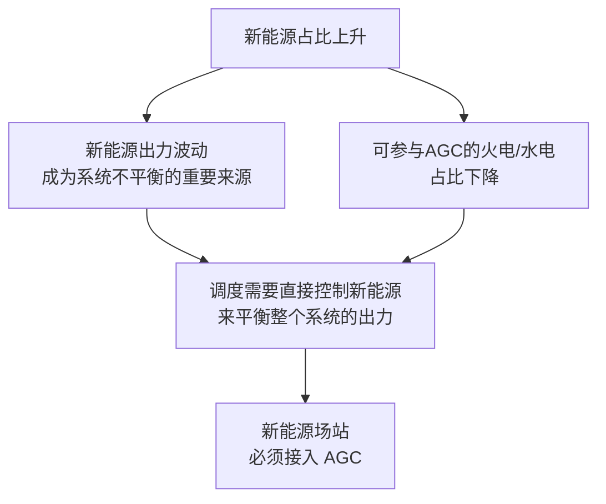
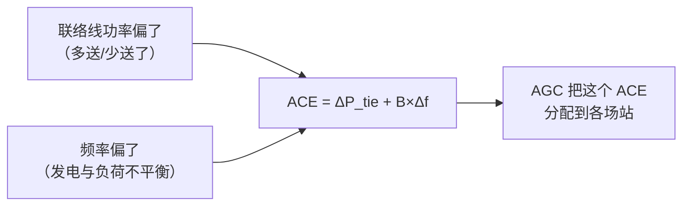
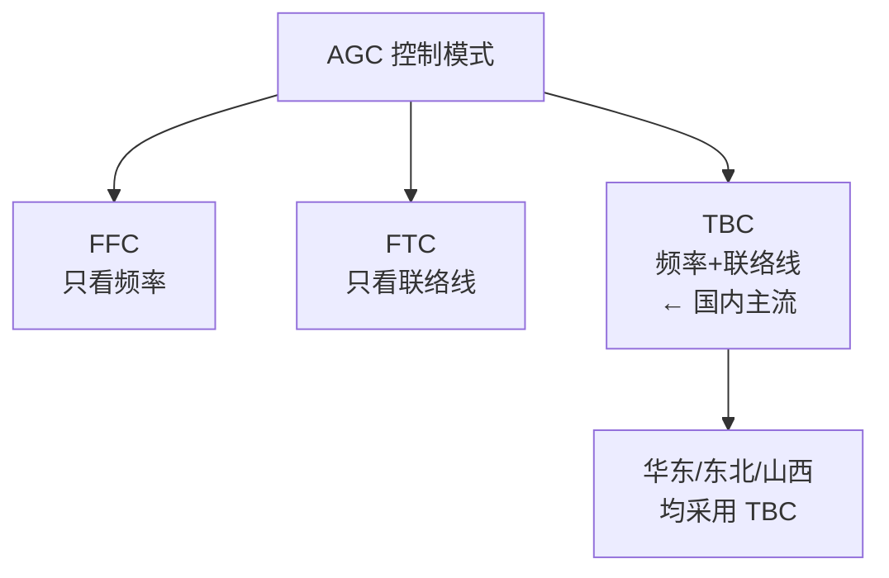
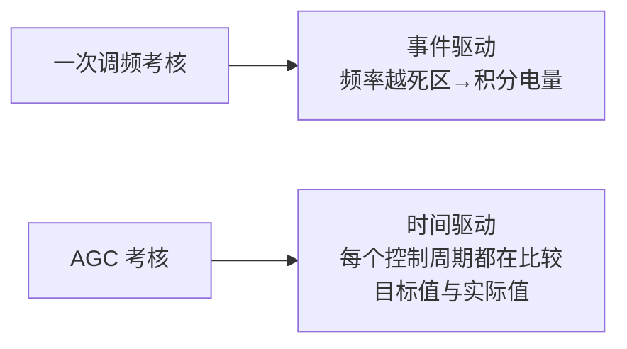
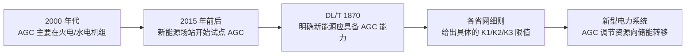

<!-- @AI_GENERATED -->
# 01 ACE怎么算、AGC控什么——TBC/FFC/FTC三种控制模式的工程选型逻辑

> 所属层面：全四层概述（通信层→执行层→精度层→结算层的基础逻辑）
> [课程首页](README.md) · 上一章：[00 AGC二次调频：从调度ACE到全场出力的闭环控制链路](00_AGC闭环控制链路.md) · 下一章：[02 AGC的K1为什么不达标](02_AGC调节速率瓶颈与整定.md)

**一句话**：AGC 以前是火电的"标配"，现在是新能源场站的"必修课"——因为新能源多了以后，电网的调节节点从几十个大机组变成了几千个分布式场站。每个场站都需要听懂调度的指令，而指令的原始输入叫 ACE（区域控制偏差）。

> ⏱ **三段速读**：
> - 5 分钟：读"为什么 AGC 突然被强调" → 理解行业背景，知道你做 AGC 不是在补课而是在抢位置
> - 15 分钟：加读 ACE 公式 + TBC/FTC 模式对比表 → 知道你在哪种模式下运行
> - 30 分钟：精读 ACE 分量的手算示例 + 一次调频/虚拟惯量关系 → 打通控制理论骨架

## 本章目标

读完本章，你应能：

1. 说清楚新能源场站为何必须接入 AGC，以及 AGC 解决的系统级问题；
2. 推导 ACE 的计算公式，理解 TBC/FFC/FTC 三种控制模式的物理含义与工程选型依据；
3. 区分"AGC 调节过程"与"AGC 考核评价"两个维度及其时间尺度差异。

## 为什么新能源场站需要 AGC【必懂】

### 从"只管出力"到"可控出力"

传统电网中，AGC 主要控制火电和水电机组——这些是电网的"主干"调节资源。新能源在很长一段时间里是"有多少发多少"的被动角色。

但新能源占比上升后，两件事同时发生：



**关键逻辑**：新能源不仅是"需要被平衡"的波动源，它也可以变成"主动平衡系统"的参与者——前提是它必须接受调度 AGC 的控制。一个满发的光伏场站，如果能接收并执行 AGC 的"减出力"指令，就等于为系统提供了下调空间。

### AGC 要解决的核心问题

AGC 解决的不是"频率掉了怎么办"（那是一次调频的事），而是：

| 问题 | AGC 如何解决 |
|---|---|
| 发电计划与实际偏差 | AGC 按调度主站的 ACE 修正场站出力 |
| 大范围功率波动 | AGC 通过分钟级指令平滑新能源出力 |
| 跨区功率交换 | AGC 控制联络线功率在计划值附近 |
| 一次调频后的频率恢复 | AGC 把频率从准稳态拉回 50.00 Hz |

---

## 区域控制偏差（ACE）【必懂】

AGC 的核心输入不是本地的频率偏差，而是**区域控制偏差（Area Control Error, ACE）**——一个同时考虑频率偏差和联络线功率偏差的复合量。

```text
ACE = ΔP_tie + B × Δf
```

| 符号 | 含义 | 单位 |
|---|---|---|
| ACE | 区域控制偏差 | MW |
| ΔP_tie | 联络线实际交换功率与计划值的偏差（送出为正） | MW |
| B | 频率偏差系数（区域的自然频率响应特性） | MW/Hz |
| Δf | 频率偏差（f − fn） | Hz |

### ACE 的物理含义



| 场景 | ΔP_tie | Δf | ACE | 调度动作 |
|---|---|---|---|---|
| 本区负荷突增 | 若向区外购电 → 负 | 负 | 负值 | 需要**增加**本区发电 |
| 区外机组跳闸 | 正（被迫多送） | 负 | 正或接近零 | 取决于 B 的大小 |
| 本区负荷突降 | 若向区外少送 → 正 | 正 | 正值 | 需要**减少**本区发电 |

> **直觉理解**：ACE 回答了"我这个区域是发电多了还是少了"——如果 ACE 为正，说明区域整体发电过剩（需要减出力）；如果 ACE 为负，说明区域整体发电不足（需要增出力）。

---

## 三种 AGC 控制模式【必懂】

不同区域采用不同的 AGC 控制模式，这直接影响 EMS 收到的指令含义：

| 模式 | 全称 | 控制量 | 说明 |
|---|---|---|---|
| **FFC** | Flat Frequency Control（定频率控制） | 仅 Δf | 只控制频率，不管联络线——适合孤网或对联络线不敏感的区域 |
| **FTC** | Flat Tie-line Control（定联络线控制） | 仅 ΔP_tie | 只控制联络线功率，不管频率——国内极少单独使用 |
| **TBC** | Tie-line Bias Control（联络线偏差控制） | ΔP_tie + B × Δf | 同时控制频率和联络线，**国内主流** |



> 🔑 **为什么 TBC 是主流？** 一句话：中国各省之间靠联络线互联，调度考核**同时**查"你省的频率贡献"（B×Δf）和"你省和外省的交换功率偏差"（ΔP_tie）。TBC 两个都管，FFC/FTC 各管一个——在省间互联电网中，只管一个等于把另一半责任甩给邻省，没人同意。

### TBC 模式下的指令链路

```
调度主站计算 ACE → 分解为各场站的目标出力 → 通过 104 下发 → EMS 接收 → 执行
```

**对 EMS 的含义**：在 TBC 模式下，AGC 指令是一个**目标出力值**（或有功增量），不是"频率修正量"。EMS 不需要自己算 ACE，但需要理解指令的来源——它是调度对全局平衡做了一次优化分配后的结果。

---

## AGC 与一次调频的精确分工【必懂】

这是最容易混淆的概念。它们在同一条功率链上、使用同一个控制对象（场站出力），但时间尺度和目标完全不同：

| 维度 | 一次调频（PFR） | 二次调频（AGC） |
|---|---|---|
| 输入 | 本地频率 f | 调度 ACE（含频率 + 联络线） |
| 时间尺度 | 秒级（2~30 s） | 分级（30 s~分钟级） |
| 指令来源 | 场内自己算 | 调度主站下发 |
| 控制性质 | 比例有差（P） | 积分无差（I） |
| 能否消除频率偏差 | 不能，必须留有稳态偏差 | **能**，通过持续修正消除 |
| 在 EMS 中的形态 | 增量 ΔP，叠加在基点上 | 目标值 P_target，覆盖型指令 |
| 对通信的依赖 | 不依赖远动通道 | **强依赖** 104 通道 |

### 功率合成公式【必懂】

```text
P_total = clamp(P_agc_base + ΔP_primary, P_min, P_max)
```

| 分量 | 来源 | 更新频率 | 作用 |
|---|---|---|---|
| P_agc_base | 调度 AGC 指令 | 4~16 s | 跟踪计划值，消除稳态偏差 |
| ΔP_primary | 本地一次调频计算 | ≤1 s | 响应频率事件，秒级支撑 |

**关键规则**：
- AGC 指令下发间隔远大于一次调频周期，两者不会在每个控制周期同时更新；
- 当 AGC 指令到来时，EMS 需要把它作为**新的基点**，然后一次调频增量继续叠加在这个基点上；
- 不能出现"AGC 指令覆盖一次调频增量"的情况，因为那等于在频率事件中主动放弃了已作出的调频贡献。

---

## AGC 考核的基本框架【必懂】

AGC 的考核围绕三个核心指标（详见[04 章](04_AGC考核指标与统计口径.md)）：

| 指标 | 代号 | 衡量什么 | 典型要求 |
|---|---|---|---|
| 调节速率 | K1 | 出力变化的速度 | ≥1.0 Pn/min（储能），≥0.5 Pn/min（光伏） |
| 响应时间 | K2 | 从指令下达到开始执行的时间 | ≤30 s |
| 调节精度 | K3 | 稳态出力与目标的偏差 | ≤±3% Pn |

这三项指标的综合得分决定了 AGC 服务的月度补偿金额（详见[07b 章](07b_AGC辅助服务经济性决策.md)）。

### 考核与一次调频的根本不同



一次调频只在频率越死区时才产生考核依据，AGC 是**每个控制周期都在产生考核数据**。这意味着：
- AGC 的考核数据量远大于一次调频（每天 24 小时 × 每分钟若干次）
- 单次超差不会导致考核失败，但**长期统计不达标会影响月度评分**
- 通信断链期间的缺失数据通常按"不合格"统计

---

## 国内 AGC 要求的标准脉络【了解】



| 阶段 | 标志 | 对 EMS 的影响 |
|---|---|---|
| 火电时代 | AGC 是火电的"标准配置" | 新能源 EMS 没有 AGC 模块 |
| 新能源试点 | 2015 年前后，西北/华东试点 | 需要从零搭建 AGC 通信与控制模块 |
| 标准化 | DL/T 1870 明确要求 | AGC 变成 EMS 的"必选功能" |
| 储能加入 | 储能 AGC 补偿单价高于火电 | EMS 需要支持储能的 SOC 约束分配 |

---

## 自测

1. ACE 由哪两部分组成？TBC 模式和 FFC 模式有什么区别？
2. AGC 和一次调频在功率合成时是什么关系？为什么不能互相覆盖？
3. AGC 的 K1/K2/K3 分别衡量什么？
4. 为什么 AGC 能消除频率偏差而一次调频不能？

<details>
<summary>参考答案</summary>

1. ACE = ΔP_tie（联络线偏差）+ B × Δf（频率偏差×系数）。TBC 同时控制频率和联络线，FFC 只控制频率。国内以 TBC 为主。
2. 是相加关系：`P_total = P_agc_base + ΔP_primary`。不能互相覆盖的原因：AGC 是调度调节经济分配，一次调频是本地响应电网事故。如果在频率事故中 AGC 覆盖了一次调频增量，等于放弃了事故支撑，会加剧频率恶化。
3. K1 调节速率（出力变化速度，MW/min），K2 响应时间（指令下达到开始执行的时间，s），K3 调节精度（稳态出力与目标的偏差，% Pn）。
4. 因为 AGC 是积分控制（I），只要偏差存在就一直累加修正量直到偏差消失——最终能把频率拉回 50 Hz。一次调频是比例控制（P），出力与偏差成正比，功率平衡时必然保留一个非零的频率偏差来维持出力。

</details>

<!-- @AI_GENERATED: end -->