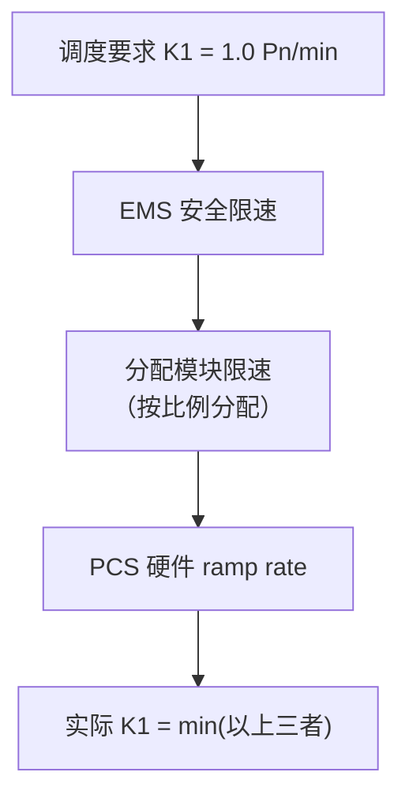
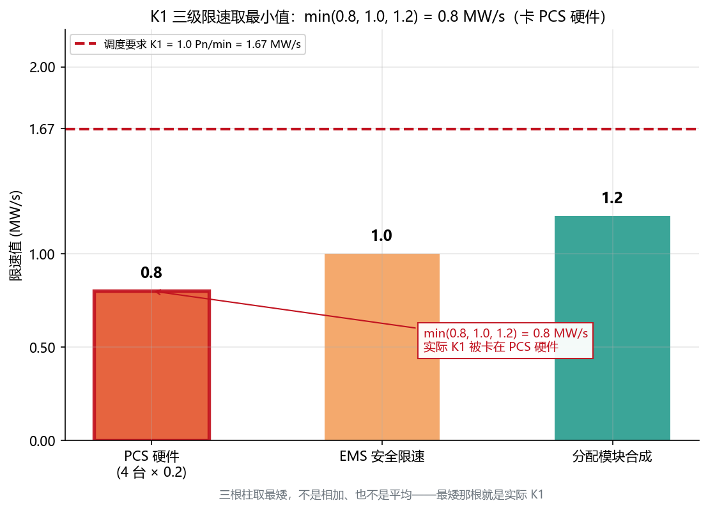
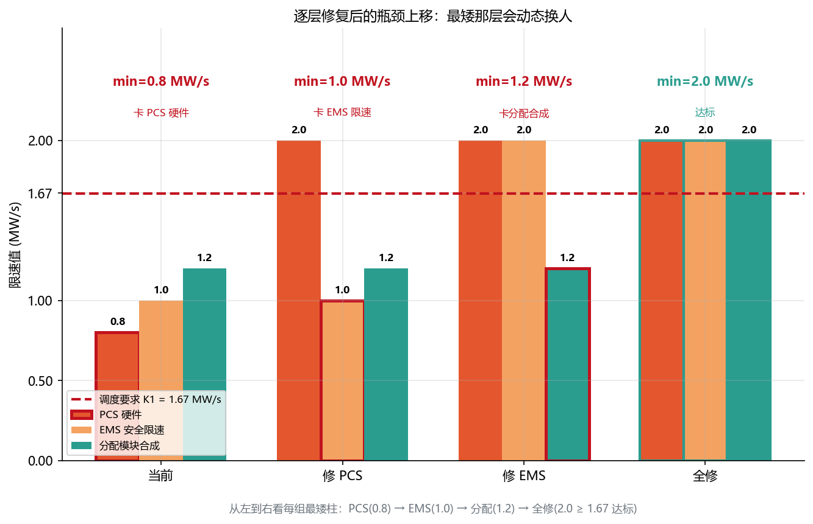

<!-- @AI_GENERATED -->
# 02 AGC的K1为什么不达标？调节速率的多级限速瓶颈与现场整定方法

> 所属层面：② 执行层 + ③ 精度层
> [课程首页](README.md) · 上一章：[01 ACE怎么算、AGC控什么](01_ACE与AGC控制模式.md) · 下一章：[03 AGC指令来了，风光储谁先动](03_AGC功率分配与动态补差.md)

**一句话**：K1 不达标，大概率不是硬件不行——是你 EMS 里的限速配置一层层把爬坡能力吃光了。PCS 理论上能跑 2.0 Pn/min，但现场把单台 ramp 设成 0.2 MW/s（4 台合成 0.8 MW/s = 0.48 Pn/min），再叠加 EMS 安全限速 1.0、分配合成 1.2，三级取最小值，最后只剩 0.48。

> ⏱ **三段速读**：
> - 5 分钟：读现场场景 + K1 叠加陷阱的 mermaid 图 → 理解三层限速链
> - 15 分钟：加读 K2（指令死区杀手）+ K3（调节精度 vs 控制偏差）→ 排查 K2/K3 不达标
> - 30 分钟：完整精读 + 手算示例 → 掌握端到端整定方法

## 现场场景【必读】

承接[01 章](01_ACE与AGC控制模式.md)：邻省 600 MW 机组跳闸后，省调按 TBC 算得 `ACE = −50 MW`，向华东某 **100 MW / 200 MWh 储能电站**（4 台 25 MW PCS）下发 AGC"上调 50 MW"指令。

周一早上，你收到调度发来的上一周 AGC 考核明细：K1（调节速率）全周平均只有 **0.48 Pn/min**——而细则要求是 1.0 Pn/min。储能 PCS 是电力电子设备，理论上能跑 2.0 Pn/min，为什么实际连要求的一半都不到？不是硬件不行，是三层限速里**最小的一层**把能力卡死了：

1. 每台 PCS 的 ramp rate 设成了 0.2 MW/s，4 台合成 0.8 MW/s（= 0.48 Pn/min）——这一层是**最小值**，等于从硬件层把 K1 卡死；
2. EMS 里的"安全爬坡限速"又套了一层 1.0 MW/s（= 0.6 Pn/min）——比要求 1.67 低，是修好 PCS 后的**下一道卡**；
3. AGC 分配模块的合成速率是 1.2 MW/s（= 0.72 Pn/min）——虽然比前两层高，但仍低于要求 1.67，是修好前两层之后的**第三道卡**。

三层不是"累加衰减"，而是**取最小值**：`min(0.8, 1.0, 1.2) = 0.8 MW/s = 0.48 Pn/min`，当前瓶颈在 PCS 硬件——而且三层**都低于**要求 1.67 MW/s。你修好最小的 PCS 层之后，瓶颈会依次"上移"到 EMS 安全限速、再上移到分配模块合成，必须把三层都抬到 ≥1.67 才算真正达标。

**爬坡速率不是越多越好，但你的每一层限制都在吃掉 K1 的余量——而且只由最小那一层决定。**

**本章回答三个问题**：

1. 细则的"≥1.0 Pn/min"怎么翻译成 PCS 的 ramp rate 配置值？
2. 为什么三层限速是"取最小"而不是"累减"，瓶颈怎么定位？
3. K2（响应时间）和 K3（调节精度）的典型卡点在哪里？

## 本章目标

读完本章，你应能：

1. 把细则里的"调节速率 ≥1.0 Pn/min"翻译成 PCS ramp rate 的配置值；
2. 计算端到端的 AGC 响应时间预算，判断通信与计算的延迟是否超标；
3. 区分"调节精度"和"控制偏差"两个概念，避免考核口径混淆。

## 本章边界与假设

本章实现**场站侧 K1 多级限速的瓶颈定位**（三级取最小），并给出把细则速率要求反推到单台 PCS 配置值的方法；不实现调度主站如何分配 AGC 指令（见[03 章](03_AGC功率分配与动态补差.md)），也不实现 K1/K2/K3 的评分公式（见[07 章](07_AGC月度考核与结算模型.md)）与 104 通信链路（见[06 章](06_AGC的IEC104链路与状态机.md)）。

**前置**：[01 章](01_ACE与AGC控制模式.md)（ACE 与三种控制模式）。

> ⚠️ **简化假设声明**：本章以"4 台 25 MW PCS、单台 ramp 0.2 MW/s、4 台合成 0.8 MW/s"作为 [教学示例]，说明"三级取最小"的瓶颈定位方法。真实项目的 PCS 台数、单台 ramp、安全限速值均由设备参数与调度细则决定，场站整定时须以现场实测 ramp 曲线和细则限值为准。

## 参数一：调节速率 K1【必懂】

### 定义

调节速率描述 AGC 指令变化后，场站出力**实际变化**的速度：

```text
K1 = ΔP_actual / Δt        （单位：MW/min 或 Pn/min）
```

| 以 Pn 为基准 | 含义 | 典型取值 |
|---|---|---|
| K1 = 1.0 Pn/min | 每分钟出力可以变化 1 倍额定功率 | 储能（电力电子快响应） |
| K1 = 0.5 Pn/min | 每分钟出力可以变化 0.5 倍额定功率 | 光伏（无储能参与） |
| K1 = 0.2 Pn/min | 每分钟出力可以变化 0.2 倍额定功率 | 风电（机械限速） |

### 为什么不同资源 K1 不同

> 💡 **读完这张表你应该知道**：如果是储能场站，硬件 K1 根本不是瓶颈（PCS 轻松跑 2.0 Pn/min）。K1 不达标的根因 90% 不在硬件，在下一节的"K1 叠加陷阱"——EMS 多级限速链。

| 资源 | K1 典型范围 | 物理约束 |
|---|---|---|
| 储能 PCS | 1.0~2.0 Pn/min | 电力电子响应快，百毫秒到秒级爬坡 |
| 光伏逆变器 | 0.5~1.0 Pn/min | 电力电子，但受辐照波动影响 |
| 双馈风电 | 0.2~0.5 Pn/min | 受变桨速率和风功率波动限制 |
| 直驱风电 | 0.3~0.8 Pn/min | 全功率变流器，比双馈略快 |

### K1 的叠加陷阱【必懂】

这是本章现场场景的核心问题。AGC 的 K1 是**多级限速的瓶颈值**：



| 限速环节 | 典型值 | 说明 |
|---|---|---|
| 调度要求 | 1.0 Pn/min（目标） | 考核用的基准 |
| EMS 安全限速 | 可配置（如 1.2 Pn/min） | 防止指令突变，但设置过低会卡 K1 |
| 分配模块限速 | 按各资源 ramp 比例合成 | 多个子资源的速率合成后可能低于预期 |
| PCS ramp rate | 设备参数（如 0.8 MW/s = 0.48 Pn/min） | 硬件硬上限 |

**工程原则**：从调度要求的 K1 出发，逐层反推，保证每一层的限速 ≥ 上一层：

```text
调度要求 K1 = 1.0 Pn/min
→ EMS 安全限速 ≥ 1.2 Pn/min（留 20% 余量）
→ 分配模块合成速率 ≥ 1.2 Pn/min
→ 各 PCS ramp rate ≥ 合成要求 ÷ 参与分配的 PCS 数量
```

> 💻 **代码落地**——三级限速校验逻辑（EMS 每次收到 AGC 指令时执行）：
>
> ```python
> def check_ramp_rate_multilevel(
>     pcs_ramp: float,        # PCS 硬件级 ramp rate (MW/s)
>     ems_safety_limit: float, # EMS 安全限速 (MW/s)
>     alloc_synthesis: float,  # 分配模块合成速率 (MW/s)
>     k1_required: float,      # 调度要求 K1 (MW/s)
>     margin: float = 1.2      # 安全裕量系数
> ) -> dict:
>     """逐层校验 AGC 多级限速链路，定位瓶颈环节"""
>     effective = min(pcs_ramp, ems_safety_limit, alloc_synthesis)
>
>     result = {
>         "k1_effective": effective,        # 实际可用 ramp rate（瓶颈值）
>         "target_with_margin": k1_required * margin,
>         "pass": effective >= k1_required * margin,
>         "bottleneck": None                # 瓶颈到底在哪一层
>     }
>
>     if not result["pass"]:
>         if pcs_ramp < k1_required * margin:
>             result["bottleneck"] = "PCS硬件"
>         elif ems_safety_limit < k1_required * margin:
>             result["bottleneck"] = "EMS安全限速"
>         else:
>             result["bottleneck"] = "分配模块合成"
>
>     return result
>
> # 现场场景示例：K1_required=1.0 Pn/min=1.67 MW/s
> # PCS ramp=0.8 MW/s, EMS限速=1.0 MW/s, 合成=1.2 MW/s
> # → effective=min(0.8,1.0,1.2)=0.8 → 卡在 PCS 硬件层
> ```

> **软件类比**：三级限速就像同一条流水线上**串了三个令牌桶限流器**——调度要求是"期望吞吐 1.67 MW/s"，PCS 硬件、EMS 安全限速、分配模块合成各是一个令牌桶，各自限制"每秒放出多少令牌（MW/s）"。整条链路的总吞吐由**最慢的那个桶**决定，跟另外两个桶还剩多少容量无关：你把中间那个桶无限扩容，只要最前面那个桶还是 0.8，链路吞吐就还是 0.8。
>
> **类比失效点**：令牌桶里"最慢桶决定吞吐"成立的前提是**桶之间串联且有排队缓冲**——请求慢了会"排队等待"但最终仍会通过。而 EMS 的多级限速发生在**同一个控制周期内的先后校验**，它不会"攒令牌"：上一个周期没放完的爬坡能力**不会积累**到下一个周期。更关键的差别是，软件限流超限只是"请求变慢"，而 AGC 限速超限是"**出力直接到不了指令值**"——缺失的出力会同时变成 K1（速率）与 K3（精度）的考核扣分，是真金白银的损失，不是"多等一会儿"。

### 配图：三级限速取最小值



| 编号 | 位置 | 标注 | 对应正文 |
|---|---|---|---|
| ① | 左柱（红，加粗框） | PCS硬件 = 0.8 MW/s | 现场场景第 1 层：4 台 × 0.2 合成 |
| ② | 中柱（橙） | EMS安全限速 = 1.0 MW/s | 现场场景第 2 层 |
| ③ | 右柱（绿） | 分配模块合成 = 1.2 MW/s | 现场场景第 3 层 |
| ④ | 虚线 | 调度要求 K1 = 1.0 Pn/min = 1.67 MW/s | 手算第 1 步：单位换算 |
| ⑤ | 标注框 | min(0.8,1.0,1.2)=0.8 → 卡在 PCS 硬件 | 现场场景"取最小值"结论 |

> 👁 **怎么看这张图**：先看**虚线**——调度要求是 1.67 MW/s；再看三根柱——没有一根够到虚线，而**最矮的那根（PCS 0.8）**就是实际 K1。三根柱取最矮，不是三根相加、也不是三根平均，这就是"三级限速取最小值"的全部含义。

### 手算示例【必懂】

`Pn = 100 MW`，调度要求 K1 ≥ 1.0 Pn/min。手算分三步：先换算单位、再逐层反推、最后代入现场配置定位瓶颈。

**第一步：把细则要求换算成速率**

```text
K1_target = 1.0 Pn/min = 1.0 × 100 MW / 60 s = 1.67 MW/s
```

**第二步：逐层反推每级限速至少要设多少（留 20% 余量则再 ×1.2）**

```text
调度要求 K1        = 1.67 MW/s（1.0 Pn/min）
分配模块合成速率   ≥ 1.67 × 1.2 = 2.0 MW/s
EMS 安全限速       ≥ 1.67 × 1.2 = 2.0 MW/s
单台 PCS ramp      ≥ 2.0 / 4 = 0.5 MW/s（4 台 25 MW PCS 均分）
```

**第三步：把现场当前配置代进去，看卡在哪一层**

```text
现场当前配置：
  单台 PCS ramp = 0.2 MW/s → 4 台合成 0.8 MW/s（0.48 Pn/min）
  EMS 安全限速  = 1.0 MW/s（0.6 Pn/min）
  分配模块合成  = 1.2 MW/s（0.72 Pn/min）

三层取最小：min(0.8, 1.0, 1.2) = 0.8 MW/s = 0.48 Pn/min → 卡在 PCS 硬件
```

单台 PCS 需要 ≥0.42 MW/s（不留余量）或 ≥0.5 MW/s（留 20%），现场只有 0.2，差了一倍多。把 PCS 抬到 0.5（4 台合成 2.0）之后，`min(2.0, 1.0, 1.2) = 1.0`，瓶颈**上移**到 EMS 安全限速；再把 EMS 抬到 2.0，`min(2.0, 2.0, 1.2) = 1.2`，瓶颈又上移到分配层——**必须三层都 ≥1.67（留余量则 ≥2.0），K1 才真正达标**。

| 层 | 现场当前值 | 要求（不留余量） | 要求（留 20% 余量） | 是否达标 |
|---|---|---|---|---|
| 单台 PCS ramp | 0.2 MW/s | ≥0.42 MW/s | ≥0.5 MW/s | ❌ |
| EMS 安全限速 | 1.0 MW/s | ≥1.67 MW/s | ≥2.0 MW/s | ❌ |
| 分配模块合成 | 1.2 MW/s | ≥1.67 MW/s | ≥2.0 MW/s | ❌ |

> 💡 **为什么"留 20% 余量"**：调度按 K1 实际值打分（见 [04 章](04_AGC考核指标与统计口径.md)），若把限速卡在正好 1.67 MW/s，任何一点波动（测量抖动、温度降额、SOC 变化）都会让实际 K1 掉到 1.0 Pn/min 以下被扣分。留 20% 余量（限速 ≥2.0 MW/s）是工程安全垫，对应代码里的 `margin = 1.2`。

### 配图：逐层修复后的瓶颈上移



| 编号 | 位置 | 标注 | 对应正文 |
|---|---|---|---|
| ① | 第 1 组最矮柱 | 当前 min = 0.8 → 卡在 PCS 硬件 | 现场场景"取最小值"结论 |
| ② | 第 2 组最矮柱 | 修 PCS 后 min = 1.0 → 卡在 EMS | 手算第三步：瓶颈上移 |
| ③ | 第 3 组最矮柱 | 修 EMS 后 min = 1.2 → 卡在分配 | 手算第三步：瓶颈再上移 |
| ④ | 第 4 组最矮柱 | 全修 min = 2.0 ≥ 1.67 → 达标 | 手算第三步：三层都 ≥2.0 |
| ⑤ | 虚线 | 调度要求 K1 = 1.67 MW/s | 手算第 1 步：单位换算 |

> 👁 **怎么看这张图**：从左到右看**每一组里最矮的那根柱**——它先是 PCS（0.8），修好后变成 EMS（1.0），再修变成分配（1.2），最后全部越过 1.67 虚线。这就是"瓶颈是动态的"：每次你只修了最矮那层，下一个最矮层就露出来，直到全部达标。

---

## 参数二：响应时间 K2【了解】

### 定义

响应时间是从**调度主站发出 AGC 指令**到**场站出力开始可靠变化**的时间。

```text
K2 = t_start − t_cmd_issued
```

| 环节 | 典型耗时 | 说明 |
|---|---|---|
| ① 104 轮询（最差 = 轮询周期） | 4 s | 调度下发 → EMS 接收，K2 预算里唯一不可控的大头 |
| ② EMS 解析 + 合理性校验 | 0.5 s | 指令合理性校验、死区判定 |
| ③ 死区判定 + 分配计算 | 0.5 s | 死区判断与分配算法执行 |
| ④ EMS → PCS 下发 | 0.5 s | 协议与网络延迟 |
| ⑤ PCS 内部响应 | 1.0 s | 设备内部指令跟踪 |
| ⑥ 出力变化到达阈值 | 3.0 s | 出力爬到目标附近、判定"开始可靠变化"的阈值 |
| **K2 合计（最差）** | **9.5 s** | 4 + 0.5 + 0.5 + 0.5 + 1.0 + 3.0 = 9.5 s |

> ⚠️ 这组数值与 [04 章](04_AGC考核指标与统计口径.md)「K2 的时间预算」代码里的 `k2_chain_budget` **逐项一致**：`4 + 0.5 + 0.5 + 0.5 + 1 + 3 = 9.5 s`。K2 限值 30 s，9.5 s 只占约 32%，正常情况下余量充足。

### 手算：K2 端到端时间预算

按最差情况逐环相加，得到端到端预算：

```text
K2 预算 = 104轮询 4.0 + EMS解析 0.5 + 死区+分配 0.5
        + EMS→PCS 0.5 + PCS响应 1.0 + 到达阈值 3.0
        = 9.5 s

对比储能 K2 限值 30 s：
  余量 = 30 − 9.5 = 20.5 s（占 68.3%）

结论：K2 的威胁不是"走得慢"，而是"根本不动"——见下一节指令死区。
```

### 指令死区——K2 的头号杀手【了解】

[00 章](00_AGC闭环控制链路.md)里的考核不合格事件中，K2 的根因是**指令死区设置过大**。

```text
EMS 收到 AGC 指令：100 MW → 101.2 MW（变化 +1.2 MW）
EMS 指令死区：±2.0 MW
判定：1.2 < 2.0 → "变化太小，不跟踪" → 不出力
```

这个逻辑在保护 PCS 避免频繁微调上是对的，但对 AGC 考核来说：
- 调度 K2 统计的是"从指令下达到 EMS 确认开始执行的时间"
- 如果 EMS 判定"变化太小不跟踪"，K2 就等于"超时"→ 不合格

| 指令死区大小 | 优点 | 缺点 |
|---|---|---|
| 大（如 ±2.0 MW） | 设备少动、寿命长 | 小步长指令不跟踪 → K2 不合格 |
| 中（如 ±0.5 MW） | 平衡 | 通常 OK |
| 小（如 ±0.1 MW） | 所有指令都跟踪 | 可能频繁微调、设备抖动 |

**工程建议**：指令死区 ≤ 调度指令的最小步长。如果不知道最小步长，设为 **0.1%~0.3% Pn** 作为起点，再根据考核数据微调。

#### 手算：死区边界（为什么 1.2 MW 会被"吃"掉）

以本章现场场景为例：指令死区 `deadband = 2.0 MW`，上一拍出力 `p_prev = 100 MW`：

```text
新指令 p_new = 101.2 MW（变化 +1.2 MW）
  |p_new − p_prev| = |101.2 − 100| = 1.2 MW
  1.2 < 2.0 → 判定"变化太小，不跟踪"

新指令 p_new = 102.0 MW（变化 +2.0 MW，恰好等于死区）
  |102.0 − 100| = 2.0 MW
  2.0 ≥ 2.0 → 判定"达到死区，跟踪"
```

边界规则是**大于等于**（`>=`）才跟踪：恰好等于死区值会跟踪，小于死区值（哪怕只小 0.1 MW）也会被判定为"变化太小"。

#### 概念实现

```python
def should_track(p_new: float, p_prev: float, deadband_mw: float) -> bool:
    """指令死区判定：变化量 |p_new − p_prev| ≥ deadband_mw 才跟踪。"""
    return abs(p_new - p_prev) >= deadband_mw
```

#### 逐拍追踪

以 `deadband_mw = 2.0`、`p_prev = 100.0` 为例，逐拍验证四类输入：

| 拍 | 输入 p_new | 变化量 \|p_new−p_prev\| | 输出 | 说明 |
|---|---|---|---|---|
| t=0 | 100.0 | 0.0 | False | 初始无变化，不跟踪 |
| t=1 | 102.0 | 2.0 | **True** | 恰好等于死区边界，跟踪 |
| t=2 | 101.2 | 1.2 | False | 连续小步长，不跟踪 → K2 的"头号杀手" |
| t=3 | 98.0 | 2.0 | **True** | 反向同幅，同样触发跟踪 |

> t=1 与 t=2 的对比给出边界答案：变化量 2.0 会跟踪，变化量 1.2 不会——**恰好等于死区算跟踪**。

---

## 参数三：调节精度 K3【了解】

### 定义

调节精度是 AGC 指令执行后，场站**稳态出力与目标值之间的偏差**：

```text
K3 = |P_actual_steadystate − P_target| / Pn × 100%
```

| K3 要求 | 含义 |
|---|---|
| ≤ ±3% Pn | 100 MW 场站，稳态偏差 ≤3 MW |
| ≤ ±2% Pn | 更严格，需要更精细的分配与反馈 |
| ≤ ±1% Pn | 很少单独要求 AGC，通常兼顾一次调频控制偏差 |

### 手算：K3 精度代入

以本章现场场景为例：`Pn = 100 MW`，调度下发目标 `P_target = 100 MW`，实际稳态出力 `P_actual = 97.5 MW`（对应下表中"分配精度不足"的表现）：

```text
K3 = |P_actual − P_target| / Pn × 100%
   = |97.5 − 100| / 100 × 100%
   = 2.5%
```

对照限值：细则要求 `≤ ±3% Pn` 时 2.5% 合格；若要求 `≤ ±2% Pn`，则 2.5% 不合格——差的正是"目标 100、实际 97.5"这 2.5 MW 的分配精度。

### K3 不达标的三个根因

| 根因 | 表现 | 排查方法 |
|---|---|---|
| 分配精度不足 | 总出力离目标差一点（如目标 100 MW，实际 97.5 MW） | 查分配模块的舍入逻辑与容量比例计算 |
| 反馈数据滞后 | 实际已到目标，但反馈值还在爬坡 | 对比 PCS 本地反馈与 EMS 采集值的时差 |
| 设备实际能力不足 | 要求出 100 MW，但某一 PCS 已到上限 | 查实时可调容量与分配指令的差异 |

### 调节精度 vs 控制偏差

| 维度 | AGC 调节精度 K3 | 一次调频控制偏差 |
|---|---|---|
| 比较对象 | P_actual vs P_target（调度给的） | P_actual vs P_theory（按频率和参数反算的） |
| 考核方 | 调度主站 | 调度主站 / 试验单位 |
| 时间窗口 | 指令执行后的稳态时段 | 频率越死区事件期间 |

---

## 参数四：调节范围【了解】

### 定义

AGC 调节范围是场站在 AGC 模式下可以被调度调节的**出力区间**：

```text
P_min ≤ P_total ≤ P_max
```

| 约束 | 来源 | 典型取值 |
|---|---|---|
| P_max | 设备最大出力 / 并网协议 | 通常 = Pn |
| P_min | 最低稳燃/稳定运行出力 | 光伏 0%~10% Pn，储能 0% Pn（可双向），火电 30%~50% Pn |

### 调节范围对经济性的影响

AGC 调节范围越宽，场站在辅助服务市场中的**可调节容量**越大，可获得的补偿越多。但代价是：
- 频繁深调会增加设备损耗；
- 光伏留裕度会损失发电量（弃光损失）；
- 储能低 SOC 运行时调节能力不对称。

这个"宽调节 vs 低成本"的权衡在[07b 章](07b_AGC辅助服务经济性决策.md)会专门展开。

---

## AGC 的两种指令模式【了解】

调度下发的 AGC 指令有两种形式，EMS 必须同时支持：

| 模式 | 指令内容 | 示例 | 适用 |
|---|---|---|---|
| **计划值模式** | 直接给出目标出力 | "AGC 目标 = 80 MW" | 大多数场景 |
| **增量模式** | 给出增量 + 基点 | "基点 75 MW，增量 +5 MW" | 需与一次调频增量区分 |

### 两种模式的切换风险

```text
风险场景：场站正在执行一次调频（ΔP_primary = +6 MW），
          AGC 以计划值模式下发"目标 = 70 MW"，
          如果 EMS 直接把总出力切到 70 MW，
          等于丢弃了一次调频的 +6 MW 贡献。

处理原则：
  ① 记录 AGC 基点 P_agc_base = 70 MW
  ② 保持一次调频增量 ΔP_primary = +6 MW
  ③ 下发总目标 = 70 + 6 = 76 MW
  ④ 等一次调频退出后（频率回死区），平滑回归到 70 MW
```

### 概念实现

两种模式的叠加与限幅，最终都落到"总目标 = clamp(基点 + 增量, P_min, P_max)"：

```python
def target_with_primary(p_agc_base: float, dp_primary: float,
                        p_min: float, p_max: float) -> float:
    """计划值模式下叠加一次调频增量并限幅。"""
    total = p_agc_base + dp_primary
    return max(p_min, min(total, p_max))   # 即 clamp(total, p_min, p_max)
```

> 计划值模式是它的特例（`dp_primary = 0` 时总目标 = 基点）；增量模式则先算 `基点 + 增量` 再走同一个限幅。两种模式共用一套叠加逻辑，避免切模式时丢掉一次调频贡献。上面风险场景代入：`target_with_primary(70, 6, 0, 100) = 76 MW`。

---

## AGC 与一次调频叠加时的限幅处理【了解】

当 AGC 指令与一次调频增量叠加时，总和可能超出设备/并网限幅：

```text
P_total = clamp(P_agc_base + ΔP_primary, P_min, P_max)
```

| 场景 | AGC 基点 | 一次调频增量 | 总和 | 限幅 | 实际 | 风险 |
|---|---|---|---|---|---|---|
| 正常 | 80 MW | +5 MW | 85 MW | 100 MW | 85 MW | 无 |
| 触上限 | 95 MW | +10 MW | 105 MW | 100 MW | 100 MW | 一次调频被裁掉 5 MW → 考核不合格 |
| 触下限 | 10 MW | −15 MW | −5 MW | 0 MW | 0 MW | 一次调频被裁掉 5 MW |

**处理原则**：如果 AGC 基点已经接近限幅，一次调频增量被裁剪时，必须记录被裁剪的部分，作为能力不足的证据（[06 章](06_AGC的IEC104链路与状态机.md)）。

### 概念实现

```python
def clamp(value: float, lo: float, hi: float) -> float:
    """把 value 限制在 [lo, hi] 区间内，超界就钳到边界。"""
    return max(lo, min(value, hi))
```

### 逐拍追踪

以 `lo = 0`、`hi = 100` 为例，逐拍验证四类输入（对应上表三种场景）：

| 拍 | 输入 value | 输出 | 说明 |
|---|---|---|---|
| t=0 | 85 | 85 | 正常：80 + 5 = 85，区间内原样返回 |
| t=1 | 100 | 100 | 恰好上边界，不裁 |
| t=2 | 105 | 105 → 100 | 触上限：95 + 10 = 105，裁掉 5 |
| t=3 | −5 | 0 | 触下限：10 − 15 = −5，钳到 0 |

> t=2 被裁掉的 5 MW 正是一次调频增量：不记录它，既丢了能力、又被考核记"未达标"——这就是上表"触上限"风险列的来源。

---

## 自测

1. K1 调节速率 = 1.0 Pn/min，对 100 MW 场站来说相当于多少 MW/s？如果 4 台 PCS 均分，每台 ramp rate 至少要多少？
2. AGC 的 K2 响应时间包含哪几个环节？哪个环节通常是瓶颈？
3. 指令死区设成 ±2 MW 导致 K2 不合格的根因是什么？
4. AGC 以计划值模式下发"目标 = 75 MW"，当前一次调频增量 = +8 MW，EMS 该怎么下发？

<details>
<summary>参考答案</summary>

1. 1.0 Pn/min = 100/60 = 1.67 MW/s。4 台均分 → 每台 ≥ 0.42 MW/s。
2. 调度→EMS（2~8 s）、EMS 解析与校验（0.1~0.5 s）、EMS 分配计算（0.1~0.3 s）、EMS→PCS（0.1~0.5 s）、PCS 响应（0.1~0.3 s）。瓶颈通常是 104 通信（调度→EMS），因为轮询周期决定了指令到达的最坏延迟。
3. 因为调度每次下发的指令变化量（如 0.5~1 MW）小于死区（2 MW），EMS 判定"变化太小不跟踪"，K2 被统计为"超时不合格"。
4. 记录 AGC 基点 75 MW，保持一次调频增量 +8 MW，下发总目标 = 83 MW。等一次调频退出（频率回死区）后平滑回归到 75 MW。不能直接用 75 MW 覆盖。

</details>

> 💻 **动手实验**：运行 `python lab/examples/ch02_ramp_rate.py` 复现本章三级限速校验（K1 瓶颈定位）与指令死区逐拍追踪（t=0/1/2/3 四拍）；运行 `python lab/tests/test_agc_core.py` 会复现本章全部断言。

<!-- @AI_GENERATED: end -->