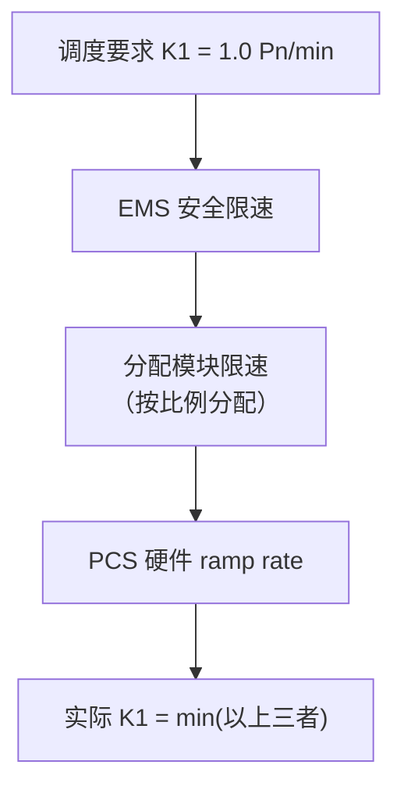

<!-- @AI_GENERATED -->
# 02 AGC的K1为什么不达标？调节速率的多级限速瓶颈与现场整定方法

> 所属层面：② 执行层 + ③ 精度层
> [课程首页](README.md) · 上一章：[01 ACE怎么算、AGC控什么](01_ACE与AGC控制模式.md) · 下一章：[03 AGC指令来了，风光储谁先动](03_AGC功率分配与动态补差.md)

**一句话**：K1 不达标，大概率不是硬件不行——是你 EMS 里的限速配置一层层把爬坡能力吃光了。PCS 能跑 2.0 Pn/min，经 EMS 安全限速→分配模块限速→单机 ramp rate 三级衰减，最后只剩 0.7。

## 现场场景【必读】

周一早上，你收到调度发来的上一周 AGC 考核明细。K1（调节速率）全周平均 0.7 Pn/min——而细则要求是 1.0 Pn/min。差的那 0.3 不是算法问题，是三个不同的配置项累加出来的：

1. PCS 的 ramp rate 设成了 0.8 MW/s（= 0.48 Pn/min），等于从硬件层面把 K1 卡死了；
2. EMS 里的"安全爬坡限速"又套了一层 1.0 MW/s（= 0.6 Pn/min），作为"保护措施"；
3. AGC 分配模块在做功率分配时，每个资源的爬坡速率是"按剩余容量比例再分"——三个约束套在一起，实际可用爬坡速率只有 0.7 Pn/min。

**爬坡速率不是越多越好，但你的每一层限制都在吃掉 K1 的余量。**

> ⏱ **三段速读**：
> - 5 分钟：读现场场景 + K1 叠加陷阱的 mermaid 图 → 理解三层限速链
> - 15 分钟：加读 K2（指令死区杀手）+ K3（调节精度 vs 控制偏差）→ 排查 K2/K3 不达标
> - 30 分钟：完整精读 + 手算示例 → 掌握端到端整定方法

## 本章目标

读完本章，你应能：

1. 把细则里的"调节速率 ≥1.0 Pn/min"翻译成 PCS ramp rate 的配置值；
2. 计算端到端的 AGC 响应时间预算，判断通信与计算的延迟是否超标；
3. 区分"调节精度"和"控制偏差"两个概念，避免考核口径混淆。

## 参数一：调节速率 K1【必懂】

### 定义

调节速率描述 AGC 指令变化后，场站出力**实际变化**的速度：

```text
K1 = ΔP_actual / Δt        （单位：MW/min 或 Pn/min）
```

| 以 Pn 为基准 | 含义 | 典型取值 |
|---|---|---|
| K1 = 1.0 Pn/min | 每分钟出力可以变化 1 倍额定功率 | 储能（电力电子快响应） |
| K1 = 0.5 Pn/min | 每分钟出力可以变化 0.5 倍额定功率 | 光伏（无储能参与） |
| K1 = 0.2 Pn/min | 每分钟出力可以变化 0.2 倍额定功率 | 风电（机械限速） |

### 为什么不同资源 K1 不同

> 💡 **读完这张表你应该知道**：如果是储能场站，硬件 K1 根本不是瓶颈（PCS 轻松跑 2.0 Pn/min）。K1 不达标的根因 90% 不在硬件，在下一节的"K1 叠加陷阱"——EMS 多级限速链。

| 资源 | K1 典型范围 | 物理约束 |
|---|---|---|
| 储能 PCS | 1.0~2.0 Pn/min | 电力电子响应快，百毫秒到秒级爬坡 |
| 光伏逆变器 | 0.5~1.0 Pn/min | 电力电子，但受辐照波动影响 |
| 双馈风电 | 0.2~0.5 Pn/min | 受变桨速率和风功率波动限制 |
| 直驱风电 | 0.3~0.8 Pn/min | 全功率变流器，比双馈略快 |

### K1 的叠加陷阱【必懂】

这是本章现场场景的核心问题。AGC 的 K1 是**多级限速的瓶颈值**：



| 限速环节 | 典型值 | 说明 |
|---|---|---|
| 调度要求 | 1.0 Pn/min（目标） | 考核用的基准 |
| EMS 安全限速 | 可配置（如 1.2 Pn/min） | 防止指令突变，但设置过低会卡 K1 |
| 分配模块限速 | 按各资源 ramp 比例合成 | 多个子资源的速率合成后可能低于预期 |
| PCS ramp rate | 设备参数（如 0.8 MW/s = 0.48 Pn/min） | 硬件硬上限 |

**工程原则**：从调度要求的 K1 出发，逐层反推，保证每一层的限速 ≥ 上一层：

```text
调度要求 K1 = 1.0 Pn/min
→ EMS 安全限速 ≥ 1.2 Pn/min（留 20% 余量）
→ 分配模块合成速率 ≥ 1.2 Pn/min
→ 各 PCS ramp rate ≥ 合成要求 ÷ 参与分配的 PCS 数量
```

> 💻 **代码落地**——三级限速校验逻辑（EMS 每次收到 AGC 指令时执行）：
>
> ```python
> def check_ramp_rate_multilevel(
>     pcs_ramp: float,        # PCS 硬件级 ramp rate (MW/s)
>     ems_safety_limit: float, # EMS 安全限速 (MW/s)
>     alloc_synthesis: float,  # 分配模块合成速率 (MW/s)
>     k1_required: float,      # 调度要求 K1 (MW/s)
>     margin: float = 1.2      # 安全裕量系数
> ) -> dict:
>     """逐层校验 AGC 多级限速链路，定位瓶颈环节"""
>     effective = min(pcs_ramp, ems_safety_limit, alloc_synthesis)
>
>     result = {
>         "k1_effective": effective,        # 实际可用 ramp rate（瓶颈值）
>         "target_with_margin": k1_required * margin,
>         "pass": effective >= k1_required * margin,
>         "bottleneck": None                # 瓶颈到底在哪一层
>     }
>
>     if not result["pass"]:
>         if pcs_ramp < k1_required * margin:
>             result["bottleneck"] = "PCS硬件"
>         elif ems_safety_limit < k1_required * margin:
>             result["bottleneck"] = "EMS安全限速"
>         else:
>             result["bottleneck"] = "分配模块合成"
>
>     return result
>
> # 现场场景示例：K1_required=1.0 Pn/min=1.67 MW/s
> # PCS ramp=0.8 MW/s, EMS限速=1.0 MW/s, 合成=1.2 MW/s
> # → effective=min(0.8,1.0,1.2)=0.8 → 卡在 PCS 硬件层
> ```

### 手算示例【必懂】

`Pn = 100 MW`，调度要求 K1 ≥ 1.0 Pn/min：

```text
K1_target = 1.0 × 100 MW / 60 s = 1.67 MW/s

各环节限速应 ≥ 1.67 MW/s：
  EMS 安全限速    ≥ 1.67 MW/s（不可以设成 1.0 MW/s！）
  单台 PCS ramp   ≥ 1.67 / N MW/s（N = 参与 AGC 的 PCS 数量）
```

如果有 4 台 25 MW PCS 参与 AGC：

```text
单台 PCS 需要 ramp rate ≥ 1.67 / 4 = 0.42 MW/s
```

实际 PCS 的 ramp rate 参数如果设为 0.8 MW/s（≥ 0.42），满足要求。但如果 EMS 的"安全限速"不小心设成了 1.0 MW/s（< 1.67），**整个 K1 就被 EMS 自己卡死了**。

---

## 参数二：响应时间 K2【必懂】

### 定义

响应时间是从**调度主站发出 AGC 指令**到**场站出力开始可靠变化**的时间。

```text
K2 = t_start − t_cmd_issued
```

| 阶段 | 典型延迟 | 说明 |
|---|---|---|
| 调度主站 → EMS | 2~8 s | 取决于 104 轮询周期与网络延迟 |
| EMS 解析与校验 | 0.1~0.5 s | 指令合理性校验、死区判定 |
| EMS 分配计算 | 0.1~0.3 s | 分配算法执行时间 |
| EMS → PCS | 0.1~0.5 s | 取决于协议与网络 |
| PCS 响应 | 0.1~0.3 s | 设备内部指令跟踪 |
| **K2 合计** | **约 2.5~10 s** | 对比限值 30 s，通常有足够余量 |

### 指令死区——K2 的头号杀手【必懂】

[00 章](00_AGC闭环控制链路.md)里的考核不合格事件中，K2 的根因是**指令死区设置过大**。

```text
EMS 收到 AGC 指令：100 MW → 101.2 MW（变化 +1.2 MW）
EMS 指令死区：±2.0 MW
判定：1.2 < 2.0 → "变化太小，不跟踪" → 不出力
```

这个逻辑在保护 PCS 避免频繁微调上是对的，但对 AGC 考核来说：
- 调度 K2 统计的是"从指令下达到 EMS 确认开始执行的时间"
- 如果 EMS 判定"变化太小不跟踪"，K2 就等于"超时"→ 不合格

| 指令死区大小 | 优点 | 缺点 |
|---|---|---|
| 大（如 ±2.0 MW） | 设备少动、寿命长 | 小步长指令不跟踪 → K2 不合格 |
| 中（如 ±0.5 MW） | 平衡 | 通常 OK |
| 小（如 ±0.1 MW） | 所有指令都跟踪 | 可能频繁微调、设备抖动 |

**工程建议**：指令死区 ≤ 调度指令的最小步长。如果不知道最小步长，设为 **0.1%~0.3% Pn** 作为起点，再根据考核数据微调。

---

## 参数三：调节精度 K3【必懂】

### 定义

调节精度是 AGC 指令执行后，场站**稳态出力与目标值之间的偏差**：

```text
K3 = |P_actual_steadystate − P_target| / Pn × 100%
```

| K3 要求 | 含义 |
|---|---|
| ≤ ±3% Pn | 100 MW 场站，稳态偏差 ≤3 MW |
| ≤ ±2% Pn | 更严格，需要更精细的分配与反馈 |
| ≤ ±1% Pn | 很少单独要求 AGC，通常兼顾一次调频控制偏差 |

### K3 不达标的三个根因

| 根因 | 表现 | 排查方法 |
|---|---|---|
| 分配精度不足 | 总出力离目标差一点（如目标 100 MW，实际 97.5 MW） | 查分配模块的舍入逻辑与容量比例计算 |
| 反馈数据滞后 | 实际已到目标，但反馈值还在爬坡 | 对比 PCS 本地反馈与 EMS 采集值的时差 |
| 设备实际能力不足 | 要求出 100 MW，但某一 PCS 已到上限 | 查实时可调容量与分配指令的差异 |

### 调节精度 vs 控制偏差

| 维度 | AGC 调节精度 K3 | 一次调频控制偏差 |
|---|---|---|
| 比较对象 | P_actual vs P_target（调度给的） | P_actual vs P_theory（按频率和参数反算的） |
| 考核方 | 调度主站 | 调度主站 / 试验单位 |
| 时间窗口 | 指令执行后的稳态时段 | 频率越死区事件期间 |

---

## 参数四：调节范围【必懂】

### 定义

AGC 调节范围是场站在 AGC 模式下可以被调度调节的**出力区间**：

```text
P_min ≤ P_total ≤ P_max
```

| 约束 | 来源 | 典型取值 |
|---|---|---|
| P_max | 设备最大出力 / 并网协议 | 通常 = Pn |
| P_min | 最低稳燃/稳定运行出力 | 光伏 0%~10% Pn，储能 0% Pn（可双向），火电 30%~50% Pn |

### 调节范围对经济性的影响

AGC 调节范围越宽，场站在辅助服务市场中的**可调节容量**越大，可获得的补偿越多。但代价是：
- 频繁深调会增加设备损耗；
- 光伏留裕度会损失发电量（弃光损失）；
- 储能低 SOC 运行时调节能力不对称。

这个"宽调节 vs 低成本"的权衡在[07b 章](07b_AGC辅助服务经济性决策.md)会专门展开。

---

## AGC 的两种指令模式【必懂】

调度下发的 AGC 指令有两种形式，EMS 必须同时支持：

| 模式 | 指令内容 | 示例 | 适用 |
|---|---|---|---|
| **计划值模式** | 直接给出目标出力 | "AGC 目标 = 80 MW" | 大多数场景 |
| **增量模式** | 给出增量 + 基点 | "基点 75 MW，增量 +5 MW" | 需与一次调频增量区分 |

### 两种模式的切换风险

```text
风险场景：场站正在执行一次调频（ΔP_primary = +6 MW），
          AGC 以计划值模式下发"目标 = 70 MW"，
          如果 EMS 直接把总出力切到 70 MW，
          等于丢弃了一次调频的 +6 MW 贡献。

处理原则：
  ① 记录 AGC 基点 P_agc_base = 70 MW
  ② 保持一次调频增量 ΔP_primary = +6 MW
  ③ 下发总目标 = 70 + 6 = 76 MW
  ④ 等一次调频退出后（频率回死区），平滑回归到 70 MW
```

---

## AGC 与一次调频叠加时的限幅处理【必懂】

当 AGC 指令与一次调频增量叠加时，总和可能超出设备/并网限幅：

```text
P_total = clamp(P_agc_base + ΔP_primary, P_min, P_max)
```

| 场景 | AGC 基点 | 一次调频增量 | 总和 | 限幅 | 实际 | 风险 |
|---|---|---|---|---|---|---|
| 正常 | 80 MW | +5 MW | 85 MW | 100 MW | 85 MW | 无 |
| 触上限 | 95 MW | +10 MW | 105 MW | 100 MW | 100 MW | 一次调频被裁掉 5 MW → 考核不合格 |
| 触下限 | 10 MW | −15 MW | −5 MW | 0 MW | 0 MW | 一次调频被裁掉 5 MW |

**处理原则**：如果 AGC 基点已经接近限幅，一次调频增量被裁剪时，必须记录被裁剪的部分，作为能力不足的证据（[06 章](06_AGC的IEC104链路与状态机.md)）。

---

## 自测

1. K1 调节速率 = 1.0 Pn/min，对 100 MW 场站来说相当于多少 MW/s？如果 4 台 PCS 均分，每台 ramp rate 至少要多少？
2. AGC 的 K2 响应时间包含哪几个环节？哪个环节通常是瓶颈？
3. 指令死区设成 ±2 MW 导致 K2 不合格的根因是什么？
4. AGC 以计划值模式下发"目标 = 75 MW"，当前一次调频增量 = +8 MW，EMS 该怎么下发？

<details>
<summary>参考答案</summary>

1. 1.0 Pn/min = 100/60 = 1.67 MW/s。4 台均分 → 每台 ≥ 0.42 MW/s。
2. 调度→EMS（2~8 s）、EMS 解析与校验（0.1~0.5 s）、EMS 分配计算（0.1~0.3 s）、EMS→PCS（0.1~0.5 s）、PCS 响应（0.1~0.3 s）。瓶颈通常是 104 通信（调度→EMS），因为轮询周期决定了指令到达的最坏延迟。
3. 因为调度每次下发的指令变化量（如 0.5~1 MW）小于死区（2 MW），EMS 判定"变化太小不跟踪"，K2 被统计为"超时不合格"。
4. 记录 AGC 基点 75 MW，保持一次调频增量 +8 MW，下发总目标 = 83 MW。等一次调频退出（频率回死区）后平滑回归到 75 MW。不能直接用 75 MW 覆盖。

</details>

> 💻 **动手实验**：运行 `python lab/ch02_ramp_rate.py` 复现本章三级校验逻辑（调度要求 K1→EMS 安全→PCS 硬件），验证 K1 瓶颈定位与 4-PCS 并行场景。

<!-- @AI_GENERATED: end -->