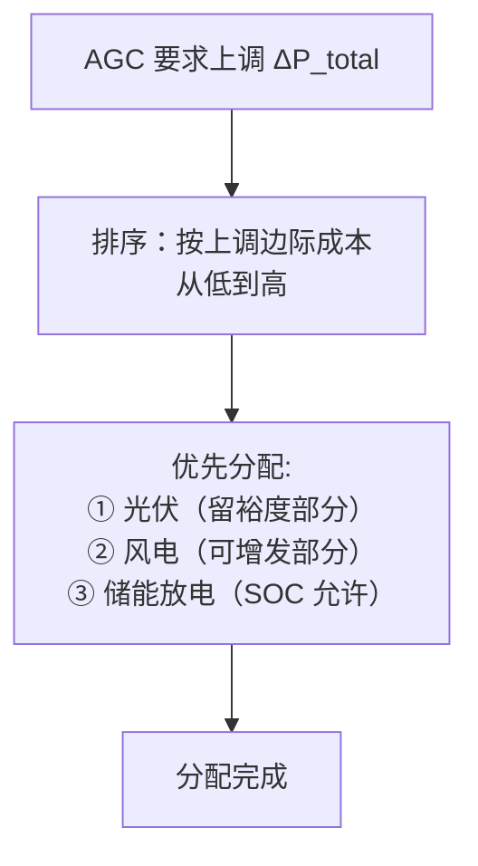
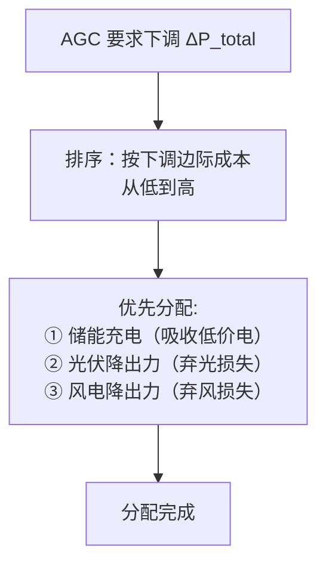
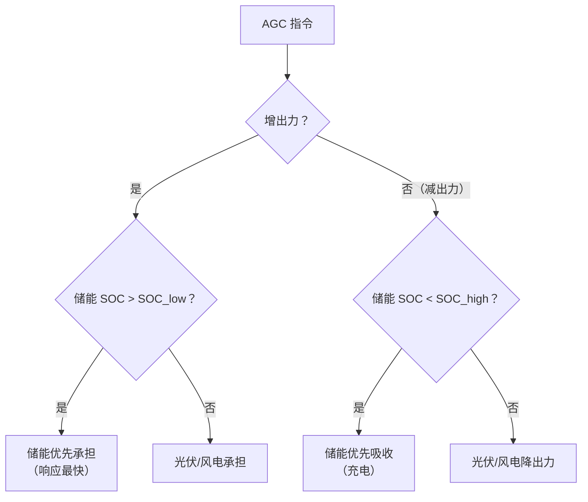
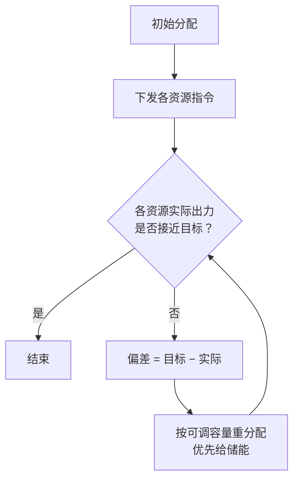

<!-- @AI_GENERATED -->
# 03 AGC指令来了，风光储谁先动？多资源功率分配策略与动态补差

> 所属层面：② 执行层（分配策略）
> [课程首页](README.md) · 上一章：[02 AGC的K1为什么不达标](02_AGC调节速率瓶颈与整定.md) · 下一章：[04 AGC考核的K1/K2/K3怎么打分](04_AGC考核指标与统计口径.md)

**一句话**：AGC 分钱的逻辑——调度告诉你全场该出多少，你来决定风、光、储各出多少。分完之后谁没到位，立刻由最快的资源补上。

## 现场场景【必懂】

某 100 MW 风光储场站，AGC 指令要求从 50 MW 升至 70 MW（+20 MW）。场站内有：光伏 40 MW（当前出力 30 MW，上限 40 MW）、风电 30 MW（当前出力 20 MW，上限 30 MW）、储能 30 MW（当前 SOC 45%，可放电 20 MW）。

EMS 按"等比例容量"分配：光伏分 8 MW、风电分 6 MW、储能分 6 MW。执行结果：

- 光伏：从 30 MW 升到 38 MW，OK；
- 风电：从 20 MW 升到 26 MW，但风速在下降，实际只到了 23 MW；
- 储能：从 0 升到 6 MW，OK，但此时 SOC 只有 45%，还剩 14 MW 可调余量没用。

最终总出力 38 + 23 + 6 = 67 MW，差目标 3 MW。如果当时把风电没发出来的 3 MW 缺口转给储能（它还有 14 MW 余量），就能补齐到 70 MW，K3 就不会这么难看。

**分配策略不是"分完就完"，而是"分完后看谁没到位，立刻由最快/最有余量的资源补上"。**

**本章回答三个问题**：

1. 四种分配策略（按容量 / 按可调容量 / 按边际成本 / 按 SOC）各自怎么算、什么时候用？
2. 分配之后谁没到位——动态补差什么时候触发、按什么规则把缺口转给谁？
3. 为什么"分完就完"会让 K3 难看，可调容量、ramp、SOC 这些约束是怎么卡住分配的？

> ⏱ **三段速读**：
> - 5 分钟：读现场场景故事 → 看四种策略优缺点对照表（本章末尾有汇总）→ 知道选哪种
> - 15 分钟：加读"动态补差逻辑"的 mermaid 图 → 理解"分完≠结束"
> - 30 分钟：精读补差分配的三个约束 + SOC 中位回归算法

## 本章目标

读完本章，你应能：

1. 实现四种 AGC 分配策略（按容量、按可调容量、按边际成本、按 SOC 优先），并说出各自的适用场景；
2. 设计"分配—反馈—再分配"的动态补差逻辑，写出触发门槛与重分配规则；
3. 处理分配中的能力约束：实时可调容量、ramp rate、SOC 边界。

## 本章边界与假设

本章实现四种 AGC 功率分配策略（按容量、按可调容量、按边际成本、按 SOC 优先）与"分配—反馈—再分配"的动态补差逻辑，全部为**教学模型**；不实现与调度主站的实时通信链路（见[06 章](06_AGC的IEC104链路与状态机.md)）、不实现考核指标统计与结算（见[04 章](04_AGC考核指标与统计口径.md)、[07 章](07_AGC月度考核与结算模型.md)）、不实现经济性盈亏决策（见[07b 章](07b_AGC辅助服务经济性决策.md)）。
**前置**：第 [01](01_ACE与AGC控制模式.md)、[02](02_AGC调节速率瓶颈与整定.md) 章。
所有参数以当地规程与合同为准；本章的 100 MW 风光储场站、各资源额定容量/SOC/成本均为 `[教学示例]`。

## 分配策略一：按容量等比例【了解】

### 做法

```text
ΔP_i = ΔP_total × Pn_i / ΣPn

代入现场数字（ΔP_total=20 MW，Pn 光伏:风电:储能 = 40:30:30，ΣPn=100 MW）：
光伏 = 20 × 40/100 = 8 MW
风电 = 20 × 30/100 = 6 MW
储能 = 20 × 30/100 = 6 MW
```

| 优点 | 缺点 |
|---|---|
| 实现简单，无争议 | 不考虑各资源的实时可调能力 |
| 适合同质资源（全是光伏或全是 PCS） | 资源能力不均时会出现"快的等慢的" |
| 与调度视角一致（按容量权分摊） | 不省钱——不会让低成本资源多出力 |

### 什么时候用

- 场站内**所有 AGC 受控资源是同质**的（如全是 PCS）；
- 或作为初始分配方案的默认选择，再叠加补差逻辑。

---

## 分配策略二：按可调容量【必懂】

### 做法

```text
ΔP_i = ΔP_total × avail_cap_i / Σ(avail_cap)
```

其中 `avail_cap_i` = 该资源当前**可用调节容量**（不是额定容量）：上调取"上限 − 当前出力"，下调取"当前出力 − 下限"。

沿用现场场景的三资源：

| 资源 | Pn | 当前出力 | 上调空间 | 下调空间 |
|---|---|---|---|---|
| 光伏 | 40 MW | 30 MW | 10 MW | 30 MW |
| 风电 | 30 MW | 20 MW | 10 MW | 20 MW |
| 储能 | 30 MW | 0 MW | 20 MW（SOC 限制） | 0 MW（已在 0 出力） |

若 AGC 要求 +20 MW（上调）：

```text
总上调空间 = 10 + 10 + 20 = 40 MW
光伏 = 20 × 10/40 = 5 MW
风电 = 20 × 10/40 = 5 MW
储能 = 20 × 20/40 = 10 MW
```

> **按可调容量分配的核心优势**：有能力的多出力，没能力的少出力。但它不关心"谁出力的成本最低"。

> 🔄 **回现场：如果用"按可调容量"重新分那 20 MW**：
>
> 按上面的算法，目标 = 光伏 35 MW / 风电 25 MW / 储能 10 MW。执行后风电风速下降，只到 23 MW，缺口 2 MW；补差把这 2 MW 转给储能（它还有 10 MW 余量），最终 = 光伏 35 / 风电 23 / 储能 12 = **70 MW**，正好到达目标。
>
> | 方案 | 总出力 | 偏差 | K3（= 偏差 / Pn × 100%） |
> |---|---|---|---|
> | 等比例（现场实际） | 67 MW | 3 MW | 3.0%（压 3% Pn 限值） |
> | 按可调容量 + 补差 | 70 MW | 0 MW | 0%（满分） |
>
> 补差把 K3 从压线的 3.0% 打到 0——这才是"分完≠结束"的价值：不是让偏差"小一点"，而是把最快资源用起来，直接补齐。

---

## 分配策略三：按边际成本【了解】

### 做法

让**边际成本最低**的资源优先承担调节量。

| 资源 | 调节方向 | 边际成本 | 说明 |
|---|---|---|---|
| 储能放电 | 上调 | 电池循环折损 + 机会成本 | 有 SOC 消耗，后续需要充电补回 |
| 光伏增发 | 上调 | 几乎为 0（如果不涉及弃光） | 但满发时没有上调空间 |
| 风电增发 | 上调 | 几乎为 0 | 但取决于风况 |
| 储能充电 | 下调 | 负（获取低价电量） | 低电价时段充电有收益 |
| 光伏降出力 | 下调 | 弃光损失 = 电价 × 损失电量 | 有收益损失 |

### 经济分配算法（上调场景）



### 经济分配算法（下调场景）



### 边际成本法的现实困难

| 困难 | 说明 |
|---|---|
| 成本参数获取 | 储能电池的循环折损率需要厂家提供数据 |
| 实时电价 | 如果场站参与现货市场，成本随电价实时变化 |
| 预测不确定 | 光伏/风电的剩余可调空间取决于 15 分钟后的天气 |

**工程现实**：大多数场站目前不用边际成本法，而是用**按可调容量 + SOC 优先**的混合策略。边际成本法在[07b 章](07b_AGC辅助服务经济性决策.md)的经济性分析中更有意义。

---

## 分配策略四：SOC 优先（含储能场站专用）【必懂】

### 基本原则

含储能的场站，AGC 分配必须加入 SOC 约束：



### SOC 状态与分配策略

| SOC 区间 | 状态 | 上调策略 | 下调策略 |
|---|---|---|---|
| <20% | 低电量 | 储能不参与上调 | 储能优先充电 |
| 20%~50% | 偏低 | 储能参与但减量 | 储能正常充电 |
| 50%~80% | 健康 | 储能优先（响应快） | 储能正常充电 |
| 80%~95% | 偏高 | 储能正常放电 | 储能减量充电 |
| >95% | 满电 | 储能优先放电 | 储能不参与充电 |

### SOC 中位回归

AGC 的执行会持续消耗或增加 SOC。如果长期不恢复中位，储能某一方向的调节能力会持续削弱。

```text
回归策略：
  当 AGC 指令为零或小幅波动时，
  以低速（如 0.02~0.05 Pn/min）将 SOC 拉回 50% 中位。
  回归产生的出力变化不算入 K1/K2/K3 考核。
```

> **注意**：SOC 回归必须在 AGC 不考核的时段（或有明确标记的"非考核窗口"）执行，否则回归导致的出力变化会被 AGC 考核系统误判为"跟踪不力"。

---

## 动态补差逻辑【必懂】

无论用哪种初始分配策略，都需要**动态补差**——实时检测各资源的执行偏差，把缺口转给"有余量且响应快"的资源。



### 补差分配的三个约束

| 约束 | 说明 |
|---|---|
| 补差频率 | 不宜每个控制周期都重分配（会导致震荡），建议 3~5 个周期一次 |
| 补差门槛 | 偏差小于一定阈值不触发补差（如 <0.5% Pn），避免频繁微调 |
| SOC 保护 | 补差也不能让储能 SOC 突破下限，补差上限 = min(偏差, SOC 可用量) |

---

## 多资源 AGC 的合成 K1【了解】

当多个资源共同响应 AGC 指令时，场站的合成 K1 取决于：

```text
K1_total = min( 各资源 ramp rate 的加权和 , 最慢资源的 ramp × 参与资源的数量 )
```

更实际的算法：

```text
ΔP_total(t) = Σ clamp(ramp_i × t, 0, ΔP_allocated_i)
K1_total  = ΔP_total(T) / T（取 T 为 AGC 考核窗口如 1 min）
```

**容易误判的场景**：如果储能 ramp rate 是 2.0 MW/s、光伏是 0.3 MW/s，储能 3 秒到位、光伏 20 秒到位。场站在前 3 秒的 K1 看起来很高（储能顶住了），但在后续 20 秒里 K1 被光伏拖慢。考核系统取的是**整个 1 分钟窗口的平均 K1**，不是峰值。

---

> 💻 **代码落地**——四种策略的核心逻辑，关键片段：
>
> ```python
> # 策略二 按可调容量：有能力的多分
> def allocate_by_available(resources, dp):
>     avail = {r.name: max(0, r.p_max - r.p_current) for r in resources}
>     return {r.name: dp * avail[r.name] / sum(avail.values()) for r in resources}
>
> # 策略四 SOC 优先：储能离 50% 中位最近的先分，缺额转非储能
> storage.sort(key=lambda r: abs(r.soc - 0.5))
>
> # 策略三 按成本：cost 升序，低的优先吃满；策略一 按容量：dp * pn / Σpn
> ```
>
> 完整实现（含 `Resource` 数据类、四种策略、动态补差）：[agc_core.py](lab/ems_lab/agc_core.py) · 端到端演示：[ch03_allocation.py](lab/examples/ch03_allocation.py) · 断言：[test_agc_core.py](lab/tests/test_agc_core.py)

---

## 自测

1. 按容量分配和按可调容量分配的核心区别是什么？各适用于什么场景？
2. SOC 优先策略下，储能 SOC = 18% 时 AGC 要求上调 10 MW，应该怎么分配？
3. 为什么按边际成本分配在大规模场站中是"理想但难落地"？
4. 动态补差的频率为什么不能太高？

<details>
<summary>参考答案</summary>

1. 按容量分配只考虑额定容量，不关心当前可调空间——适合同质资源。按可调容量分配考虑实时上调/下调空间——适合含风光储的混合场站。例如光伏满发时上调空间为 0，按容量分给它 8 MW 是浪费，按可调容量就会跳过它。
2. SOC = 18% 属于低电量，储能不参与上调。这 10 MW 全部分给光伏和风电（按其各自的可调容量比例）。同时储能不参与放电。
3. 因为需要实时获取电池循环折损率、实时电价、风光可调裕度预测——三类数据来源不同、更新频率不同、精度不同。大多数场站不具备整合这些数据的条件。
4. 每个控制周期都重分配会导致目标值持续变化，资源频繁调整反而产生功率振荡。建议 3~5 个周期补差一次。

</details>

> 💻 **动手实验**：运行 `python lab/examples/ch03_allocation.py` 用风光储混合场站复现四种分配策略（容量/可调/成本/SOC），对比上调 20MW 与下调 15MW 场景下各策略的输出差异。

<!-- @AI_GENERATED: end -->