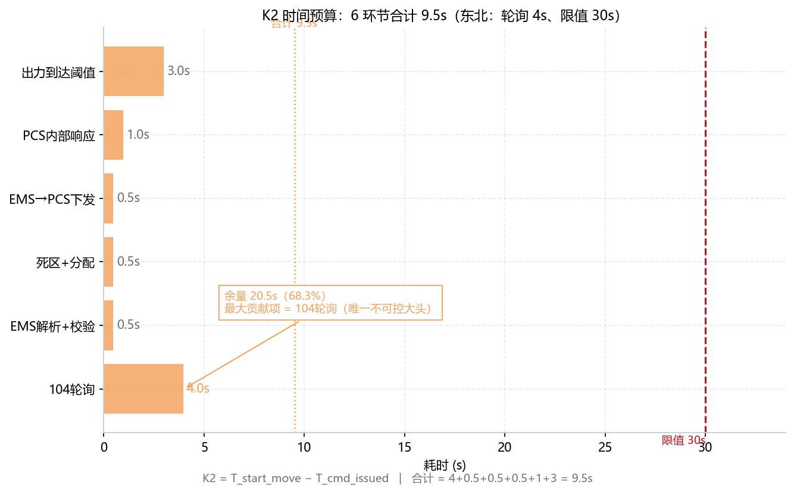
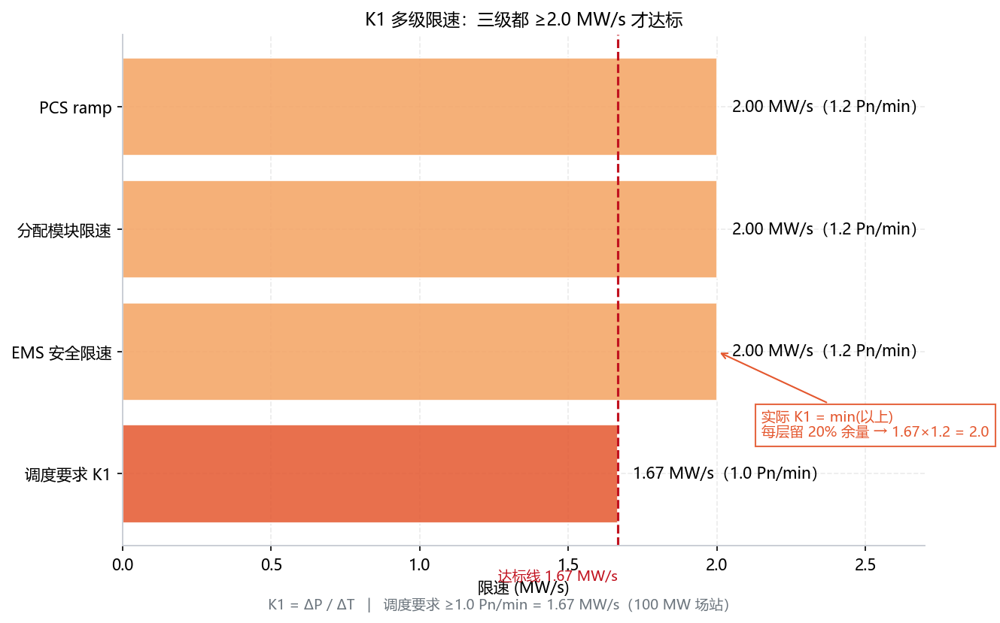
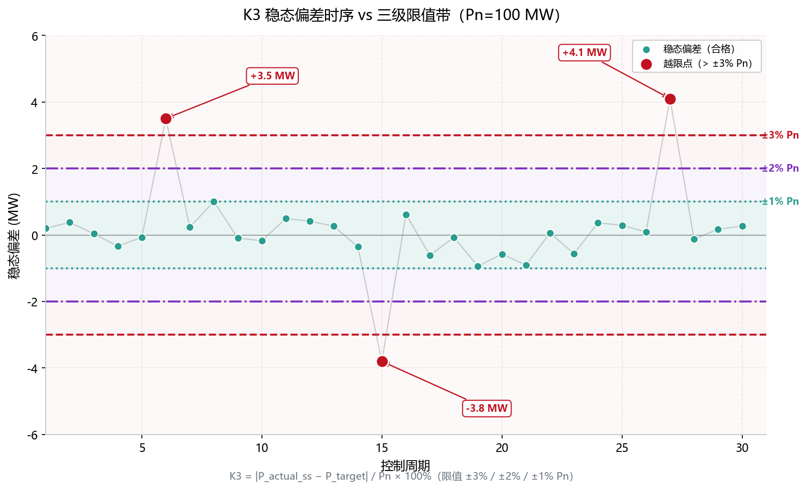
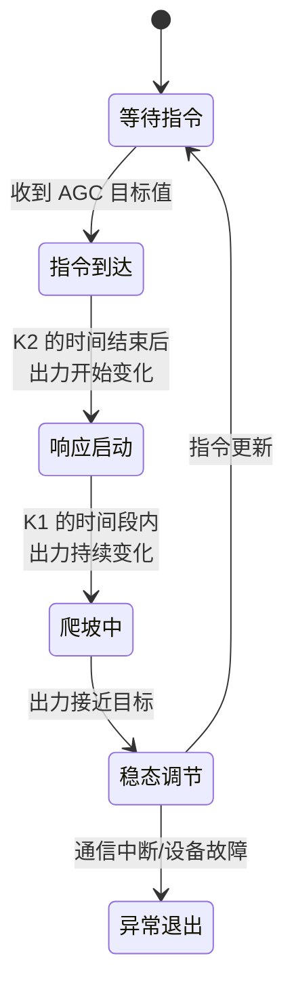

<!-- @AI_GENERATED -->
# 04 AGC考核的K1/K2/K3怎么打分？指标测算、权重分配与调度口径对齐

> 所属层面：② 执行层 + ③ 精度层（指标与链路）
> [课程首页](README.md) · 上一章：[03 AGC指令来了，风光储谁先动](03_AGC功率分配与动态补差.md) · 下一章：[05 同一套AGC代码，三个省三套规则](05_AGC跨区调度细则适配.md)

**一句话**：K1/K2/K3 不是三个独立指标，而是时间轴上三个串行检查点——收到指令到开始动（K2）、开始动到动到位（K1）、到位后不准了多少（K3）。哪个环节有短板，K3（占 50% 权重）都会放大。

## 现场场景【必懂】

AGC 考核月报出来了，K1 合格、K2 合格、K3 差 0.3% 没达标。你觉得 0.3% Pn（对 100 MW 场站就是 0.3 MW）不该是问题，但查了原始数据发现：

- 调度以"指令发出后 1 分钟的**瞬时偏差**"来算 K3；
- 你的 EMS 把实际出力按 30 秒滚动平均后上送；
- 某次指令下发后，前 30 秒出力还在爬坡（K1 生效中），后 30 秒稳了——但你上送的滚动平均值被前半段拖低，和调度记录的瞬时值差了 2%。

**K3 并不是你"控制精度不行"，而是你的"数据统计口径"和调度不一样。**

> ⏱ **三段速读**：
> - 5 分钟：读现场场景 → 理解"K3 差 0.3% 不是算法问题，是采样窗口偏了 30 秒"
> - 15 分钟：加读 K1/K2/K3 独立评分公式 → 三张快查对照表
> - 30 分钟：精读时序图 + 手算示例 → 能画出你的场站 AGC 响应时序，做 K2 预算

## 本章目标

读完本章，你应能：

1. 列出 K1/K2/K3 三项指标的定义、限值与计算方法；
2. 画出 AGC 端到端的延迟链路并做时间预算；
3. 区分"EMS 自己统计的指标"和"调度主站统计的指标"，避免口径不一致。

## K1/K2/K3 三项指标全貌【必懂】


| 指标 | 代号 | 衡量什么 | 典型限值（储能） | 卡在链路哪一环 |
|---|---|---|---|---|
| 调节速率 | K1 | 出力变化的速度 | ≥1.0 Pn/min | ramp rate + 分配策略 |
| 响应时间 | K2 | 指令下行到开始执行 | ≤30 s | 104 通信 + 指令死区 + EMS 处理 |
| 调节精度 | K3 | 稳态与目标的偏差 | ≤±3% Pn | 分配精度 + 反馈数据粒度 |

---

## K2 响应时间的详细分解【必懂】

### 定义与限值

```text
K2 = T_start_move − T_cmd_issued

T_cmd_issued：调度主站记录的指令下发时刻
T_start_move：场站出力开始可靠变化的时刻（出力变化 ≥ 某阈值）
```

| 资源 | K2 限值 | 备注 |
|---|---|---|
| 储能 | ≤30 s | 电力电子快响应 |
| 光伏 | ≤60 s | 通常 30~60 s |
| 风电 | ≤120 s | 机械响应慢 |

### K2 的时间预算

对于储能场站，K2 ≤30 s 相对宽松，但这 30 秒里每节链条都不能掉链子：

| 环节 | 典型耗时 | 预算占比 |
|---|---|---|
| ① 调度下发 → EMS 接收（104 轮询） | 2~8 s | 20%~27% |
| ② EMS 指令解析 + 合理性校验 | 0.1~0.5 s | <2% |
| ③ 指令死区判定 + 分配计算 | 0.1~0.5 s | <2% |
| ④ EMS → PCS 下发 | 0.1~0.5 s | <2% |
| ⑤ PCS 内部响应 | 0.1~1 s | <3% |
| ⑥ 出力变化到达阈值 | 0.5~3 s | 2%~10% |
| **合计（最差情况）** | **约 14 s** | **约 47%** |
| **余量** | **约 16 s** | **53%** |

> **结论**：在正常情况下，K2 的 30 s 限值并不紧张。K2 的真正威胁不是"走得慢"，而是"根本不动"——指令死区过大或 104 断链。

> 💻 **代码落地**——K2 时序预算检查（EMS 配置阶段执行），关键片段：
>
> ```python
def k2_chain_budget(poll_period_s=4.0, k2_limit_s=30.0):
    chain = {"104轮询": poll_period_s, "EMS解析": 0.5, "死区+分配": 0.5,
             "EMS→PCS": 0.5, "PCS响应": 1.0, "到达阈值": 3.0}
    total = sum(chain.values())            # total=9.5s
    return {"chain_detail": chain, "total_s": total,
            "margin_s": k2_limit_s - total, "pass": total <= k2_limit_s}
```
>
> 完整实现（含余量/占比/最大风险项定位）：[agc_core.py](lab/ems_lab/agc_core.py) · 端到端演示：[ch04_k2_budget.py](lab/examples/ch04_k2_budget.py)
>
> 示例：东北 K2=30s、轮询=4s → `total = 4+0.5+0.5+0.5+1+3 = 9.5s`，余量 20.5s（68.3%）；最大贡献项 = "104轮询"，这是 K2 预算中唯一不可控的大头。



### 104 轮询周期对 K2 的数学影响

如果 104 轮询周期是 `T_poll` 秒，则指令到达 EMS 的延迟在 `[0, T_poll]` 之间均匀分布。对于 T_poll = 5 s 的典型配置：

```text
K2 的 104 贡献 ∈ [0, 5] s，期望值 = 2.5 s
最坏情况 = 5 s
```

如果 T_poll 提高到 10 s（有些场站为节省流量这样做）：

```text
K2 的 104 贡献 ∈ [0, 10] s，期望值 = 5 s
最坏情况 = 10 s → 仅 104 延迟就吃掉 1/3 的 K2 预算
```

---

## K1 调节速率的详细分解【必懂】

### 定义

```text
K1 = ΔP / ΔT    （MW/min 或 Pn/min）
ΔP = P_end − P_start（实际出力变化量）
ΔT = T_end − T_start（变化经历了多长时间）
```

### K1 的计算窗口

调度不是看"从指令发出到稳定"的全段速率，而是取**响应过程中的最大速率**或**指定窗口内的平均速率**：

```text
方法 A（最大速率）： K1 = max( ΔP_window / Δt_window )，滑动窗口通常 10~30 s
方法 B（区间均值）： K1 = ΔP_total / T_total（从开始执行到稳定）
```

| 方法 | 优点 | 缺点 |
|---|---|---|
| 最大速率 | 反映响应能力上限 | 忽略"起步慢"的问题 |
| 区间均值 | 综合考虑全过程 | 起步慢会拉低均值 |

**需要与调度确认用的是哪一种**。

### 影响 K1 的瓶颈链


参见 [02 章](02_AGC调节速率瓶颈与整定.md)的叠加陷阱。



---

## K3 调节精度的详细分解【必懂】

### 定义与限值

```text
K3 = |P_actual_ss − P_target| / Pn × 100%
P_actual_ss：指令执行后达到稳态时的实际出力
```

| K3 要求 | 对 100 MW 场站 | 对 50 MW 场站 |
|---|---|---|
| ≤±3% Pn | 偏差 ≤3 MW | 偏差 ≤1.5 MW |
| ≤±2% Pn | 偏差 ≤2 MW | 偏差 ≤1 MW |
| ≤±1% Pn | 偏差 ≤1 MW | 偏差 ≤0.5 MW |

### K3 统计的两个口径差异【必懂】

这是[00 章](00_AGC闭环控制链路.md)考核不合格事件的根源之一：

| 口径 | 做法 | 特点 |
|---|---|---|
| 调度主站口径 | 指令发出后第 60 秒时刻的**瞬时偏差** | 对最后几秒的抖动敏感 |
| 调度主站口径 B | 指令发出后 30~60 秒窗口内的**平均偏差** | 平滑了末段抖动 |
| EMS 自己统计 | 稳态段取样（人工判断"什么时候稳了"） | 可能与调度的采样窗口错开 |

**工程建议**：

1. 确认调度 K3 的采样窗口（是指令后多少秒、取多少秒的均值）；
2. EMS 用同样的窗口统计内部 K3，定期与调度对账；
3. 不要用滚动平均上送实际出力——用**瞬时值**或**与调度同窗口的平均值**。



### K3 失分的三种模式

| 模式 | 表现 | 根因 |
|---|---|---|
| 系统性偏低 | 每次指令后稳态值都比目标低一点 | 分配算法有舍入误差或 PCS 跟踪有固定偏置 |
| 单方向偏低 | 上调 K3 好看、下调 K3 差 | 储能 SOC 不对称或某一方向 ramp 限制了 |
| 偶发超标 | 10 次里有 2~3 次 K3 差 | 通信抖动、资源瞬时不可用（风况/辐照瞬时跌） |

---

## AGC 指令跟踪的时序状态机【必懂】

AGC 指令下发后，场站响应经历四个状态：



| 状态 | 考核指标 | 注意事项 |
|---|---|---|
| 等待指令 | 无 | 通信正常即可 |
| 指令到达 → 响应启动 | **K2** | 指令死区可能让状态停留在此 |
| 响应启动 → 爬坡 | **K1** | 多级限速会卡在这里 |
| 爬坡 → 稳态 | **K3** | 数据口径不一致会被误判 |

---

## 多资源场站的性能合成【必懂】

当多个资源共同响应 AGC 时，场站级的 K1/K2/K3 如何合成？

| 指标 | 合成规则 |
|---|---|
| K2 | 取**各资源中最先动作的**时刻 = min(K2_i) |
| K1 | 取**各资源加权的实际速率**，不是加权 K1 |
| K3 | 取**场站总出力**与目标的偏差 |

**K2 的取法需要注意**：如果先动作的是储能（0.5 s 就动了）但只承担了 10% 的增量，主要承担者的风电 15 秒后才开始动——"min(K2)"会掩盖大部分出力还没动的事实。一些省网的考核细则已经区分了"首个资源开始响应"和"主要出力开始响应"两个时间。

> **接下来**：搞懂了 K1/K2/K3 怎么打分，下一步自然要问——同一个场站、同一套代码，到了东北考核为什么就是另一套标准？[第五章：跨区调度细则适配](05_AGC跨区调度细则适配.md) 用三份真实细则帮你看清区域差异。

---

## 自测

1. K1/K2/K3 分别衡量什么？为什么 K2 对储能场站通常不是瓶颈？
2. 指令死区为 ±2 MW，调度每次下发步长 0.5~1 MW，K2 的表现会如何？
3. EMS 上送 30 秒滚动平均出力和上送瞬时值，对 K3 统计有什么影响？
4. 多资源场站的 K2 取 min(K2_i) 有什么风险？

<details>
<summary>参考答案</summary>

1. K1 调速率、K2 响应时间、K3 调节精度。储能场站 K2 通常不是瓶颈，因为电力电子 0.1~0.5 s 内即可响应，30 s 限值对执行环节非常充裕。K2 的主要威胁是指令死区（根本不动）或通信断链。
2. 每次变化量小于死区，EMS 判定"不跟踪"，调度侧统计 K2 = 超时 → 不合格。这是指令死区过大导致的"伪 K2 不合格"。
3. 滚动平均会被爬坡段拖低，导致上送值偏低（看起来"出力不够"），而瞬时值反映的是爬坡后段的实际出力。两者差异可达 2%~5% Pn，直接影响 K3 判定。
4. min(K2_i) 只看"最快那个动了"就算动了，但最快动作的资源可能只承担了很小比例的增量。主要承担者的 K2 可能很大，却被 min 掩盖了。

</details>

> 💻 **动手实验**：运行 `python lab/examples/ch04_k2_budget.py` 逐节检验 104 轮询→EMS 解析→分配→下发→PCS 响应→出力到达的 K2 时序预算，对比三区域达标差异与最差轮询场景。

<!-- @AI_GENERATED: end -->