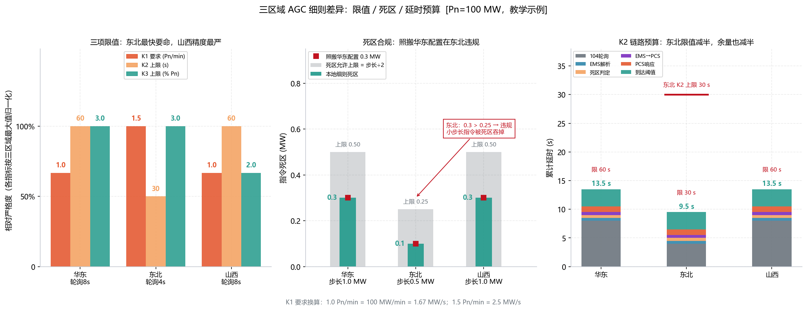
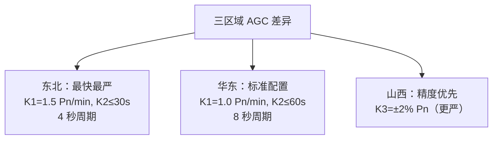
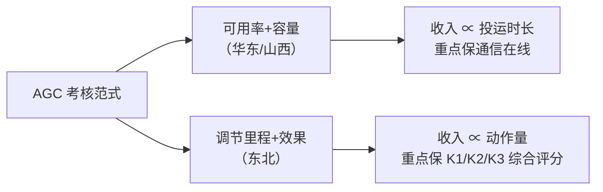
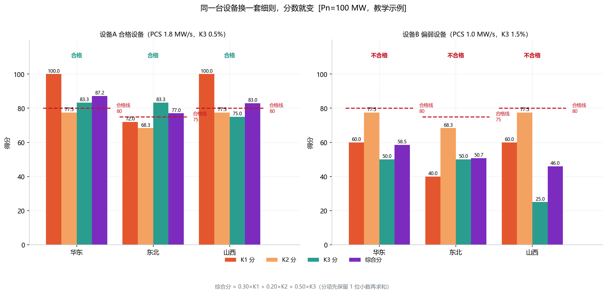
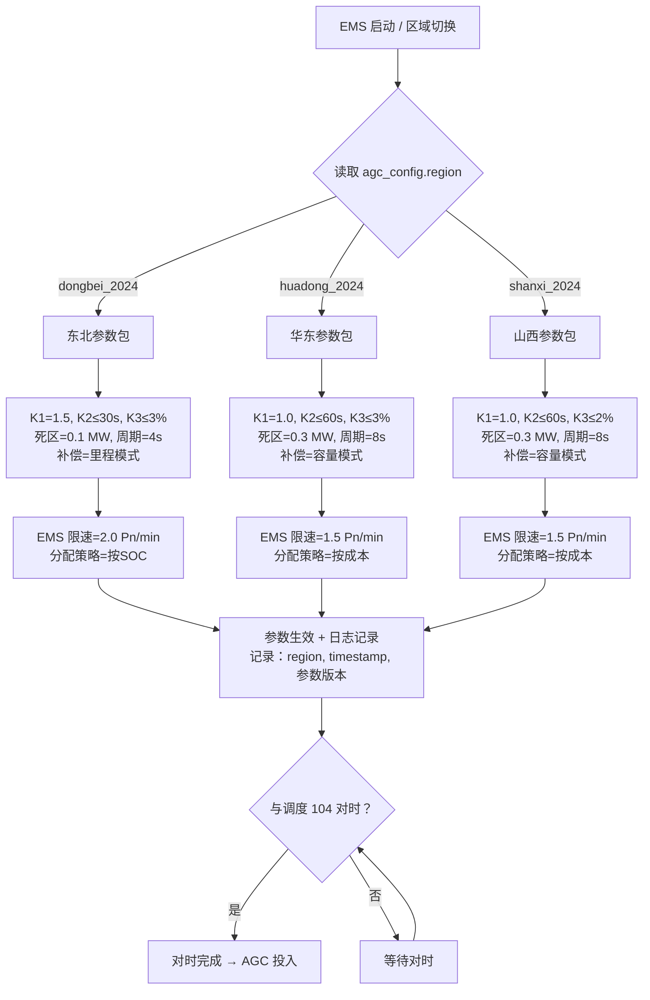

<!-- @AI_GENERATED -->
# 05 同一套AGC代码，三个省三套规则——华东/东北/山西调度细则的差异化适配

> 所属层面：全四层（区域参数差异）
> [课程首页](README.md) · 上一章：[04 AGC考核的K1/K2/K3怎么打分](04_AGC考核指标与统计口径.md) · 下一章：[06 AGC在EMS里怎么落地](06_AGC的IEC104链路与状态机.md)

**一句话**：同一套 AGC 代码，在东北跑得好好的，搬到华东可能 K1 直接不达标——不是因为代码有 bug，是每个省对 K1/K2/K3 的要求、指令间隔、补偿方式都不一样。

## 现场场景【必懂】

你的 EMS 在华东一个 100 MW 储能场站跑了一年，AGC 考核综合评分 87.2 分（合格）。销售签下了东北一个同规模储能场站，你想当然地用同一套 AGC 参数。

一个月后，东北的 AGC 评分只有 77.0 分——刚比合格线 75 分高 2 分，随时可能不合格。翻出细则才发现三处差异：

1. 东北 AGC 的 K1 要求是 ≥1.5 Pn/min（华东是 1.0 Pn/min）。你的 PCS 实测爬坡能力 1.8 MW/s：华东只需 1.67 MW/s，K1 拿满 100 分；东北要 2.5 MW/s，同一台设备只能拿 **72.0 分**；
2. 东北的 AGC 补偿按**实际调节里程 × 单价**计算，不是华东的"可用率 × 容量补偿"，两边的收入结构完全不同；
3. 东北的 AGC 指令更新周期是 4 秒，华东是 8 秒——你从华东照搬的 0.3 MW 死区，在东北会违反"死区 ≤ 最小步长 ÷ 2 = 0.25 MW"的规则，让小步长指令被吞掉。

**同一套代码，换上三套不同的数字，就是三种完全不同的考核结果。**

> ⏱ **三段速读**：
> - 5 分钟：读现场场景 + 三区域参数对照表 → 知道差异在哪
> - 15 分钟：加读区域切换 mermaid + 验证单 → 新项目上线前逐项核查
> - 30 分钟：精读 9 参数完整配置差异 + 补偿模型差异 → 能写一份区域适配方案

## 本章目标

读完本章，你应能：

1. 对照华东、东北、山西三份细则的 AGC 参数差异；
2. 理解不同区域的考核方式差异（按可用率 vs 按里程）；
3. 设计一套支持多区域 AGC 参数切换的 EMS 配置结构。

## 本章边界与假设

本章实现**三区域（华东/东北/山西）的 AGC 参数差异对照与可配置化设计**，用一套 100 MW 储能场站的统一设备参数演示"同一设备、换细则、分数变"；

不实现逐条细则原文的完整复述（以项目实际适用的调度细则与并网协议为准），也不实现具体省份的一次调频/惯量/黑启动等其他辅助服务品种的叠加结算（一次调频见[一次调频课程](../ems-primary-frequency-regulation/README.md)，经济性决策见[07b 章](07b_AGC辅助服务经济性决策.md)）。

**前置**：[04 章](04_AGC考核指标与统计口径.md)（K1/K2/K3 定义与打分公式）、[02 章](02_AGC调节速率瓶颈与整定.md)（三级限速链）。

所有参数均为 `[教学示例]`，取自公开技术报告与典型细则量级，**不能直接用于现场整定**；具体数值以项目适用细则为准。

## 三份细则的 AGC 参数对照【必懂】

| 项目 | 华东 | 东北 | 山西 |
|---|---|---|---|
| K1 调节速率 | ≥1.0 Pn/min | ≥1.5 Pn/min（储能） | ≥1.0 Pn/min |
| K2 响应时间 | ≤60 s | ≤30 s | ≤60 s |
| K3 调节精度 | ≤±3% Pn | ≤±3% Pn | ≤±2% Pn |
| AGC 指令周期 | 8 s（典型） | 4 s（典型） | 8 s（典型） |
| 考核方式 | 可用率 + 容量补偿 | 调节里程 + 效果补偿 | 可用率 + 容量补偿 |
| 投运率要求 | ≥98% | ≥95% | ≥98% |

> `[汇报口径]`，数据引自技术报告和相关细则。具体数值以项目适用细则为准。

> 💡 **读完这张表你应该知道**：东北是三个区域里最"激进的"——K1 要求是华东/山西的 1.5 倍、K2 时限只有一半、指令间隔也只有一半；山西是最"保守的"——要求跟你一样，但 K3 限值最严（±2% vs ±3%）。这意味着：同一个场站，华东/山西用容量模式躺着收钱（少调也行），东北用里程模式累着收钱（必须多调）。**EMS 代码里把这些参数写成可配置项，不是"hardcode"，是第一铁律。**

### 手算示例：同一台设备在三套细则下各得几分【必懂】

手算对象 = 现场场景里那台设备：`Pn = 100 MW`、PCS 实测爬坡 `1.8 MW/s`、调节精度 `K3 = 0.5% Pn`、实测端到端响应 `K2 = 13.5 s`（华东/山西，8 s 轮询）或 `9.5 s`（东北，4 s 轮询）。

**第一步：把细则的 K1 要求从 "Pn/min" 换算成 "MW/s"**

```text
K1_要求(MW/s) = K1_要求(Pn/min) × Pn ÷ 60
华东/山西：1.0 × 100 ÷ 60 = 1.667 MW/s
东北    ：1.5 × 100 ÷ 60 = 2.500 MW/s
```

**第二步：逐项算分（公式沿用 04 章）**

| 分项 | 公式 | 华东 | 东北 | 山西 |
|---|---|---|---|---|
| K1 | `min(100, 100 × 1.8 ÷ K1_要求)` | `100 × 1.8 ÷ 1.667 = 108` → **100.0** | `100 × 1.8 ÷ 2.5 = `**72.0** | **100.0** |
| K2 | `100 × (1 − K2_实际 ÷ K2_限值)` | `100 × (1 − 13.5 ÷ 60) = `**77.5** | `100 × (1 − 9.5 ÷ 30) = `**68.3** | **77.5** |
| K3 | `100 × (1 − K3_实际 ÷ K3_限值)` | `100 × (1 − 0.5 ÷ 3) = `**83.3** | **83.3** | `100 × (1 − 0.5 ÷ 2) = `**75.0** |

**第三步：加权合成（权重 30%/20%/50%，分项先保留 1 位小数再求和）**

```text
华东：0.30×100.0 = 30.0  |  0.20×77.5 = 15.5  |  0.50×83.3 = 41.7
      综合 = 30.0 + 15.5 + 41.7 = 87.2 分   ≥ 合格线 80 → 合格

东北：0.30×72.0  = 21.6  |  0.20×68.3 = 13.7  |  0.50×83.3 = 41.7
      综合 = 21.6 + 13.7 + 41.7 = 77.0 分   ≥ 合格线 75 → 合格（只余 2 分）

山西：0.30×100.0 = 30.0  |  0.20×77.5 = 15.5  |  0.50×75.0 = 37.5
      综合 = 30.0 + 15.5 + 37.5 = 83.0 分   ≥ 合格线 80 → 合格
```

**第四步：读结论——同一台设备，跨区落差 10.2 分**

- 华东 87.2 分 → 东北 77.0 分：K1 从 100 掉到 72（−8.4 分）、K2 从 77.5 掉到 68.3（−1.8 分），合计 −10.2 分；
- 山西 83.0 分：K1/K2 与华东一致，但 K3 限值从 3% 收紧到 2%，K3 分从 83.3 掉到 75.0，扣 −4.2 分；
- **结论：K1 是跨区适配的第一矛盾（权重虽只 30%，但落差最大），K3 限值是第二矛盾（权重 50%，山西一收紧就吃掉 4 分）。**

> ⚠️ **口径提醒**：东北 77.0 分"合格"是因为东北合格线是 75 分（比华东/山西低 5 分）。如果只看分数不看合格线，会误判"东北考核更松"——实际东北 K1 要求更严，只是合格线设得更低来匹配当地资源特性。



| 编号 | 位置 | 标注 | 对应正文 |
|---|---|---|---|
| ① | 左图 | 1.0 / 1.5 / 1.0（K1 要求）、60 / 30 / 60（K2 上限）、3.0 / 3.0 / 2.0（K3 上限） | "三份细则的 AGC 参数对照"表逐项数值 |
| ② | 左图纵轴 | 相对严格度（按三区域最大值归一化） | 三项量纲不同（Pn/min、s、%），不归一化无法同图比较 |
| ③ | 中图 | 灰柱 = 死区允许上限（步长÷2）；绿柱 = 本地细则死区 | "配置设计四条原则"之"死区 ≤ 最小步长 ÷ 2" |
| ④ | 中图标注 | 东北 0.3 > 0.25 → 违规 | 照搬华东 0.3 MW 死区在东北违规（现场场景第 3 条） |
| ⑤ | 右图 | 13.5 s / 9.5 s 与"限 60 s / 限 30 s" | 手算示例的 K2 实际值与区域限值 |
| ⑥ | 右图红线 | 东北 K2 上限 30 s | 东北限值是华东的一半 |

> 👁 **怎么看这张图**：左图看"哪根柱满格"——东北 K1 满格（要求最高）、山西 K3 只有 2/3 高度（限值最严）；中图看"红方块有没有超出绿柱"——东北红方块 0.3 落在 0.25 上限之上，就是违规；右图看"柱顶离红线还有多远"——东北柱顶 9.5 s、红线 30 s，余量 20.5 s；华东柱顶 13.5 s、红线 60 s，余量 46.5 s。

### 差异解读



| 差异点 | 含义 | 对 EMS 的影响 |
|---|---|---|
| 东北 K1 更高 | 要求储能响应更快，爬坡更猛 | PCS ramp rate 必须配得更高 |
| 东北指令周期更短 | 指令变化频率更高、步长更小 | 指令死区必须设得更小 |
| 山西 K3 更严 | 稳态跟得更准 | 分配精度和反馈数据必须更精细 |
| 东北按里程补偿 | 收入与动作量正相关 | 更频繁动作意味着更高收入，但也更高 SOC 消耗 |

---

## AGC 考核的两种范式【必懂】

不同区域对 AGC 服务的付费逻辑不同，这直接影响场站的收入结构：

### 范式一：可用率 + 容量补偿

```text
月度 AGC 补偿 = 可用调节容量 × 补偿单价 × 投运率
```

| 特点 | 说明 |
|---|---|
| 收入来源 | 主要是"你把容量拿出来给调度用"，有点像"租赁费" |
| 与动作量无关 | 调得多调得少，收入差不多 |
| 适用区域 | 华东、山西等 |
| 对 EMS 的影响 | 重点是保投运率、保通信在线，K1/K2/K3 达标即可 |

### 范式二：调节里程 + 效果补偿

```text
月度 AGC 补偿 = 累计调节里程 × 里程单价 × K1/K2/K3 综合系数
调节里程 = Σ |ΔP_target|（所有指令变化的绝对值累加）
```

| 特点 | 说明 |
|---|---|
| 收入来源 | 按"实际干活的量"计酬 |
| 与动作量正相关 | 动作越频繁、幅度越大，收入越高 |
| 适用区域 | 东北等 |
| 对 EMS 的影响 | 频繁动作 → 高收入，但 SOC 消耗也快 → 需要经济优化（[07b 章](07b_AGC辅助服务经济性决策.md)） |

### 两种范式的对比



---

## 各省 AGC 与一次调频的叠加规则差异【必懂】

虽然一次调频是本地自主响应、AGC 是调度下发指令，但在考核层面，各省对两者的叠加有不同的处理：

| 区域 | AGC 考核是否排除一次调频动作期间 | 说明 |
|---|---|---|
| 华东 | 部分排除 | 频率越死区期间 AGC 考核可能豁免或降权 |
| 东北 | 排除 | 频率越死区事件期间不计入 AGC 考核 |
| 山西 | 视情况 | 需与调度确认 |

**对 EMS 的影响**：EMS 需要记录一次调频动作起止时间，在上送 AGC 考核数据时标记这些时段，供调度豁免。

---

## EMS 的多区域 AGC 参数配置设计【必懂】

面对多套细则，AGC 参数必须可配置：

```text
agc_config:
  region: "dongbei_2024"          # 区域版本标识
  k1_min_pn_per_min: 1.5          # K1 最低要求
  k2_max_s: 30                    # K2 上限
  k3_max_pct: 3.0                 # K3 上限（% Pn）
  cmd_deadband_mw: 0.3            # 指令死区（MW）
  cmd_deadband_pct: 0.3           # 指令死区（% Pn，二选一）
  poll_period_s: 4                # 104 轮询周期
  compensation_mode: "mileage"    # capacity（容量） / mileage（里程）
  pn_mw: 100.0                    # 场站额定有功
  ems_ramp_limit_pn_per_min: 2.0  # EMS 安全限速（必须 > K1）
  alloc_strategy: "soc_first"     # 分配策略
```

### 配置设计的四条原则

| 原则 | 理由 | 反例 |
|---|---|---|
| EMS 安全限速 ≥ K1 × 1.2 | 留 20% 裕量确保 K1 不被 EMS 卡死 | EMS 限速 = K1 → 任何抖动都导致 K1 不达标 |
| 指令死区 ≤ 调度最小指令步长 ÷ 2 | 确保小步长指令也被跟踪 | 指令死区 = 2 MW，调度步长 = 1 MW → K2 不合格 |
| 考核模式显式存储 | 里程模式和容量模式对 EMS 行为要求完全不同 | 默认容量模式，到东北被里程模式考核 |
| 每个参数带版本和来源 | 追溯与审计 | 配置里只有数值没有出处 |

---

## 跨区适配实战演练【进阶】

### 同一场站在三套参数下的完整配置差异

以 100 MW 储能场站为例，列出在同一套 EMS 代码中，为华东/东北/山西三种场景配置的全部参数差异：

| 参数项 | EMS 配置键 | 华东值 | 东北值 | 山西值 | 差异影响 |
|---|---|---|---|---|---|
| K1 最低要求 | `k1_min_pn_per_min` | 1.0 | 1.5 | 1.0 | 东北要求 1.5 倍爬坡能力 |
| K2 上限 | `k2_max_s` | 60 | 30 | 60 | 东北用时预算减半 |
| K3 上限 | `k3_max_pct` | 3.0 | 3.0 | 2.0 | 山西精度要求 1.5 倍于其他 |
| 指令死区 | `cmd_deadband_mw` | 0.3 | **0.1** | 0.3 | 东北 4s 周期需更小死区 |
| 轮询周期 | `poll_period_s` | 8 | 4 | 8 | 东北指令更新频率翻倍 |
| 补偿模式 | `compensation_mode` | `capacity` | `mileage` | `capacity` | 收入模型不同 |
| 投运率要求 | `availability_rate_min` | 0.98 | 0.95 | 0.98 | 东北要求稍宽松 |
| EMS 安全限速 | `ems_ramp_limit` | 1.5 | **2.0** | 1.5 | 东北 K1=1.5，安全裕量需匹配 |
| 评分系数下限 | `score_threshold` | 0.80 | 0.75 | 0.80 | 东北合格线更低 |

> 💡 **读完这张表你应该知道**：从华东搬到东北，你至少要改 5 个参数值（K1、K2、死区、轮询周期、补偿模式），不是简单地把补偿模式从 `capacity` 改成 `mileage` 就完事。最容易被漏掉的是 `cmd_deadband_mw`（死区）和 `ems_ramp_limit`（安全限速），这两个不改的话：死区会把东北 4 秒周期里一半的指令屏蔽，EMS 限速会在 PCS 还没发力时就把爬坡掐断。**改配置的顺序：补偿模式 → K1/K2/K3 限值 → 死区 → 轮询周期 → 安全限速**——这个顺序错了，调试时会不断重来。

### 换细则前先算一遍：好设备与弱设备的跨区表现【进阶】

同一套代码、同一套细则，**设备能力不同，跨区后果完全不同**。下表把两台设备在三地算一遍（公式同"手算示例"，这里直接给结果并标出扣分主因）：

| 设备 | 参数 | 华东 | 东北 | 山西 | 关键差异 |
|---|---|---|---|---|---|
| 设备 A（合格） | PCS 1.8 MW/s，K3 0.5% | 87.2 分（K1 100 / K2 77.5 / K3 83.3） | 77.0 分（K1 **72.0** / K2 **68.3** / K3 83.3） | 83.0 分（K1 100 / K2 77.5 / K3 **75.0**） | 东北两处同时扣分：K1 要求翻 1.5 倍 + K2 限值砍半 |
| 设备 B（偏弱） | PCS 1.0 MW/s，K3 1.5% | 58.5 分（K1 **60.0** / K2 77.5 / K3 **50.0**） | 50.7 分（K1 **40.0** / K2 **68.3** / K3 **50.0**） | 46.0 分（K1 60.0 / K2 77.5 / K3 **25.0**） | 三地全不合格；山西 K3 限值 2% 让 K3 只剩 25 分 |

**手算核对（设备 B / 山西，最差一档）**：

```text
K1 = 100 × 1.0 ÷ 1.667 = 60.0
K2 = 100 × (1 − 13.5 ÷ 60) = 77.5
K3 = 100 × (1 − 1.5 ÷ 2.0) = 25.0        ← 1.5% 的精度在 2% 限值下只剩 1/4 空间
综合 = 0.30×60.0 + 0.20×77.5 + 0.50×25.0
     = 18.0 + 15.5 + 12.5 = 46.0 分   < 合格线 80 → 不合格
```

**读法**：设备 A 的短板是 K1（靠调 PCS 限速能救），设备 B 的短板是 K1+K3 同时不达标——**K3 差是分配算法和反馈精度问题，改 PCS 参数救不了**，这类设备换到山西几乎必然不合格，签项目前必须先做 K3 摸底测试。



| 编号 | 位置 | 标注 | 对应正文 |
|---|---|---|---|
| ① | 左图四柱 | 100.0 / 77.5 / 83.3 / 87.2（华东） | 设备 A 手算示例第二步、第三步 |
| ② | 左图东北柱 | 72.0 / 68.3 / 83.3 / 77.0 | 东北 K1 要求 2.5 MW/s、K2 限值 30 s |
| ③ | 左图山西柱 | K3 = 75.0（低于华东 83.3） | 山西 K3 限值 2% 严于 3% |
| ④ | 右图三地 | 58.5 / 50.7 / 46.0，全部"不合格" | 设备 B 的 K1=60/40/60、K3=50/50/25 |
| ⑤ | 双图虚线 | 合格线 80 / 75 / 80 | 各区域 `score_pass` 参数 |
| ⑥ | 顶部文字 | 合格 / 不合格 | 综合分与该区域合格线的比较结果 |

> 👁 **怎么看这张图**：先看左图（设备 A）——三地都"合格"，但东北的综合柱（77.0）明显矮一截，矮下去的那部分是 K1 柱（72.0）拖的；再看右图（设备 B）——三地全"不合格"，且山西的 K3 柱只剩 25.0，说明**精度不达标在山西是硬伤**。两图对比给出项目决策依据：**同样的细则，设备能力决定跨区可行性；不是"改配置就能跨区"，先算分再签字。**

### 区域切换流程图



### 切换关键验证单

区域参数切换后，在 AGC 投入之前必须确认：

| 检查项 | 验证方法 | 如果不一致 |
|---|---|---|
| 104 轮询周期与调度一致 | 连续接收 10 条指令，统计算术间隔 | 不在本侧修改——与调度确认其参数 |
| 指令步长范围 | 记录 50 条指令，统计 min/max ΔP | 死区 > 最小步长 ÷ 2 → 调整死区 |
| K1 实际可达性 | 发 10% Pn 阶跃测试，实测 ramp rate | 实际 < 要求 → 检查 PCS 限速、EMS 限速链 |
| K2 预算充足性 | 模拟指令→响应全链路延时 | 总延时 > K2_limit×0.7 → 排查通信链路 |
| 投运率统计口径 | 与调度确认闭锁/暂停是否计入 | 口径不一致→申诉无效 |

---

## 自测

1. 东北的 AGC 和华东的 AGC 在 K1 要求和补偿模式上有什么关键差异？
2. 调节里程补偿和容量补偿的区别是什么？对 EMS 的行为有什么不同要求？
3. 为什么 EMS 安全限速必须 ≥ K1 × 1.2，而不能等于 K1？
4. 东北指令 4 秒更新一次，指令死区应该怎么设？
5. 【算】一台 100 MW 场站 PCS 爬坡 1.6 MW/s、K3 = 1.5% Pn、K2 = 9.5 s，在东北能拿多少综合分？合格吗？
6. 【算】接着第 5 题：只把 K1 提上去（K2/K3 不变），能合格吗？如果不行，K3 精度至少要改到多少？

<details>
<summary>参考答案</summary>

1. 东北 K1 ≥ 1.5 Pn/min（华东 1.0），补偿按调节里程（华东按可用率+容量）。东北要求动作更快、更频繁。
2. 里程补偿 = 按调了多少 MW 来计酬，动作越多收入越高；容量补偿 = 按你拿出来多少 MW 容量来算钱，动作量不影响收入。里程模式下 EMS 需要更高的动作频率和 SOC 消耗，容量模式下 EMS 重点是保投运率和基本达标。
3. 因为任何抖动、延迟、通信波动都会让实际速率低于设定值。如果 EMS 限速恰好等于 K1，实际 K1 必定低于要求（没有安全余量）。
4. 调度 4 秒更新一次，假设最小步长约 0.5%~1% Pn（即 0.5~1 MW），指令死区应设为 ≤0.25 MW（步长的一半），以确保每次小步长指令都被跟踪。
5. K1 = 100 × 1.6 ÷ 2.5 = 64.0；K2 = 100 × (1 − 9.5 ÷ 30) = 68.3；K3 = 100 × (1 − 1.5 ÷ 3) = 50.0；
   综合 = 0.30×64.0 + 0.20×68.3 + 0.50×50.0 = 19.2 + 13.7 + 25.0 = **57.9 分，不合格**（< 75）。
6. **不行。** 即使 K1 拿满分（`min(100, …)` 封顶 100），加权也只有 0.30×100 = 30.0；
   综合上限 = 30.0 + 13.7 + 25.0 = **68.7 分 < 75** —— K1 单独改善的天花板不够。
   要让综合 ≥75：`0.50 × K3 分 ≥ 75 − 30.0 − 13.7 = 31.3` → K3 分 ≥ 62.6 →
   `100 × (1 − K3_实际 ÷ 3) ≥ 62.6` → K3_实际 ≤ 3 × (1 − 0.626) = **1.12% Pn**。
   即调节精度必须从 1.5% 提到 ≤1.12%（约提升 25%），再叠加 K1 提速才可能合格。

</details>

> 💻 **动手实验**：运行 `python lab/examples/ch05_regional.py`，输出包含①三份细则参数对照表、②设备 A 在三地的 K1/K2/K3 与综合分、③设备 B 的三地得分、④1.8 MW/s 在三地折算的 K1 分与达标判定、⑤指令死区合规校验、⑥两种补偿范式对比。重点核对两处：设备 A 在东北的 K1 = 72.0 是否与正文"手算示例"一致；设备 B 在山西的 K3 = 25.0 是否与"好设备与弱设备"表一致。

> 🔁 **换参数再跑一遍**：把脚本顶部 `DEVICES` 里设备 B 的 `pcs_ramp_mw_per_s` 改成 `2.5`（PCS 爬坡等于东北 K1 要求），重跑——东北综合分从 50.7 只升到 **68.7**（K1 从 40.0 变 100.0，但 K3 仍是 50.0），正好验证第 6 题"K1 满分也救不了 K3 短板"的天花板结论。

---

## 🧭 下一站

本章解决的是"**参数怎么按区域切换**"。但参数再对，如果 104 链路的状态机走不通、遥调报文解析错位、AGC 投入/退出时序乱掉，考核照样一分不剩。

下一章 [06 AGC在EMS里怎么落地](06_AGC的IEC104链路与状态机.md) 从"参数层"下沉到"**链路层**"：一条 AGC 指令从调度主站发出，经 104 规约到达 EMS，再被拆成 PCS 可执行的点表——中间任何一跳断掉，K1/K2/K3 都是空谈。

> 如果你现在更关心"评分怎么变成钱"，可以先跳到 [07 AGC月度考核与结算模型](07_AGC月度考核与结算模型.md)。

<!-- @AI_GENERATED: end -->