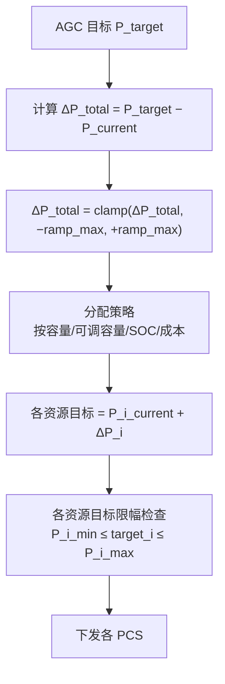
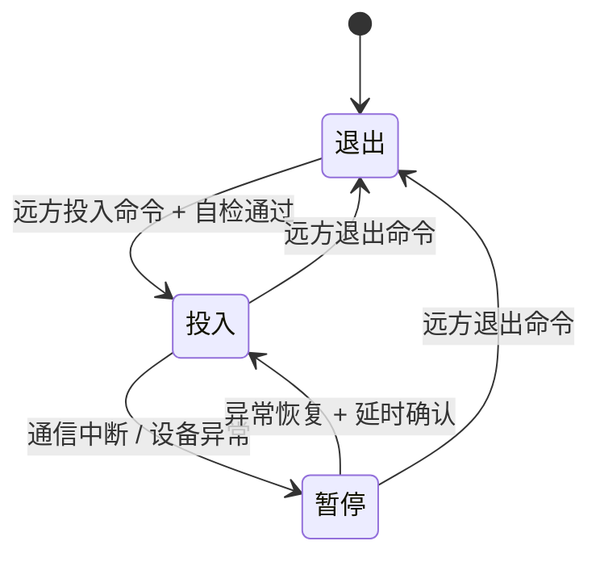

<!-- @AI_GENERATED -->
# 06 AGC在EMS里怎么落地？IEC104指令链路、五级流水线与状态机的代码实现

> 所属层面：全四层整合（通信→执行→精度→结算的代码落地）
> [课程首页](README.md) · 上一章：[05 同一套AGC代码，三个省三套规则](05_AGC跨区调度细则适配.md) · 下一章：[07 AGC月度评分58.9分能拿多少补偿](07_AGC月度考核与结算模型.md)

**一句话**：AGC 在 EMS 里怎么落地的？三件事：104 链路收指令、五级流水线处理指令、状态机管投退。任一环出 bug 都会直接反映到考核分数上——链路断影响投运率，流水线缺校验导致 K1/K2/K3 失分，状态机逻辑错让调度以为你离线。

## 现场场景【必懂】

凌晨 4:15，调度发来告警：你场站的 AGC 投运状态变成了"退出"。查 104 链路日志：4:12 时 t1 超时（连接空闲超过 60 秒未测试→调度侧主动断开→EMS 侧链路重建）。

重建过程中（约 30 秒），三条 AGC 指令丢失。调度考核系统将这 30 秒标记为"AGC 不可用"。按华东细则，AGC 月度投运率要求 ≥98%，一天的"30 秒 × N 次断链"累积起来就能占掉 2% 的额度。

**AGC 的对手不是算法精度，是 104 链路的稳定性。**

> ⏱ **三段速读**：
> - 5 分钟：读现场场景 → 理解 t1 超时怎么导致投运率扣分
> - 15 分钟：加读五级流水线 mermaid + t1/t2/t3 定时器对照表 → 能排查链路问题
> - 30 分钟：精读 `agc_allocate()` 完整实现 + 边界条件注释 → 直接复用

## 本章目标

读完本章，你应能：

1. 实现从 104 指令接收到 PCS 指令下发的完整 AGC 控制流水线；
2. 设计 AGC 状态机，覆盖投运、暂停、闭锁与恢复；
3. 明确 AGC 考核数据的记录要求（指令、分配、反馈、状态）；
4. 处理 AGC 与一次调频的指令合成与优先级。

## 职责边界【必懂】

AGC 的指令来源是调度主站，执行终端是 PCS/逆变器，EMS 是中间的"翻译与分发层"：


| 环节 | 执行主体 | EMS 的职责 |
|---|---|---|
| 104 链路维护 | EMS | 维持 104 连接，监控 t1/t2/t3 状态 |
| 指令接收与解析 | EMS | IEC 104 帧解析、指令提取 |
| 合理性校验 | EMS | 上下限、变化率、数据质量 |
| 指令死区判定 | EMS | 小变化过滤 |
| 分配计算 | EMS | 按策略分给各资源 |
| 安全校验 | EMS | 运行边界、ramp rate、SOC |
| 指令下发 | EMS | Modbus/GOOSE 写入 PCS |
| 反馈上送 | EMS | 实际出力、状态、时标 |
| 投退控制 | EMS | 远方投退、自动闭锁 |

---

## 104 链路维护【必懂】

### 三个关键定时器

参见 [一次调频课程 06 章](../ems-primary-frequency-regulation/06_PFR控制链路实现.md) 的通信协议部分，AGC 共用同一条 104 链路：

| 参数 | 含义 | 推荐值 | 对 AGC 的影响 |
|---|---|---|---|
| t1 | 发送方等待确认的超时 | 15~30 s | 超时→链路断开→AGC 指令丢失→投运率下降 |
| t2 | 接收方确认间隔 | 10~15 s | 过大会触发对端 t1 超时 |
| t3 | 空闲链路测试间隔 | 20~30 s | 空闲时用于维持链路活性 |

### 对 AGC 而言的关键

AGC 对 104 链路的可用性极其敏感，因为：

1. **AGC 指令不可重传**：调度每次下发的 AGC 指令是基于最新 ACE 计算的，一旦丢失不会被重发。丢失的指令段会被视为"AGC 不可用"。
2. **投运率 = 链路在线率**：在很多细则里，AGC 投运率 = 104 链路在线且 AGC 功能未闭锁的时间占比。
3. **t1 超时导致的断链是累积性的**：每天断链 30 秒 × 5 次 = 2.5 分钟/天 = 0.17%/天，一个月就是 5.2%——直接跌破 98% 的投运率要求。

### 双通道保护

建议关键 AGC 链路配置双通道（与一次调频课程 06 章的建议一致）：

```text
主通道：104（调度主站 ↔ EMS，主链路）
备通道：104（调度主站 ↔ EMS，备链路，不同网络路径）
切换：主链路 t1 超时 → 自动切到备链路 → 告警但不闭锁
```

| 注意事项 | 说明 |
|---|---|
| 双通道不可共用物理链路 | 走不同的光纤/路径，否则一铲子全断 |
| 切换要无损 | 备链路维持着但处于"冷备"模式，切换到"热备"时间 ≤1 s |
| 切换要上送告警 | 让调度知道你在用备链路，避免主链路修复后的重复考核 |

---

## 指令解析与合理性校验【必懂】

### IEC 104 指令格式（要点）

AGC 指令通常走 104 的**遥控**或**遥调**通道：

| 字段 | 含义 | 注意 |
|---|---|---|
| IOA（信息对象地址） | 确定是哪个设备/场站的 AGC 目标 | 点表必须与调度一致 |
| 指令值 | 目标出力（MW）或增量（MW） | 量纲确认（kW 还是 MW） |
| 时标 | 指令下发时刻 | 用于 K2 计算 |

### 合理性校验的五个检查

| 检查 | 判据 | 处理 |
|---|---|---|
| 越限检查 | P_target 在 [P_min, P_max] 范围内 | 拒绝 + 告警，上送"指令越限" |
| 变化率检查 | ΔP 在 ramp 能力范围内 | 裁剪到 ramp 上限，告警 |
| 数值合法性 | P_target 不是 NaN / Inf / 负值（放电为负的场景除外） | 拒绝 |
| 重复指令 | 与上一次完全相同的目标值 | 接受但不重新分配 |
| 时标合理性 | 时标不早于上一次指令 | 拒绝 + 告警（可能 104 数据错乱） |

### 危险的反模式

```python
# 反模式：无条件接受 → 直接下发（危险）
def on_agc_cmd(p_target): dispatch(p_target)

# 正确：先校验范围、ramp，不合格拒绝或裁剪
if not is_valid_range(p_target, p_min, p_max): return alert("越限")
if not is_valid_ramp(p_target, p_prev, ramp_limit): p_target = clamp_to_ramp(...)
dispatch(p_target)
```

---

## 指令死区判定【必懂】

[02 章](02_AGC调节速率瓶颈与整定.md)和[04 章](04_AGC考核指标与统计口径.md)多次提到指令死区。具体实现：

```text
if |P_target − P_current_target| ≤ deadband:
    return  # 不跟踪，维持当前目标
else:
    update_target(P_target)
```

| 参数 | 推荐值 | 说明 |
|---|---|---|
| deadband（MW） | ≤0.3% Pn（如 100 MW 场站 ≤0.3 MW） | 取调度最小指令步长的一半 |
| 确认周期 | 每个 AGC 指令周期判断一次 | 不需要额外的计时器 |

### 指令死区的"不安全替代"

有些实现会在 P_target 接近当前值时把目标**夹持**到当前值：

```text
不安全做法：
  if |P_target − P_current| ≤ 2 MW: P_target = P_current
  → 目标被篡改，即使调度想让你微调也被阻止了

正确做法：
  维持 P_target 不变，但内部不启动新的分配计算
  → 目标不改变，调度侧不会发现有数据混乱
```

---

## 分配计算【必懂】

### 完整分配流水线



### 关键代码片段

```python
def agc_allocate(p_target_mw, resources, p_current_total, cfg, dt_s):
    delta_total = p_target_mw - p_current_total
    if abs(delta_total) <= cfg.cmd_deadband_mw:          # ① 死区：不跟踪
        return {r.name: r.p_current_mw for r in resources}
    max_delta = cfg.ramp_limit_pn_per_min * cfg.pn_mw * dt_s / 60.0
    delta_total = max(-max_delta, min(delta_total, max_delta))   # ② ramp 裁剪
    # ③ 分配：avail_cap / soc_first 按资源可调容量或 SOC 排序分给各资源并限幅
    return allocations
```

> 完整实现（含 `AgcConfig`/`Resource` 数据类、avail_cap 与 soc_first 两种分配分支、零可调容量告警、分配偏差校验）：[ch06_full_chain.py](lab/examples/ch06_full_chain.py) · 断言：[test_agc_core.py](lab/tests/test_agc_core.py)

---

## 安全校验与 AGC 闭锁【必懂】

### AGC 状态机



| 状态 | 含义 | 行为 |
|---|---|---|
| 退出 | 未投入 AGC | 不接收 AGC 指令 |
| 投入 | 正常投入 | 正常接收与执行 |
| 暂停 | 因异常暂停 | 保持当前出力，不上调/下调，上送告警 |

### 闭锁的触发条件

| 触发 | 判据 | 恢复条件 |
|---|---|---|
| 104 链路中断 | t1 超时 | 链路重建 + 连续 3 次指令正常 |
| AGC 指令超时 | 超过 N 个指令周期未收到新指令 | 收到新指令 |
| 设备异常 | PCS 故障、通信中断 | 设备复归 |
| 人工暂停 | 检修、试验需要 | 人工恢复 |
| SOC 极限 | 储能 SOC 触及保护下限/上限 | SOC 回到安全区间 |

### 闭锁恢复时的平滑过渡

AGC 从"暂停"恢复到"投入"时，可能收到与当前出力差距很大的指令。需要：

```text
恢复过渡策略：
  ① 收到恢复后第一条指令时，
     以 ramp rate 从当前出力平滑过渡到目标值（不直接跳变）
  ② 过渡过程中标记"恢复过渡中"，调度考核豁免
  ③ 过渡时间 ≤ 2 个 AGC 指令周期
```

---

## 与一次调频的指令合成【必懂】

参见 [02 章](02_AGC调节速率瓶颈与整定.md) 的参数四部分。核心规则：

```text
P_total = clamp(P_agc_base + ΔP_primary, P_min, P_max)

其中：
  P_agc_base 每次 AGC 指令更新时刷新
  ΔP_primary 每个一次调频控制周期独立计算
```

### 优先级规则

| 场景 | 规则 |
|---|---|
| AGC 上调 + 一次调频上调 | 直接相加，总量限幅 |
| AGC 下调 + 一次调频下调 | 直接相加，总量限幅 |
| AGC 上调 + 一次调频下调 | **一次调频优先**——保留一次调频减量，AGC 上调裁剪 |
| AGC 下调 + 一次调频上调 | **一次调频优先**——保留一次调频增量，AGC 下调裁剪 |

**原则**：一次调频响应的是电网安全事件，优先级高于 AGC 经济调度。

---

## 数据记录与上送【必懂】

AGC 记录比一次调频多了"指令"维度：

| 字段 | 说明 |
|---|---|
| ts | AGC 指令时标 |
| p_target | 调度下发的 AGC 目标值（MW） |
| p_agc_base | EMS 记录的 AGC 基点（MW） |
| delta_p_primary | 当前生效的一次调频增量（MW） |
| p_total_target | AGC 基点 + 一次调频增量的合成目标（MW） |
| p_actual | 场站实际总出力（MW） |
| p_allocated_i | 分配各资源的指令值（MW） |
| p_actual_i | 分配各资源的实际出力（MW） |
| status | 投入 / 暂停 / 闭锁 |
| block_reason | 闭锁原因码 |

### 记录的两个目的

| 目的 | 需要的数据 |
|---|---|
| 调度对账（K1/K2/K3 复算） | p_target、p_actual、ts |
| 争议举证 | p_total_target、p_allocated_i、status、block_reason |

> **接下来**：代码写好了、状态机跑起来了、投运进入正常考核——接下来最重要的问题就是月度考核怎么算钱？你的 K1/K2/K3 值怎么变成实打实的补偿收入？[第七章：月度考核与结算模型](07_AGC月度考核与结算模型.md) 揭晓答案。

---

## 自测

1. AGC 的 104 链路 t1 超时导致断链 30 秒，一个月发生 5 次，对投运率是什么影响？
2. 指令死区的"不安全替代"是什么？为什么不能那样做？
3. AGC 与一次调频同时动作时，优先级规则是什么？
4. 闭锁恢复后收到与当前出力差距 40 MW 的指令，应该怎么处理？

<details>
<summary>参考答案</summary>

1. 30 秒 × 5 次 = 2.5 分钟/天 = 0.17%/天，一个月约 5.2%，直接跌破 98% 投运率要求。
2. "如果指令接近当前值，直接把目标改写成当前值"——这会篡改指令，调度侧的目标值和 EMS 侧的目标值不一致，导致 K3 的计算基准错误。
3. 一次调频优先。同向直接相加限幅，反向时以一次调频为准、AGC 被裁剪。
4. 不能直接跳变到 40 MW。应以 ramp rate 平滑过渡（如 1.2 Pn/min = 2 MW/s，过渡约 20 秒），过渡期间标记"恢复过渡中"（考核豁免），过渡时间 ≤ 2 个 AGC 指令周期。如果过渡时间过长，应告警。

</details>

> 💻 **动手实验**：运行 `python lab/examples/ch06_full_chain.py` 演示死区→ramp 约束→分配→限幅→下发全链路流水线，对比 avail_cap 与 soc_first 模式在 3-BESS 场站的分配差异。

<!-- @AI_GENERATED: end -->