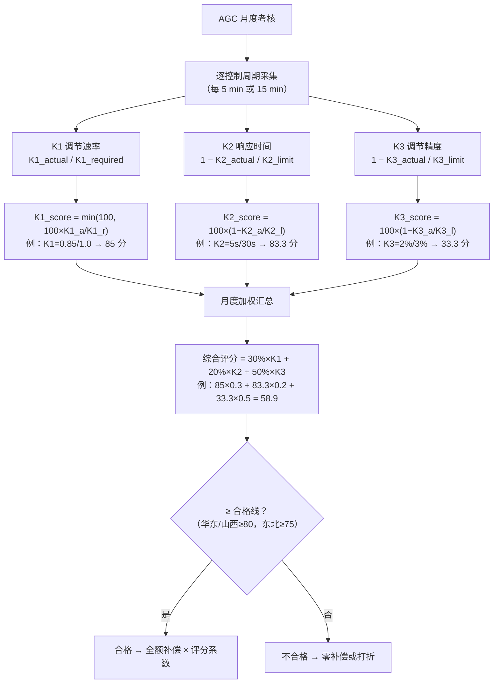
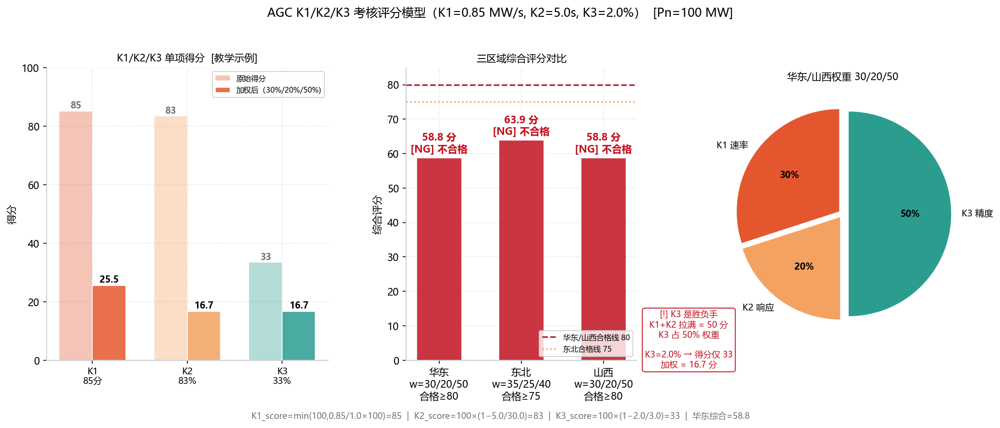
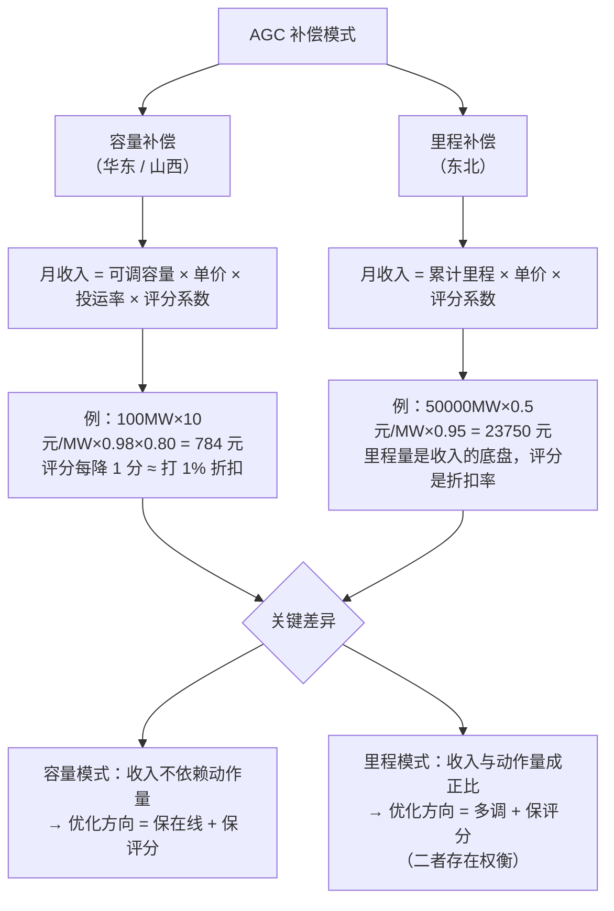
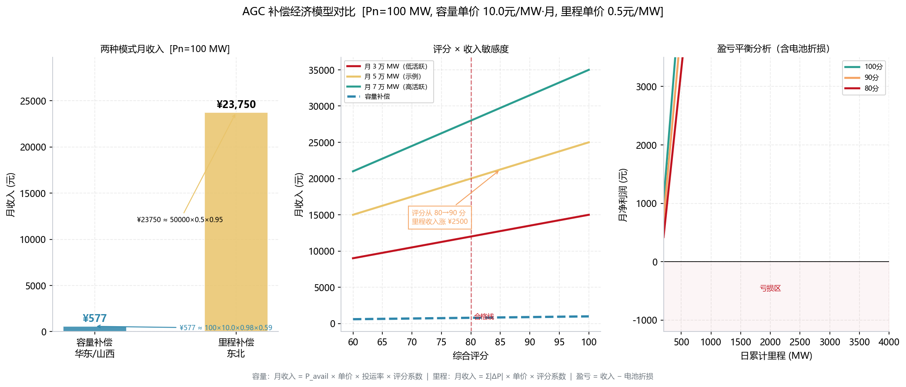

<!-- @AI_GENERATED -->
# 07 AGC月度评分58.9分能拿多少补偿？综合评分算法与容量/里程两种结算模型

> 所属层面：④ 结算层
> [课程首页](README.md) · 上一章：[06 AGC在EMS里怎么落地](06_AGC的IEC104链路与状态机.md) · 下一章：[07b AGC调频能赚钱吗](07b_AGC辅助服务经济性决策.md)

**一句话**：调度按 K1/K2/K3 给场站打分，K3 占权 50%——稳态跑偏 1%，综合分就能掉 17。评分 × 投运率 × 基准价 = 你这个月的 AGC 收入。

## 现场场景【必懂】

AGC 考核月报上的综合评分是 58.9 分（合格线 80 分）。翻开明细：K1 调节速率 0.85 Pn/min（要求 1.0，得分 85/100），K2 响应时间 5 s（限值 30 s，得分 83.3/100），K3 调节精度 2%（限值 3%，得分 33.3/100）。

加权方式是 K1 占 30%、K2 占 20%、K3 占 50%：

```text
综合评分 = 85×0.3 + 83.3×0.2 + 33.3×0.5 = 25.5 + 16.7 + 16.7 = 58.9 分
```

差了 21.1 分——不是 K1/K2 的问题（K1 85 分、K2 83.3 分，拉满了也只有 50 分权重）。根因在 K3：K1+K2 贡献了 42.2 分，离合格线 80 分还差 37.8 分——这 37.8 分全压在 K3 身上。而 K3=2%（要求 3%），评分公式 K3_score=100×(1−2/3)=33.3 分，加权后只贡献 16.7 分，根本填不上这 37.8 分的缺口。

但如果你的场站在华东（按可用率补偿），这个 58.9 分只会让你拿不到全额补偿，还不会倒扣。如果在东北（按里程补偿），58.9 分可能连基准电价都拿不到——低于合格线（如 75 分）直接"不合格：零补偿"。

**同一个分数，落在不同的考核范式和门槛上，结果天差地别。**

> ⏱ **三段速读**：
> - 5 分钟：读现场场景 → 理解 58.9 分怎么算出来的（K3 是凶手）
> - 15 分钟：加读"容量 vs 里程"两种结算模型对照 → 知道你在哪种模式下赚钱
> - 30 分钟：精读公式推导 + 手算 → 能直接用 Excel 复现调度系统的考核评分

## 本章目标

读完本章，你应能：

1. 写出 K1/K2/K3 三项指标的评分公式；
2. 用月度目标数据复算综合得分并与调度核对；
3. 计算 AGC 月度补偿金额（容量模式与里程模式）；
4. 识别结算中的争议点并准备好举证数据。

## K1/K2/K3 单项评分公式【必懂】

各区域的评分公式略有差异，但核心结构一致：

### K1（调节速率）评分

```text
K1_score = min(100, 100 × K1_actual / K1_required)
```

| 场景 | 计算 | 得分 |
|---|---|---|
| K1_actual = 1.2, K1_required = 1.0 | 100 × 1.2/1.0 = 120 → cap 100 | 100 |
| K1_actual = 0.8, K1_required = 1.0 | 100 × 0.8/1.0 = 80 | 80 |
| K1_actual = 0.4, K1_required = 1.0 | 100 × 0.4/1.0 = 40 | 40 |

> 有些区域对 K1 设置**考核下限**（如 <0.3 Pn/min 直接不合格，不进入算术评分）。

### K2（响应时间）评分

```text
K2_score = 100 × (1 − K2_actual / K2_limit)      # 线性递减
```

| 场景 | 计算 | 得分 |
|---|---|---|
| K2 = 5 s, K2_limit = 30 s | 100 × (1 − 5/30) = 83.3 | 83 |
| K2 = 25 s, K2_limit = 30 s | 100 × (1 − 25/30) = 16.7 | 17 |
| K2 = 35 s, K2_limit = 30 s | 0（超限值直接判零） | 0 |

> 有些区域用**阶梯制**：K2 ≤ 10 s（满分 100）、K2 ≤ 20 s（满分 80）、K2 ≤ 30 s（满分 60）。

### K3（调节精度）评分

```text
K3_score = 100 × (1 − K3_actual / K3_limit)
```

| 场景 | 计算 | 得分 |
|---|---|---|
| K3 = 1.0%, K3_limit = 3.0% | 100 × (1 − 1/3) = 66.7 | 67 |
| K3 = 2.5%, K3_limit = 3.0% | 100 × (1 − 2.5/3) = 16.7 | 17 |
| K3 = 5.0%, K3_limit = 3.0% | 0（超限值直接判零） | 0 |

> **为什么 K3 容易拉低总分**：因为 K3 对精度非常敏感。K3 从 1% 变到 2%，得分从 67 掉到 33——翻了一倍。而 K1 从 1.0 变到 0.8（也降了 20%）只从 100 掉到 80。

---

## 综合评分公式与权重【必懂】



**图中标注对照表**：

| 标注 | 含义 | 本例数值 |
|---|---|---|
| K1_score = 85 | K1 调节速率得分 | K1=0.85 Pn/min，要求 1.0 → 85 分 |
| K2_score = 83.3 | K2 响应时间得分 | K2=5 s，限值 30 s → 83.3 分 |
| K3_score = 33.3 | K3 调节精度得分 | K3=2%，限值 3% → 33.3 分 |
| 综合 = 58.9 | 三指标加权 | 30%×85 + 20%×83.3 + 50%×33.3 |
| 合格线 | 区域差异 | 华东≥80 / 东北≥75 / 山西≥80 |

> **为什么 K3 是"胜负手"**：K1+K2 拉满也只有 50 分（30+20），剩下 50 分全靠 K3。K3=2%（要求 3%）时得分仅 33.3，加权后只贡献 16.7 分——这就是现场场景中 58.9 分不合格的根因。



> 👁 **怎么看这张图**：左半三根柱子分别是 K1/K2/K3 的单学科分数（上）和加权贡献分（下）。注意 K3 的加权贡献（16.7 分）= K3 满分 50×33.3%，比 K1 的 25.5 分还低——这就是 K3 权重 50% 的"放大器效应"。右下饼图告诉你：如果 K3 拖后腿，华东/东北的 50% 权重会让总分直接腰斩。

```text
AGC_score = w1 × K1_score + w2 × K2_score + w3 × K3_score
```

| 区域 | w1（K1） | w2（K2） | w3（K3） | 合格线 |
|---|---|---|---|---|
| 华东 | 30% | 20% | 50% | ≥80 |
| 东北 | 30% | 20% | 50% | ≥75 或 ≥70 |
| 山西 | 30% | 20% | 50% | ≥80 |

> `[汇报口径]`，具体权重和合格线以项目适用细则为准。这里展示的是常见的权重结构。

### K3 权重 50% 的含义

K3 占了总分的一半——这意味着**K3 是你 AGC 考核的"胜负手"**。K1 和 K2 拉满分也就 50 分（30+20），K3 如果只有 50 分（50×50%=25 分），综合才 75 分——刚好擦线或不合格。

### 手算月度综合评分

月度考核以"每 5 分钟"或"每 15 分钟"作为统计窗口，月度汇总：

```text
月度 K1 = 所有窗口 K1 的算术平均（或有效窗口的算术平均）
月度 K2 = 所有窗口 K2 的算术平均
月度 K3 = 所有窗口 K3 的算术平均

月度评分 = w1 × 100 × K1_monthly / K1_required + ...
```

| 窗口类型 | 是否计入 | 说明 |
|---|---|---|
| AGC 投入中 | 计入 | 正常考核 |
| AGC 退出/暂停 | 不计入或按 0 分 | 详见细则 |
| 一次调频动作期间 | 可能豁免 | 需上送标记 |
| 通信中断期间 | 按 0 分 | 或按细则的"不可用"处理 |

---

## 补偿金额计算【必懂】



**图中标注对照表**：

> 💡 **读完这张表你应该知道**：同样是 100 MW 场站、同样是 80 分，容量补偿一个月只拿 784 元，里程补偿却能拿 20000 元——差 25 倍。这解释了为什么东北的 AGC 市场比华东热闹：里程模式让"多干活"直接变成"多拿钱"，而容量模式是"坐着就能拿，但金额小"。
>
> 下面我们先用**同一评分 80 分**做公平对比，再展示评分从 60→100 对两种模式的边际影响——你会发现容量模式的收入对评分是线性的，而里程模式是"先跃升、后趋缓"。

| 标注 | 含义 | 示例数据 |
|---|---|---|
| 容量补偿 | 按可调容量每月结算 | 100 MW × 10 元/MW·月 × 投运率 × 评分系数 |
| 784 元 | **80 分下的容量补偿** | 100×10×0.98×0.80 |
| 里程补偿 | 按累计调节里程结算 | Σ\|ΔP_target\| × 0.5 元/MW × 评分系数 |
| 20000 元 | **80 分下的里程补偿**（同一基线） | 50000 MW·月 × 0.5 元/MW × 0.80 |
| 23750 元 | 95 分下的里程补偿（评分边际效应参考） | 50000 MW·月 × 0.5 元/MW × 0.95 |



### 容量补偿模式（华东/山西）

```text
月度补偿 = P_avail × 补偿单价 × 投运率 × 评分系数

其中：
  P_avail = AGC 可调容量（MW）
  评分系数 = AGC_score / 100
  投运率 = AGC 投入时间 / 总考核时间
```

**关键**：评分系数 ≤1.0，等于直接对补偿金额打折扣。80 分 = 八折、90 分 = 九折。

| 月评 | 评分系数 | 对 100 MW 场站的影响（单价假设 10 元/MW·月） |
|---|---|---|
| 95 | 0.95 | 补偿 = 100 × 10 × 0.98 × 0.95 = 931 元 |
| 80 | 0.80 | 补偿 = 100 × 10 × 0.98 × 0.80 = 784 元 |
| 70 | 0.70 或 0 | 可能不合格→零补偿 |

### 里程补偿模式（东北）

```text
月度补偿 = 累计调节里程 × 里程单价 × 评分系数

累计调节里程 = Σ |ΔP_target|（所有指令变化的绝对值累加）
```

**关键**：里程模式下，分数打折的是"每 1 MW 调节量的单价"。分数低→每次调节的收益打折。

| 月评 | 评分系数 | 对月调节里程 50000 MW 的影响（单价 0.5 元/MW） |
|---|---|---|
| 95 | 0.95 | 50000 × 0.5 × 0.95 = 23750 元 |
| 80 | 0.80 | 50000 × 0.5 × 0.80 = 20000 元 |
| 70 | 0.70 或 0 | 可能不合格→零补偿 |

---

## 投运率——AGC 的"及格门槛"【必懂】

不管 K1/K2/K3 多好，投运率不达标，全部免谈：

```text
投运率 = T_agc_on / T_total　（通常考核窗口为月度）
```

| 区域 | 投运率要求 | 不达标后果 |
|---|---|---|
| 华东 | ≥98% | 无补偿，且可能按细则罚款 |
| 东北 | ≥95% | 无补偿 |
| 山西 | ≥98% | 无补偿 |

### 投运率的敌人

| 原因 | 影响 | 应对 |
|---|---|---|
| 104 链路频繁断链 | 每次断链期间 = 退出 | 双通道 + t1/t2/t3 优化 |
| 设备故障导致闭锁 | 闭锁 = 退出 | 冗余设备、快速恢复 |
| 检修时段计入考核 | 检修 = 长期退出 | 与调度沟通、申请考核豁免 |
| 软件升级 | 升级期间退出 | 选择非考核窗口（如月末）、提前申请 |

---

## AGC 结算的常见争议【必懂】

### 争议一：统计窗口不一致

| 调度侧 | EMS 侧 | 差异来源 |
|---|---|---|
| 以 5 分钟为窗口、每窗口第一个样本 | 以 5 分钟为窗口、窗口内平均 | 采样的时刻偏移会导致偏差最大可达 ±2% |
| 以 15 分钟为窗口 | 以 5 分钟为窗口，合成了 3 个 | 不同窗口长度的统计量不同 |

### 争议二：数据缺失的处理

| 调度侧 | 可能后果 |
|---|---|
| 缺失点 = 0 分 | 只要丢一个数据点，该窗口 K1/K2/K3 全零 |
| 缺失窗口 = 不参与月度平均 | 可能对 EMS 有利（少一个差样本）也可能不利（少一个好样本） |

### 争议三：一次调频动作期间的 AGC 考核

- 有些细则对一次调频动作期间豁免 AGC 考核；
- 但豁免的前提是 EMS 准确标记了动作时段；
- 如果 EMS 没有标记或标志不上送→调度不会自动豁免。

### 举证数据清单

| 争议类型 | 需要的证据 |
|---|---|
| K2 时间偏差 | EMS 侧 104 接收时刻 vs 调度下发时标 |
| K3 精度偏差 | EMS 侧上送的实际出力序列 + 采样时刻 |
| 投运率偏差 | EMS 侧投退事件记录（起止时间 + 原因码） |

---

## 自测

1. K1=0.85（要求 1.0）、K2=5 s（要求 30 s）、K3=2%（要求 3%），综合评分多少（w1=30%, w2=20%, w3=50%）？
2. 同样的评分（≈73 分），在容量补偿模式和里程补偿模式下有什么区别？
3. 投运率要求 98%，一个月 30 天，最多能"不在线"多长时间？
4. 调度侧和 EMS 侧的 K3 差异最常见的根因是什么？

<details>
<summary>参考答案</summary>

1. K1_score = 100×0.85/1.0 = 85，K2_score = 100×(1−5/30) = 83.3，K3_score = 100×(1−2/3) = 33.3。综合 = 85×0.3 + 83.3×0.2 + 33.3×0.5 = 25.5+16.7+16.7 = 58.9 分。
2. 容量模式：收入打折（73 分→73% 的补偿单价打在可调容量上）。里程模式：如果 73 分低于合格线（如 75），可能直接零补偿（不合格）。即使不直接零补偿，也是 73% 的里程单价。
3. 2% × 30 天 × 24 小时 × 60 分钟 = 864 分钟 = 14.4 小时/月。平均每天不超过 28.8 分钟。
4. 统计窗口的采样时刻偏移。调度取瞬时值、EMS 上送平均值或滚动平均，时间对齐差 5~15 秒就可能造成 1%~3% Pn 的 K3 偏差。

</details>

> 💻 **动手实验**：运行 `python lab/examples/ch07_scoring.py` 重现 K1/K2/K3 综合评分卡，对比容量补偿与里程补偿在统一 80 分基线下的月度收入差距。

<!-- @AI_GENERATED: end -->