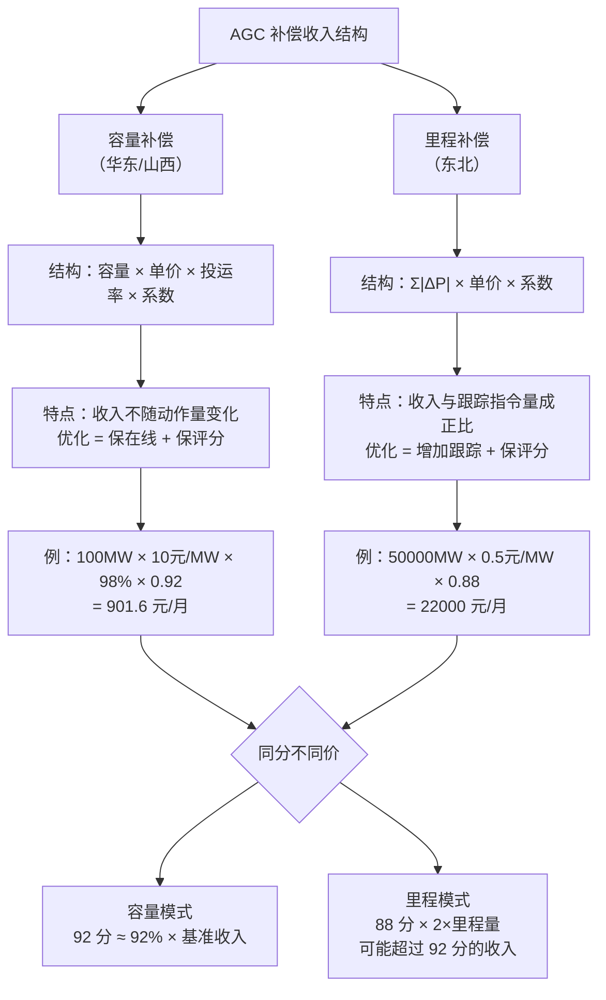
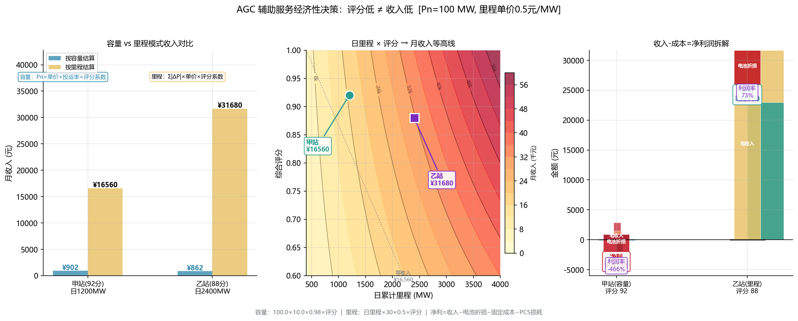
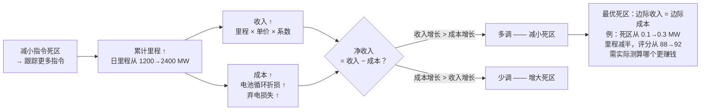
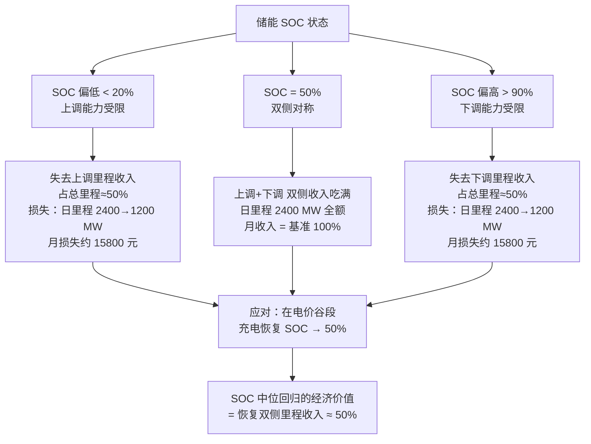
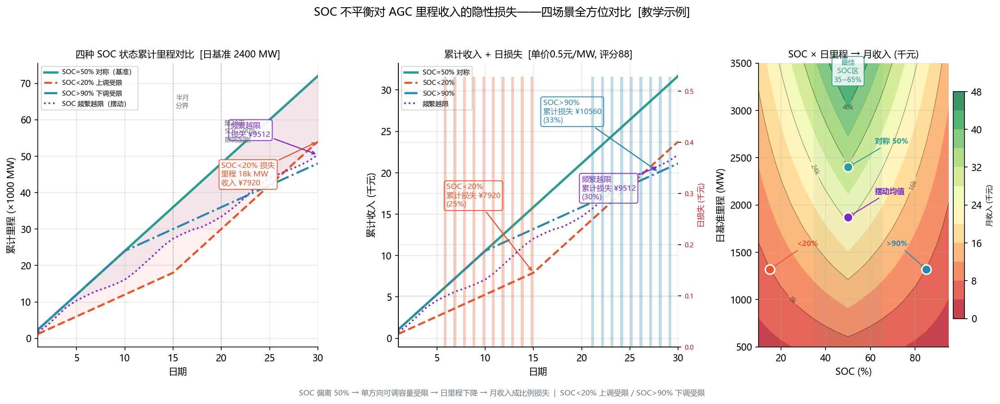

<!-- @AI_GENERATED -->
# 07b AGC调频能赚钱吗？里程补偿、容量补偿与储能电池全寿命成本的量化决策

> 所属层面：④ 结算层（经济性）
> [课程首页](README.md) · 上一章：[07 AGC月度评分58.9分能拿多少补偿](07_AGC月度考核与结算模型.md) · 下一章：[08 AGC并网联调怎么一次过](08_AGC并网联调与验收证据链.md)

**一句话**：评分的目的是拿钱。在里程补偿模式下，评分高不一定赚得多——你的动作量（累计调节里程）才是收入的底盘，评分系数只是底盘上的折扣率。

## 现场场景【必读】

两个同规模 100 MW 储能场站，同时接入同一电网、同套细则，均采用里程补偿模式。甲站 AGC 月评分 92 分，收入 16600 元。乙站 AGC 评分 88 分，收入 31700 元。

为什么评分低的反而收入高？

翻出两个站 30 天的 AGC 指令日志：

- 甲站 AGC 指令死区 0.3 MW，K3 精度好（1.0%）——但日调节里程只有 1200 MW；
- 乙站 AGC 指令死区 0.1 MW，K3 精度差（2.2%）——但日调节里程 2400 MW，是甲站的两倍。

在里程补偿模式下，乙站多出来的 1200 MW/天 × 30 天 = 36000 MW 里程，即使评分打八八折（1200×30×0.5×0.88=15840 元 vs 1200×30×0.5×0.92=16560 元），总里程更大意味着总盘子更大。

**评分高不等于收入高。在里程模式下，动作量才是收入的底盘，评分只是底盘的折扣率。**

> ⏱ **三段速读**：
> - 5 分钟：读现场场景故事 → 甲站 92 分赚 16600 vs 乙站 88 分赚 31700，秒懂为什么
> - 15 分钟：加读"容量 vs 里程"两种补偿模式的经济对比表
> - 30 分钟：精读 SOC 折旧模型 + 边际分析 → 算你的场站最优死区该设多少

## 本章目标

读完本章，你应能：

1. 区分容量补偿和里程补偿两种收入模型；
2. 计算不同分配策略和 SOC 管理方式对月度收入的影响；
3. 分析 AGC 的调节成本（电池折损、弃电损失），做经济优化；
4. 判断"多调还是少调"的经济平衡点。

## AGC 收入模型对比【必懂】



**图中标注对照表**：

| 标注 | 含义 | 来自"现场场景"数据 |
|---|---|---|
| 甲站 92 分 | 里程模式，死区 0.3 MW：评分高但动作少 | 日里程 1200 MW → 1200×30×0.5×0.92 = 16560 元 |
| 乙站 88 分 | 里程模式，死区 0.1 MW：评分低但动作多 | 日里程 2400 MW → 2400×30×0.5×0.88 = 31680 元 |
| 关键结论 | 里程模式下，动作量是收入底盘 | 乙站里程是甲站的 2 倍，即使打 88 折仍更赚钱 |



> 👁 **怎么看这张图**：左半是"两站 × 两种结算口径"四根柱——甲站按容量结算只有 ¥902（100×10×0.98×0.92），按里程结算 ¥16560；乙站按容量 ¥775，按里程 ¥31680。这说明**先选对结算模式，再谈评分高低**：同一场站，里程口径比容量口径高一个量级。中间等高线解释 88 分反超 92 分的机理：里程收入 = 日里程 × 30 × 0.5 × 评分系数，乙站日里程是甲站的 2 倍，评分只差 4 分（折扣 92% vs 88%），2 倍的盘子打八八折仍然更大。结论：**评分是折扣率，动作量才是基数——基数大比分高的经济价值高。**

### 模型 A：容量补偿

```text
月收入 = 可调容量 × 容量单价 × 投运率 × 评分系数
```

| 变量 | 可控性 | 优化空间 |
|---|---|---|
| 可调容量 | 可控 | 尽可能多地申报可调容量（不超出 PCS 实际能力） |
| 容量单价 | 不可控（市场定价） | 无 |
| 投运率 | 高可控 | 保通信、保设备在线 |
| 评分系数 | 高可控 | 优化 K1/K2/K3 |

**容量模式的特点**：收入与动作量无关，优化方向是"保在线率 + 保评分"。

### 模型 B：里程补偿

```text
月收入 = 累计调节里程 × 里程单价 × 评分系数
```

| 变量 | 可控性 | 优化空间 |
|---|---|---|
| 累计调节里程 | 半可控 | 指令死区小 → 追踪更多指令 → 更高里程 |
| 里程单价 | 不可控 | 无 |
| 评分系数 | 高可控 | 优化 K1/K2/K3 |

**里程模式的特点**：收入与动作量成正比，但这引入了一个"多调 vs 评分"的权衡——多调会拉低评分（动作频繁 → K3 精度会下降），评分低会拉低收益率。

---

## 里程模式下的经济平衡点【必懂】

这是里程模式最核心的经济问题：



**图中标注对照表**：

| 标注 | 数值来源 | 含义 |
|---|---|---|
| 日里程 1200 MW | 甲站（死区 0.3 MW） | 动作量少，评分高 |
| 日里程 2400 MW | 乙站（死区 0.1 MW） | 动作量大，评分略低 |
| 边际收入 | 额外 1 MW 里程 × 单价 × 系数 | 多跟踪 1 MW 指令带来的收入 |
| 边际成本 | 电池折损 + 弃电损失 | 额外动作导致的设备与电量成本 |

```text
净收入 = 累计里程 × 里程单价 × 评分 - 调节成本
```

如果"多调"带来的额外调节成本超过了额外收入——那就赔了。

### 调节成本的构成

| 成本项 | 储能 | 光伏/风电 |
|---|---|---|
| 电池循环折损 | 充放电一次 = 固定折损 | 无 |
| SOC 消耗后的充电成本 | 放出去了得充回来（有时差价为正，充电是收益） | 无 |
| 弃电损失（限电/降出力） | 无 | 降出力 = 损失电量 × 电价 |
| 设备磨损 | PCS 频繁调节增加运维 | 逆变器频繁调节 |

### 电池循环折损的手算示例

```text
假设：
  电池循环寿命 = 6000 次（到 80% SOH）
  一次等效全循环（0%→100%→0%）= 1/6000 的寿命折损
  电池投资 = 0.8 元/Wh × 100 MWh = 8000 万元
  一次全循环折损 = 8000 万 ÷ 6000 = 约 13300 元

  实际 AGC 日调节量 = 10 MWh（电池 100 MWh，等效 1 次全循环的 10%）
  日折损 = 13300 × 10% = 1330 元
  日收入 = 日里程 1200 MW × 0.5 元/MW × 0.92 ≈ 552 元

结论：在低里程单价下，AGC 的电池折损可能接近或超过收入
```

### 经济平衡判定公式

```text
如果 边际收入 > 边际成本 → 多调（减小指令死区、增加跟踪频率）
如果 边际收入 < 边际成本 → 少调（增大指令死区、减少跟踪）

边际收入 = 额外 1 MW 里程 × 里程单价 × 当前评分系数
边际成本 = 额外 1 MW 里程导致的操作成本
```

---

## SOC 对经济性的影响【必懂】



**图中标注对照表**：

| 标注 | 含义 | 数据（基于乙站 100MW 储能） |
|---|---|---|
| SOC 50% | 最优 SOC 中位 | 上调 + 下调各能贡献 1200 MW/天 |
| SOC < 20% | 上调能力丧失 | 日里程从 2400 跌至 1200 MW |
| 月损失 ≈ 15800 元 | 失去 50% 里程收入 | 1200 MW/天 × 30 天 × 0.5 元/MW × 0.88 = 15840 元 |
| SOC 回归策略 | 谷段充电归一化 | 用最低电价把 SOC 拉回 50%，成本最小化 |



### SOC 不对称导致的机会损失

| SOC 水平 | 上调能力 | 下调能力 | 经济损失 |
|---|---|---|---|
| SOC 过低（<20%） | 差 | 好 | 失去上调里程收入（占总里程约 50%） |
| SOC 过高（>90%） | 好 | 差 | 失去下调里程收入 |
| SOC = 50% | 对称 | 对称 | 无损失 |

### SOC 中位回归的经济价值

把 SOC 维持在 50% 附近，可以实现上调/下调收入都吃满：

```text
如果 SOC 长期偏离 50%：
  失去一侧的里程收入 ≈ 50% 的总里程收入

SOC 回归的"功率损失" vs "里程收入增加"：
  回归消耗的充电/放电功率不计入 AGC 里程（不算收入）
  但回归后的对称 SOC 让双侧里程收入都正常
  经济最优：在电价低谷期做 SOC 归一化（把花出去的成本最小化）
```

### 电价套利与 AGC 里程的协同

储能可以在"电价低谷充电、电价高峰放电"的同时，提供 AGC 调频服务：

```text
理想场景（凌晨）：
  调度 AGC 要求下调（减出力）→ 储能借机充电，电价低 → 有收益
  调度 AGC 要求上调（增出力）→ 储能放电支持，后续等高峰充电补回

理想场景（晚高峰）：
  调度 AGC 要求上调 → 储能放电，电价高 → 额外收益
  调度 AGC 要求下调 → 如果需要降出力、优先降光伏（光伏此时已无出力），储能少动作
```

这种"AGC 动作方向与电价趋势一致"的理想情况不总是发生，但可以作为 SOC 管理策略的方向。

---

## 分配策略对经济性的影响【必懂】

[03 章](03_AGC功率分配与动态补差.md)讲了四种分配策略，这里把它们的经济影响纳入：

| 策略 | 经济性 | 说明 |
|---|---|---|
| 按容量等比例 | 中性 | 不考虑成本，可能存在资源浪费 |
| 按可调容量 | 较优 | 分配更"可执行"→ K3 更高 → 评分系数高 |
| 按边际成本 | 最优 | 理论上最优，但需要大量实时数据 |
| SOC 优先 | 对储能场站最优 | 保持 SOC 对称，最大化双侧里程收入 |

---

## AGC 投入的经济决策模型【必懂】

场站运营方在决策"AGC 是否投入"和"投入多少容量"时是一个经济判断：

```text
收入 = AGC 补偿收入（容量或里程）
支出 = AGC 设备成本 + 通信成本 + 电池折损 + 弃电损失

如果收入 > 支出：全面投入 AGC
如果收入 ≈ 支出：只投入最小容量满足并网要求
如果收入 < 支出：仅满足合规，不追求高分
```

### 影响决策的参数

| 参数 | 高说明什么 | 低说明什么 |
|---|---|---|
| AGC 容量单价 / 里程单价 | 市场补偿充足，积极投入 | 市场补偿不足，基本合规即可 |
| 电池循环折损成本 | 储能 AGC 成本高，需精算 | 储能边际成本低，可大量动作 |
| K3 权重 50% | K3 是收入的关键杠杆 | 无 |
| 投运率要求 | 保在线是第一优先级 | 可以在线时间要求低，费用低 |

---

## 自测

1. 两个场站，同样的 AGC 条件，为什么评分低的场站可能收入更高（在里程模式下）？
2. 电池一次全循环折损约 13300 元，场站日 AGC 调节电量 20 MWh（电池 100 MWh，等效 0.2 次全循环），折算日里程 400 MW，里程单价 0.5 元/MW，评分系数 0.9，日净收入是多少？
3. SOC 长期 85%（偏高）对经济性的影响是什么？
4. AGC 分配策略从"按容量"切换到"SOC 优先"，经济收益体现在哪里？

<details>
<summary>参考答案</summary>

1. 因为里程补偿模式下，收入=里程×单价×评分系数。评分低的场站如果指令死区更小、跟踪更频繁，里程可能是高评分场站的 2 倍——即使评分系数低 5%，总收入仍然更高。
2. 日收入 = 400 MW × 0.5 元/MW × 0.9 = 180 元。日折损 = 13300 × 0.2 = 2660 元。日净收入 = 180 − 2660 = −2480 元（亏）。这说明电池折损成本在低里程单价下可能是 AGC 的主要经济阻力。
3. SOC 85% 偏满，下调能力受限。失去约 50% 的（下调）里程收入。同时储能随时需要放电才能腾出充电空间，而调度下调指令被储能部分拒绝。
4. SOC 优先策略更平衡 SOC 在 50% 附近，双侧（上调+下调）的里程收入都能吃满。按容量分配不关心 SOC，可能导致 SOC 漂移，某侧能力丧失→损失约 50% 里程收入。

</details>

> 💻 **动手实验**：运行 `python lab/ch07b_economics.py` 对比不同评分、不同 KP、不同月调频电量下容量 vs 里程补偿的盈亏平衡点。

<!-- @AI_GENERATED: end -->