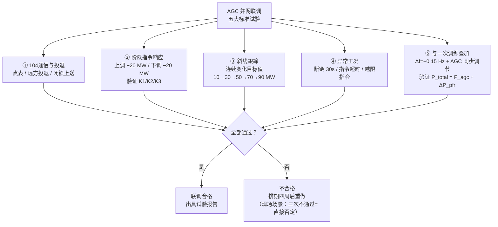
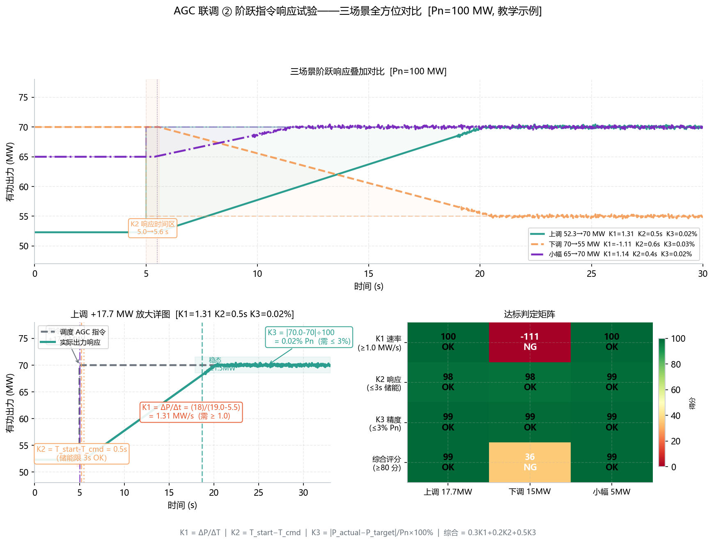
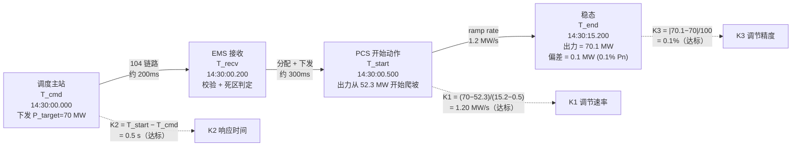
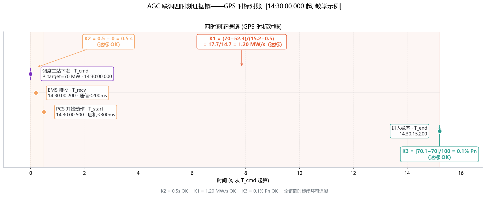

<!-- @AI_GENERATED -->
# 08 AGC并网联调怎么一次过？五大标准试验、三个隐蔽陷阱与完整证据链

> 所属层面：全四层贯通（试验验证）
> [课程首页](README.md) · 上一章：[07b AGC调频能赚钱吗](07b_AGC辅助服务经济性决策.md) · 下一章：[09 AGC考核不合格的根因在哪](09_AGC典型误区与故障诊断.md)

**一句话**：联调不是把你的 AGC 跑一遍就行——调度要模拟断链、越限、反向叠加这些"正常不出、出了就死"的故障。三个看起来过了其实没过的地方：采集粒度偷了你的 K3、投退瞬间的动作延时、你自认为投入但调度侧看到的是退出。

## 现场场景【必懂】

AGC 并网联调定在周三。周一调试完成，与调度的 104 点表对通、指令收发 OK、AGC 状态上送正常——你觉得万事俱备。

周三联调开始：

1. 调度下发第一个 AGC 指令"目标 = 80 MW"，你回复"接收 OK"，但实际出力 82 MW——差 2 MW，因为分配模块里把指令向下取了整（80 → round(80/4)×4 = 80，但实际执行中 PCS 分组造成了 2 MW 的偏差）；
2. 调度下发第二个 AGC 指令"目标 = 50 MW（大幅下调）"，你的 ramp rate 设了 0.5 MW/s，花了 60 秒到位——但调度要求 30 秒 K2 + K1 整体到位，记录为"调节速率不达标"；
3. 调度模拟 "104 链路中断 30 秒再恢复"，你的 AGC 没有自动退出也没有自动恢复——状态机逻辑在断链时卡住了，一直停留在"等待新指令"状态，调度无法确认 AGC 是否仍在工作。

三次不通过=联调不合格。下次排期：四周后。

**联调的验收标准比正常运行还严——因为调度要在联调中验证你"在各种工况下都不会出乱子"。**

> ⏱ **三段速读**：
> - 5 分钟：读现场场景 → 三个不通过案例 + 漫画式重现场景
> - 15 分钟：加读五大试验 mermaid + "症状 1/2/3" → 联调 checklist 基本够用
> - 30 分钟：精读证据清单 + 验收到凌晨的签字接收流程 → 下次联调直接照做

## 本章目标

读完本章，你应能：

1. 列出 AGC 并网联调的标准试验项目与合格判据；
2. 为每项试验准备指令序列、验收步骤与证据记录；
3. 识别联调中常见的"看似 OK 实则不合格"的隐蔽问题；
4. 准备一套完整的 AGC 联调验收证据链。

## AGC 并网联调与一次调频联调的关系

AGC 联调通常在一次调频联调之后进行（先验证"被动的频率响应"，再验证"被动的调度控制"）：

| 试验 | 顺序 | 关联 |
|---|---|---|
| 一次调频联调 | 先做 | 验证频率响应能力 |
| AGC 联调 | 后续 | 在满足一次调频要求的基础上，验证 AGC 受控能力 |
| AGC + 一次调频叠加试验 | 最后做 | 验证两者叠加不冲突、优先级正确 |

---

## AGC 联调的标准试验项目【必懂】

**图中标注对照表**：

| 试验编号 | 核心验证点 | 现场场景中的失败案例 |
|---|---|---|
| ① | 104 通信可靠性 + 状态机正确 | — |
| ② | K1（速率）、K2（响应）、K3（精度） | 第二次指令：ramp rate 0.5 MW/s → 60s 到位 → 不达标 |
| ③ | 连续跟踪能力 | — |
| ④ | 断链/超时/越限的异常处理 | 第三次：断链 30s 后状态机卡住，无法恢复 |
| ⑤ | AGC 与一次调频不冲突 | 一次调频优先，AGC 被裁剪 |

### 项目一：104 通信与 AGC 投退

| 验证项 | 试验方法 | 合格判据 |
|---|---|---|
| 104 点表一致性 | 调度侧读取 EMS AGC 相关测点 | 点地址、量纲、数据类型与实际一致 |
| AGC 远方投入 | 调度下发"AGC 投入"指令，EMS 切换至投入 | EMS 状态正确切换，上行传输正常 |
| AGC 远方退出 | 调度下发"AGC 退出"指令，EMS 切换至退出 | EMS 状态正确切换，AGC 指令停止执行 |
| AGC 闭锁后上送 | EMS 模拟设备故障，触发闭锁 | 闭锁状态 + 原因码上送到调度 |

### 项目二：指令响应——阶跃测试

| 验证项 | 试验方法 | 合格判据 |
|---|---|---|
| K2 响应时间 | 调度下发阶跃指令（如 50 MW → 70 MW） | 从指令下达到出力开始可靠变化 ≤ K2_limit |
| K1 调节速率 | 记录阶跃过程中的出力变化曲线 | 最大速率 ≥ K1_required |
| K3 调节精度 | 稳态持续 1~2 分钟 | 偏差 ≤ K3_limit |
| 双向响应 | 阶跃上调 + 阶跃下调 | 上调且下调均满足 K1/K2/K3 |

### 项目三：指令响应——斜线跟踪

| 验证项 | 试验方法 | 合格判据 |
|---|---|---|
| 连续斜线跟踪 | 调度下发连续变化的 AGC 目标值 | 出力跟踪目标，偏差 ≤ K3_limit × 1.5（动态放宽） |
| 小步长跟踪 | 调度以最小步长逐步调整目标 | 每一步都被跟踪，无跳过 |

### 项目四：异常工况

| 验证项 | 试验方法 | 合格判据 |
|---|---|---|
| 104 链路中断恢复 | 断开 104 链路 30 s 后恢复 | 断链期间 AGC 退出或保持，恢复后正常接收指令 |
| 指令超时 | 断链后 AGC 长时间未收到新指令 | 自动退出或保持当前出力并上送告警 |
| 越限指令 | 调度下发超出调节范围的指令 | EMS 拒绝下发 + 上送"指令越限"告警 |

### 项目五：与一次调频叠加

| 验证项 | 试验方法 | 合格判据 |
|---|---|---|
| AGC + 一次调频叠加 | 模拟频率偏差 + 同时下发 AGC 指令 | 输出 = AGC 基点 + 一次调频增量，不冲突 |
| 优先级验证 | AGC 上调 + 一次调频下调（反向） | 一次调频方向保留，AGC 被裁剪 |

---

## 联调中三种"看起来过了其实没过"的症状

### 症状 1：你的 K3=1%，调度记的 K3=4%

| 场景 | 问题 |
|---|---|
| EMS 以 1 秒采集一次 PCS 出力 | 10 MW/s 的爬坡速度下，1 秒内变化 = 10 MW |
| 调度以 4 秒采样一次 | 4 秒间隔的采样可能"跳"过中间值 |

在联调中，如果调度记录的 K1 和 EMS 记录的 K1 不同，根因很可能是**采样粒度不同导致的对齐误差**。唯一线索：你的反馈数据用的是高密度采点，调度的秒级瞬时值抓到了"跳变"瞬间。

### 症状 2：阶跃测试过了，斜线追踪却挂了

在联调中，AGC 指令通常是大步长（如 10 MW），不会触发指令死区。但实际运行中的小步长指令（1 MW）会被死区屏蔽 → K2 不合格。联调合格不意味着日常考核合格——阶跃是"从 50 跳到 70 等它到位"，斜线是"连续 10-30-50-70-90 像走楼梯"，你的 ramp rate 在连续变向时可能触发限幅保护。

**建议**：在联调中主动请求尝试小步长指令，确认指令死区配置合理。

### 症状 3：一切正常，但调度说"你的 AGC 半小时前就退出了"

AGC 投入、退出、闭锁恢复后的过渡行为，在联调中往往被忽视：

| 过渡状态 | 应该怎么做 |
|---|---|
| AGC 投入后第一次接收指令 | 以 ramp rate 从当前出力平滑过渡 |
| 闭锁恢复后第一次指令 | 以 ramp rate 平滑过渡，标记过渡期 |
| AGC 退出后最后一次指令 | 保持当前出力 or 按计划值回归 |

---

## 联调验收的证据清单【必懂】

参照一次调频课程的联调证据要求，AGC 联调至少需要记录：

**图中标注对照表**：

| 时刻 | 含义 | 来源 | 本例时间戳 | K1/K2/K3 计算 |
|---|---|---|---|---|
| T_cmd | 调度下发指令 | 调度主站 | 14:30:00.000 | — |
| T_recv | EMS 接收指令 | EMS 日志 | 14:30:00.200 | 104 传输延迟 200 ms |
| T_start | PCS 开始动作 | PCS 录波 | 14:30:00.500 | K2 = 0.5 − 0 = **0.5 s** |
| T_end | 出力进入稳态 | 稳态判定 | 14:30:15.200 | K1 = 17.7/(15.2−0.5) = **1.20 MW/s** |
| K3 偏差 | 稳态出力 vs 目标 | 调度采样 | 70.1 − 70 = 0.1 MW | K3 = 0.1/100 = **0.1% Pn** |

> **关键**：四时刻必须带毫秒级时标。调度侧和 EMS 侧的时间如果差 5 秒以上，K2 的计算结果就会完全不同——这是最常见的数据对账争议点。

| 证据项 | 内容 | 格式 |
|---|---|---|
| 试验项目清单 | 做了哪些试验 | 表 |
| 每条指令的 4 个时刻 | T_cmd（调度下发）、T_recv（EMS 接收）、T_start（开始动作）、T_end（稳态） | 时间序列 |
| 出力响应曲线 | 目标值曲线 + 实际出力曲线 + 各 PCS 出力曲线 | CSV/图片 |
| K1/K2/K3 每项试验的统计 | 试验条件和结果 | 表 |
| 异常工况的日志 | 断链、越限、闭锁的详细日志 | 日志文件 |

上述证据按优先级分为 6 类，验收时逐类核查：

| 证据类型 | 优先级 | 内容要求 |
|---|---|---|
| 调度指令日志截图 | 必须 | 含 GPS 时标、指令值与时刻 |
| PCS 录波曲线 | 必须 | ≥4 通道：有功 + 无功 + 频率 |
| EMS 事件记录 | 必须 | 含 t1/t2/t3、超时告警 |
| 稳态区间统计数据 | 必须 | 均值 + 标准差，≥30 周期 |
| 104 报文抓包 | 建议 | Wireshark，含时标字段 |
| 时钟同步校验记录 | 必须 | NTP/GPS，偏差 <10 ms |

### 联调证据打包建议

| 格式 | 说明 | 注意事项 |
|---|---|---|
| 截图 | 展示关键时刻点的状态 | 带系统时钟，带测点名称 |
| 录屏 | 展示完整动态过程 | 建议录 AGCA 系统的画面 10 分钟 |
| CSV 导出 | 数据证据 | 带时标的原始数据，不要加工后覆盖 |
| 日志文件 | 文本证据 | 包含 104 通信收发的完整记录、指令处理时间戳 |

---

## 联调前的检查清单【必懂】

| 检查项 | 是/否 |
|---|---|
| 104 点表与调度一致（地址、量纲、数据类型） | |
| AGC 投入/退出/闭锁状态能正确上传 | |
| 指令死区 ≤ 0.3% Pn 并已确认 | |
| EMS ramp rate ≥ K1_required × 1.2 | |
| 分配策略已配置并能稳定工作 | |
| AGC 闭锁恢复后的过渡逻辑已测试 | |
| 所有 PCS 可正常受控，通信无误 | |
| AGC + 一次调频叠加的逻辑已实现 | |
| 双通道 104 切换功能已就绪 | |
| 联调证据采集工具已启动 | |

---

## 自测

1. AGC 联调的三个隐蔽陷阱是什么？各会带来什么风险？
2. AGC 闭锁恢复后收到与当前出力差距 30 MW 的指令，在联调中为什么容易被忽视？
3. 联调中大步长指令都测试通过，日常运行时 K2 不合格——最可能的根因是什么？
4. AGC + 一次调频叠加试验的优先级是什么？

参考答案

1. ① 采集粒度不一致：EMS 和调度的采样粒度不同导致 K1/K2/K3 统计偏差；② 指令死区掩盖 K2：联调大步长不触发死区、实际小步长会→实际 K2 不合格；③ 投退过渡行为被忽略：AGC 投入/恢复后的首次过渡未测试，实际可能跳变或超时。
2. 因为联调通常按固定步骤执行指令——不会模拟"闭锁恢复后立刻收到大差距指令"的场景，但实际运行时这个场景可能发生。
3. 指令死区过大。联调使用的是大步长（如 ±10 MW），不触发死区。日常调度使用小步长（如 ±0.5~1 MW），触发死区 → 不跟踪 → K2 不合格。
4. 一次调频优先。同向相加并限幅，反向时保留一次调频方向、AGC 被裁剪。

> 💻 **动手实验**：运行 `python lab/examples/ch08_testing.py` 仿真阶跃响应 K1/K2/K3 自检与调度-EMS 参数一致性校验，验证"验收不过就查这三个维度"。

<!-- @AI_GENERATED: end -->