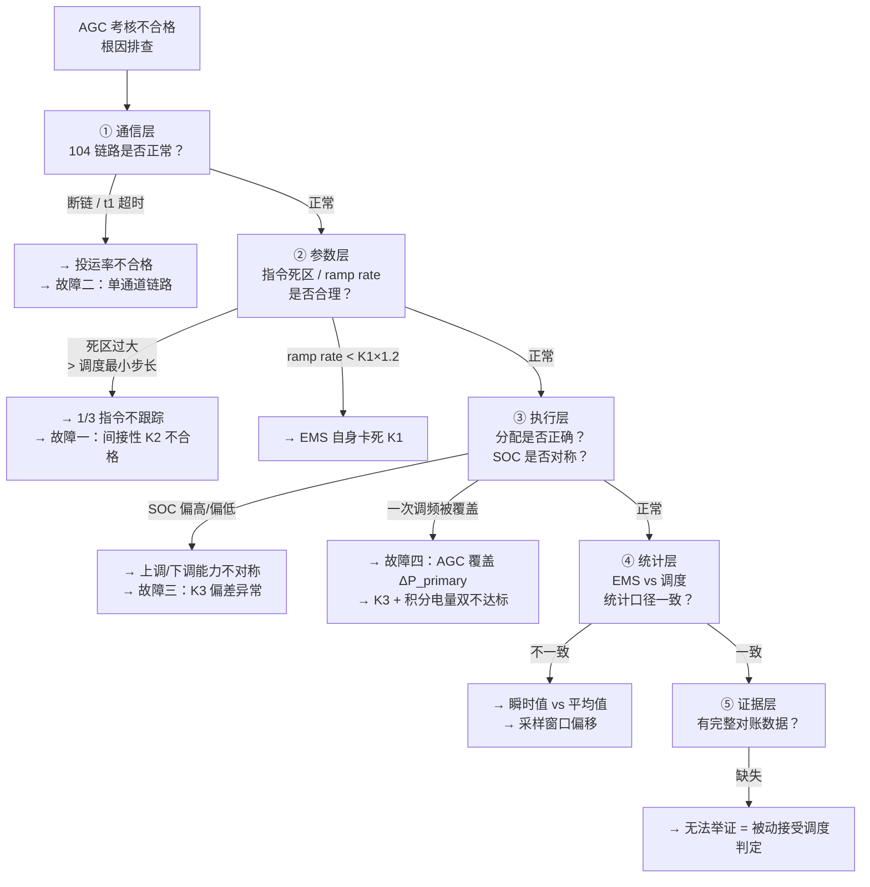
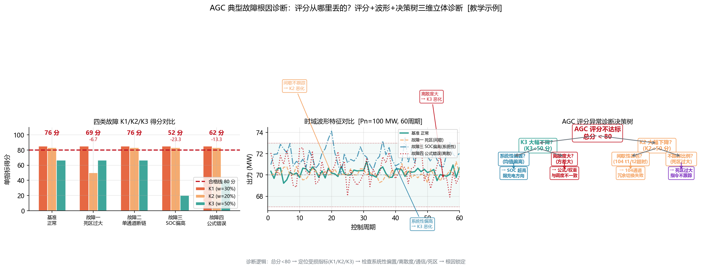
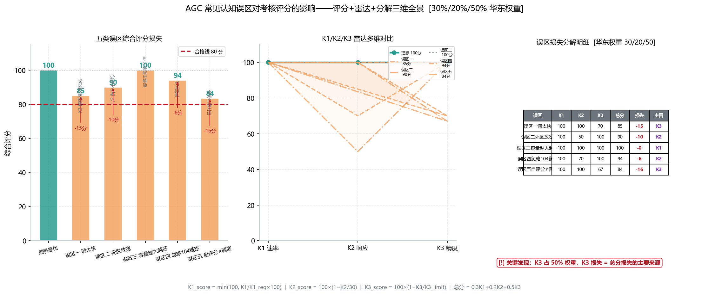

<!-- @AI_GENERATED -->
# 09 AGC考核不合格的根因在哪？五类典型误区与四个真实故障的逐层诊断

> 所属层面：全四层（经验教训）
> [课程首页](README.md) · 上一章：[08 AGC并网联调怎么一次过](08_AGC并网联调与验收证据链.md) · 下一章：[附录A 术语与符号表](附录A_AGC术语与参数速查.md)

**一句话**：考核不合格，90% 不是算法问题——是你某个参数配了但没生效、调度算的口径跟你不一样、或者出问题时你拿不出对账数据。

**图中标注对照表**：

| 排查层 | 检查项 | 对应故障/误区 |
|---|---|---|
| ① 通信层 | 104 链路 t1/t2/t3、双通道冗余 | 故障二：投运率 95.2%（单通道断链 3h） |
| ② 参数层 | 指令死区 ≤0.3% Pn、ramp rate ≥ K1×1.2 | 故障一：死区 2 MW 屏蔽 1/3 指令 |
| ③ 执行层 | SOC 中位 50%、P_total = P_agc + ΔP_pfr | 故障三（SOC 88%）、故障四（公式错误） |
| ④ 统计层 | 瞬时值 vs 平均值、采样窗口对齐 | 误区五：K3=2.5% 时得分仅 16.7 |
| ⑤ 证据层 | 四时刻 + 出力曲线 + 日志 | 争议时拿不出数据 |

> 👁 **怎么看这张图**：左半四组柱状——每个故障对 K1/K2/K3 的分别影响。死区过大只影响 K2（响应投递消失），SOC 偏高和公式错误都只影响 K3（精度塌陷），单通道断链影响投运率（直接扣分）。右半的综合评分降幅最直观：公式错误把 100 分直接砸到 56 分，是杀伤力最大的单点故障。**排障优先级：先查 K3（公式→SOC→统计口径），再查 K2（死区→链路），最后查 K1（限速链）。**

> ⏱ **三段速读**：
> - 3 分钟：只读"症状 A/B/C/D/E"五个标题 → 看看你有没有中招
> - 10 分钟：加读"故障一/二/三/四"复盘 → 搬出你自己的 AGC 日志对照查
> - 30 分钟：精读排查 mermaid + 全部复盘细节 → 搭建你的故障诊断 SOP

---

## 常见误区清单 — 别等出事才醒悟

### 症状 A："K1 已经超了要求，多出来的 K1 能拉分"

| 真相 | 说明 |
|---|---|
| K1 超了不会加分 | 评分公式 K1_score = min(100, 100 × K1_actual / K1_required)，K1 只要 ≥ K1_required 就是 100 分。超了部分无收益。 |
| 调太快可能有副作用 | PCS 频繁大功率爬坡 → 设备发热、寿命折损、电池循环加速 |
| 调太快可能干扰一次调频 | 过快的 AGC 调节可能在一次调频还在热备用时就把资源耗尽 |

**结论**：K1 调到比要求略高（约 1.1~1.2 倍）即可，不需要无限拔高。

### 症状 B："我 AGC 综合评分 90 分，稳了"

| 真相 | 说明 |
|---|---|
| 综合评分是加权和 | K1=100, K2=100, K3=80 → 综合=30+20+40=90。但 K3=80 可能只是刚过线，存在波动风险。 |
| 评分高不代表收入高 | 见[07b 章](07b_AGC辅助服务经济性决策.md)现场场景：里程模式下动作量比评分更重要。 |
| 评分高可能"不太稳定" | 这个月 90 分，下个月因为几个通信中断掉了到 75——高分需要每一个维度都持续在线。 |

### 症状 C："104 链路没断，AGC 肯定在线"

| 真相 | 说明 |
|---|---|
| 104 链路在线 ≠ AGC 投运 | AGC 可能处于"暂停"或"退出"状态，即使链路在线 |
| 链路"看起来在线"可能已经丢指令 | t1 刚好在边界上，指令到达不稳定 |
| 调度侧可能未认可投运状态 | 调度系统可能在内部把场站标记为"AGC 不可用"，EMS 侧不知道 |

### 症状 D："多资源场站，按额定容量分就行"

| 真相 | 说明 |
|---|---|
| 额定容量 ≠ 可调容量 | 光伏满发时上调空间为 0，按额定分给它 8 MW 是浪费 |
| 等比例不考虑实时约束 | 某资源的 ramp rate 限制了它分担的份额 |
| 不考虑 SOC | 储能 SOC 过低时，上调能力为 0 |

详见[03 章](03_AGC功率分配与动态补差.md)。

### 症状 E："K3 差 0.5% 而已" → 综合评分崩盘

| 真相 | 说明 |
|---|---|
| K3=2.5%（要求 3.0%）= 得分 16.7 | 余量并不大：3.0% 到 2.5% 只差 0.5%，评分从 0 降到 17 |
| K3 权重 50% | K3 拖低 1 分，综合评分拉低 0.5 分 |
| K3 对统计口径极其敏感 | 调度取瞬时值 vs EMS 取平均值，可能差 1%~2% |

---

## 典型故障复盘【必懂】

### 故障一：指令死区导致的"间接性 K2 不合格"

| 现象 | 根因 | 日均影响 |
|---|---|---|
| AGC 月报 K2 约 25 秒（要求 30 s），但有几个窗口超了 | 指令死区 = 2 MW，调度最小步长约 1 MW | 1/3 的指令不被跟踪 |

**复盘要点**：

1. 对比调度侧的"指令序列"和 EMS 侧的"已执行指令序列"——发现大约 1/3 的指令在 EMS 侧没有对应的执行记录；
2. 基本结论：指令死区过大；
3. 修正：指令死区从 2 MW 降到 0.3 MW（0.3% Pn），K2 全部正常。

---

### 故障二：104 链路单通道导致的投运率不合格

| 现象 | 根因 |
|---|---|
| AGC 月度投运率 95.2%（要求 98%） | 104 链路因光纤故障断链 3 小时，单通道无法切换 |

**复盘要点**：

1. 单通道是故障暴露的风险——主光纤被施工挖断 3 小时，无备链可切；
2. 这 3 小时被调度记为"AGC 不可用"= 180 分钟，占月度 3×24×60=4320 分钟的 0.42%——不算大，但前提是这个月没有其他断链事件；
3. 实际上当月还有三次 t1 超时导致的 1 分钟断链 + 一次设备故障 2 小时闭锁，合计约 220 分钟 → 220+180=400 分钟 → 投运率 = (4320−400)/4320 = 90.7% → 不合格。

---

### 故障三：SOL 过高导致的"上调 OK 下调差"的 K3 不合格

| 现象 | 根因 |
|---|---|
| K3 上调窗口达标（2.5% Pn），下调窗口不达标（5% Pn） | 储能 SOC 长期 88%，下调时充电空间不足 |

**复盘要点**：

1. SOC 偏高 → 充电空间小 → 下调指令到达时储能无法全量吸收；
2. 剩余下调量必须转到光伏/风电降出力 → 光伏降出力响应慢 → K3 超差；
3. 修正：降低 SOC 中位从 80% 到 50%，实时监控充电空间。

---

### 故障四：AGC 和一次调频叠加时互相干扰

| 现象 | 根因 |
|---|---|
| 频率事件期间 AGC K3 不达标，一次调频积分电量也低于理论 | AGC 指令覆盖了一次调频增量 |

**复盘要点**：

1. EMS 的 P_total 计算逻辑：P_total = P_agc_target（直接用 AGC 目标值，没有叠加一次调频增量）；
2. 这导致在频率事件中，AGC 每次刷新就覆盖掉一次调频已作出的出力贡献；
3. 修正：P_total = P_agc_base + ΔP_primary（AGC 刷新时只更新基点，不覆盖一次调频增量）。

---

## FAQ

**Q1：AGC 投入时需要什么条件？**

> A：104 链路正常、AGC 相关设备（PCS/逆变器）均正常、无闭锁原因、调度已远方投入或 EMS 已本地投入。部分区域要求并网后 72 小时内投入 AGC。

**Q2：AGC 可以部分退出吗（如只退出储能、保留光伏）？**

> A：取决于细则和调度要求。通常 AGC 是全站统一投入/退出。如果要差异化控制，需要在 EMS 分配层实现（某资源不参与分配 ≠ AGC 退出）。

**Q3：调度下发的 AGC 目标值和我看到的实际目标值不一致，谁的问题？**

> A：首先排除 104 点表问题（地址和量纲）。其次排查 EMS 是否在内部改了目标值（如指令死区的"不安全替代"）。最后对一下调度下发的原始帧和 EMS 解析后的值。

**Q4：AGC 指令死区能设成 0 吗？**

> A：不建议。零死区意味着每一个微小的指令变化都会触发完整的分配—下发—执行流程，导致 PCS 频繁微调、通信负载增加、设备寿命降低。保留一个合理的死区（≤0.3% Pn）是平衡精度的工程方法。

**Q5：AGC 考核数据对不上的时候应该怎么做？**

> A：① 先查验你自己的记录数据完整性；② 与调度对一下统计窗口和口径（瞬时 vs 平均、5 min vs 15 min）；③ 如果确认是调度侧统计口径不同，把你的原始数据（含时标）交给调度作为对账证据；④ 不找调度问"为什么"，而是主动提供已对齐格式的数据。

---

## 十大自查清单

| # | 检查项 | 说明 |
|---|---|---|
| 1 | 指令死区 ≤ 0.3% Pn | 防止 K2 间接性不合格 |
| 2 | EMS ramp rate ≥ K1 × 1.2 | 防止 EMS 自身卡死 K1 |
| 3 | AGC 合成公式：P_total = P_agc_base + ΔP_primary | 防止覆盖一次调频 |
| 4 | 双通道 104 | 防止单通道故障断链 → 投运率不合格 |
| 5 | K3 统计口径 = 调度侧统计口径 | 防止"自己看没问题、调度看有问题" |
| 6 | SOC 管理维持中位 50% | 防止充电/放电能力不对称 |
| 7 | 闭锁恢复后平滑过渡 | 防止恢复后跳变 |
| 8 | 多资源分配含反馈补差 | 防止"分的多但到位的少" |
| 9 | AGC 退出原因码上送 | 防止投运率争议时无证据 |
| 10 | 联调证据完整留存 | 防止联调重新做时无参考 |

---

## 自测

1. K1 = 1.8 Pn/min（要求 1.0）和 K1 = 1.0 Pn/min（要求 1.0）在评分上有区别吗？
2. 故障一（指令死区）的核心教训是什么？
3. AGC 和一次调频叠加的合成公式是什么？
4. 104 单通道导致的投运率不合格最可能的场景是什么？

参考答案

1. 评分无区别：K1_score = min(100, K1_actual/K1_required)，K1≥required 就是 100 分。K1=1.8 评 100 分，K1=1.0 也评 100 分。多余的 0.8 不产生评分收益，却增加了设备磨损。
2. 指令死区设置不能脱离调度指令的实际步长。联调时的测试步长（大步长）不代表日常运行的步长（小步长）。死区的设定必须依据调度最小步长，而不是凭经验给一个"差不多的"值。
3. P_total = clamp(P_agc_base + ΔP_primary, P_min, P_max)。AGC 刷新时只更新基点，不覆盖一次调频增量。一次调频优先。
4. 光纤被施工挖断（主通道物理中断）时无备链可切，断链期间被调度记为 AGC 不可用。如果该月中还有其他断链累积（如 t1 超时 × 几次），投运率就会跌破 98%（或 95%）。

> 💻 **动手实验**：运行 `python lab/ch09_diagnostics.py` 模拟调度目标→EMS 下发→PCS 采集三份数据的逐段对齐诊断，快速定位 EMS 侧 vs PCS 侧偏差根因。

<!-- @AI_GENERATED: end -->