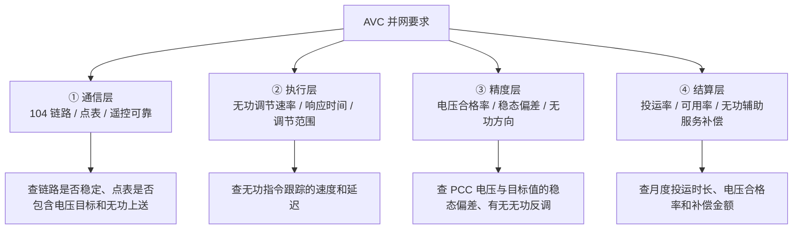
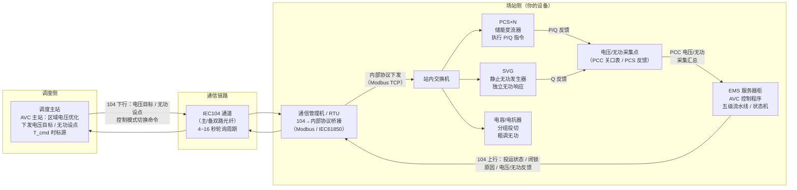
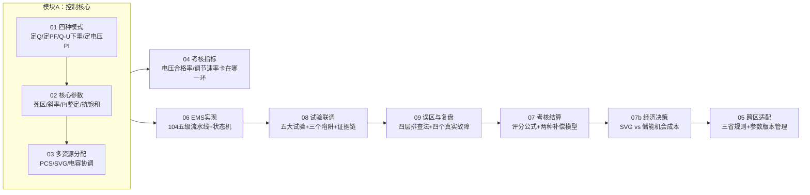

<!-- @AI_GENERATED -->
# 00 AVC自动电压控制：从调度电压目标到全场无功出力的闭环控制链路

> 所属层面：导航层 · 全课程地图
> [课程首页](README.md) · 下一章：[01 AVC四种控制模式怎么选](01_AVC控制模式与选型.md)

**一句话**：AVC 是电网的"电压自动配平器"——调度发现并网点电压偏了，给场站一个电压目标或无功设点，场站控制无功出力把电压拉回合格范围，响应快不快、调得准不准决定了你的考核分数和收入。

> **从控制理论看**：AVC 本质上是一套分层无功-电压控制系统——一级电压控制是本地快速响应（Q-U 下垂，P），二级电压控制是区域闭环修正（定电压 PI），三级电压控制是全系统优化（经济调度）。场站侧 AVC 子站属于二级电压控制，通过 PI 闭环消除电压偏差。（如果这几个概念不熟，点开下面的"前置知识自检"花 30 秒看一下。）

<details>
<summary>📋 前置知识自检（30 秒，不会也没关系，点开看看）</summary>

如果你对"无功功率为什么能影响电压"感到陌生，先花 30 秒过一遍三个核心概念：

| 概念 | 直觉解释 | 在 AVC 中的对应 |
|---|---|---|
| **无功功率 Q** | 不传输能量但能改变电压的功率，通过线路感抗 X 影响节点电压差 | AVC 的主要控制手段——发无功提升电压，吸无功降低电压 |
| **Q-U 下垂（P 控制）** | "电压偏差越大，无功响应越大"，但电压回不到目标值（有差调节） | **本地快速响应**：PCS 看到电压偏了就立刻按斜率发/吸无功 |
| **定电压 PI（I 控制）** | "只要电压还有偏差，我就一直调整无功直到电压回到目标"（无差调节） | **AVC 子站闭环**：PI 控制器持续修正 Q 指令直到 PCC 电压等于调度目标 |

```text
PCC 电压偏差持续存在

Q-U 下垂（P）：    Q = −K × (U − U_ref)      → 电压回不到目标（有差）
定电压 AVC（PI）：  Q = Kp×ΔU + Ki×∫ΔU dt    → 最终电压回到目标（无差）
OLTC 协调（慢）：   分接头调节变比             → 改变电压基准面
```

> 💡 **读完之后继续。全书需要你真正记住的"控制理论"只有这一件事：**AVC 的本质是通过调节无功来消除电压偏差。Q-U 下垂是"看电压就反应"的有差调节，定电压 PI 是"记着偏差持续修正"的无差调节。两者分工类似于一次调频和 AGC 的分工——一个管速度，一个管精度。

</details>

> ⏱ **三段速读**：
> - 3 分钟：读"过压考核不合格事件"故事 → 知道这门课要解决什么问题
> - 10 分钟：加读"四个层面"→ 理解 AVC 的通信/执行/精度/结算四层串联结构
> - 30 分钟：完整通读 + 自测 → 建立全课程骨架，决定从哪里开始精读

## 本章目标

读完本章，你应能：

1. 说出 AVC 在并网验收中被检查的四个层面（通信、执行、精度、结算）；
2. 区分"Q-U 下垂在工作"和"AVC 考核通过了"这两件不同的事；
3. 建立本课程的整体学习地图，知道每一章解决哪个环节。

## 本章边界与假设

本章是课程导航层，建立 AVC 闭环节点的全景认知；不深入任何控制算法的推导与参数整定（这些由第 01~09 章分别承担）。
**前置**：无硬性前置，建议了解无功功率与电压的基本关系（见折叠框中的前置知识自检）。
所有参数以当地规程与合同为准。

## 从一个过压考核不合格事件说起【必懂】

某 50 MW / 100 MWh 储能电站，AVC 功能上线首月，调度下发的月考核结果如下：

| 考核项 | 结果 | 现场初判 |
|---|---|---|
| AVC 投运率 | 合格 | 全月 97.5% |
| 电压合格率 | **不合格**（94.6%，要求≥99%） | "PCC 电压大部分时间都在 1.00±0.03 pu 内啊" |
| 无功调节速率 | **不合格** | "SVG 响应很快的，指令下去 200ms 就动了" |
| 无功反向调节 | **扣分** | "我们是按 Q-U 下垂在发无功，怎么会反向？" |

现场工程师查了两天，发现三件互不相干的事：

1. **控制模式与考核口径不匹配**：EMS 运行在 Q-U 下垂模式，即 `Q = −K×(U−U_ref)`。当 PCC 电压在 1.020 pu 时发出了 −200 kvar，逻辑没毛病。但调度考核系统按"定电压模式"口径——要求"电压目标 1.000 pu 时，PCC 实测必须在 0.997~1.003 pu 以内"。Q-U 下垂是有差调节，电压永远回不到 1.000 pu，所以**全月都在"偏差超标"状态**。本质上是"控制模式挂错了挡"。

2. **无功响应计时起始点搞错了**：调度考核"无功调节速率"的计时起点是"AVC 主站下发指令的时刻 T_cmd"，而 EMS 侧记录的起始点是"子站接收并校验通过的时刻 T_recv"。104 通道轮询周期 8 秒 + 校验延迟 2 秒，光是链路就吃掉了 10 秒的时间。考核要求的"30 秒内达到目标 90%"变成了实际只有 20 秒可用——SVG 本身 500ms 就完成响应了，但计时方式让它在纸面上成了"慢响应"。

3. **无功方向与有功耦合被忽略**：在中午光伏大发时，储能同时执行 AGC 放电和 AVC 无功吸收。PCS 的视在功率限制是 `S_max = 1.0 MVA`，当有功已经放到 900 kW 时，无功最多只能吸收 `sqrt(1000² − 900²) = 436 kvar`。AVC 要求的 500 kvar 吸收量被 P-Q 能力限幅截断了——看起来是"AVC 没执行到位"，实际上是"有功把无功的预算占满了"。

这三件事没有一件属于"算法难"，全部属于**模式、时序与能力边界**问题。

> **软件类比**：这很像配置了 Redis 缓存但没设 TTL——缓存本身工作正常，但业务需要的是强一致性，而你给了它最终一致性。Q-U 下垂给了本地快速响应，但调度考核要的是"电压精确回到目标值"——**选错了工具，结果永远是"不及格"**。
> **类比失效点**：Redis 缓存失效最多导致数据短暂不一致；AVC 模式选错会导致月度考核不合格，直接损失数万元的辅助服务补偿。而且 AVC 涉及的是物理电网，电压失控可能触发保护跳闸造成更大的安全事故。

---

## AVC 被检查的四个层面【必懂】

把并网要求拆开看，调度与试验单位其实在检查四件不同的事：



| 层面 | 谁在查 | 典型证据 | 常见失败原因 |
|---|---|---|---|
| 通信层 | 调度 / 自动化 | 104 链路日志、电压/无功点表核对表 | 轮询周期过长、电压目标点号在点表中遗漏 |
| 执行层 | 调度（月度考核） | 无功目标与实际出力的时序对比 | Q-U 下垂代替 PI 闭环、PI 参数使能未生效 |
| 精度层 | 调度（月度考核） | PCC 电压与目标的偏差统计 | 死区过大、PI 积分饱和、有功挤出无功预算 |
| 结算层 | 调度（结算中心） | 投运率 / 电压合格率统计表 | 频繁闭锁、电压越限触发考核扣分 |

**这四层是串联的**：通信层断了，执行层和精度层没有数据来源；执行层的延迟直接影响精度层；精度层不稳则结算层的补偿会被削减甚至变罚款。

---

## 物理部署全景图【了解】

在你深入任何一章之前，先把"信号在哪里跑、设备在哪里放"看清楚——很多排障时的困惑，本质上是不知道哪个环节断了：



**图中关键点**：

| 环节 | 常出问题的地方 | 影响 |
|---|---|---|
| 104 通道 | t1 超时导致重连（06 章） | 投运率扣分 |
| 通信管理机桥接 | 电压目标点号遗漏、协议转换延时（08 章症状一） | 电压合格率计算偏差 |
| EMS 控制流水线 | 死区过大 / PI 积分饱和（02/03 章） | 电压合格率下降、无功调节速率不合格 |
| PCS 本地执行 | P-Q 能力限幅 / P 优先模式挤占 Q 空间（02/03 章） | 无功指令不能足额执行 |
| SVG 独立响应 | SVG 工作模式与 AVC 协调错误（03 章） | 无功过补或欠补 |
| 电压反馈回路 | PCC 测点与调度考核测点不一致（04/08 章） | 自己算的电压合格率和调度算的不一样 |

> 💡 **口诀**：调度发电压目标 → 104 光纤到机柜 → 通信管理机翻译 → EMS 选模式算 Q → PCS/SVG 执行 → PCC 电压回传。任一环断了，AVC 全链路失效。

---

## 为什么单独立一门课【必懂】

AVC 的基本原理，在[入门课程第 17 章](../ems-python-learning/17_无功电压与AVC.md)已经讲过。但那一章讲的是**"四种模式各产生多少 Q"**，而工程上真正卡住人的是**"调度怎么考核你、用什么口径算你合格、四种模式在什么场景下该选哪个"**。

两者的差别可以用一句话概括：

| 视角 | 关心的问题 |
|---|---|
| 算法视角（入门课程） | 定 Q/PF/Q-U/AVC 的 Q 请求公式怎么写 |
| 并网视角（本课程） | 考核测点是 PCC 还是站内母线？电压合格率怎么统计？PI 参数怎么整定？SVG 和 PCS 谁先动？ |

同一个 PI 控制公式，在两种视角下的"正确"标准完全不同。算法上合理的一组 Kp/Ki，可能因为**统计窗口划分**或**P-Q 能力限幅**被判不合格。

---

## AVC 与 AGC 的本质区别【必懂】

在深入各章之前，先搞清楚 AVC 和 AGC 在控制对象与考核逻辑上的本质区别：

| 维度 | AGC（有功/频率） | AVC（无功/电压） |
|---|---|---|
| 控制对象 | 有功功率 P（MW） | 无功功率 Q（Mvar） |
| 受控物理量 | 系统频率 f（全局量） | 节点电压 U（局部量） |
| 谁发指令 | 调度主站（响应区域 ACE） | 调度主站（响应区域电压优化） |
| 指令形式 | 目标出力 P_target | 电压目标 U_target 或无功设点 Q_setpoint |
| 考核核心 | K1 调节速率 / K2 响应时间 / K3 调节精度 | 电压合格率 / 无功调节速率 / 电压响应时间 |
| 设备资源 | PCS 有功能力 | PCS 无功能力 + SVG + 电容/电抗器 + OLTC |
| P-Q 耦合 | 有功分配不影响无功可用量（仅受 SOC 约束） | 无功可用量被有功实时挤出（P-Q 能力圆） |
| 时间尺度 | 秒~分级（AGC 指令 4~16s 周期） | 秒~分级（电压变化较慢，但 SVG 毫秒级响应） |
| 本地控制 | 一次调频（频率→有功，P 控制） | Q-U 下垂（电压→无功，P 控制） |
| 远程闭环 | AGC（频率→积分→有功，I 控制） | 定电压 AVC（电压→PI→无功，I 控制） |

> **一句话区分**：AGC 考的是"调度让你出多少有功，你跟得快不快、准不准"；AVC 考的是"调度让你把电压维持在多少，你控得稳不稳、无功够不够用"。

---

## 学习地图【必懂】

> 章节编号保持不变，推荐按以下顺序阅读——全书围绕同一座 50 MW / 100 MWh 储能电站展开，不跳场景。



| 章节 | 如果你只想解决一个问题 | 建议读法 |
|---|---|---|
| 01 | 不理解 Q-U 下垂和定电压 PI 到底什么时候用 | 通读 + 对照四种模式 |
| 02 | AVC 响应太慢，无功老是跟不上 | 精读 + 手算 PI 参数 |
| 03 | 场站同时有 PCS、SVG 和电容 | 精读 |
| 04 | 电压合格率总是不达标 | 精读 + 做统计窗口分析 |
| 05 | 项目在特定省份 | 对照查阅 |
| 06 | 要做架构设计 | 精读 |
| 07 | 月度考核被扣钱 | 精读 |
| 08 | 要做 AVC 联调 | 精读 |
| 09 | 上线前做自查 | 通读，逐条对照 |

---

## 🔥 紧急通道：我只想快速解决一个问题

| 你的症状 | 直接跳到这里 | 预计时间 |
|---|---|---|
| PCC 电压达标了但考核还是不合格 | [04 章：统计窗口和测点位置](04_AVC考核指标与统计口径.md) | 10 min |
| 无功发了但电压纹丝不动 | [01 章：Q-U 关系与 X/R 比](01_AVC控制模式与选型.md) + [09 章：误区一](09_AVC典型误区与故障诊断.md) | 12 min |
| SVG 和 PCS 互相抢无功 | [03 章：多资源协调控制](03_AVC多资源无功分配.md) | 10 min |
| 被调度扣了钱，不知道为什么 | [07 章：评分公式](07_AVC考核与结算模型.md) | 15 min |
| 马上要做联调，怕漏项 | [08 章：五大试验+三个症状](08_AVC并网联调与验收证据链.md) | 20 min |
| 同一场站在华东和山西考核不一样 | [05 章：三区域参数对照](05_AVC跨区调度细则适配.md) | 10 min |
| 不知道从哪开始 | 往下读"过压考核不合格事件"故事 → 那是全课程的 ground zero | 5 min |

---

## 本课程的统一约定【必懂】

为了避免混淆，全课程采用以下约定（与一次调频和 AGC 课程保持一致）：

| 项目 | 约定 | 说明 |
|---|---|---|
| 功率方向 | 储能向电网发出有功/无功为正（P>0, Q>0） | 吸收为负 |
| 并网点电压 | 以 pu 为单位，基准值为测点额定线电压 | 如 110 kV PCC 基准为 110 kV |
| 无功功率单位 | kvar / Mvar | 代码中以 kvar 为单位 |
| 视在功率 | kVA / MVA | P-Q 能力圆的上限约束 |
| AVC 指令 | 由调度主站通过 104 规约下发 | 电压目标或无功设点 |
| 时间 | 秒（s），统一时钟 | 指令时标与反馈时标必须统一 |

> **注意**：不同厂家与标准中，"无功调节速率"有时指"Q 指令变化率（kvar/s）"，有时指"从指令到执行的时间（s）"。**读到任何一份细则，第一步都是先确认它用的是哪套术语**。附录 A 给出了对照表。

---

## 🧪 动手验证

全书从第 01 章开始，每个核心章节末尾均配有可运行的 Python 代码实验室。运行的启动点是第 01 章：

```bash
cd lab/
python examples/ch01_mode_compare.py
```

或运行全部 20 个一致性测试，验证代码与正文手算 100% 对齐：

```bash
cd lab/
python -m pytest tests/ -v
```

> 详见各章末尾的 `🧪 动手验证` 小节和 [README](README.md) 中的 lab 使用指南。

---

## 自测

1. AVC 的并网要求可以拆成哪四个层面？各自最常见的失败原因是什么？
2. "Q-U 下垂在工作"和"AVC 考核通过了"为什么可能不一致？请举一个具体例子。
3. AVC 与 AGC 在控制对象、考核指标和 P-Q 耦合三个方面有什么本质区别？
4. 如果你接手一个省网的 AVC 改造项目，第一件要拿到的资料是什么？

<details>
<summary>参考答案</summary>

1. 通信层（104 链路不稳定、电压目标点号遗漏）、执行层（Q-U 下垂代替 PI 闭环、PI 参数未生效）、精度层（死区过大、PI 积分饱和、P 优先挤占 Q 空间）、结算层（电压合格率被统计窗口放大偏差、频繁闭锁）。
2. 因为 Q-U 下垂只保证"电压偏高时吸收无功"，不保证"电压回到目标值"。例如调度要求 PCC 电压回到 1.000 pu ±0.003，Q-U 下垂在 U=1.020 pu 时输出 Q=−200 kvar，电压可能只降到 1.015 pu 就平衡了——Q 响应了，但电压没回到合格范围。
3. AGC 控有功/频率（全局量），AVC 控无功/电压（局部量）；AGC 考 K1/K2/K3（跟踪精度），AVC 考电压合格率（稳态精度）；AGC 的有功分配不受无功影响，AVC 的无功可用量会被 P-Q 能力圆上的有功吃掉。
4. 该省最新的 AVC 调度管理细则、并网调度协议中 AVC 相关条款、PCC 测点的额定电压和互感器变比。
</details>

<!-- @AI_GENERATED: end -->