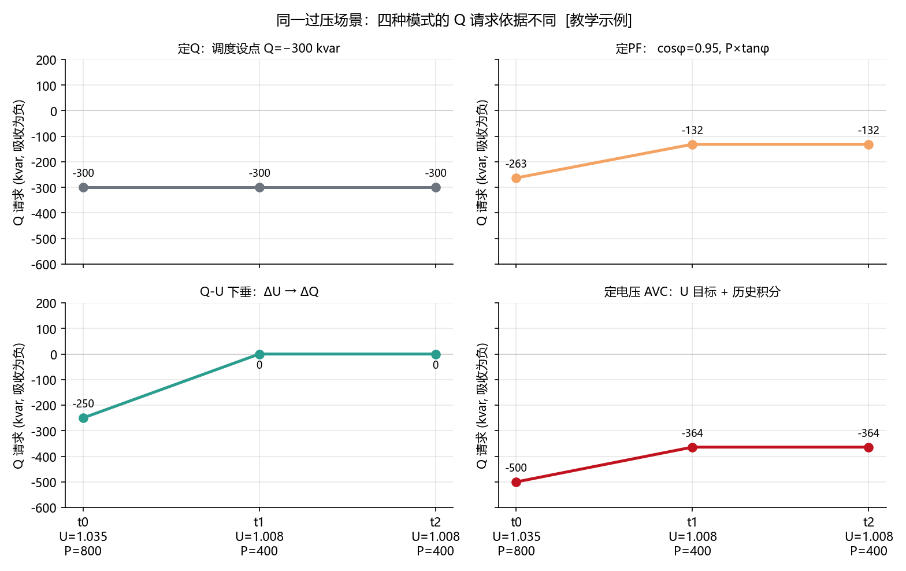
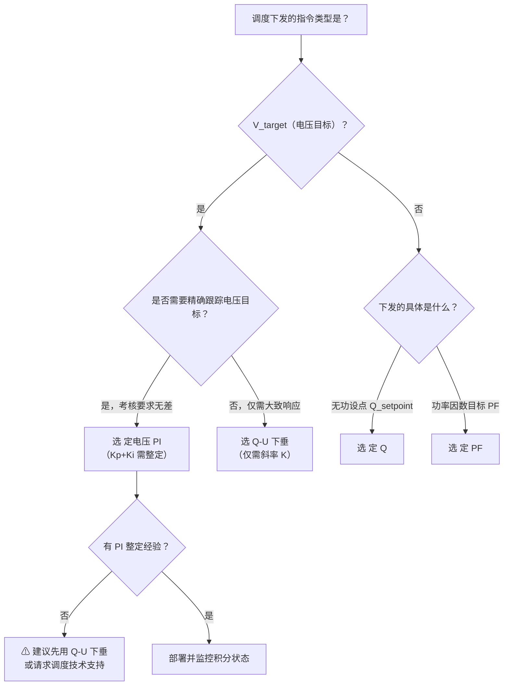

<!-- @AI_GENERATED -->
# 01 AVC四种控制模式怎么选：定Q、定PF、Q-U下垂与定电压PI

> [课程首页](README.md) · 上一章：[00 AVC闭环控制链路](00_AVC闭环控制链路.md) · 下一章：[02 AVC核心参数与整定](02_AVC核心参数与整定.md)

**一句话**：四种 AVC 控制模式——定 Q、定 PF、Q-U 下垂、定电压 PI——在不同的输入信号、控制目标和适用场景下产生完全不同的 Q 请求，选错模式等于从一开始就跑偏了方向。

## 本章目标

读完本章，你应能：

1. 写出四种 AVC 控制模式的公式、输入信号和输出逻辑；
2. 在同一组场景输入下，手算四种模式各自的 Q 请求；
3. 根据现场要求（调度下发的是"电压目标"还是"无功设点"）做出控制模式选型；
4. 区分 Q-U 下垂的"有差快速响应"和定电压 PI 的"无差闭环修正"。

## 本章边界与假设

- **in-scope**：四种控制模式（定 Q、定 PF、Q-U 下垂、定电压 PI）的 Q 请求生成算法与工程选型。
- **out-of-scope**：PI 参数整定与抗积分饱和（留到第 02 章）、多资源分配与多机/OLTC 协调（留到第 03 章）。
- **prerequisites**：第 00 章；建议了解基础课程第 17 章中关于 P/Q/pu 方向约定和 R/X 线路模型。

所有参数以当地规程与合同为准。

---

## 01.1 现场场景【必懂】

某 50 MW 光储电站，110 kV 并网。一个下午的三小时内发生了三件事：

1. **13:00**：光伏大发，PCC 电压从 1.000 pu 升到 1.035 pu [行业典型值：光伏高发时段 PCC 电压升高 2%~5%]。调度 AVC 主站下发"电压目标 1.000 pu"。
2. **14:30**：云层遮阳，光伏骤降 30 MW，PCC 电压回落到 1.008 pu，但调度没有更新指令。
3. **15:00**：调度切换模式，改为直接下发"吸收无功 300 kvar"——调度不再关心电压，只要场站按量吸收。

**问题清单**：本章回答这三个问题：
- 同样面对"PCC 电压偏高"，为什么有些模式只生成固定的 Q（定 Q），有些按当前 P 比例缩放（定 PF），有些按当前电压查曲线（Q-U 下垂），有些则记住历史偏差持续修正（定电压 PI）？
- 13:00、14:30、15:00 三个时刻，四种模式分别算出什么 Q？
- 调度说的"AVC"和你理解的"调压"可能不是一回事——怎么区分？

---

## 01.2 四种模式全景对比【必懂】

| 模式 | 控制目标 | Q 从哪里来 | 看 PCC 电压？ | 有状态（积分）？ | 不保证什么 |
|---|---|---|---|---|---|
| 定 Q | 固定无功设点 | 调度/人工下发 Q_setpoint | 否 | 否 | 不保证电压回到目标 |
| 定 PF | 固定功率因数 | PF 目标 + 当前 P 实时计算 | 否 | 否 | 不保证固定 Q 或电压 |
| Q-U 下垂 | 固定电压-无功响应曲线 | 当前 PCC 电压查下垂曲线 | 是 | 否 | 不保证精确跟踪电压目标（有差） |
| 定电压 PI | PCC 电压精确跟踪目标 | 电压目标与实测的闭环 PI | 是 | 是 | 不保证超出无功能力时仍能达标 |

### 四种模式的同一输入场景

| 时刻 | PCC 电压 U（pu） | 有功 P（kW） | 调度下发 | 场景说明 |
|---|---:|---:|---|---|
| t0 | 1.035 | 800 | 电压目标=1.000 pu；Q 设点=−300 kvar | 13:00 光伏大发过压 |
| t1 | 1.008 | 400 | 同上（未更新） | 14:30 云遮阳、电压回落 |
| t2 | 1.008 | 400 | 调度切换为"吸收 Q=300 kvar" | 15:00 调度改发无功设点 |

参数：PF 目标=0.95（吸收），Q-U 下垂斜率 K=10000 kvar/pu、死区 ±0.01 pu、Q 限幅 ±500 kvar，PI 参数 Kp=8000 kvar/pu、Ki=2000 kvar/(pu·s)、控制周期 Ts=4s、Q 限幅 ±500 kvar。均为 `[教学示例]`。

---

### 配图：四模式同一场景 Q 请求对比



| 编号 | 位置 | 标注 | 对应正文 |
|---|---|---|---|
| ① | 定Q面板 | t0~t2 始终 −300 kvar（调度设点不变则 Q 不变） | §01.3 定Q手算表 |
| ② | 定PF面板 | t1 时 P 从 800→400 kW，Q 从 −263.0→−131.5 kvar（P 掉则 Q 掉） | §01.4 手算 |
| ③ | Q-U下垂面板 | t0 U=1.035→Q=−250；t1/t2 U=1.008 进入死区→Q=0 | §01.5 手算 |
| ④ | 定电压PI面板 | t0 U=1.035→Q=−500（限幅）；t1/t2 U=1.008→Q=−364（I 饱和在 −300） | §01.6 逐拍追踪 |

---

## 01.3 定 Q：执行明确的无功命令【必懂】

### 为什么需要

调度可能直接要求场站"吸收 300 kvar"或"发出 5 Mvar"。这时控制目标本身就是无功量，EMS 不需要自己猜电压应该调到哪里。定 Q 也是 AVC 子站的"保底模式"——当电压测量失效或 PI 积分异常时，手动切换到定 Q 可以维持可控状态。

### 原理

```text
q_request_kvar = q_setpoint_kvar
```

### 手算

| 时刻 | Q 设点 | q_request_kvar |
|---|---|---|
| t0 | −300 kvar | −300 |
| t1 | −300 kvar | −300 |
| t2 | −300 kvar | −300 |

无论电压怎么变，Q 始终 = −300 kvar。

### 概念实现

```python
def fixed_q_control(q_setpoint_kvar: float) -> float:
    return q_setpoint_kvar
```

> **软件类比**：定 Q 就像写死的数据库连接池大小——不管负载如何，始终给你固定数量的连接。
> **类比失效点**：数据库连接池写死最多排队等待；定 Q 写死在电网过压时可能导致该多吸收无功时吸收不够，电压越限触发考核。

---

## 01.4 定 PF：保持 P 和 Q 的固定比例【必懂】

### 为什么需要

有些并网协议考核的是功率因数窗口——要求场站在某一时段内 PF 不低于 0.95（吸收无功）。EMS 需要根据当前 P 实时计算 Q，维持固定的 P/Q 比例。

### 原理

PF = P / S = cos(φ)。给定 PF 幅值和无功方向：

```text
φ = arccos(PF)
Q = direction × |P| × tan(φ)
```

其中 `direction = +1` 为发出无功（Q>0，容性），`direction = −1` 为吸收无功（Q<0，感性）。

### 手算

PF=0.95（吸收，direction=−1），φ = arccos(0.95) = 18.19°，tan(φ) = 0.3287。

| 时刻 | P（kW） | Q（kvar） |
|---|---|---|
| t0 | 800 | −1 × 800 × 0.3287 = **−263.0** |
| t1 | 400 | −1 × 400 × 0.3287 = **−131.5** |
| t2 | 400 | −1 × 400 × 0.3287 = **−131.5** |

### 概念实现

```python
import math

def fixed_pf_control(p_kw: float, pf_target: float, direction: int) -> float:
    tan_phi = math.tan(math.acos(pf_target))
    return direction * abs(p_kw) * tan_phi
```

> **软件类比**：定 PF 像 CSS 中的 `vw` 单位——元素尺寸按视口宽度比例缩放。Q 按 P 等比例缩放。
> **类比失效点**：CSS 的 `vw` 是纯美学问题。定 PF 在 P 很低时（如夜间光伏停机），Q 也趋于零——此时即使电压偏高，也产生不了足够的无功吸收量，电压失控风险仍然存在。

---

## 01.5 Q-U 下垂：本地的即时电压响应【必懂】

### 为什么需要

当远方指令更新较慢或通信中断时，本地设备需要根据 PCC 电压自主响应——这是"自治控制"的基础。Q-U 下垂也是 PCS 本地控制层的标准功能，很多逆变器出厂就带。

> **物理直觉类比**：Q-U 下垂的本质与同步发电机的无功-电压下垂特性完全相同。同步发电机在并网运行时，励磁电流恒定的情况下，端电压会随着无功出力的增加而降低——发出无功越多，内电势与端电压的夹角越大，端电压越被"拉低"。Q-U 下垂用电子控制复现了这条天然的物理特性：
> - 电压偏高 → 吸收无功 → 电压被"拉回"（等同于发电机欠励）
> - 电压偏低 → 发出无功 → 电压被"抬起"（等同于发电机过励）
>
> 区别在于：同步发电机的下垂斜率由绕组阻抗等物理参数决定（不可调），而 Q-U 下垂的斜率 K 是人为设定的（可调）。这种可调性既是优势（可以匹配不同容量），也是陷阱（K 设错了等于"伪造了一条不存在的物理特性"，会导致电网侧误判你的无功响应能力）。
> **类比失效点**：同步发电机有旋转惯量提供数秒级的"缓冲时间"，PCS 电子下垂没有惯量——偏差一出现立即响应，可能导致与电网其他调节设备产生高频交互。

### 原理

```text
ΔU = U_pcc_pu − U_ref_pu
ΔU_db = deadband(ΔU, ±db_width)    # 死区内的偏差归零
Q = clamp(−K × ΔU_db, −Q_max, +Q_max)
```

连续型死区函数：

```text
deadband(x, ±d) = x − d   if x > +d
                  x + d   if x < −d
                  0        otherwise
```

### 手算

U_ref=1.000 pu，死区 ±0.01 pu，K=10000 kvar/pu。

| 时刻 | U（pu） | ΔU | ΔU_db | Q_request（kvar） |
|---|---:|---:|---:|---:|
| t0 | 1.035 | +0.035 | 0.035 − 0.01 = **+0.025** | −250 |
| t1 | 1.008 | +0.008 | 0.008 在死区内 → **0** | 0 |
| t2 | 1.008 | +0.008 | 0.008 在死区内 → **0** | 0 |

**关键观察**：t1/t2 的 U=1.008 pu 落在 ±0.01 死区内，Q-U 下垂输出 Q=0——它不管"刚才电压偏高"，只看此刻。

### 概念实现

```python
def q_u_droop_control(u_pcc_pu: float, u_ref_pu: float,
                      db_width: float, K: float,
                      q_max: float) -> float:
    error = u_pcc_pu - u_ref_pu
    if error > db_width:
        error_db = error - db_width
    elif error < -db_width:
        error_db = error + db_width
    else:
        error_db = 0.0
    q = -K * error_db
    return max(-q_max, min(q_max, q))
```

> **软件类比**：Q-U 下垂像 CDN 边缘节点的本地缓存——响应极快（本地下垂一算就出 Q），但不保证最终一致性（电压回不到目标值）。
> **类比失效点**：CDN 缓存过期最多返回旧数据；Q-U 下垂在电压死区内完全不响应，如果死区宽度和调度考核的"电压合格范围"不一致（如死区 ±0.01 pu、合格范围 ±0.007 pu），那在 1.008~1.010 pu 区间内：调度判你"不合格"，但 Q-U 下垂认为"不需要动作"。

---

## 01.6 定电压 PI：闭环消除电压偏差【必懂】

### 为什么需要

调度下发的是"电压目标"而不是"无功量"——AVC 子站必须通过闭环控制把 PCC 电压拉回到目标值，且保持住。这是并网考核中最核心的模式。

### 原理

```text
error[n] = U_target_pu − U_pcc_pu[n]        # 电压偏低为正、偏高为负（与附录B的 ΔU=U−U_target 互为相反数）
I[n] = I[n−1] + Ki × error[n] × Ts
I[n] = clamp(I[n], −I_max, +I_max)          # 抗积分饱和
Q = clamp(Kp × error[n] + I[n], −Q_max, +Q_max)
```

关键区别：PI 的 I 项保存了历史偏差——即使当前偏差很小，只要积分项还有残余，Q 就会持续输出。`error = U_target − U_pcc` 与附录 B 的通用偏差 `ΔU = U − U_target` 互为相反数：电压偏高时 error<0、ΔU>0，两者都使 Q 为负（吸收）。

### 手算

Kp=8000 kvar/pu，Ki=2000 kvar/(pu·s)，Ts=4s，Q_max=500 kvar，I_max=300 kvar。error = U_target − U_pcc（电压偏高为负）。

| 拍 | U | error | I[n−1] | P=Kp×error | I[n] | Q_request | 说明 |
|---|---:|---:|---:|---:|---:|---:|---:|
| t0 | 1.035 | −0.035 | 0 | −280 | −280 | −500（clamp） | P+I=−560 超出 Q_max，被限幅到 −500 |
| t1 | 1.008 | −0.008 | −280 | −64 | −344→−300 | −364 | 电压仍偏高，I 持续累积并逼近 I_max |
| t2 | 1.008 | −0.008 | −300 | −64 | −364→−300 | −364 | 抗积分饱和：I 停在 −300，Q 稳定在 −364 |

**关键观察**：t1/t2 的 U 同为 1.008 pu，PI 都输出 −364 kvar——因为 I 记住了历史偏差并饱和在 I_max=−300，即使当前偏差已很小，Q 仍持续输出。而 Q-U 下垂在 t1/t2 都输出 0。这就是"有差"与"无差"的根本区别：下垂只看此刻，PI 带着历史记忆。

### 概念实现

```python
def voltage_pi_control(u_pcc_pu: float, u_target_pu: float,
                       kp: float, ki: float, ts: float,
                       i_prev: float, i_max: float,
                       q_max: float) -> tuple[float, float]:
    error = u_target_pu - u_pcc_pu
    i_new = i_prev + ki * error * ts
    i_new = max(-i_max, min(i_max, i_new))
    q = kp * error + i_new
    q = max(-q_max, min(q_max, q))
    return q, i_new
```

> **软件类比**：定电压 PI 像数据库的 WAL（Write-Ahead Log）——每次写入不仅关心当前状态，还累积历史操作记录，保证最终一致性。
> **类比失效点**：WAL 重放失败可以人工介入恢复。PI 积分饱和（I 被限幅后持续"粘"在边界上）可能导致反向电压偏差时响应迟钝——这需要抗积分饱和策略（第 02 章详解）。

---

## 01.7 四种模式的工程选型决策树【必懂】



| 场景 | 推荐模式 | 原因 |
|---|---|---|
| 调度直接下发"吸收 XX kvar" | 定 Q | 目标就是无功量，不需要闭环 |
| 合同要求 PF≥0.95（考核窗口） | 定 PF | 必须按 P 等比例缩放 Q |
| 调度下发电压目标，但现场无 PI 整定能力 | Q-U 下垂 | 参数少（仅 K 和死区），不会出大错 |
| 调度下发电压目标，要求电压合格率≥99% | 定电压 PI | 只有 PI 能实现无差闭环 |
| 通信中断时需要本地自治 | Q-U 下垂 | 不依赖远方指令，本地闭环 |

### 四种模式的经典翻车案例【了解】

以下四个案例都来自实际联调中的真实问题模式，每种模式都有一个"你以为没事，实际上出事了"的典型翻车路径。

**翻车 1：定 Q——"指令没变，但场景变了"**

某电站 14:00 收到调度下发"吸收 Q=300 kvar"，现场确认后 PCS 执行正常。16:00 光伏已经下山，PCC 电压从 1.020 pu 回落到 0.996 pu——电压已经偏低了。但 EMS 的定 Q 模式仍在执行 −300 kvar（吸收无功）——吸收无功会让电压更低。

**根因**：定 Q 不读电压。指令下发时是正确的（电压偏高），但场景变化后（电压偏低），同样的 Q 指令变成了反向调节。

**教训**：定 Q 模式必须加"定时限自动退出"——如果调度 N 分钟不更新 Q 设点，自动切到本地 Q-U 下垂或冻结当前 Q。

**翻车 2：定 PF——"P 归零，Q 也归零了"**

某电站夜间光伏停机，P=0。AVC 运行在定 PF 模式输出 Q = 0×tan(arccos(0.95)) = 0 kvar——完全不发无功。此时夜间电网电压偏低（感性负载多），AVC 本应发无功支撑电压，但因为 P=0 导致 Q=0。

**根因**：定 PF 的 Q 与 P 成正比，P→0 则 Q→0。夜间光伏停机但电压仍需无功支撑时，这个模式形同虚设。

**教训**：定 PF 应设置"最低 Q 保底值"——当 P 低于某个阈值时，不再按比例缩放，而是切到定 Q 或 Q-U 下垂维持一个最小无功输出。

**翻车 3：Q-U 下垂——"死区把你挡在了考核红线外"**

某电站 Q-U 下垂死区 ±0.015 pu，但该省电压合格范围是 ±0.007 pu。U=1.012 pu 时：调度判电压不合格（1.012 > 1.007），但 Q-U 下垂判"在死区内"（|ΔU|=0.012 < 0.015），Q=0——一动不动。结果：连续 20 分钟电压超标，调度记录 20 个不合格点。

**根因**：死区宽度大于合格范围。Q-U 下垂的 db 必须 ≤ 合格范围，这是硬约束。详见第 02 章死区约束链。

**翻车 4：定电压 PI——"Kp/Ki 被怕出事的人砍废了"**

某电站联调时现场负责人担心 PI 超调导致电压震荡，把 Kp 从 8000 砍到 500、Ki 从 2000 砍到 100。结果是：电压偏高 → PI 响应极慢 → 调度等不及 → 判响应时间不合格。Kp/Ki 不是"越小越安全"，而是必须在 30 秒全链路时序预算内完成收敛（详见第 02 章）。

---

## 自测【必懂】

1. 四种 AVC 控制模式各需要哪些输入信号？
2. 在 t0（U=1.035 pu，P=800 kW）时，四种模式的 Q 请求分别是多少？为什么差别这么大？
3. Q-U 下垂和定电压 PI 在 t1（U=1.008 pu）时的 Q 请求各是多少？这个差异说明了什么？
4. 调度说"投入 AVC"——你需要追问哪几个问题来确定应该选用哪个模式？

<details>
<summary>参考答案</summary>

1. 定 Q：q_setpoint；定 PF：p_kw、pf_target、direction；Q-U 下垂：u_pcc_pu、u_ref_pu、K、db_width、q_max；定电压 PI：u_pcc_pu、u_target_pu、Kp、Ki、Ts、i_prev、i_max、q_max。
2. 定 Q：−300 kvar；定 PF：−263.0 kvar（随 P 缩放）；Q-U 下垂：−250 kvar（由电压偏差和斜率决定）；定电压 PI：−500 kvar（被限幅）。差别来自"控制目标不同"——定 Q 看设点，定 PF 看当前 P，下垂看当前 U，PI 看 U+历史偏差。
3. Q-U 下垂：0（落在死区内）；定电压 PI：−280 kvar（I 记住了历史偏差）。这说明 Q-U 下垂是"无记忆的有差调节"，PI 是"有记忆的无差调节"。
4. 1) 调度下发的是"电压目标"还是"无功设点"？2) 电压合格范围是多少？3) 104 点表中电压目标在哪个点号？4) 考核指标用的是"电压合格率"还是"无功响应速率"？
</details>

---

## 🧪 动手验证【必懂】

本章四种模式 Q 请求公式已实现为可运行代码（参数与正文主线 50MW/100MWh 储能电站一致）：

```bash
cd lab/
python examples/ch01_mode_compare.py
```

**关键输出**（与正文 §1.2 手算表对照，t0：U=1.035 pu / P=800 kW）：
- 定 Q 模式 Q=−300 kvar（直接设点，不随电压变化）
- 定 PF 模式 Q=−263.0 kvar（按当前 P 缩放）
- Q-U 下垂 Q=−250 kvar（有差；t1/t2 落死区内输出 0）
- 定电压 PI Q=−500 kvar（t0 被限幅；t1/t2 稳定在 −364 kvar）

> 对照正文 §1.2 "同一组输入，四种模式四种 Q"的表格逐行验证。


> 🧭 **下一站**：选好了定电压 PI 模式——但这只是"画对了路线图"。PI 的 Kp 取 5 还是 10、积分上限设多大、死区怎么跟合格范围对齐——这些数值差一个数量级，控制品质就是天壤之别。下一章 [02 AVC 核心参数与整定](02_AVC核心参数与整定.md) 回到我们这座 50 MW 储能电站，逐一手算。

<!-- @AI_GENERATED: end -->