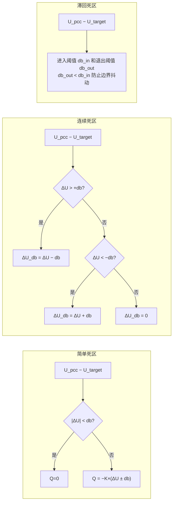
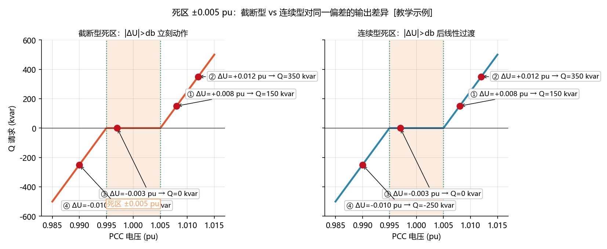
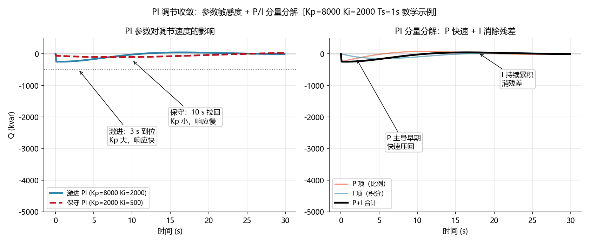
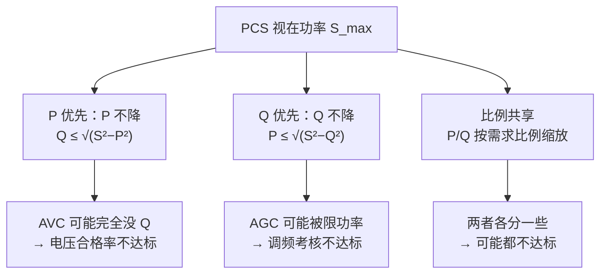
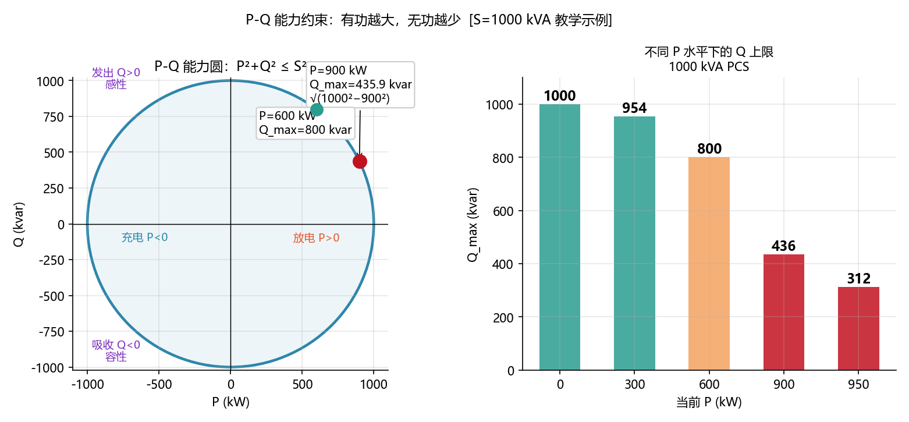

<!-- @AI_GENERATED -->
# 02 AVC的Q响应为什么不够快：死区、PI整定与多级瓶颈

> [课程首页](README.md) · 上一章：[01 AVC四种控制模式怎么选](01_AVC控制模式与选型.md) · 下一章：[03 AVC多资源无功分配](03_AVC多资源无功分配.md)

**一句话**：AVC 的子站响应速度被多个串行瓶颈卡住——PI 参数、电压死区、Q 限幅、P-Q 能力耦合、104 轮询周期，任何一个环节都能让你的无功调节速率被打"不合格"。

## 本章目标

读完本章，你应能：

1. 将规程中的"电压合格范围"和"无功调节速率要求"逐级翻译为可配置的 PI 参数、死区宽度和 Q 限幅值；
2. 手算 PI 控制器的 Kp/Ki/I_max 初始值并做逐拍追踪验证；
3. 辨识死区不连续导致的"电压振荡"现象；
4. 分析 P-Q 能力耦合对无功响应速度的制约。

## 本章边界与假设

本章实现 PI 参数整定、抗积分饱和、死区配置和基本能力校核；不实现多设备间的分配次序（留到第 03 章）、104 通信链路的具体时序（留到第 06 章）、考核指标的统计窗口对齐（留到第 04 章）。
**前置**：第 00、01 章。
所有参数以当地规程与合同为准。

---

## 02.1 现场场景【必懂】

某 50 MW 光储电站投运后第二个考核月，调度反馈数据：

| 指标 | 上月 | 本月 | 调度结论 |
|---|---|---|---|
| 电压合格率 | 98.2%（未达标） | 96.8%（更差） | "AVC 根本没在好好调" |
| 无功响应时间 | 18 s（合格） | 35 s（不合格） | "越调越慢，是不是控制器有问题？" |

现场排查发现三条独立的问题链：

1. **PI 参数被"保守化"了**：上个月联调时因怕超调，Kp 从 8000 砍到了 2000 kvar/pu、Ki 从 2000 砍到了 500 kvar/(pu·s)。电压从 1.035 pu 回到 1.003 pu 需要积分累积 60 秒以上。
2. **计量表更换导致死区错位**：PCC 电压从旧的 0.5 级表换成 0.2 级表，电压读数精度从 ±0.005 pu 提高到 ±0.002 pu——但死区 ±0.01 pu 没改。结果是：以前在死区边缘"进入-退出-进入"的振荡被掩盖了（旧表读数迟钝），新表下控制循环每 4 秒发一次 Q 指令，PCS 频繁调无功，发热增加、响应反而慢了。
3. **P-Q 耦合没更新**：电站扩了一组 20 MW 的 PCS。原来 1×50 MVA 的 PCS 在 P=40 MW 时剩余 Q 能力 30 Mvar。现在单台 PCS 下降到 1×20 MVA，同样 P=15 MW 时只剩 `sqrt(20²−15²) = 13.2 Mvar`——指令没变，但实际可用 Q 腰斩了。

**问题清单**：本章回答这三个问题：
- Kp/Ki 到底设多大？小了响应慢，大了超调——有没有系统性的初值整定方法？
- 死区到底是用来"避免频繁调节"还是"掩盖问题"？怎么判断现在的死区是否合理？
- P-Q 能力什么时候变成 AVC 的真正瓶颈？

---

## 02.2 从考核要求反推时序预算【必懂】

### 为什么需要

拿到一份调度细则，第一步不是调参数，而是做"反向时序预算"——把考核要求的"总允许时间"分解到各环节，看哪一环是瓶颈。`[教学示例]`

```text
某省细则：AVC 子站从接收电压目标到无功出力达到目标 90%，不超过 30 秒。

时序预算分解（假设全链路）：
├─ 104 通信延迟（轮询+校验）：      4~8 秒
├─ EMS 控制周期（Ts）：            2~4 秒 × 1 拍 = 4 秒
├─ 内部协议下发到 PCS/SVG：        1~2 秒
├─ PCS/SVG 本地响应 ramp：         2~5 秒（取决于 kvar/s 斜率）
├─ 无功→电压生效（电气时间常数）：  2~8 秒（取决于系统 X/R）
└─ 反馈回路（采集+上送）：         1~2 秒
─────────────────────────────────────
合计最小链路延迟：约 14 秒（理想情况）
合计保守链路延迟：约 29 秒（恶劣情况）
```

**结论**：如果 PI 参数的积分累积就要吃掉 20 秒以上，那 30 秒总预算直接超支。Kp/Ki 整定的硬约束不是"数学上最优"，而是"全链路时序预算下是否可行"。

> **软件类比**：这像做 API 的超时分析——你不能只看自己代码的响应时间，还要算 DNS 解析、TCP 握手、TLS、负载均衡、上游 API 的总延迟。你的 P99 是它们 P99 的串联。
> **类比失效点**：API 超时大不了返回 504。AVC 响应时间超限直接导致月度考核不合格，关联数万元补偿损失，且电压越限可能触发保护动作。

---

## 02.3 死区：是保护还是陷阱【必懂】

### 为什么需要

控制周期中每拍都计算 Q 请求。如果 PCC 电压在目标附近抖动（采样噪声 ±0.001 pu 是正常的），每次抖动都发出 Q 指令 = 让 PCS 在"发无功"和"吸无功"之间来回切换——不仅损耗设备寿命，而且无功在 PCC 上来回震荡反而恶化电压质量。

死区的作用：在目标附近划出一个"不要动"的小窗口。

### 死区公式定义

死区的三种工程形态对应三种数学表达。以下公式统一使用附录A符号：ΔU = U_pcc − U_target，db 为死区半宽。

**简单死区（Eq.2-1）**——最直觉但最危险：

```
         ⎧ ΔU − db    if ΔU > +db
ΔU_db = ⎨ ΔU + db    if ΔU < −db
         ⎩ 0          otherwise
```

进入死区时 Q 直接置零，出死区时 Q 立即跳到非零值。这个跳变就是"功率冲击"的根源。

**连续死区（Eq.2-2）**——工程最常用，消除跳变：

```
         ⎧ ΔU − db    if ΔU > +db
ΔU_db = ⎨ ΔU + db    if ΔU < −db
         ⎩ 0          otherwise
```

与简单死区的公式相同，但物理行为不同：连续死区的 db 被视为"纯死区"，进入死区时 Q 连续归零（因为 ΔU_db 在 db 边界处恰好为零），退出时也不产生跳变。

**滞回死区（Eq.2-3）**——彻底消除边界高频切换：

```
进入判定：|ΔU| > db_in   → 激活控制（ΔU_db = ΔU − sign(ΔU)×db_out）
退出判定：|ΔU| < db_out  → 退出控制（ΔU_db = 0）
其中 db_out < db_in，差值为滞回窗宽
```

> **关键约束**：不管用哪种死区类型，db（或 db_out）必须 ≤ 电压合格范围。这个约束在 A.4 典型参数速查中给出量级参考。

### 三种死区类型图解



| 死区类型 | 优点 | 陷阱 |
|---|---|---|
| 简单死区（|ΔU\<db|→Q=0） | 实现极简（1 行 if） | 在 db 边界上控制量跃变，产生功率冲击 |
| 连续死区 | 消除边界跳变，平滑过渡 | db 宽度需要与电压合格范围协调 |
| 滞回死区 | 彻底消除边界高频切换 | 调试困难——上个月参数正常，下个月环境变化就变异常 |

### 死区宽度的工程约束

死区宽度不能随意设。必须同时满足两条链：

```text
链1（考核链）：死区宽度 ≤ 电压合格范围
  例：合格范围 ±0.007 pu → 死区必须 <0.007 pu
  否则在 0.007~0.010 pu 区间：调度判不合格，但控制器认为不需要动

链2（防抖链）：死区宽度 ≥ 3 × 电压采样噪声标准差
  例：采样噪声 σ=0.001 pu → 死区 ≥ 0.003 pu
  否则死区挡不住噪声，PCS 频繁来回调节
```

如果 **链1 允许的上限 < 链2 要求的下限**——对不起，这是不可行区间。你需要：提升采样精度（降噪）或跟调度确认合格范围是否有协商空间。`[汇报口径]`

### 逐拍追踪：简单死区的边界振荡

U_ref=1.000 pu，死区 ±0.010 pu，K=10000 kvar/pu。

```text
t=0: U=1.012 → ΔU=+0.012 → Q=−200 kvar（触发，发出无功使电压上升...不，这是吸收）
      等等，方向：ΔU>0 表示电压偏高，Q=−K×ΔU 应该吸收无功→Q<0 即吸收。
      吸收无功→电压降低→正确。

t=1: U=1.008 → |ΔU|=0.008 < 0.010 → Q=0（退出了！）
t=2: U=1.013 → ΔU=+0.013 → Q=−300 kvar（又触发了！）
t=3: U=1.007 → |ΔU|=0.007 < 0.010 → Q=0（又退出了！）
```

**观察**：死区边界上，每一次进入-退出都是一次 PCS 的功率跳变（从 0 到 −300 kvar 再回 0）。如果每个控制周期 4 秒，一分钟就是 15 次跳变——PCS 在"高频振荡"中运行。

### 配图：截断型 vs 连续型死区



| 编号 | 位置 | 标注 | 对应正文 |
|---|---|---|---|
| ① | 截断型 | ΔU=+0.008 pu → Q=150 kvar（|ΔU|>0.005，阶跃动作） | §02.3 截断型概念实现 |
| ② | 截断型 | ΔU=+0.012 pu → Q=350 kvar | §02.3 |
| ③ | 连续型 | ΔU=−0.003 pu（|ΔU|<0.005）→ Q=0（死区内不动作） | §02.3 死区宽度约束 |
| ④ | 连续型 | ΔU=−0.010 pu → Q=−500 kvar（线性过渡无跳变） | §02.3 连续型对比 |

---

## 02.4 PI 参数整定：从物理到代码【必懂】

### 为什么需要

定电压 PI 是 AVC 子站最核心的模式，但也是最容易被"怕出事"整成废物的模式。PI 参数整定不是高深的控制理论问题，而是**如何把电气参数翻译为代码中的 Kp/Ki**。

### Kp 的物理含义

Kp 的单位是 `kvar/pu`，物理含义是：**每 1 pu 电压偏差对应多少 kvar 无功输出**。

```text
Kp = ΔQ_max / ΔU_typical
```

`[教学示例]` 假设：PCS 可用 Q 范围为 ±500 kvar（ΔQ_max = 500 kvar），典型电压偏差为 0.030 pu（光伏大发过压场景）。则：

```text
Kp = 500 / 0.030 ≈ 16667 kvar/pu
```

保守取 50%：`Kp = 8000 kvar/pu`。这样在 ΔU=0.030 pu 时，P 项贡献 8000×0.030 = 240 kvar——在 Q 范围的中段，不会一下子就打满。

### Ki 的物理含义

Ki 的单位是 `kvar/(pu·s)`，物理含义是：**每秒每 1 pu 电压偏差累积多少 kvar 积分量**。

```text
设定最大积分累积时间 T_integral，希望在 T_integral 内积分量达到 Kp×ΔU_typical。
Ki = Kp / T_integral
```

`[教学示例]` 取 T_integral = 4 秒：

```text
Ki = 8000 / 4 = 2000 kvar/(pu·s)
```

### 逐拍追踪：PI 参数效果验证

沿用第 01 章场景：U_target=1.000 pu，Ts=4s，Q_max=500 kvar，I_max=300 kvar。

**场景 A：Kp=8000，Ki=2000（正常）**

| 拍 | U | ΔU | I_prev | P项=Kp×ΔU | I累积 | I_new | Q=P+I | 说明 |
|---|---:|---:|---:|---:|---:|---:|---:|---:|
| t0 | 1.035 | +0.035 | 0 | −280 | −280 | −280 | **−500(clamp)** | 大偏差触发满 Q |
| t1 | 1.012 | +0.012 | −280 | −96 | −184 | −184 | **−280** | 电压改善，I 在消退 |
| t2 | 1.005 | +0.005 | −184 | −40 | −144 | −144 | **−184** | 接近目标，I 慢退 |
| t3 | 1.003 | +0.003 | −144 | −24 | −120 | −120 | **−144** | 逼近 1.000 pu |

响应时间约 12 秒（3 拍 × 4 秒）达到接近目标。

**场景 B：Kp=2000，Ki=500（被"保守化"后）**

| 拍 | U | ΔU | I_prev | P项 | I累积 | I_new | Q=P+I | 说明 |
|---|---:|---:|---:|---:|---:|---:|---:|---:|
| t0 | 1.035 | +0.035 | 0 | −70 | −70 | −70 | **−140** | 初始 Q 只有原来的 28% |
| t1 | 1.030 | +0.030 | −70 | −60 | −130 | −130 | **−190** | 积分累积慢 |
| t2 | 1.026 | +0.026 | −130 | −52 | −182 | −182 | **−234** | 仍在缓慢爬升 |
| t3 | 1.022 | +0.022 | −182 | −44 | −226 | −226 | **−270** | 16 秒才到场景 A 的 t1 水平 |

同样的场景，保守化后的 PI 需要多花 2 倍以上的时间。**调度考核不关心你为什么慢，只看你 30 秒内达没达标**。

### 配图：PI 参数敏感度 + P/I 分量分解



| 编号 | 位置 | 标注 | 对应正文 |
|---|---|---|---|
| ① | 左图 | 激进 PI（Kp=8000 Ki=2000）：3 s 到位，Kp 大响应快 | §02.4 Kp 整定 |
| ② | 左图 | 保守 PI（Kp=2000 Ki=500）：10 s 拉回，Kp 小响应慢 | §02.4 整定后验证 |
| ③ | 右图 | P 项（比例）：早期主导，快速压回偏差 | §02.4 PI 公式 |
| ④ | 右图 | I 项（积分）：持续累积，消除稳态残差 | §02.4 积分时间常数 |

---

## 02.5 抗积分饱和【必懂】

### 为什么需要

当 PCS 的 Q 已经达到限幅（±500 kvar），而电压偏差仍然存在时，积分项会继续毫无意义地累积。一旦电压反向变化，积分需要花很长时间才能"退出来"——这叫积分饱和。

### 积分饱和的危害示例

```text
t0: U=1.035, Q=−500 (clamp), I=−280, 电压仍偏高
t1: U=1.033, Q=−500 (clamp), I=−344, 电压仍偏高
t2: U=1.030, Q=−500 (clamp), I=−404, 电压仍偏高
t3: 光伏骤降，U=0.985（电压偏低了！）→需要发无功 Q>0
    但 I=−404 的累积负积分需要先排空……
    t3: Q = Kp×(−0.015) + (−404) = +120 + (−404) = −284（还在吸收！）
    t4: Q = Kp×(−0.015) + (−276) = −156（还在吸收！）
    t5: 终于 Q 变正 → 但这期间电压一直偏低，AVC 在"反向拉"。
```

这就是**无功反向调节**的常见根因——不是公式写反了，是积分饱和了。

### 两种抗饱和策略

**策略一：条件积分（Conditional Integration）**

```python
def anti_windup_conditional(error, i_prev, ki, ts, q_unclamped, q_max):
    saturated_high = (q_unclamped > q_max and error > 0)
    saturated_low = (q_unclamped < -q_max and error < 0)
    if saturated_high or saturated_low:
        i_new = i_prev  # 冻结积分
    else:
        i_new = i_prev + ki * error * ts
    return i_new
```

**策略二：反计算钳位（Back-Calculation / Clamping）**

```python
def anti_windup_backcalc(error, i_prev, ki, ts, q_unclamped, q_max):
    q_clamped = max(-q_max, min(q_max, q_unclamped))
    # 如果被钳位了，积分仅按"未被钳位部分"累积
    i_new = i_prev + ki * error * ts + (q_clamped - q_unclamped) * ts
    return i_new, q_clamped
```

`[教学示例]` 推荐使用策略一（条件积分），因为它直接、可解释，且不会引入反计算系数调参。

### 逐拍追踪：有抗饱和 vs 无抗饱和

场景：U 从 1.035 跳变到 0.985。Kp=8000，Ki=2000，Ts=4s，Q_max=500，I_max=300。

**无抗饱和**：

| 拍 | U | ΔU | I_prev | Q=P+I（未钳位） | Q_actual | I_new |
|---|---:|---:|---:|---:|---:|---:|
| t0 | 1.035 | +0.035 | 0 | −280 | −280 | −280 |
| t1 | 1.035 | +0.035 | −280 | −560 | −500(clamp) | −560（I 被背着走！） |
| t2 | 0.985 | −0.015 | −560 | +120+(−560)=**−440** | −440 | −560+2000×(−0.015)×4=−680 |

t2 时电压已经偏低了，Q 还是负数（在吸收）——无功反向调节。

**有条件积分抗饱和**：

| 拍 | U | ΔU | I_prev | Q=P+I（未钳位） | Q_actual | I_new |
|---|---:|---:|---:|---:|---:|---:|
| t0 | 1.035 | +0.035 | 0 | −280 | −280 | −280 |
| t1 | 1.035 | +0.035 | −280 | −560 | −500(clamp) | −280（冻结！） |
| t2 | 0.985 | −0.015 | −280 | +120+(−280)=**−160** | −160 | −280+2000×(−0.015)×4=−400→clamp(−300) |

t2 时 Q=−160，仍然在吸收，但幅度小很多。t3 可以转向正 Q。**响应时间从 3 拍缩短到 2 拍**。

### 完整案例：T0-T5 逐拍追踪（含饱和/冻结/恢复全流程）【必懂】

以下用一个完整六拍案例，展示从"大偏差触发限幅"到"电压反转、积分退出、最终恢复"的全过程。场景参数与上文一致：Kp=8000 kvar/pu，Ki=2000 kvar/(pu·s)，Ts=4s，Q_max=500 kvar，I_max=300 kvar，U_target=1.000 pu。

**条件积分抗饱和规则**：当 Q 被钳位且误差方向与钳位方向一致时，冻结 I（I_new = I_prev）。

| 拍 | 时刻 | U_pcc | ΔU | I_prev | P项=Kp×ΔU | Q未钳位 | 钳位？ | 冻结？ | I_new | Q实际 | 物理状态 |
|---|---:|---:|---:|---:|---:|---:|---:|---:|---:|---:|---:|
| T0 | 0s | 1.035 | +0.035 | 0 | −280 | −280 | 否 | 否 | −280 | **−280** | 初始大偏差，P项主导 |
| T1 | 4s | 1.033 | +0.033 | −280 | −264 | −544 | **是**（Q<−500） | **是**（误差同向） | **−280** | **−500** | 饱和！I 冻结在 −280 |
| T2 | 8s | 1.030 | +0.030 | −280 | −240 | −520 | **是** | **是** | **−280** | **−500** | 持续饱和，I 继续冻结 |
| T3 | 12s | 1.012 | +0.012 | −280 | −96 | −376 | 否 | 否 | −376 | **−376** | 电压改善，Q 退钳位，I 正常累积 |
| T4 | 16s | 1.005 | +0.005 | −376 | −40 | −416 | 否 | 否 | −416 | **−416** | 逼近目标，I 负值在减少 |
| T5 | 20s | 1.002 | +0.002 | −416 | −16 | −432 | 否 | 否 | −432 | **−432** | 接近稳态，Q 绝对值缩小 |

**关键观察**：

| 拍 | 现象 | 解读 |
|---|---|---|
| T1→T2 | Q 被钳在 −500 kvar 两拍不动，但 I 冻结在 −280 不增长 | 无抗饱和时 I 会从 −280 继续跌到 −544→−664→…，反向退出需要更多拍 |
| T3 | Q 退钳位，I 从 −280 开始正常变化（而非 −544） | 抗饱和节省了 264 kvar 的积分"债务"，反向响应提前了至少 2 拍 |
| T4→T5 | I 的负值在缩小，说明积分在"排空"历史偏差 | 从 T0 到 T5 共 20 秒（5 拍）接近稳态——在 30 秒时序预算内 |

> **无抗饱和对比**：若未冻结 I，T1 时 I=−544，T2 时 I=−664，T3 时电压反转偏低的瞬间 Q = +120+(−664) = −544——还在大量吸收无功！需要额外 3~4 拍才能把 I 从 −664 排空到零，总响应时间从 20 秒拉长到 36 秒，超出 30 秒考核上限。

---

## 02.6 P-Q 能力耦合：有功在偷你的无功预算【必懂】

### 为什么需要

PCS 的视在功率 S_max 是 P 和 Q 共享的上限：

```text
P² + Q² ≤ S_max²
```

当 PCS 在放大量有功时，可用的 Q 被大幅压缩。这是一条硬物理约束，不是软件优化能绕过的。

### 三种 P-Q 优先级模式

| 模式 | 规则 | AVC 场景影响 |
|---|---|---|
| P 优先 | Q_max_available = sqrt(S_max² − P²)，P 不降 | AGC 大出力时 AVC 可能完全没 Q 空间 |
| Q 优先 | P_max_available = sqrt(S_max² − Q²)，P 可能需要降 | 电压优先，但牺牲有功收益 |
| 比例共享 | P 和 Q 按目标需求比例瓜分 S_max | 两者都能分到一些，但可能都喂不饱 |



### 概念实现：P 优先下的 Q 可用量

```python
import math

def q_available_under_p(p_kw: float, s_max_kva: float) -> float:
    if abs(p_kw) >= s_max_kva:
        return 0.0
    return math.sqrt(s_max_kva**2 - p_kw**2)
```

### 手算：不同 P 水平下 Q 的余量

S_max = 1000 kVA，Q 需求 = 500 kvar。

| P（kW） | Q_available（kvar） | Q 需求能否满足？ |
|---|---:|---:|
| 0 | 1000 | ✔ |
| 600 | 800 | ✔ |
| 800 | 600 | ✔（刚好） |
| 900 | 436 | **✘ 截断了 64 kvar** |
| 950 | 312 | **✘ 截断了 188 kvar** |

### 配图：P-Q 能力圆 + 不同 P 水平下 Q 上限



| 编号 | 位置 | 标注 | 对应正文 |
|---|---|---|---|
| ① | 左图 | P=900 kW → Q_max=435.9 kvar（P²+Q² ≤ S²=1000²） | §02.6 P-Q 手算表 |
| ② | 左图 | P=600 kW → Q_max=800 kvar（P 越低 Q 余量越大） | §02.6 对比 |
| ③ | 右图 | P=950 kW → Q_max=312 kvar（AGC 满发时 Q 腰斩） | §02.6 手算：截断 188 kvar |

---

## 自测

1. 拿到某省 AVC 细则，要求"无功响应时间 ≤ 30 秒"。你的全链路时序预算怎么分解？
2. 死区宽度 0.010 pu，电压合格范围 ±0.007 pu，采样噪声 σ=0.001 pu——这个配置有什么问题？
3. 积分饱和在什么情况下最危险？你怎么从月度考核数据中发现"发生过积分饱和"？
4. S_max=2000 kVA，当前 P=1800 kW，AVC 要求 Q=−800 kvar（吸收）。这个指令能完整执行吗？

<details>
<summary>参考答案</summary>

1. 从 30 秒中减去通信延迟（约 8 秒）、协议下发（约 2 秒）、PCS 本地 ramp（约 3 秒）、电压反馈（约 2 秒），剩约 15 秒给 PI 收敛。如果控制周期 Ts=4s，约 3~4 拍内积分项必须消除大部分偏差。
2. 死区（0.010 pu）大于合格范围（±0.007 pu），在 0.007~0.010 pu 区间内调度判不合格但控制器不动。死区同时大于 3σ=0.003 pu，防抖 OK——但防抖不是挡箭牌，合规链断了。
3. 最危险场景：电压持续偏高，Q 被限幅钳在 −Q_max，积分默默累积到很高的负值。当光伏骤降、电压反转偏低时，积分需要排空很长时间才能让 Q 变正——期间电压一直偏低，造成"无功反向调节"扣分。从月度数据中可以看到：电压从偏高切换到偏低的时间点上，Q 的符号没有立即翻转，而是滞后了数十秒。
4. Q_available = sqrt(2000²−1800²) = sqrt(760000) ≈ 872 kvar。需要吸收 800 kvar → 872 ≥ 800 → 可以。如果 P 再高 50 kW（1850 kW），Q_available ≈ 761 kvar → 不够。
</details>

---

## 🧪 动手验证

PI 控制器、死区与抗饱和算法已实现为可运行代码（参数与正文主线 Kp=8/Ki=0.3/Ts=4s 一致）：

```bash
cd lab/
python examples/ch02_pi_tuning.py
```

**关键输出**（与正文 §2.3 手算对照）：
- Kp 敏感度：Kp=5 收敛需 18 步，Kp=8 收敛需 12 步
- 抗积分饱和：积分冻结前后 Q 输出差异

> 对照正文 §2.3 "Kp 扫参"表格逐行验证。


> 🧭 **下一站**：参数整完了，PI 算出的总 Q 请求有了——但问题来了：PCS 的 Q 被 AGC 挤没了怎么办？SVG 和电容组谁先动？下一章 [03 多资源无功分配](03_AVC多资源无功分配.md) 回到我们这座 50 MW 储能电站的第三个月，站里刚扩容了 ±15 Mvar SVG 和一组 10 Mvar 电容，看看怎么把总 Q 需求分到四类设备上。

<!-- @AI_GENERATED: end -->