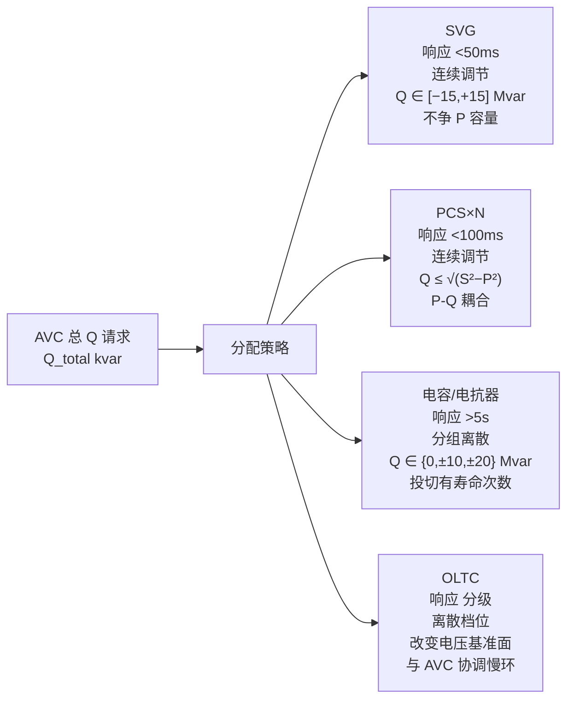
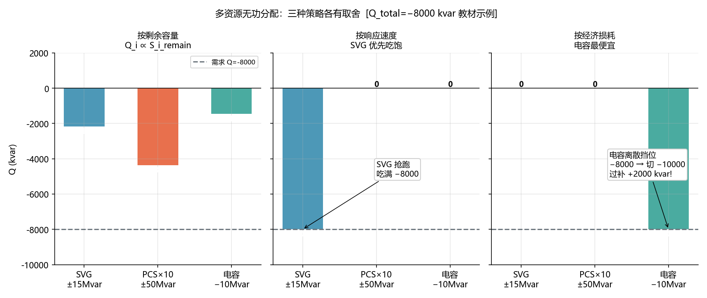
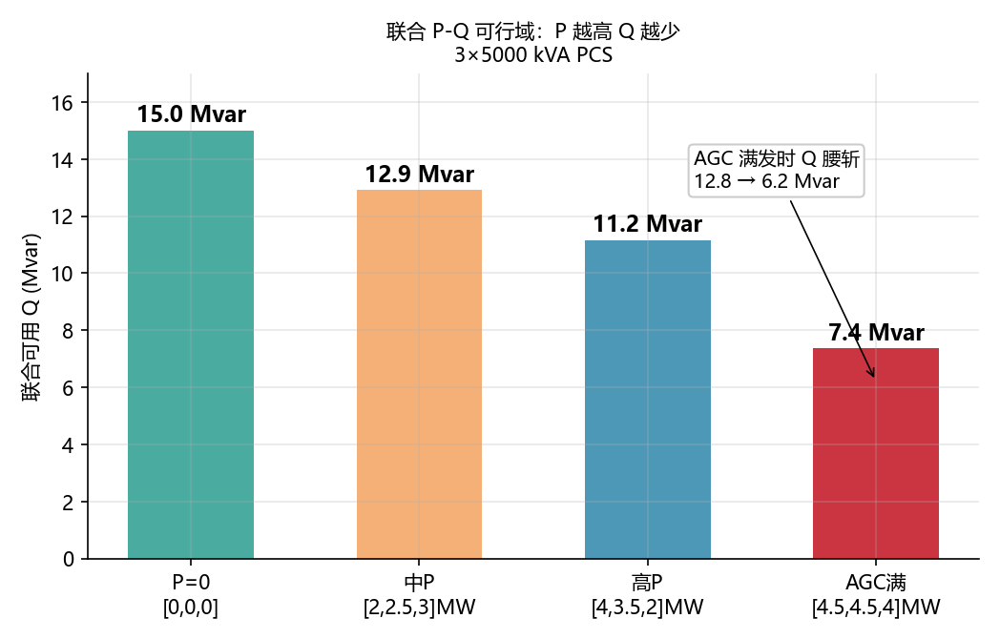
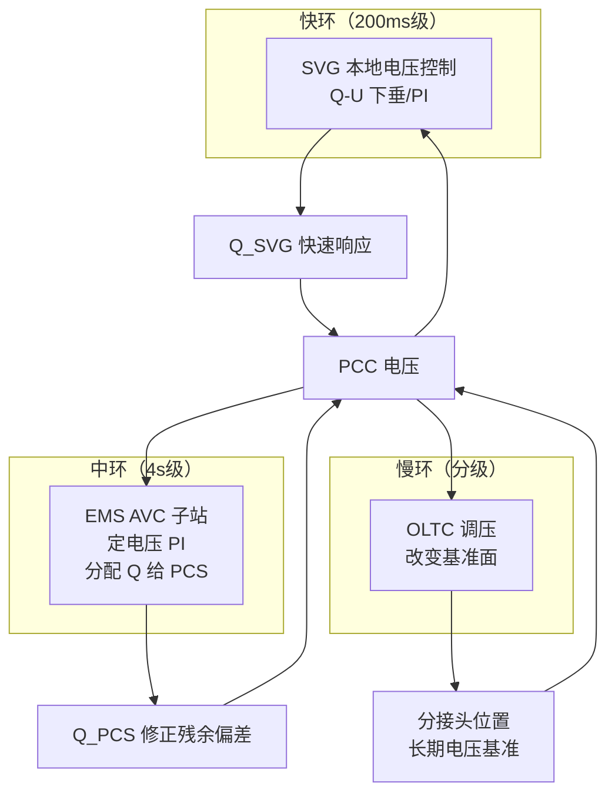

<!-- @AI_GENERATED -->
# 03 无功不够了，PCS、SVG、电容谁先动：多资源无功分配与协调控制

> [课程首页](README.md) · 上一章：[02 AVC核心参数与整定](02_AVC核心参数与整定.md) · 下一章：[04 AVC考核指标与统计口径](04_AVC考核指标与统计口径.md)

**一句话**：AVC 算出总 Q 请求只是第一步——如何把这个 Q 分解到 PCS、SVG、电容/电抗器上，把"谁快谁先动、谁便宜谁扛"的权衡变成代码逻辑，这才是 AVC 子站分配层的核心工程问题。

## 本章目标

读完本章，你应能：

1. 写出四种无功资源（PCS、SVG、电容/电抗器、OLTC）的能力模型和分配优先级；
2. 实现三种分配策略（按剩余容量、按响应速度、按经济损耗）的核心逻辑；
3. 手算 P-Q 能力投影下的多机联合可行域；
4. 处理 SVG 与 PCS 之间的无功"抢跑"问题。

## 本章边界与假设

本章实现 AVC 总 Q 请求到多设备的分配逻辑；不实现 IEC104 指令链路（留到第 06 章）、具体的 PCS 点表和通信协议（留到第 06 章）、OLTC 的详细档位逻辑（本章仅概述协调时序）。
**前置**：第 00、01、02 章。
所有参数以当地规程与合同为准。

---

## 03.1 现场场景【必懂】

回到我们那座 50 MW / 100 MWh 储能电站。前两个月的 AVC 考核接连翻车：

- **首月**（00 章故事）：挂在 Q-U 下垂模式——调度要求 PCC 电压回到 1.000 pu，但下垂是有差调节，电压永远差一截，全月不合格。
- **第二月**（01/02 章故事）：切到定电压 PI 模式，算法对了，但 P-Q 耦合在中午 AGC 放电高峰时把无功空间挤没了——每台 PCS 的 S=5 MVA 被有功吃掉 4 MW 后，只剩 3 Mvar 给无功，全场 Q 能力不足导致电压曲线中午时段断崖式下跌。

站里痛定思痛，第三个月扩容了两套无功设备：

| 设备 | 数量 | 单台额定 | 无功特点 | 什么时候加的 |
|---|---|---|---|---|
| PCS（储能） | 10 台 | 5 MVA | P-Q 共享容量，响应快（<100ms），但 P 优先 | 建站即有 |
| SVG | 1 台 | ±15 Mvar | 独立无功，不跟 P 抢，响应最快（<50ms） | **本月新投** |
| 电容组 | 1×10 Mvar | 10 Mvar | 分组投切粗调，响应慢（>5s），只能发无功 | **本月新投** |

> 💡 为什么没配 OLTC？对于 50 MW 规模的储能电站，主变通常是 110/35 kV 固定变比，不配有载调压分接头。OLTC 的控制逻辑留到 03.5 节作为扩展知识了解即可。

**13:00 场景**：中午 AGC 满功率放电 40 MW（10 台 PCS 各 4 MW），PCC 电压 1.035 pu。AVC 定电压 PI 算出需要吸收 Q=−8000 kvar。

扩容后总算有设备可选了——但这 8000 kvar 到底怎么分给 PCS、SVG 和电容组？

**现场初分配的错误**（如果没人看过这一章）：
- 运维按"SVG 最快，先让它上"——SVG 吃满 −15 Mvar，超额完成 8000 kvar 需求，看起来没问题
- 但 SVG 满载后温升加速，15 分钟后风扇故障告警
- 电容组还在冷备用，没人想到投——"投切有寿命次数，少用为好"
- 结果是：SVG 单扛全线压力，PCS 的空间白白浪费，电容组买了等于白买

**问题清单**：本章回答这三个问题：
- PCS、SVG、电容各有什么速度和容量特征？什么时候该让"快的先扛、慢的跟着"？
- SVG 和 PCS 的 Q 指令冲突了怎么办——谁优先？
- 电容组这种"分组投切、有寿命次数"的设备，什么时候值得投？

---

## 03.2 四种无功资源的能力模型【必懂】



| 维度 | SVG | PCS | 电容/电抗器 | OLTC |
|---|---|---|---|---|
| 响应速度 | ★★★★★ | ★★★★☆ | ★★☆☆☆ | ★☆☆☆☆ |
| 调节精度 | ★★★★★ | ★★★★★ | ★☆☆☆☆ | ★★★☆☆ |
| 无功容量 | ★★★☆☆ | ★★★★☆ | ★★★★☆ | —（改基准面） |
| P 耦合 | 无 | P-Q 抢 S | 无 | 无 |
| 损耗/成本 | 中 | 高（P-Q 机会成本） | 低（只有开关损耗） | 低 |
| 投切寿命 | 电子开关（几乎无限） | 电子开关（几乎无限） | 机械开关（有限） | 机械开关（有限） |
| 离散/连续 | 连续 | 连续 | 离散 | 离散 |

---

## 03.3 三种分配策略【必懂】

### 策略一：按剩余容量比例分配

```text
目标：用得均衡——谁有更多余量，谁多扛。
适用：所有设备同质、PCS 之间无差别。
不适合：设备异构大（PCS vs SVG 完全不可比）、SVG 与 PCS 属性不同。
```

```python
def allocate_by_remaining_capacity(q_total: float,
                                    capacities: list[float]) -> list[float]:
    total_cap = sum(capacities)
    if total_cap == 0:
        return [0.0] * len(capacities)
    return [q_total * (cap / total_cap) for cap in capacities]
```

### 策略二：按响应速度分级分配（快者优先）

```text
目标：快的先吃饱，剩的给慢的。
适用：SVG（毫秒级）> PCS（百毫秒级）> 电容（秒级）。
核心思路：逐级填充，上一级填满了再往下分。
```

```python
def allocate_by_speed(q_total: float,
                       tiers: list[dict]) -> list[float]:
    result = [0.0] * len(tiers)
    remaining = q_total
    for i, tier in enumerate(tiers):
        alloc = max(-tier['q_max'], min(tier['q_max'], remaining))
        result[i] = alloc
        remaining -= alloc
    return result
```

### 策略三：按经济损耗分配（便宜者扛大头）

```text
目标：总损耗最小。
适用：需要量化每种设备的无功成本后排序。
典型排序：电容/电抗器（几乎零损耗）< SVG（微小损耗）< PCS（机会成本最高）。
但注意：电容只能离散投切，不能承担精细调节任务。
```

### 手算对比三种策略

Q_total = −8000 kvar（吸收），资源：

| 资源 | Q 范围（kvar） | 当前可用 | 速度等级 | 单位损耗系数（元/kvar·h） |
|---|---|---|---|---|
| SVG | [−15000, +15000] | 15000 | 1（最快） | 0.02 |
| PCS×10 | [−30000, +30000] | 30000 | 2 | 0.05 |
| 电容 | [−10000, 0] | 10000 | 3 | 0.005 |

**策略一（按剩余容量）**：

| 资源 | 剩余容量 | 占比 | Q 分配 |
|---|---|---|---|
| SVG | 15000 | 27.3% | −2182 kvar |
| PCS | 30000 | 54.5% | −4364 kvar |
| 电容 | 10000 | 18.2% | −1454 kvar（但电容不能连续调！→ 实际切 0 或 −10000 kvar） |

**策略二（按速度分级）**：SVG→PCS→电容。SVG 先吃饱 −8000 kvar（完全在 ±15000 范围内），PCS 和电容不分配。

**策略三（按经济损耗）**：电容→SVG→PCS。电容最便宜，但只有一档 −10000 kvar，切了就超过 −8000 kvar 的总需求——这是电容的"离散困境"：切也不是、不切也不是。

> **软件类比**：无功分配像 CDN 的多级缓存策略——边缘节点（SVG）最快但容量小，区域节点（PCS）容量大但有耦合，源站（电容/电抗器）最便宜但速度慢。
> **类比失效点**：CDN 缓存回源只是增加延迟，无功分配错误（如电容投切过度造成过补偿）可能直接引发过电压，触发保护跳闸。

### 配图：三种分配策略的取舍



| 编号 | 位置 | 标注 | 对应正文 |
|---|---|---|---|
| ① | 策略一 | SVG:−2182 / PCS:−4364 / 电容:−1455 kvar（按剩余容量比例分配） | §03.3 策略一手算 |
| ② | 策略二 | SVG 吃满 −8000 kvar / PCS 和电容不分配（按响应速度，SVG 优先） | §03.3 策略二手算 |
| ③ | 策略三 | 电容 −10000 kvar（过补 +2000 kvar！离散挡位困境） | §03.3 策略三手算 |

---

## 03.4 P-Q 能力投影与联合可行域【必懂】

### 为什么需要

第 02 章讲了单台 PCS 的 P-Q 能力圆。多台 PCS 时，需要计算出"所有 PCS 联合能为 AVC 提供的 Q 范围"。

### 联合可行域

```text
N 台 PCS，第 i 台的视在功率 S_i、当前有功 P_i：
Q_available_total = Σ sqrt(S_i² − P_i²)，仅考虑吸收方向
Q_available_positive_total = Σ sqrt(S_i² − P_i²)，仅考虑发出方向

但注意：Q 是有符号的——吸收 Q（负）和发出 Q（正）共用同一组 S_i 限制！
```

### 手算

3 台 PCS：S=[5000, 5000, 5000] kVA，当前 P=[4000, 3500, 2000] kW。

| PCS | S | P | P/S | Q_avail |
|---|---:|---:|---:|---:|
| #1 | 5000 | 4000 | 0.80 | √(25−16)×1000 = **3000** |
| #2 | 5000 | 3500 | 0.70 | √(25−12.25)×1000 = **3571** |
| #3 | 5000 | 2000 | 0.40 | √(25−4)×1000 = **4583** |

联合可用 Q = 3000 + 3571 + 4583 = 11154 kvar。

**但！** 这些 Q 是在"假设每台都以 S_max 为上限独立出 Q"的前提下。实际上如果 AGC 改变了 P——Q 可用量也跟着变。

### 概念实现：联合有向 P-Q 可行域

```python
import math

def joint_q_available(pcs: list[dict]) -> dict:
    q_pos = 0.0  # 可发无功（Q>0）
    q_neg = 0.0  # 可吸无功（Q<0）
    details = []
    for pcs_i in pcs:
        s = pcs_i['s_kva']
        p = pcs_i['p_kw']
        if abs(p) >= s:
            q_i = 0.0
        else:
            q_i = math.sqrt(s**2 - p**2)
        q_pos += q_i
        q_neg += q_i
        details.append({'id': pcs_i['id'], 'q_avail': q_i, 'p_ratio': abs(p)/s})
    return {'q_pos_kvar': q_pos, 'q_neg_kvar': q_neg, 'details': details}
```

### 配图：联合 P-Q 可行域



| 编号 | 位置 | 标注 | 对应正文 |
|---|---|---|---|
| ① | 左1 | P=0: 联合可用 Q=15 Mvar（3×5000 kVA PCS 无有功时满 Q） | §03.4 联合可行域计算 |
| ② | 左2~3 | 中P/高P: Q 逐步被 P 挤占 | §03.4 投影公式 |
| ③ | 右1 | AGC 满发 P=[4.5,4.5,4]MW → Q 腰斩至 6.2 Mvar | §03.4 最差工况 |

---

## 03.5 SVG 与 PCS 的协调：避免"抢跑"【必懂】

### SVG 与 PCS 的本质差异

SVG 和 PCS 在 AVC 视角下有一个关键不同：**SVG 的无功响应不经过 EMS 分配层（如果 SVG 有自己的本地控制器）**。

```text
情况一：EMS 统一分配
  AVC → Q 总需求 → EMS 分配 → SVG Q1 + PCS Q2 → 完全可控

情况二：SVG 自带本地电压控制
  AVC → Q 总需求（给 PCS 的） → PCS 分配
  SVG 自己读电压 → 自己算 Q → 独立动作
  → EMS 不知道 SVG 在干啥 → 总 Q 失控
```

### 解决方案

1. **SVG 切到"远方设点"模式**（推荐）：EMS 控制 SVG 的 Q 设点，SVG 不做本地电压闭环。EMS 拿到所有资源的总控权。
2. **SVG 本地+EMS 协调**：如果 SVG 必须本地模式，EMS 在计算 PCS 的 Q 时，把 PCC 电压中 SVG 已经贡献的部分"扣掉"——相当于 EMS 只控"残余电压偏差"。
3. **时序错开**：SVG 本地响应快环（200ms 级），EMS 做慢环修正（4s 级）——类似于 OLTC 和 AVC 的分层协调。



### 循环冲突示例

SVG 本地 Q-U 下垂（K_SVG=5000 kvar/pu，死区 ±0.005 pu），EMS AVC 定电压 PI（Kp=8000，Ki=2000）。

```text
t0: U=1.035
    SVG 本地：ΔU=+0.030, Q=−5000×0.025 = −125 kvar（SVG 容量小）
    EMS AVC：ΔU=+0.035, Q=−500(限幅)

t1: U=1.025（SVG 和 PCS 共同拉下来了）
    SVG 本地：ΔU=+0.020, Q=−5000×0.015 = −75 kvar（SVG 自然减少）
    EMS AVC：I 在累积，Q=−400（EMS 还在加码）

t2: U=1.012
    SVG 本地：ΔU=+0.007, Q=−10 kvar（接近死区，快停了）
    EMS AVC：Q=−300（EMS 在继续）

关键问题：EMS 不知道 SVG 已经贡献了 −125→−75→−10 kvar 的变化趋势。
如果 EMS 按"自己把电压从 1.035 拉到了 1.012"来计算积分，就多算了。
```

**解法**：EMS 读 SVG 的实际 Q 反馈做前馈修正——`Q_pcs_needed = Q_total_PI − Q_svg_actual`。

---

## 03.6 混合资源配置的风险：SVG+电容器的超调振荡【必懂】

### 为什么会出现振荡

SVG+电容器混合配置是工程中最常见的无功资源组合，但也是"协调失败"的高发区。核心矛盾在于两者的响应时间差异：

```text
SVG 响应：       <50ms —— 连续调节，几乎即时
电容投切响应：   >5s   —— 离散投切，机械延迟
```

当 AVC 需要大量无功时，典型的灾难时序是这样的：

```text
T=0s:   电压偏高 1.035 pu，AVC 判定需要吸收 −8000 kvar
T=0.1s: SVG 快速吸收 −8000 kvar（全部由 SVG 承担）
T=0.2s: 电压下降到 1.028 pu（SVG 快速生效）
T=4s:   EMS 下一拍控制——电压 1.028 pu，仍有偏差
        AVC 判断："SVG 还不够，需要更多无功"
        → 指令：投入一组 10 Mvar 电容（吸收方向）
T=9s:   电容机械开关闭合，额外提供 −10000 kvar
        总无功吸收 = SVG −8000 + 电容 −10000 = −18000 kvar
        → 过补偿！电压被拉到 0.992 pu（偏低了！）
T=9.1s: SVG 检测到电压偏低 → 快速减少吸收 → SVG Q 从 −8000 跳到 +2000（发无功）
T=13s:  EMS 下一拍——电压又偏低了 → 切出电容
        但电容切出又要等 5 秒……
```

**这就是经典的"SVG 快 + 电容慢 = 超调振荡"**：SVG 先快速吃满，EMS 以为不够→投电容→电容延迟到达后总量爆炸→SVG 又快速反向→下一拍又切电容……形成"快-慢"闭环振荡。

### 振荡的数学条件

```text
振荡触发条件（必要条件）：
  Q_SVG_响应时间 << Q_cap_响应时间（满足，差 100 倍以上）
  EMS 控制周期 << Q_cap_响应时间（满足，Ts=4s < 5~30s）
  电容投切粒度 > SVG 剩余调节范围（关键！）
```

最危险的是第三条：电容单组容量（如 10 Mvar）远大于 SVG 的精细调节范围（如 ±2 Mvar 残余），一旦投入就是"大象跳进浴缸"。

### 解决方案：电容投切闭锁窗口

```python
def capacitor_switch_with_lockout(q_continuous_deficit, cap_groups,
                                   svg_q_current, svg_q_max,
                                   lockout_active, lockout_timer):
    # 规则 1：SVG 必须有 ≥30% 的反向余量才允许投切电容
    svg_headroom = svg_q_max - abs(svg_q_current)
    if svg_headroom < 0.3 * svg_q_max:
        return "SVG 余量不足 → 禁止投切电容（会失去反向调节能力）"

    # 规则 2：每次投切后锁定 30 秒（等待电容动作 + 电压稳定 + EMS 收敛）
    if lockout_active:
        lockout_timer -= 1
        if lockout_timer > 0:
            return f"闭锁窗口剩余 {lockout_timer} 拍 → 禁止投切"
        else:
            lockout_active = False

    # 规则 3：连续设备（SVG+PCS）必须已经满负荷 ≥3 拍，才允许投切电容
    if q_continuous_deficit < min(cap_groups):
        return "连续设备尚未满负荷 → 不需要投切电容"

    return "允许投切"
```

核心原则：**电容投切的闭锁窗口必须 ≥（电容动作时间 + EMS 收敛时间 + 安全余量）**。推荐闭锁窗口：≥60 秒（15 拍 × 4s），确保上一轮投切的全部响应（SVG 反向修正 + EMS PI 收敛）都已完成后再允许下一次投切。

---

## 03.7 电容/电抗器投切：离散资源的协调【了解】

电容/电抗器的特点：只能离散分组投切，有动作次数寿命（如电容器 5000 次），响应慢（>5s）。

### 投切决策逻辑

```python
def capacitor_switching_decision(q_continuous_deficit: float,
                                  cap_groups: list[float],
                                  current_switched: list[bool],
                                  voltage_trend_pu_per_s: float) -> tuple:
    # q_continuous_deficit: 连续设备（PCS+SVG）填不满的无功缺额
    # voltage_trend: 电压变化趋势，正=电压在升，负=电压在降
    # 只在连续设备持续满负荷 + 电压趋势仍未改善时投切
    if abs(voltage_trend_pu_per_s) < 0.0005:  # 电压已稳定
        return current_switched  # 不动
    # 选择最接近需要的小组
    ...
```

两个关键原则：
1. **宁可欠补不冒补**：电容过补偿（吸收不足→过压→无功反向）的危险大于欠补偿。
2. **投切后等 30 秒再看**：电容投切后电压需要时间稳定，不能连续快速投切。

---

## 🧪 动手验证

多资源分配器（容量比例/速度优先/经济优先）已实现为可运行代码（与正文主线 SVG±15Mvar/PCS±50Mvar/电容−10Mvar 一致）：

```bash
cd lab/
python examples/ch03_alloc_strategies.py
```

**关键输出**（与正文 §3.2 手算对照）：
- 速度优先：SVG 先于 PCS（tSVG=2s vs tPCS=8s）
- 经济优先：电容优先投切（必要时才调用 SVG/PCS）

> 对照正文 §3.2 三种策略的分配结果表格逐行验证。


> 🧭 **下一站**：分配策略做对了、SVG 和电容投运了——但这只是"我们认为调得好"。调度怎么判定你做得好？04 章讲的就是电压合格率、无功调节速率、响应时间三大考核指标的精算口径——以及为什么你自统计 99%+ 的合格率到了调度手里变成了 94%。下一章：[04 AVC考核指标与统计口径](04_AVC考核指标与统计口径.md)

## 自测

1. 四种无功资源从快到慢怎么排？各自适合承担什么类型的 Q 需求？
2. 10000 kvar 的总 Q 请求，SVG 范围 ±15000、PCS 可用 30000——按速度优先策略各分配多少？
3. 3 台 PCS：S=5000 kVA，P=[4500, 2000, 0] kW——联合 Q 可用量是多少？如果 AGC 突然把 #3 的 P 从 0 升到 4000 kW，Q 可用量变化多少？
4. SVG 本地控制 + EMS 远程控制共存的场景下，"EMS 不知道 SVG 在干啥"会引发什么具体问题？你准备怎么解决？

<details>
<summary>参考答案</summary>

1. SVG（<50ms，适合快速暂态响应和精细调节）> PCS（<100ms，适合持续无功主力）> 电容/电抗器（>5s，适合粗调/长期无功基荷）> OLTC（分级，改变电压基准面、减少无功需求量）。
2. 速度优先：SVG 先吃满 −10000 kvar（在 ±15000 范围内），PCS 分到 0。因为 −10000 kvar 完全在 SVG 能力内。
3. P=[4500,2000,0]：Q1=√(5000²−4500²)=2179，Q2=√(5000²−2000²)=4583，Q3=5000。联合=11762 kvar。AGC 升 #3：P=[4500,2000,4000]：Q1=2179，Q2=4583，Q3=√(5000²−4000²)=3000。联合=9762 kvar。减少了 2000 kvar。
4. 问题：EMS 的 PI 积分用"自己把电压从 A 点拉到了 B 点"来算，但实际上是 SVG 贡献了一部分。导致积分过累积→SVG 退出后 EMS 的 Q 突然跳变。解法：EMS 读 SVG 实际 Q 反馈做前馈——Q_pcs_needed = Q_total_PI − Q_svg_actual。
</details>

<!-- @AI_GENERATED: end -->