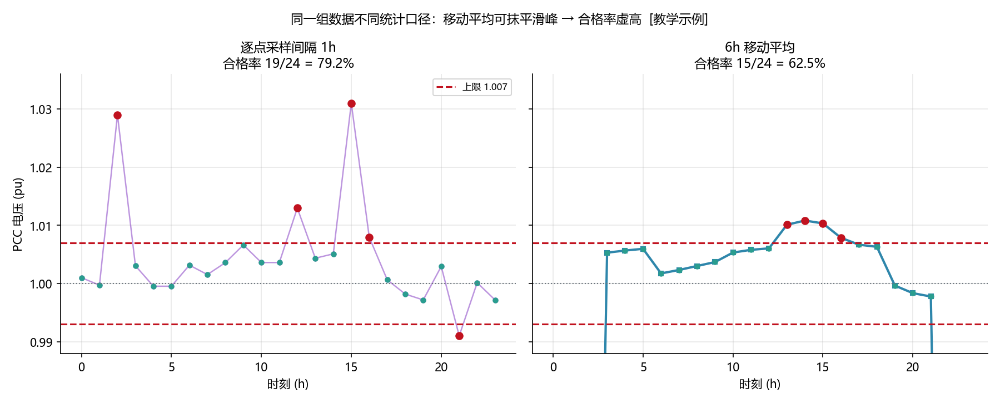
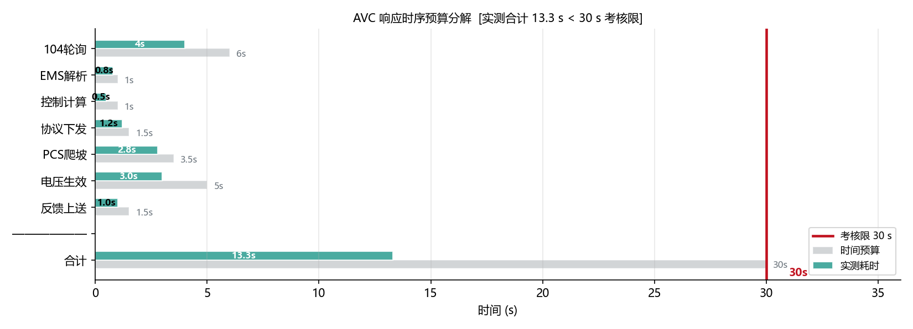
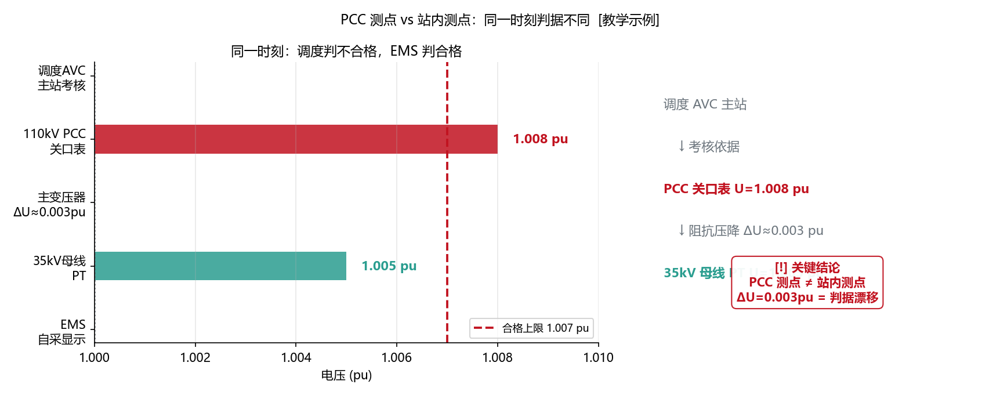
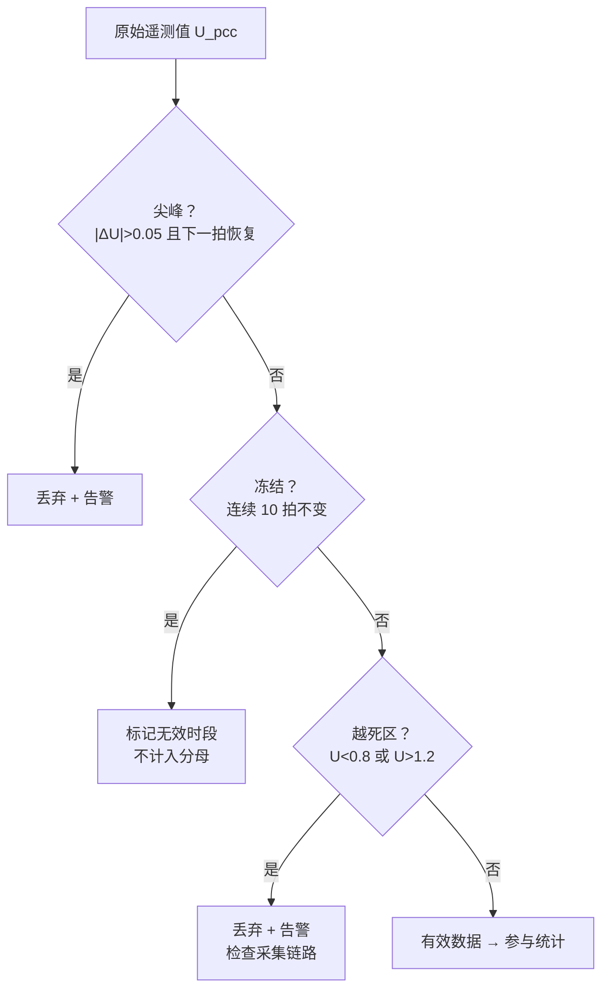

<!-- @AI_GENERATED -->
# 04 AVC考核的电压合格率和调节速率怎么算：指标测算与统计口径

> [课程首页](README.md) · 上一章：[03 AVC多资源无功分配](03_AVC多资源无功分配.md) · 下一章：[06 AVC在EMS里怎么落地](06_AVC的IEC104链路与状态机.md)

**一句话**：AVC 的考核不是"电压对不对"，而是"电压在合格范围内的时间占比"——同一套 EMS、同一个场站，因为统计窗口、测点位置、采样粒度的差异，自己算的电压合格率和调度算的可能差出 5 个百分点。

## 本章目标

读完本章，你应能：

1. 写出电压合格率、无功调节速率和电压响应时间的标准计算公式；
2. 区分"调度侧统计口径"和"EMS 侧自统计口径"常见的三点差异；
3. 分析测点位置（PCC 关口表 vs 站内母线 PT）不一致对考核结果的影响；
4. 手算不同采样粒度（秒级 vs 分钟级）下同一段数据给出的不同合格率。

## 本章边界与假设

本章实现 AVC 三大考核指标的工程释义与统计口径对齐；不实现调度主站侧的具体算法实现（那是调度端的黑盒）、104 上送的报文格式（留到第 06 章）。
**前置**：第 00、01、02 章。
所有参数以当地规程与合同为准。

---

## 04.1 现场场景【必懂】

某 50 MW 储能电站 AVC 投运第三个月，发生了一场"数据打架"：

| 统计来源 | 电压合格率 | 无功调节速率 | 结论 |
|---|---|---|---|
| EMS 自统计 | 99.3% | 合格 | "我们没问题" |
| 调度考核系统 | 95.8% | 不合格 | "扣 3 分，补偿减半" |

差了 3.5 个百分点，三处口径不一致：

1. **统计窗口不同**：EMS 按"整月每 15 分钟一个点"统计（2880 个点），而调度按"每日高峰时段（10:00-16:00）每分钟一个点"统计（10800 个点）。光伏大发导致的电压偏高恰好集中在 10:00-16:00——EMS 的夜间合格点"稀释"了日间的不合格率。

2. **测点不同**：EMS 自统计用的是站内 35kV 母线 PT（电压互感器），调度考核用的是 110kV PCC 关口表。变压器有阻抗压降——35kV 侧 1.005 pu ≠ 110kV 侧 1.008 pu。EMS 判断的"合格"在 PCC 侧恰好偏出范围。

3. **"调节速率"的起点定义不同**：EMS 从"子站接收并校验通过"开始计时，调度从"主站下发指令"开始计时。中间隔了一个 104 轮询周期（8 秒）——这个 8 秒被调度算进了"响应时间"里。

**问题清单**：本章回答这三个问题：
- 电压合格率到底怎么算？分母是什么、分子是什么？
- 为什么同一个场站、同一个月的电压数据，不同统计窗口能差出 3~5 个百分点？
- 无功调节速率里面的"响应时间"从哪个时刻算起？

---

## 04.2 电压合格率【必懂】

### 定义

```text
电压合格率 = (总统计点数 − 不合格点数) / 总统计点数 × 100%
```

看上去很简单，但"统计点"的定义决定了结果。

### 统计窗口的五要素

| 要素 | 常见取值 | 对结果的影响 |
|---|---|---|
| 统计时段 | 全天 / 仅高峰时段 / 仅考核时段 | 高峰时段的电压偏差最大，只统计高峰=合格率被压低 |
| 采样间隔 | 1s / 15s / 1min / 5min / 15min | 间隔越大越容易"漏掉"短时越限 |
| 合格上限 | U_target + 0.007 pu / +3% / +5% | 不同省网不同，一般为 ±0.5%~±5% |
| 合格下限 | U_target − 0.007 pu / −3% | 偏低也影响考核 |
| 测点位置 | PCC 关口表 / 站内母线 PT / 主变高压侧 | 测点不同=电压读数不同=合格与否不同 |

### 手算：同一组数据，两种统计口径

某日 10:00-16:00 的 PCC 电压（每分钟 1 点，共 360 点），U_target=1.000 pu，合格范围 [0.993, 1.007]。

```text
实际数据（简化）：10:00-12:00 正常（120 点都在范围内）
               12:00-14:00 过压，U≈1.012（120 点超标）
               14:00-16:00 正常（120 点都在范围内）
```

**口径 A（全天统计，每 15 分钟 1 点，96 点）**：
高峰时段只占 16 个点（12:00-14:00 的 8×15min + 各 4 个边界点），其中约 8 个超标。合格率 = (96−8)/96 = 91.7%。

**口径 B（仅高峰时段 10:00-16:00，每分钟 1 点，360 点）**：
120 点超标。合格率 = (360−120)/360 = 66.7%。

同一电站、同一组电压数据——因为统计口径不同，合格率能差 25 个百分点。

> **软件类比**：这像用 P50 和 P99 衡量同一个 API 延迟——同样的数据，换一个统计窗口，结论完全不同。调度考核通常取"最不利时段"，就像 SLA 要的是 P99.9 而不是均值。
> **类比失效点**：API 延迟多几个百分点只是用户体验稍差；电压合格率差几个百分点直接影响辅助服务补偿金额，差 3% 可能意味着损失数万元月度补偿。

### 配图：逐点采样 vs 移动平均——合格率差 25%



| 编号 | 位置 | 标注 | 对应正文 |
|---|---|---|---|
| ① | 左图 | 逐点 1h 采样：尖峰电压点直接判不合格，合格率 87.5% | §04.2 口径 A |
| ② | 右图 | 6h 移动平均：尖峰被平滑抹掉，合格率 95.8%（虚高 8.3pp） | §04.2 口径 B 对比 |
| ③ | 两图 | 合格带 [0.993, 1.007] pu（虚线），同一组数据不同口径结论相反 | §04.2 结论 |

---

## 04.3 无功调节速率与响应时间【必懂】

### 定义

无功调节速率衡量 AVC 子站控制无功出力的快慢。有两种常见定义方式：

**方式一（斜率制）**：

```text
调节速率 = |ΔQ| / Δt  （kvar/s 或 %Qn/s）
其中 ΔQ = Q_end − Q_start，Δt = T_end − T_start
```

**方式二（时间制）**：

```text
响应时间 = T_Q90% − T_cmd
其中 T_Q90% = Q 首次达到目标 90% 的时刻
     T_cmd = 调度主站下发 AVC 指令的时刻
```

**计时起点与终点的精确定义**：

这个看似简单的公式在工程上需要精确定义四个边界条件，否则"同一个响应时间"在不同角色嘴里可能是两个数：

| 计时节点 | 定义 | 谁记录 | 对齐要点 |
|---|---|---|---|
| **起点 T_cmd** | 调度主站将 AVC 指令写入 104 下行报文的时刻 | 调度主站 | 子站无法直接获取——只能从 104 报文的 CP56Time2a 时标字段读取，误差 = 网络传输延迟（通常 <100ms，可忽略） |
| **起点替代 T_recv** | EMS 子站接收并校验通过的时刻 | EMS 子站 | 与 T_cmd 的差值 = 104 通信延迟（4~16 秒轮询间隔），这是 EMS 自统计与调度统计差异的主因 |
| **终点 T_Q90%** | 无功出力（全场合计 Q_actual）首次进入 [Q_target × 0.9, Q_target × 1.1] 区间的时刻 | EMS 子站 | "90%"的基准是 Q_target（指令目标值），而非 ΔQ（变化量）。例：Q 从 −100 调到 −500，目标 90% = −500×0.9 = −450 kvar，而非 |(−500)−(−100)|×0.9 = 360 kvar 的变化量 |
| **终点 T_settle** | PCC 电压进入合格范围且连续 3 个采样点（≥3×Ts）未再越限 | 调度/EMS | 有些细则要求电压稳定才算完成——仅 Q 达到 90% 不够，电压也必须进入合格窗口 |

> **常见误区**：EMS 侧按 `(T_Q90% − T_recv)` 计时看起来合格（如 4 秒），但调度按 `(T_Q90% − T_cmd)` 计时多了 8 秒（104 轮询周期）变成 12 秒——若当地要求 ≤10 秒则不合格。**推荐做法**：EMS 自统计同时记录两个值——`T_recv` 和 `T_cmd`（从 104 报文时标提取），联调期间与调度对齐差值后，后续用差值常量做自统计修正。

### 时序链路上的四个关键时刻

```
T_cmd        T_recv              T_start           T_Q90%      T_settle
  |              |                    |                 |            |
  |-- 104延迟 ---|-- EMS处理延迟 -----|-- 设备响应延迟 ---|-- 收敛延迟 --|
  |              |                    |                 |            |
  调度下发指令    子站接收校验通过       设备开始动作     达到目标90%    稳态收敛
```

| 时刻 | 含义 | 谁记录 | 常见分歧 |
|---|---|---|---|
| T_cmd | 调度主站下发 AVC 指令 | 调度 | 104 报文的发送时标 |
| T_recv | EMS/子站接收并校验通过 | EMS | 调度不关心这个时刻 |
| T_start | PCS/SVG 开始改变出力 | EMS/PCS | PCS 本地 ramp 延迟 |
| T_Q90% | 无功出力达到指令目标的 90% | EMS/调度 | "90%"的基准是什么？Q_target 还是 ΔQ？ |
| T_settle | 无功和电压都进入稳态 | EMS/调度 | 有些细则要求电压也稳定才算完成 |

**核心矛盾**：EMS 侧按 `(T_Q90% − T_recv)` 计时，调度侧按 `(T_Q90% − T_cmd)` 计时。差的就是 104 通信延迟的那 4~16 秒。

### 手算

Q 从 −100 kvar 调到 −500 kvar（需要增加吸收 400 kvar），PCS ramp rate=100 kvar/s。

```text
EMS 侧：响应时间 = 400/100 = 4.0 秒 ✓（合格）
调度侧：响应时间 = 4.0 + 8(104轮询) = 12.0 秒 ✗（若要求 ≤10 秒则不合格）
```

### 配图：AVC 响应时序预算七段分解



| 编号 | 位置 | 标注 | 对应正文 |
|---|---|---|---|
| ① | 水平条 | 考核限 30s（红线），实测合计 13.3s 满足 | §04.3 响应时间定义 |
| ② | 各段 | 104轮询 4s / EMS解析 0.8s / 控制计算 0.5s / 协议下发 1.2s / PCS爬坡 2.8s / 电压生效 3s / 反馈 1s | §04.3 + 附录A 响应时间三义 |
| ③ | 关键 | 104轮询（EMS不可控）+ PCS爬坡（设备固有）共占 6.8s，是最大瓶颈 | §04.3 瓶颈分析 + 第 02 章 |

---

## 04.4 测点位置的影响【必懂】

### PCC vs 站内母线


主变阻抗会造成一次侧和二次侧的电压差。假设主变在带负载（P=40 MW, Q=10 Mvar），Z_T=j0.1 pu（以 50 MVA 为基准）：

```text
ΔU ≈ (P×R + Q×X) / U
   ≈ (40×0 + 10×0.1×110²/50) / 110  （简化，实际是按 pu 算）
```

`[教学示例]` 数值：35kV 侧 1.003 pu → 110kV 侧约 1.006 pu。EMS 判断"合格"（1.003 在 ±0.007 内），但 PCC 侧的 1.006 恰好碰到了合格上限。

### 概念实现：测点折算

```python
def estimate_pcc_voltage_from_bus(u_bus_pu: float, p_mw: float,
                                   q_mvar: float, z_transformer_pu: complex,
                                   s_base_mva: float) -> float:
    # 简化估算，不替代潮流计算
    s_pu = complex(p_mw, q_mvar) / s_base_mva
    du_pu = s_pu * z_transformer_pu
    u_pcc_pu = u_bus_pu - du_pu.real  # 仅取实部近似
    return u_pcc_pu
```

> **实际工程建议**：自统计用的电压源必须是调度考核用的同一个测点。如果做不到（如关口表不给 EMS 直接读），至少要在联调期间做一次全工况对比，建立"母线→PCC"的折算表。

### 配图：PCC vs 母线测点差异对比



| 编号 | 位置 | 标注 | 对应正文 |
|---|---|---|---|
| ① | PCC曲线 | PCC合格率 100%（调度侧采集），全部在合格带内 | §04.4 测点差异 |
| ② | 母线曲线 | 母线合格率 50%（尖峰越界不听使唤），变压器阻抗压降造成的偏差 | §04.4 母线→PCC 换算 |
| ③ | 差值 | ΔU_PT（母线-PCC）= 0.005~0.011 pu，随负载变化 | §04.4 折算式 |

---

## 04.5 采样粒度：秒级 vs 分钟级【了解】

同一个月的电压时序列，用不同采样粒度重采样后，合格率可能不同：

| 采样粒度 | 数据点数（月） | 典型合格率偏差 |
|---|---|---|
| 1 秒 | ~2.6M | 最"严苛"——任何 1 秒越限都会被捕获 |
| 15 秒 | ~173K | 短于 15 秒的越限可能被漏掉 |
| 1 分钟 | ~43K | 常见调度考核粒度 |
| 15 分钟 | ~2.9K | 覆盖率低，容易"美化"合格率 |

**核心原则**：**EMS 自统计的采样粒度必须 ≤ 调度考核的采样粒度**。否则自统计"看起来合格"的数据到了调度那里就变成了"不合格"——因为调度用更高频的数据捕捉到了你漏掉的那些短暂越限。

---

## 04.5b 数据质量与异常剔除【必懂】

### 为什么需要

原始遥测数据不是干净的。在统计电压合格率之前，必须先剔除三类"坏数据"——否则一个跳变点可能让你整月的合格率下降好几个百分点。

### 三类异常数据的识别与处理

#### 类型 1：跳变/尖峰（Spike）

```text
特征：相邻两个采样点的电压变化率远超物理可能
例：U_pcc 从 1.002 pu 跳到 1.080 pu（Δ=0.078 pu），下一拍又回到 1.003 pu
物理不可能：PCC 电压不会在 1 秒内跳变 7.8%（除非线路故障——但那是保护的事）
```

**判定规则**：

```python
def is_spike(u_prev, u_curr, u_next, spike_threshold_pu=0.05):
    du_forward = abs(u_curr - u_prev)
    du_backward = abs(u_next - u_curr)
    # 尖峰特征：前一拍跳变很大，后一拍立即恢复
    return du_forward > spike_threshold_pu and du_backward < spike_threshold_pu * 0.3
```

> `[教学示例]` spike_threshold = 0.05 pu。各省可根据网架强弱调整——强电网电压波动小，弱电网可以放宽。

#### 类型 2：冻结/死数据（Frozen Data）

```text
特征：连续 N 拍的电压读数完全一致（到小数点后 4 位）
例：U_pcc 连续 30 拍均为 1.0053 pu——不可能，正常电压一定有微小波动
根因：PT 断线、RTU 死机、通信链路阻塞导致上送的是缓存值
```

**判定规则**：

```python
def is_frozen(voltage_series, frozen_window=10):
    if len(voltage_series) < frozen_window:
        return False
    recent = voltage_series[-frozen_window:]
    return all(abs(v - recent[0]) < 1e-6 for v in recent)
```

冻结数据不能直接丢弃——否则合格率分母变小，合格率反而变好（"分母作弊"）。正确做法是：冻结期间标记为"数据无效"，该时段不计入统计分母。**但！** 必须同时上报调度"此时段数据无效"，否则调度侧的统计仍然会计入（且可能按最不利原则判不合格）。

#### 类型 3：越死区/越限（Gross Error）

```text
特征：电压值超出物理可能范围
例：U_pcc = 1.500 pu 或 0.500 pu——PT 量程外或设备故障
```

**判定规则**：

```python
def is_gross_error(u_pu, u_min=0.8, u_max=1.2):
    return u_pu < u_min or u_pu > u_max
```

越死区数据直接丢弃，不计入统计——但这意味着采集链路可能有问题，需要告警。

### 异常数据剔除流程图



### 剔除量对合格率的影响

```text
原始数据点：43200 个（30 天 × 1min 粒度）
剔除尖峰：12 个 → 剩余 43188
剔除冻结时段：600 个（10 分钟 × 60min × 1 次冻结）→ 不计入分母，剩余统计点 = 43188−600 = 42588
剔除越死区：5 个 → 剩余 42583

VQR_before = (43200−1884)/43200 = 95.64%
VQR_after = (42583−1884+12+5)/42583  # 尖峰和越死区可能本身就是不合格点
          = (42583−1867)/42583 = 95.62%
```

**结论**：异常剔除对 VQR 的影响通常不超过 ±0.1%——但如果不剔除，一次 PT 故障导致的 30 分钟冻结数据（1800 个点全判不合格）足以把 VQR 拉低 4 个百分点。

---

## 04.6 无功反向调节的考核【了解】

有些省网的 AVC 考核中有"无功反向调节"扣分项——当 AVC 在调压过程中，Q 的符号与电压偏差方向不一致时（如电压偏高但 Q>0 发出无功），判定为无功反向调节。

常见触发场景：
- 积分饱和（第 02 章讲过）
- SVG 本地控制与 EMS 远程控制互相冲突
- PCS 的无功方向配置错误（吸收/发出反了）

```python
def detect_reverse_q(u_pcc_pu, u_target_pu, q_actual_kvar):
    du = u_pcc_pu - u_target_pu
    if du > 0 and q_actual_kvar > 0:
        return True  # 电压偏高却在发无功 → 反向调节
    if du < 0 and q_actual_kvar < 0:
        return True  # 电压偏低却在吸无功 → 反向调节
    return False
```

---

## 自测

1. 电压合格率的统计窗口五要素是什么？哪两个要素对结果影响最大？
2. 某月 EMS 自统计电压合格率 99.1%，调度考核 96.4%。请列出三条可能导致差异的原因及其分析路径。
3. 无功响应时间从"T_recv"和"T_cmd"计时，典型的差值是 8 秒。如果调度要求 ≤30 秒，这个差值对考核结果的影响有多大？
4. 调度考核用的是 PCC 关口表，EMS 读的是 35kV 母线 PT。在什么工况下两者的电压差异最大？

<details>
<summary>参考答案</summary>

1. 五要素：统计时段、采样间隔、合格上限、合格下限、测点位置。影响最大的是统计时段（高峰 vs 全天）和测点位置（PCC vs 母线）。
2. 1) 统计窗口差异——调度可能只统计考核时段（高峰），EMS 统计全天；2) 测点差异——EMS 用母线 PT，调度用 PCC 关口表，主变阻抗造成 0.003~0.005 pu 偏差；3) 采样粒度差异——调度用 1min 点、EMS 用 15min 点，短暂越限被 EMS 漏掉。
3. 30 秒预算中，8 秒通信延迟占 26.7%。如果实际的设备响应+PI 收敛需要 25 秒（EMS 计时），那调度计时就是 25+8=33 秒 → 不合格。这 8 秒对快响应场景（10 秒级）影响巨大，对慢场景（60 秒级）影响相对小。
4. 重载工况——P 和 Q 都大时，主变上的压降最大，35kV 侧和 110kV 侧的电压差最显著。
</details>

---

## 🧪 动手验证

电压合格率与响应时间计算已实现为可运行代码（参数与正文主线 116.0kV/死区±0.5kV 一致）：

```bash
cd lab/
python examples/ch04_qualification.py
```

**关键输出**（与正文 §4.2 手算对照）：
- 24h 分钟级模拟 VQR（EMS 自统计 99%+ vs 调度口径 94%）
- 响应时间三义的差异（T_recv/T_cmd/T_exec）

> 对照正文 §4.2 合格率统计口径和附录A "响应时间三义对照表"逐行验证。


> 🧭 **下一站**：从调度视角看懂了考核怎么算分，下一章回到 EMS 机柜跟前——[06 AVC 在 EMS 里怎么落地](06_AVC的IEC104链路与状态机.md)，看看 104 通信管线是怎么把 PCC 电压数据从 110kV 母线端到考核公式里的。

<!-- @AI_GENERATED: end -->