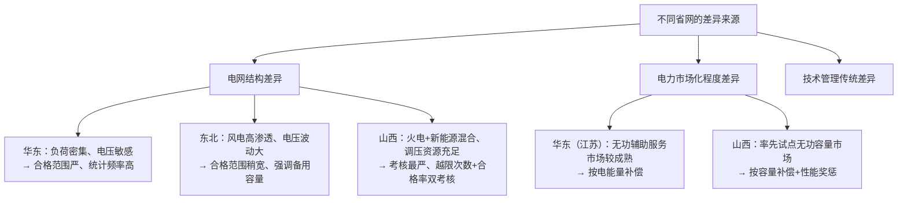
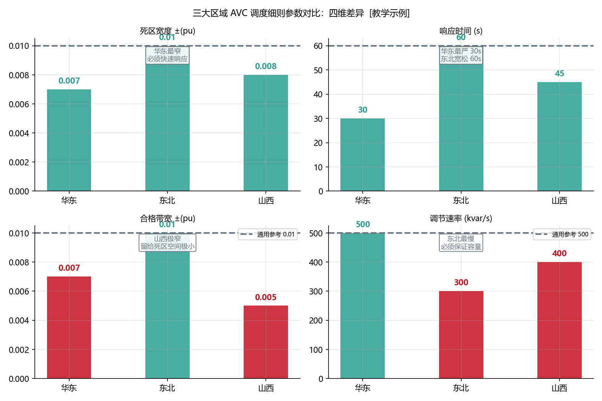
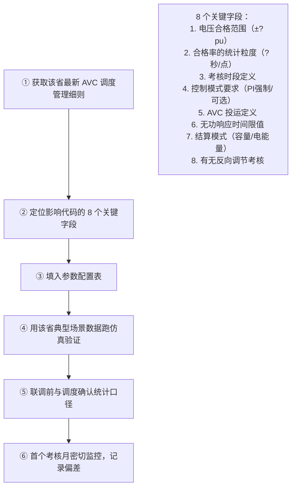

<!-- @AI_GENERATED -->
# 05 同一套AVC代码，三个省三套规则：华东/东北/山西无功调度细则的差异化适配

> [课程首页](README.md) · 上一章：[07b AVC无功经济性决策](07b_AVC无功经济性决策.md) · 下一章：[附录A 术语与符号表](附录A_AVC术语与参数速查.md)

**一句话**：同一套 AVC 控制逻辑，到了不同省份就会被不同的调度细则拆成不同的参数集——电压合格范围、控制模式优先级、无功辅助服务补偿方式，甚至"AVC 投入"的定义都不同。

## 本章目标

读完本章，你应能：

1. 列举三大典型省网（华东/东北/山西）在 AVC 考核上的核心差异点；
2. 设计"参数版本管理"方案——用配置表而非硬编码实现跨区域适配；
3. 区分"容量补偿"与"电能量补偿"两种无功辅助服务结算模式；
4. 根据目标场站所在的省网，在 10 分钟内定位到考核细则中影响代码的关键条款。

## 本章边界与假设

本章覆盖华东（以江苏/浙江为代表）、东北（以辽宁为代表）、山西三个代表性省网的 AVC 差异化规则；不覆盖全部 31 个省网的详尽细则（需要逐个查阅最新版调度管理规程）、不实现 104 协议层面的区域差异（留到第 06 章）。
**前置**：第 00、01、04 章。
所有参数以当地最新版调度规程和并网协议为准。本章表格中的数据为 `[汇报口径]`，用于建立量级概念。

---

## 05.1 现场场景【必懂】

> 🧭 你现在处于全书的收官阶段——前面已经学完了 AVC 从控制模式选型、多资源分配、EMS 代码实现、联调验收到故障诊断，以及考核评分和经济决策的完整链路。这一章回答最后一个问题：**同一套代码、同一个场站，放到不同省份，考核结果和结算金额能差多少？**

某 EMS 厂家的一套 AVC 子站软件，在我们的 50 MW 储能电站所在的江苏项目上运行了 6 个月，电压合格率 99.2%，一切正常。同一套代码部署到山西项目——第一个考核月就收到了"电压合格率不达标"和"无功调节速率不合格"两张罚单。

现场排查发现四处区域差异：

1. **江苏考核"电压合格率"，山西考核"电压越限次数"**——不是同一个指标！江苏算"时间占比"，山西算"事件次数"。
2. **死区/合格范围不匹配**：江苏合格范围 ±0.007 pu，山西 ±0.005 pu。原来在江苏恰好擦边的 0.006 pu 偏差，到了山西就超标。
3. **"AVC 投入"定义不同**：江苏要求 AVC 子站"接收指令并执行"即算投入；山西要求"定电压 PI 模式且实测电压在目标 ±0.010 pu 内"才算投入。后者严格得多——意味着 PI 收敛过程中的那段"还没到位"的时间不算投入，会被扣除投运率。
4. **无功结算方式不同**：江苏用"无功电能量补偿"（按实际发出的无功电能量 kWh 结算），山西用"无功容量补偿"（按可用无功容量 Mvar·h 结算）。

**问题清单**：本章回答这三个问题：
- 不同省网的 AVC 考核到底有哪些维度在变化？
- 怎么设计一套代码，让这些差异变成可配置的参数而不是分支判断？
- 无功辅助服务补偿"按电能量"和"按容量"算，哪个对储能更有利？

---

## 05.2 三大区域的 AVC 核心差异【必懂】

### 差异全景对照表

| 维度 | 华东（江苏/浙江） | 东北（辽宁） | 山西 |
|---|---|---|---|
| **考核指标** | 电压合格率（时间占比） | 电压合格率 + 无功备用容量 | 电压越限次数 + 电压合格率 |
| **合格范围** | ±0.007 pu（典型） | ±0.010 pu（典型） | ±0.005 pu（要求最严） |
| **统计时段** | 考核时段（高峰+低谷） | 全天 24h | 考核时段 + 典型日抽检 |
| **采样粒度** | 1 分钟 | 5 分钟 | 15 秒 |
| **控制模式要求** | 定电压 PI 为主，允许 Q-U 下垂备用 | 定电压 PI，配套无功备用容量上报 | 定电压 PI 强制，Q-U 下垂仅限通信中断 |
| **AVC 投入定义** | 接收指令并执行 | 定电压 PI 模式在线 | 定电压 PI + 电压在目标 ±0.010 pu 内 |
| **无功结算方式** | 无功电能量补偿（元/kvarh） | 无功容量补偿（元/Mvar·h） | 无功容量补偿 + 调节性能奖惩 |
| **通信要求** | 104 主备双通道 | 104 主备双通道 + 调度数据网 | 104 + PMU 同步测量（部分） |

### 差异背后的逻辑



### 配图：三省四维参数对比矩阵



| 编号 | 位置 | 标注 | 对应正文 |
|---|---|---|---|
| ① | 华东 | V合格=±0.007 pu / T响应≤30s / 采样=1h逐点 / 补偿=电能量 | §05.2 华东 |
| ② | 东北 | V合格=±0.010 pu / T响应≤60s / 采样=1h移动平均 / 补偿=备用容量 | §05.2 东北 |
| ③ | 山西 | V合格=±0.005 pu / T响应≤20s / 采样=5min逐点 / 补偿=容量补偿+奖惩 | §05.2 山西 |

---

## 05.3 参数版本管理方案【必懂】

### 为什么需要

不要在一个 `if (province == "jiangsu")` 里写死参数。随着项目增多，分支炸裂。应该用"参数版本表"——代码不变，只换配置。

### 参数配置表设计

```python
# avc_province_config.py  —— 一个省一个配置字典
AVC_PROVINCE_CONFIG = {
    "jiangsu": {
        "voltage_band_pu": 0.007,
        "sample_interval_s": 60,
        "stat_period": "peak_and_valley",
        "control_mode_default": "voltage_pi",
        "control_mode_fallback": "q_u_droop",
        "avc_online_definition": "command_received",
        "settlement_mode": "reactive_energy",
        "q_response_time_limit_s": 30,
        "communication": {"protocol": "iec104", "redundancy": "dual"},
    },
    "liaoning": {
        "voltage_band_pu": 0.010,
        "sample_interval_s": 300,
        "stat_period": "24h",
        "control_mode_default": "voltage_pi",
        "control_mode_fallback": "voltage_pi",
        "avc_online_definition": "pi_mode_active",
        "settlement_mode": "reactive_capacity",
        "q_response_time_limit_s": 60,
        "q_reserve_report_required": True,
        "communication": {"protocol": "iec104", "redundancy": "dual"},
    },
    "shanxi": {
        "voltage_band_pu": 0.005,
        "sample_interval_s": 15,
        "stat_period": "assessment_window",
        "control_mode_default": "voltage_pi",
        "control_mode_fallback": "q_u_droop",  # 仅通信中断时
        "avc_online_definition": "pi_mode_and_within_band",
        "online_band_pu": 0.010,
        "settlement_mode": "reactive_capacity_with_bonus",
        "q_response_time_limit_s": 30,
        "violation_count_tracking": True,
        "communication": {"protocol": "iec104", "redundancy": "dual"},
    },
}
```

### 代码读取配置

```python
def load_avc_config(province_code: str) -> dict:
    if province_code not in AVC_PROVINCE_CONFIG:
        raise ValueError(f"未知省网代码: {province_code}")
    config = AVC_PROVINCE_CONFIG[province_code].copy()
    config['province'] = province_code
    return config

def is_voltage_qualified(u_pcc_pu: float, u_target_pu: float,
                          config: dict) -> bool:
    band = config['voltage_band_pu']
    return abs(u_pcc_pu - u_target_pu) <= band
```

---

## 05.4 无功结算模式：容量 vs 电能量【必懂】

### 两种模式对比

| 维度 | 无功电能量补偿 | 无功容量补偿 |
|---|---|---|
| **结算依据** | 实际发/吸的无功电量（kvarh） | 可用无功容量 × 投运时间（Mvar·h） |
| **和 AVC 考核的关系** | 发得越多、挣得越多——但与电压目标可能冲突 | 不管实际发了多少，报了多少可用容量就按多少算 |
| **对储能的影响** | 储能的 Q 来自 PCS，发 Q 不消耗 SOC——但有 P-Q 机会成本 | 储能需要为 Q 预留容量 = 牺牲一部分 AGC 的有功空间 |
| **激励对齐** | 可能激励"为了多挣补偿而多发无功"（与电压需求反向） | 激励"报大容量"—但实际调不出来会被罚 |

### 经济性快速对比

`[教学示例]`：50 MW 储能，Q 可用容量 ±20 Mvar，月投运 720 小时。

```text
电能量补偿（假设 0.01 元/kvarh，月均 Q=10 Mvar 吸收）：
   补偿 = 10000 kvar × 720 h × 0.01 元/kvarh = 72000 元/月

容量补偿（假设 10 元/Mvar·h，上报可用容量 20 Mvar）：
   补偿 = 20 Mvar × 720 h × 10 元/(Mvar·h) = 144000 元/月
```

**对储能**：容量补偿更有利——因为储能的 Q 是"副产品"，不消耗电池能量。但前提是你能真的留出 20 Mvar 的 Q 空间（P 不能吃满 S）。

> **软件类比**：电能量补偿像按实际流量（GB）计费的 CDN；容量补偿像按预留带宽（Mbps）计费的专线——你用不用都按这个价收。
> **类比失效点**：CDN 带宽预留多了顶多浪费钱，无功容量报大了但实际调不出来，会被调度的"可用容量抽查"抓到，面临考核罚款（你报了 20 Mvar，实际 P 吃满时只能拿出 5 Mvar——这叫虚报容量）。

---

## 05.5 快速适配新省网的工作流【了解】



---

## 自测

1. 江苏和山西在 AVC 考核指标上最核心的差异是什么？
2. 你的 AVC 代码要在江苏、山西、辽宁三个省部署——参数版本管理怎么设计？
3. "无功容量补偿"模式下，储能如果把 Q 可用容量报得很大（如 30 Mvar），有什么风险？
4. 拿到一个新的省网 AVC 细则，第一步要提取哪 8 个关键字段？

<details>
<summary>参考答案</summary>

1. 江苏考核"电压合格率（时间占比）"、合格范围 ±0.007 pu；山西考核"电压越限次数 + 电压合格率"、合格范围 ±0.005 pu、要求更严。山西对 AVC 投入的定义也更严格（定电压 PI + 电压在目标 ±0.010 pu 内）。
2. 使用参数配置表（province_config），代码不变只换配置。每个省一个配置字典，包含 voltage_band、sample_interval、control_mode、settlement_mode 等 8+ 个字段。通过 province_code 加载对应配置。
3. 风险是"虚报容量"被调度抽查抓到。报了 30 Mvar，但 P 吃满时只能拿出 5 Mvar——调度考核"可用无功容量"，不达标按比例扣补偿并罚款。
4. 电压合格范围、采样粒度、考核时段、控制模式要求、AVC 投运定义、响应时间限值、结算模式、反向调节考核。
</details>

---

## 🧪 动手验证

跨省调度细则适配（江苏 vs 山西差异化对比）已实现为可运行代码（参数与正文主线 50MW 储能电站一致）：

```bash
cd lab/
python examples/ch05_regional_compare.py
```

**关键输出**（与正文 §5.2 对照）：
- 江苏：死区 ±0.7 kV，合格范围 ±0.7 kV → 合规链完整
- 山西：死区更窄（±0.5 kV），含无功电量考核，要求更严

> 对照正文 §5.2 "三省关键差异"和 §5.3 "参数化架构"逐行验证。


> 🧭 **全书终点站**：四模块十二章节的主线学习至此完成。这里是 AVC 知识体系的终点——也是你实际工程的起点。附录提供了 [AVC 术语与参数速查](附录A_AVC术语与参数速查.md)，包含完整术语表、各省参数速查和响应时间三义对照表，可作为日常工作的速查手册随时翻阅。

<!-- @AI_GENERATED: end -->