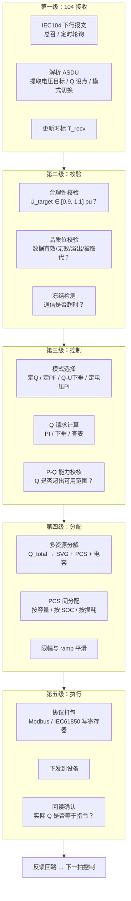
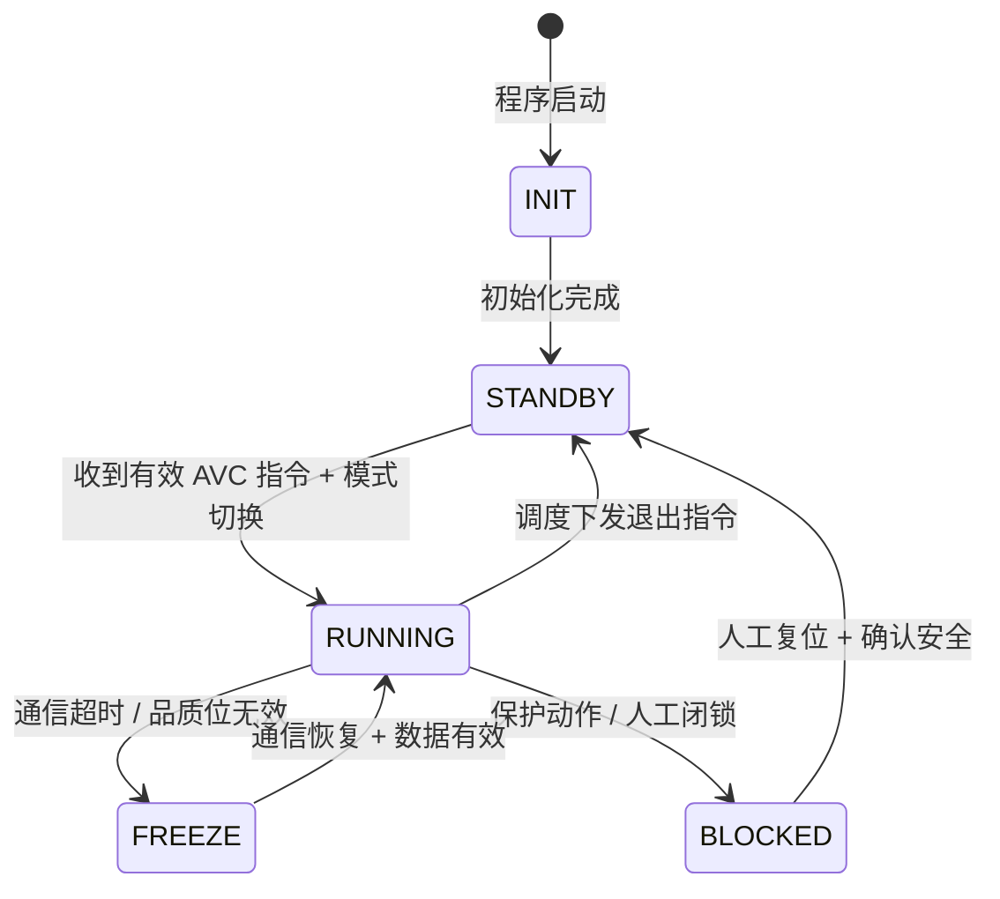

<!-- @AI_GENERATED -->
# 06 AVC在EMS里怎么落地：IEC104指令链路、五级流水线与控制状态机

> [课程首页](README.md) · 上一章：[04 AVC考核指标与统计口径](04_AVC考核指标与统计口径.md) · 下一章：[08 AVC并网联调怎么一次过](08_AVC并网联调与验收证据链.md)

**一句话**：AVC 不是几句控制公式——它是一条从 104 报文解析、到控制模式切换、到五级校验、到设备下发、到反馈采集的完整数据流水线，任何一级断了，前面的算法再对也是白费。

## 本章目标

读完本章，你应能：

1. 画出 AVC 子站在 EMS 中的五级数据流水线（接收→校验→控制→分配→执行）；
2. 实现 AVC 控制状态机的核心状态（就绪/运行/冻结/闭锁）及其转移条件；
3. 写出 104 点表中 AVC 必需的电压目标、无功设点和模式切换命令的映射；
4. 处理通信失效时的冻结策略和恢复策略。

## 本章边界与假设

本章实现 AVC 子站的五级流水线架构、控制状态机、104 点表映射和通信失效处理；不实现具体的 104 协议栈（已有成熟库）、PCS/SVG 的具体通信协议适配（Modbus/IEC61850 按项目配置）、OLTC 的控制协调（仅给出架构级描述）。
**前置**：第 00、01、02、03 章。
所有参数以当地规程与合同为准。

---

## 06.1 现场场景【必懂】

某储能电站 AVC 上线首日，现场调试记录：

```
14:30  调度下发电压目标：1.000 pu → 104 报文到达
14:30  EMS 日志："收到 AVC 指令，电压目标 1.000 pu，"→ 控制状态 → 运行
14:31  EMS 日志："PCC 电压：1.035 pu，Q 请求：−500 kvar"
14:31  PCS 日志："收到 Q 指令 −50 kvar"（每台 PCS 分到 1/10）
14:35  调度电话："你们 AVC 是投入了吗？电压还是 1.035 pu，没动啊！"
```

问题出在流水线的第五级——分配后实际下发时：
- Q 总需求 = −500 kvar，分配到 10 台 PCS 各 −50 kvar
- 但 PCS 的 Modbus 点表中"无功设点"的寄存器地址写错了一个偏移量（偏了 2 个字节）
- PCS 实际收到的不是 −50 kvar，而是一个乱码值（被 PCS 本地安全校验拒绝后保持原值）
- EMS 以为发下去了，实际上 PCS 没执行——**从 EMS 日志看一切正常，从 PCS 看根本没收到有效指令**

**问题清单**：本章回答这三个问题：
- AVC 的代码从"收到 104 报文"到"PCS 执行"之间到底经过了哪些环节？
- 每个环节可能在哪一步默默失败？怎么在代码里防护这些失败？
- 通信断了怎么办——AVC 该"冻结当前 Q"还是"切到本地 Q-U 下垂"？

---

## 06.2 五级数据流水线【必懂】



### 每一级可能默默失败的地方

| 级 | 常见故障 | 对 EMS 日志的影响 | 对考核的影响 |
|---|---|---|---|
| L1 接收 | 104 t1 超时重连、报文 CRC 错误、点号映射错 | "收到指令"日志可能正常（因为 t0 收到了） | 指令更新频率不够→电压合格率下降 |
| L2 校验 | U_target=0（品质位=无效）、U_target=1.5 pu（越限被拒） | 校验拒绝后有日志 | 指令被丢弃→AVC 失去目标→电压偏差累积 |
| L3 控制 | 模式未切换（仍留在定 Q）、PI 积分异常 | Q 计算日志正常但值不对 | 电压合格率下降 |
| L4 分配 | 分配总额与需求不一致、PCS 分配和为 0 | 分配日志正常 | 个别 PCS 没出力→总 Q 不足 |
| L5 执行 | 寄存器地址偏移、通信超时、PCS 本地闭锁 | **EMS 日志正常（只记录"已下发"）** | 无声失败→电压完全没调 |

> **软件类比**：AVC 流水线像 ETL 管道——Extract（104 接收）、Transform（校验→控制→分配）、Load（下发执行）。ETL 的"数据丢了"通常能在监控面板上看到行数下降；AVC 流水线里"Q 指令丢了"是看不见的，只能从 PCS 实际 Q 反馈与指令对比才能发现。
> **类比失效点**：ETL 数据丢失可以重跑，AVC 的无功调节错过了时间窗口就补不回来了。而且 ETL 失败是"少了几行数据"，AVC 失败可能触发电压越限保护动作。

---

## 06.3 控制状态机【必懂】

### 状态定义



| 状态 | 含义 | Q 指令行为 | 考核影响 |
|---|---|---|---|
| INIT | 程序初始化中 | 无输出 | AVC 未投运 |
| STANDBY | 待命，等待调度指令 | 保持当前 Q / Q=0 | AVC 未投运 |
| RUNNING | 正常运行，闭环控制 | 每拍计算并下发 Q | 计入投运率 |
| FREEZE | 冻结，通信或数据失效 | 保持冻结前最后一拍的 Q 值 | 不计入投运（通信中断时段） |
| BLOCKED | 闭锁，保护动作或人工操作 | Q=0，立即停止所有无功调节 | 不计入投运，且可能触发扣分 |

### 状态转移代码

```python
class AvcStateMachine:
    def __init__(self):
        self.state = "INIT"
        self.freeze_q_kvar = 0.0
        self.comm_timeout_count = 0
        self.comm_timeout_limit = 3

    def transition(self, event: str, context: dict) -> str:
        transitions = {
            ("INIT", "init_done"): "STANDBY",
            ("STANDBY", "avc_cmd_valid"): "RUNNING",
            ("RUNNING", "comm_timeout"): self._handle_comm_loss,
            ("RUNNING", "quality_invalid"): "FREEZE",
            ("RUNNING", "protection_trip"): "BLOCKED",
            ("RUNNING", "manual_block"): "BLOCKED",
            ("RUNNING", "avc_exit"): "STANDBY",
            ("FREEZE", "comm_restored"): "RUNNING",
            ("FREEZE", "protection_trip"): "BLOCKED",
            ("BLOCKED", "manual_reset"): "STANDBY",
        }
        handler = transitions.get((self.state, event))
        if callable(handler):
            return handler(context)
        if isinstance(handler, str):
            self.state = handler
        return self.state

    def _handle_comm_loss(self, ctx):
        self.comm_timeout_count += 1
        if self.comm_timeout_count > self.comm_timeout_limit:
            self.state = "FREEZE"
        return self.state

    def get_q_output(self, q_current_kvar: float) -> float:
        if self.state == "RUNNING":
            return q_current_kvar
        elif self.state == "FREEZE":
            return self.freeze_q_kvar
        else:
            return 0.0
```

### 06.3b 异常态与恢复：三种典型异常的进入与退出【必懂】

工程上最棘手的状态转移不是稳态切换，而是异常中断后的恢复逻辑。以下三种异常是 AVC 现场最高频的故障来源。

#### 异常 1：通信中断 → 恢复

```text
触发条件：连续 N 拍未收到有效 104 报文（comm_timeout_count > comm_timeout_limit）
状态转移：RUNNING → FREEZE
Q 行为：保持最后一拍 Q 值（freeze_q_kvar）
恢复条件：收到有效 104 报文 + 品质位有效
恢复转移：FREEZE → RUNNING
恢复后行为：
  ① 恢复后第一拍：Q 从 freeze_q_kvar 继续计算（不是从 0 重新开始）
  ② I（积分项）不重置——保持冻结前的 I 值继续累积
  ③ 若 FREEZE 超过阈值（如 120s），积分项视为"过期"，I = 0 重新开始
```

**关键设计决策**：通信恢复后 I 是保留还是归零？

| 选择 | 优点 | 风险 |
|---|---|---|
| 保留 I | 恢复后立即接续，不产生额外响应滞后 | 若 FREEZE 期间电压已大幅变化，保留的 I 可能"过时"——导致恢复瞬间 Q 跳变 |
| 归零 I | 安全——I=0 从头开始，不会产生意外 Q 跳变 | 归零后 P 项主导，相当于"重启 PI"——恢复后响应变慢 |

**推荐方案**：短期 FREEZE（<60s）保留 I；长期 FREEZE（≥60s）归零 I + 首拍 P 项翻倍补偿。

```python
def handle_freeze_recovery(i_frozen, freeze_duration_s, error, kp, ki, ts):
    if freeze_duration_s < 60:
        i_new = i_frozen + ki * error * ts  # 接续累积
    else:
        i_new = ki * error * ts               # 归零重启
        kp_boost = kp * 1.5                   # P 项临时翻倍，补偿积分缺失
    return i_new, kp_boost
```

#### 异常 2：保护动作闭锁 → 复位

```text
触发条件：PCS 保护动作（过温/过流/孤岛检测）/ 人工紧急停止
状态转移：任意状态 → BLOCKED
Q 行为：Q = 0（立即归零——这是与 FREEZE 的本质区别）
I 重置：I = 0（状态机设计保证：每次进入 BLOCKED 时 I 清零）
恢复条件：保护复位 + 人工确认安全 + 遥控/本地手动复位
恢复转移：BLOCKED → STANDBY（不是直接回 RUNNING！）
恢复后行为：
  ① STANDBY 状态等待调度下发新的 AVC 投入指令
  ② 不能自动从 BLOCKED 跳回 RUNNING——这是安全设计
```

> **为什么 BLOCKED 必须人工复位**：保护动作可能意味着设备真实故障（如 PCS 过温是散热坏了）。自动复位可能导致"反复投入→反复跳"的振荡，每次投入都是对设备的一次冲击。

#### 异常 3：控制超时/设备无声失败

```text
触发条件：Q 指令已下发超过 T_timeout 秒，但 |Q_actual − Q_cmd| > 阈值
即"发了指令但设备没执行"——这是 06.1 现场场景中的无声失败

检测机制：
  if time_since_cmd > timeout_s and abs(q_actual - q_cmd) > threshold:
      → 判定为"执行超时"

处理策略（三级递进）：
  第 1 次超时：记录告警，重发同一指令
  第 2 次超时（连续）：记录告警，标记该设备为"不可用"，重新分配 Q 给其他设备
  第 3 次超时（连续）：触发 BLOCKED（该设备的 Q 通道可能物理断开）

关键参数：
  T_timeout = 3 × Ts（控制周期 × 3，给设备足够响应时间）
  threshold = Q_cmd × 0.2 或 min(设备额定 Q 的 5%, 50 kvar)
```

```python
def check_execution_timeout(q_cmd, q_actual, ts, retry_count):
    T_TIMEOUT = 3 * ts
    THRESHOLD = max(abs(q_cmd) * 0.2, 50)  # 至少 50 kvar 的差异才算超时

    if abs(q_actual - q_cmd) > THRESHOLD:
        retry_count += 1
        if retry_count == 1:
            return "retry", retry_count       # 重发同指令
        elif retry_count == 2:
            return "exclude_device", retry_count  # 标记设备不可用
        else:
            return "block_device", retry_count    # 闭锁该设备通道
    else:
        return "ok", 0
```

---

## 06.4 104 点表：AVC 必需的数据点【必懂】

### 下行（调度→场站）

| 序号 | 点描述 | 类型 | 单位 | 说明 |
|---|---|---|---|---|
| 1 | AVC 电压目标值 | 遥调 / 设点 | pu / kV | 核心——AVC 子站的控制目标 |
| 2 | AVC 无功设点值 | 遥调 / 设点 | kvar/Mvar | 定 Q 模式的输入 |
| 3 | AVC 控制模式切换 | 遥控 / 设点 | 枚举 | 1=定Q, 2=定PF, 3=Q-U下垂, 4=定电压PI |
| 4 | AVC 投入/退出 | 遥控 | 布尔 | 调度远程投退 AVC |
| 5 | PF 目标值 | 遥调 / 设点 | 无 | 定 PF 模式的输入 |
| 6 | AVC 指令时标 | 遥信 | 时间戳 | T_cmd，响应时间计时起点 |

### 上行（场站→调度）

| 序号 | 点描述 | 类型 | 单位 | 说明 |
|---|---|---|---|---|
| 1 | PCC 电压实测值 | 遥测 | pu/kV | 调度考核的电压数据源 |
| 2 | 全场无功出力合计 | 遥测 | kvar/Mvar | Q_actual = Σ Q_PCS + Q_SVG |
| 3 | AVC 投运状态 | 遥信 | 布尔 | 0=退出, 1=投入 |
| 4 | AVC 当前控制模式 | 遥信 | 枚举 | 当前运行在哪种模式 |
| 5 | AVC 闭锁原因 | 遥信 | 枚举 | 0=正常, 1=通信中断, 2=保护动作, 3=人工闭锁 |
| 6 | SVG 无功出力 | 遥测 | kvar/Mvar | 独立上报 SVG 的 Q |
| 7 | 无功可用容量 | 遥测 | kvar/Mvar | 容量补偿省份的必需上送量 |
| 8 | AVC 响应时标 | 遥信 | 时间戳 | T_Q90%，响应时间的结束点 |

> **关键检查**：联调前必须逐位核对点表——电压目标的点号有没有跟 AGC 的功率目标点号搞混、无功设点的单位是 kvar 还是 Mvar、控制模式的枚举值 1/2/3/4 和 EMS 代码中的定义是否一致。

---

## 06.5 通信失效处理：冻结 vs 本地自治【必懂】

### 两种策略对比

| 策略 | 行为 | 优点 | 风险 |
|---|---|---|---|
| **冻结（Freeze）** | 保持通信失效前最后一拍的 Q 值不变 | 不引入意外的无功变化 | 如果失效时间很长，电压已变化但 Q 不变 → 可能反向调节 |
| **本地自治（Q-U 下垂）** | 切换到 Q-U 下垂模式，按本地电压自主响应 | 适应电压变化，不依赖远方指令 | 与调度预期不一致、Q-U 下垂的 Q 可能与上一拍 Q 跳变 |
| **缓退（Ramp to Zero）** | 以固定斜率将 Q 逐步退到 0 | 平滑过渡，不产生冲击 | 电压可能失去全部无功支撑 |

### 推荐策略：冻结+超时切换

```python
def handle_comm_loss(state_machine, freeze_q, timeout_s, timeout_limit_s):
    if timeout_s < timeout_limit_s:
        state_machine.transition("comm_timeout")  # 仍在 RUNNING，容忍短时中断
    else:
        state_machine.transition("comm_timeout")
        # 通信中断超过限值（如 60 秒），切到本地 Q-U 下垂
        if state_machine.state == "FREEZE":
            activate_local_droop_mode()
```

---

## 自测

1. AVC 子站的五级数据流水线分别是什么？每一级最常见的默默失败是什么？
2. AVC 控制状态机有几个核心状态？从 RUNNING 到 FREEZE 的触发条件是什么？从 FREEZE 回到 RUNNING 呢？
3. 104 点表中，AVC 下行必需的数据点有哪些？上行必需的数据点有哪些？
4. 通信中断 120 秒——你的 AVC 应该怎么做？

<details>
<summary>参考答案</summary>

1. L1 104 接收（t1 超时/点号错误）、L2 校验（品质位无效/越限拒绝）、L3 控制（模式未切换/PI 异常）、L4 分配（总额不一致/分配为 0）、L5 执行（寄存器地址偏移/PCS 本地闭锁）。L5 最危险——EMS 日志正常，但 PCS 没执行。
2. 5 个核心状态：INIT → STANDBY → RUNNING/FREEZE/BLOCKED。RUNNING→FREEZE 触发条件：通信超时 OR 数据品质位无效。FREEZE→RUNNING：通信恢复 AND 数据有效。
3. 下行：电压目标值、无功设点值、控制模式切换、AVC 投入/退出、PF 目标值、指令时标。上行：PCC 电压实测、全场无功合计、投运状态、当前控制模式、闭锁原因、SVG 无功、无功可用容量、响应时标。
4. 冻结当前 Q 值（短时容忍，如 30 秒内保持 RUNNING），超过限值（如 60 秒）切到 FREEZE，如果进一步超过（如 120 秒）启动本地 Q-U 下垂——既不会产生 Q 跳变冲击，也不会在长时间通信中断后保持一个不合理的 Q 值。
</details>

---

## 🧪 动手验证

IEC104 链路驱动的 AVC 状态机（STANDBY→RUNNING→FREEZE→BLOCKED）已实现为可运行代码：

```bash
cd lab/
python examples/ch06_state_machine.py
```

**关键输出**（与正文 §6.3 逐拍追踪对照）：
- comm_loss 第三拍仍在 RUNNING，第四拍触发 FREEZE
- comm_restored → 立即返回 RUNNING（冻结 Q 释放）

> 对照正文 §6.3 "状态转移代码"的逐拍追踪逐行验证。


> 🧭 **下一站**：代码写完了、状态机也跑通了——但代码对不等于是对的。下一章进入真实战场：[08 AVC 并网联调怎么一次过](08_AVC并网联调与验收证据链.md)，回到我们这座 50 MW 储能电站的联调现场，看看调度怎么验收你的 AVC 系统。

<!-- @AI_GENERATED: end -->