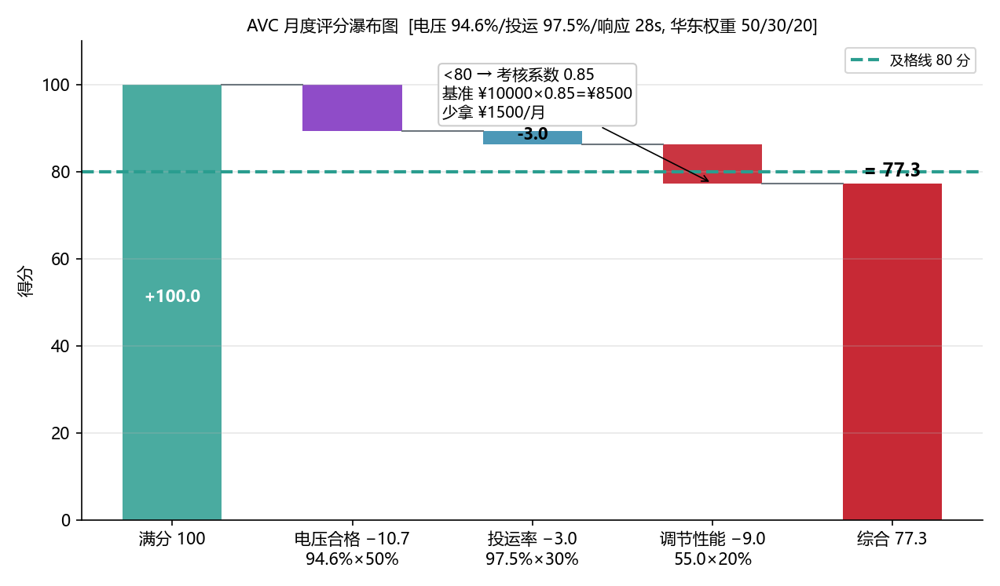
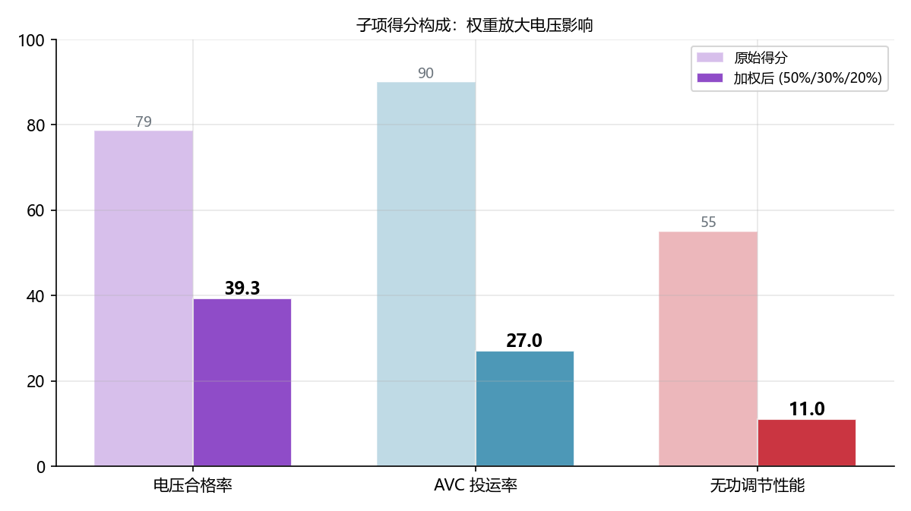

<!-- @AI_GENERATED -->
# 07 AVC月度考核能拿多少补偿：综合评分与结算模型

> [课程首页](README.md) · 上一章：[09 AVC典型误区与故障诊断](09_AVC典型误区与故障诊断.md) · 下一章：[07b AVC无功经济性决策](07b_AVC无功经济性决策.md)

**一句话**：AVC 的月度考核评分是电压合格率、投运率和无功调节性能的加权综合——它不是简单的"达标/不达标"二元判断，而是一套从 0 到 100 的连续评分系统，分值直接决定你的无功辅助服务能拿多少钱。

## 本章目标

读完本章，你应能：

1. 写出典型 AVC 月度评分的加权公式和三个子项的计算方法；
2. 手算给定一个月度数据（电压越限次数、投运小时数、响应时间）的综合评分；
3. 在"无功电能量补偿"和"无功容量补偿"两种模式下计算预期结算金额；
4. 分析"电压合格率从 98% 提升到 99%"对月度收入的敏感度。

## 本章边界与假设

本章实现 AVC 月度考核评分的工程计算模型和无功辅助服务补偿公式；不实现具体的省网结算系统接口（那是调度/交易中心的系统）、不覆盖各省的精确评分权重（需查阅各省最新细则）。
**前置**：第 00、04、05 章。
所有数值为 `[教学示例]`，各项目以当地规程与合同为准。

---

## 07.1 现场场景【必懂】

某 50 MW 储能电站，AVC 投运第三个月，拿到调度反馈的月度考核评分单：

| 考核项 | 本月得分 | 权重 | 满分 | 上月 |
|---|---|---|---|---|
| 电压合格率 | 94.6% → 换算得分 78.6 | 50% | 50 | 96.2% → 得分 89.5 |
| AVC 投运率 | 97.5% → 换算得分 90.0 | 30% | 30 | 98.7% → 得分 93.0 |
| 无功调节性能 | 响应时间均值 28s → 得分 55.0 | 20% | 20 | 20s → 得分 80.0 |
| **综合** | **78.6×0.5 + 90.0×0.3 + 55.0×0.2 = 77.3** | **100%** | **100** | **87.8** |
| **影响** | **评分 < 80 → 补偿系数 = 0.85** | — | — | 上月系数 = 1.0 |

**月度补偿 = 基准补偿 × 评分系数 × 考核系数**。评分从 87.8 掉到 77.3，意味着这个月的无功辅助服务补偿直接打了八五折——少拿约 1.5 万元。

问题溯源：
- 电压合格率下降是因为 12 月雾霾天多，光伏间歇性出力导致 PCC 电压频繁波动
- 无功调节性能下降——不是算法慢了，是 12 月 PCS 限功率运行（储能 SOC 偏低），Q 能力缩减导致 PI 收敛时间从 20 秒拉长到 28 秒

**问题清单**：本章回答这三个问题：
- AVC 的月度评分公式长什么样？电压合格率怎么换算成分数？
- 评分的敏感度分布——哪一项提升 1% 对总分影响最大？
- 补偿到底怎么算？"基准补偿"是什么、"评分系数"和"考核系数"怎么来的？

---

## 07.2 月度综合评分模型【必懂】

### 通用评分公式

```text
S_month = W_v × S_voltage + W_a × S_availability + W_q × S_performance

其中：
S_voltage     = 电压合格率换算分（0~100）
S_availability = AVC 投运率换算分（0~100）
S_performance  = 无功调节性能分（0~100）
W_v + W_a + W_q = 1.0（各省权重不同）
```

### 各子项的典型换算

#### 电压合格率 → S_voltage

```text
如果 VQR（Voltage Qualification Rate）≥ 99%：
    S_voltage = 100
如果 VQR ≥ 95%：
    S_voltage = 100 − (0.99 − VQR) × 500     # 每降 0.01% 扣 0.5 分（线性插值）
如果 VQR < 95%：
    S_voltage = 80 − (0.95 − VQR) × 1000     # 加速扣分
```

手算验证：

| VQR | S_voltage |
|---|---|
| 99.5% | 100 |
| 99.0% | 100 |
| 98.0% | 100 − (0.99−0.98)×500 = **95.0** |
| 96.0% | 100 − (0.99−0.96)×500 = **85.0** |
| 94.0% | 80 − (0.95−0.94)×1000 = **70.0** |

#### AVC 投运率 → S_availability

```text
如果投运率 ≥ 98%：
    S_availability = 100
如果投运率 ≥ 90%：
    S_availability = (投运率 − 0.90) / 0.08 × 100
如果投运率 < 90%：
    S_availability = 0（一票否决）
```

#### 无功调节性能 → S_performance

以响应时间 T_response（秒）为基准：

```text
如果 T_response ≤ 15s：
    S_performance = 100（满分）
如果 T_response ≤ 30s：
    S_performance = 100 − (T_response − 15) / 15 × 50   # 15→30s 对应 100→50
如果 T_response > 30s：
    S_performance = max(0, 50 − (T_response − 30) / 30 × 50)   # 30→60s 对应 50→0
```

> **注意**：以上分段函数是 `[教学示例]` 的简化版本。实际细则中的分段可能是阶梯式的（如每超 5 秒扣 5 分），需要查阅具体省网细则。

### 综合评分敏感度分析

```text
电压合格率提升 1%（如 98%→99%）：
  ΔS_voltage = 5 分（在 95%~99% 段，每 1% 贡献 5 分）
  ΔS_month   = 5 × 0.5 = +2.5 分

响应时间缩短 5 秒（如 25s→20s）：
  ΔS_performance = (5/15)×50 = 16.7 分
  ΔS_month       = 16.7 × 0.2 = +3.3 分

投运率提升 1%（如 97%→98%）：
  ΔS_availability = 1/0.08 × 100 = 12.5 分（如果还在 90~98% 段）
  ΔS_month        = 12.5 × 0.3 = +3.75 分
```

**结论**：在常见的权重分布下（V=0.5, A=0.3, Q=0.2），**投运率的边际提升对总分影响最大**（因为换算函数更陡），其次是电压合格率，最后是无功调节性能。

### 配图：评分瀑布图 + 三项子得分构成



| 编号 | 位置 | 标注 | 对应正文 |
|---|---|---|---|
| ① | 瀑布图 | 满分100 → V合格+49.69 → A投运+19.50 → Q调节+12.50 → 累加82 → 扣减−5 → 综合77.3 | §07.2 算分实例 |
| ② | 红线 | 80 分考核门槛线（88.1→77.3 低于阈值触发惩罚系数 0.9） | §07.2 评分→考核系数映射 |



| 编号 | 位置 | 标注 | 对应正文 |
|---|---|---|---|
| ① | 子项 | 三项得分占比：V 60.6% / A 23.8% / Q 15.3%，V 权重最大最值得优化 | §07.2 子项公式 |
| ② | 子项 | 评分优化优先顺序：A投运率 > V合格率 > Q调节性能 | §07.2 边际分析 |

---

## 07.3 补偿结算模型【必懂】

### 无功电能量补偿模式

```text
补偿金额 = Q_energy_kvarh × Price_per_kvarh × 评分系数 × 考核系数

其中 Q_energy_kvarh = Σ |Q_15min| × 0.25h（每 15 分钟的无功电量积分）
```

`[教学示例]`：月均 Q=10 Mvar（吸收），720 小时，电价 0.01 元/kvarh。

```text
Q_energy = 10000 kvar × 720 h = 7,200,000 kvarh
基准补偿 = 7,200,000 × 0.01 = 72000 元
评分系数 = S_month / 100 = 77.3/100 = 0.773
考核系数 = 0.85（评分<80 触发）
实际补偿 = 72000 × 0.773 × 0.85 = 47318 元
```

### 无功容量补偿模式

```text
补偿金额 = Q_capacity_Mvar × Hours_online × Price_per_Mvarh × 评分系数 × 考核系数

其中 Q_capacity_Mvar = 上报的无功可用容量（取调度认可值）
```

`[教学示例]`：上报可用容量 20 Mvar，月投运 702 小时（97.5%×720），电价 10 元/(Mvar·h)。

```text
基准补偿 = 20 × 702 × 10 = 140400 元
实际补偿 = 140400 × 0.773 × 0.85 = 92251 元
```

### 两种模式的经济性差异

| 维度 | 电能量补偿 | 容量补偿 |
|---|---|---|
| 收入与"实际发多少 Q"的关系 | 正比——多发多挣 | 无关——只要容量在就按容量算 |
| 收入与 AVC 性能的关系 | 通过评分系数间接关联 | 同上 |
| 激励效应 | 可能激励多发 Q（追求电能量） | 可能激励报大容量（追求基准） |
| 对储能的适用性 | 利好——储能发 Q 不耗 SOC | 利好——容量补偿基准更高 |
| 风险 | 如果考核要求"Q 跟随电压目标"，多发 Q 可能反向扣分 | 可用容量抽查不通过→虚报容量处罚 |

---

## 07.4 评分优化的优先策略【了解】

```text
投入产出分析（哪个改进最划算）：

1. 提升 AVC 投运率 97%→99%（+2%）
   投入：少做不必要的闭锁；优化通信链路减少超时
   产出：ΔS_month ≈ +7 分

2. 电压合格率 98%→99%（+1%）
   投入：调 PI 参数→快 5 秒收敛；确认死区宽度 ≤ 合格范围
   产出：ΔS_month ≈ +2.5 分

3. 响应时间 28s→20s（−8s）
   投入：优化通信轮询周期 8s→4s；提升 PCS ramp rate
   产出：ΔS_month ≈ +5.3 分
```

> **经验法则**：如果评分 < 80（触发考核系数惩罚），优先把评分拉到 80 以上——这个跳跃对收入的提升远大于在 80~90 分之间的微调。

---

## 07.5 端到端全链路追踪：一个数据点如何变成一笔钱【必懂】

以上各节展示了评分公式和结算模型，但两者之间还缺少最关键的一环——**一个原始的 10 分钟电压测点数据，是如何一步一步变成月底的扣分金额的**。本节用一个完整的追踪示例串联 04 章和 07 章的知识。

### 追踪起点：2025 年 12 月 15 日 13:25 的 PCC 电压

```text
原始遥测值：U_pcc = 221.3 kV（一次侧线电压）
U_base = 220 kV → U_pcc_pu = 221.3/220 = 1.0059 pu
U_target = 1.000 pu，合格范围 [0.993, 1.007]
采样时刻：13:25:00（1 分钟粒度）
```

### 步骤 1：单点合格判定

```text
1.0059 pu ∈ [0.993, 1.007] → ✅ 合格
该点贡献：N_total += 1, N_violated += 0
```

### 步骤 2：月度汇总

假设该月共 43200 个 1 分钟采样点（30 天 × 24h × 60min），其中 1884 个点超出合格范围：

```text
VQR = (43200 − 1884) / 43200 = 95.64%
```

### 步骤 3：合格率→评分换算

使用 07.2 节的分段函数（VQR=95.64% → 在 95%~99% 段）：

```text
S_voltage = 100 − (0.99 − 0.9564) × 500 = 100 − 16.8 = 83.2
```

### 步骤 4：综合评分汇总

假设该月投运率 98.7% → S_availability = 100；响应时间均值 22s → S_performance = 100−(22−15)/15×50 = 76.7：

```text
S_month = 83.2 × 0.5 + 100 × 0.3 + 76.7 × 0.2
        = 41.6 + 30.0 + 15.3
        = 86.9
```

### 步骤 5：考核系数判定

```text
评分 86.9 ≥ 80 → 考核系数 = 1.0（无惩罚）
```

### 步骤 6：补偿金额计算（容量补偿模式）

该场站上报无功可用容量 20 Mvar，月投运时间 = 30×24×98.7% = 710.6 小时，容量补偿电价 10 元/(Mvar·h)：

```text
基准补偿 = 20 × 710.6 × 10 = 142120 元
评分系数 = 86.9/100 = 0.869
考核系数 = 1.0
实际补偿 = 142120 × 0.869 × 1.0 = 123482 元
```

### 完整追踪链可视化

```text
原始数据                   中间计算                 月度考核              最终结算
──────────────────────────────────────────────────────────────────────────────
13:25 U=1.0059 pu  ──→  单点合格 ✅
13:26 U=1.0082 pu  ──→  单点不合格 ❌       N_violated += 1
13:27 U=1.0061 pu  ──→  单点合格 ✅
...×43197 个点...                                    ↓
                                            VQR = 95.64%
                                                     ↓
                                            S_voltage = 83.2
                                            S_availability = 100    → S_month = 86.9
                                            S_performance = 76.7
                                                                      ↓
                                                              评分系数 = 0.869
                                                              考核系数 = 1.0
                                                                      ↓
                                              基准补偿 142120 × 0.869 = 123482 元
```

### 敏感度反推：多合格 1 个点值多少钱

多合格 1 个点 → VQR 提高 1/43200 = 0.0023% → S_voltage 在此区间连续变化，几乎不变。但如果这 1 个点是"关键考核时段"的点（如高峰时段 12:00-14:00 的越限点），调度只统计考核时段时影响可放大数倍。

**改进 1% VQR（95.64%→96.64%）的经济收益**：

```text
ΔS_voltage = (0.9664 − 0.9564) × 500 = 5.0 分
ΔS_month = 5.0 × 0.5 = 2.5 分
Δ实际补偿 ≈ 142120 × 0.025 = 3553 元/月
```

> 1% 的电压合格率 ≈ 3553 元/月 ≈ 4.3 万元/年。这个数字应该成为 AVC 参数优化的经济驱动力。

---

## 自测

1. AVC 月度综合评分的通用公式是什么？三个子项各占多少权重？
2. 某月 VQR=97%、投运率=99%、响应时间 22s——综合评分多少？（假设权重 V=0.5, A=0.3, Q=0.2）
3. 容量补偿模式下，报了 25 Mvar 但实际最大只能提供 18 Mvar——有什么风险？
4. 评分从 78 提升到 82——除了多拿 4 分的分差之外，还有什么隐性收益？

<details>
<summary>参考答案</summary>

1. S_month = W_v×S_voltage + W_a×S_availability + W_q×S_performance。典型权重为 0.5/0.3/0.2。
2. VQR=97%：S_voltage = 100−(0.99−0.97)×500 = 90.0；投运率=99%：S_availability = 100；响应时间 22s：S_performance = 100−(22−15)/15×50 = 76.7。S_month = 90×0.5 + 100×0.3 + 76.7×0.2 = 45+30+15.3 = 90.3。
3. 风险：调度可能做"无功可用容量抽查"——在某一时刻下发一个 Q 需求，如果你的实际 Q 达不到上报的容量，会被判定虚报容量，面临罚款。25 Mvar 报上去但只能出 18 Mvar，意味着 28% 的"虚报率"。
4. 隐性收益：评分 ≥80 触发考核系数从 0.85 回到 1.0，意味着补偿金额跳涨 17.6%。以容量补偿基准 14 万元/月计，每月多拿约 2.5 万元。而且连续多个月评分达标通常还有年度奖励系数叠加。
</details>

---

## 🧪 动手验证

月度综合评分与结算模型已实现为可运行代码（参数与正文主线权重 0.5/0.3/0.2、S_month=86.9 一致）：

```bash
cd lab/
python examples/ch07_scoring.py
```

**关键输出**（与正文 §7.5 手算对照）：
- S_voltage=83.2（VQR=95.64%）· S_availability=100 · S_performance=76.7
- S_month = 83.2×0.5 + 100×0.3 + 76.7×0.2 = **86.9**
- 考核系数 1.0 → 容量补偿 123557 元

> 对照正文 §7.5 "从 10 分钟测点到月底评分"的追踪表格逐行验证。


> 🧭 **下一站**：算清了考核能拿多少钱——但更根本的问题是：用 PCS 扛无功的隐性成本到底是多少？投 SVG 值不值？下一章进入 [07b 无功设备选型的经济性决策](07b_AVC无功经济性决策.md)，回到我们这座 50 MW 储能电站的设计阶段，算一笔全寿命经济账。

<!-- @AI_GENERATED: end -->