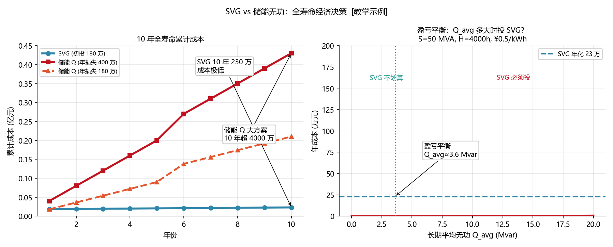

<!-- @AI_GENERATED -->
# 07b AVC投SVG还是靠储能扛：无功设备选型与全寿命成本的经济性决策

> [课程首页](README.md) · 上一章：[07 AVC考核与结算模型](07_AVC考核与结算模型.md) · 下一章：[05 AVC跨区调度细则适配](05_AVC跨区调度细则适配.md)

**一句话**：储能 PCS 的无功是"免费的副产品"——但它不是真的免费，它偷走的是 AGC 的有功空间和 PCS 的寿命。投不投 SVG，需要把机会成本、设备折旧、辅助服务收益放在同一张表上算账。

## 本章目标

读完本章，你应能：

1. 计算储能 PCS 的"无功机会成本"——发 Q 导致少发 P 的损失；
2. 对比 SVG 与储能无功在 10 年全寿命周期内的成本差异；
3. 在给定项目参数下做出"投 SVG 还是靠储能扛"的经济决策；
4. 分析不同无功辅助服务补偿模式下储能参与 AVC 的盈利空间。

## 本章边界与假设

本章实现无功设备选型的经济性对比框架；不包含详细设备采购报价（市场波动）、不覆盖 SVG 的具体电气设计参数（那是电气一次设计的事）、不包含项目融资和税收模型。
**前置**：第 03、07 章。
所有数值为 `[教学示例]` 和 `[汇报口径]`，实际参数以项目可研报告和设备报价为准。

---

## 07b.1 现场场景【必懂】

> 🧭 07 章算清了"AVC 考核评分能拿多少钱"——但有了评分公式还不够，你还需要回答一个更基础的问题：**用储能 PCS 扛无功省钱，还是单独投 SVG 更划算？** 事实上，本书主线故事中的 50 MW 储能电站之所以能在第三个月（03 章）用上 SVG 和电容组，正是因为设计阶段做了下面这笔经济账。

回到我们这座 50 MW / 100 MWh 储能电站的设计阶段——时间拨回到建站前。设计团队面临一个关键决策：

| 方案 | 描述 | 初投资 |
|---|---|---|
| 方案 A：纯储能 | PCS 预留 30% 无功容量，不投 SVG | 0（仅靠 PCS） |
| 方案 B：储能+SVG | 投 1 台 ±15 Mvar SVG，PCS 不做无功 | 约 180 万元 `[汇报口径]` |

方案 A 看起来不要钱——PCS 反正能发无功，为什么还要多花 180 万投 SVG？

但算一笔账：

- AGC 放电是储能的主要收入来源（假设峰谷套利 + 调频，年收入 3000 万元）
- 如果 30% 的 PCS 容量长期被 Q 占用，等效于丢了 30% 的有功窗口 → 年损失潜在放电收益约 400 万元 `[汇报口径]`
- SVG 全寿命 10 年总成本约 180 万（初投）+ 50 万（运维）= 230 万元
- 纯储能方案 10 年累计损失放电收益约 4000 万元

**结论**：180 万的 SVG 省下了 4000 万的机会成本——这是一笔 ROI 超过 20 倍的投资。

**问题清单**：本章回答这三个问题：
- 储能 PCS 的"无功机会成本"怎么量化？
- SVG 的投入和储能的放电收益损失——盈亏平衡点在哪里？
- 什么情况下"靠储能扛"反而是对的？

---

## 07b.2 储能无功的机会成本模型【必懂】

### P-Q 容量被 Q 占用时的损失

```text
机会成本 = 被 Q 挤占的 P 容量 × 年利用小时 × 单位放电收益

其中：
被挤占的 P 容量 = S_nominal − √(S² − Q²_avg)
                ≈ Q²_avg / (2 × S_nominal)（小 Q 近似）
年利用小时：取决于储能运行策略（套利窗口/调频时长）
单位放电收益：电价差 − 充放电损耗 − 电池衰减分摊
```

### 手算

S=50 MVA，长期 Q_avg=10 Mvar（吸收），年放电窗口 4000 小时（日均约 11 小时），电价差 0.5 元/kWh，充放电效率 90%。

```text
被挤占的 P = 10²/(2×50) = 1.0 MW（近似）
年损失电量 = 1.0 MW × 4000 h = 4000 MWh
年损失收益 = 4000 × 1000 × 0.5 × 0.9 = 180 万元
```

**10 年累计 = 1800 万元**。对比 SVG 全寿命成本 230 万元——纯靠储能扛的隐性成本高达 SVG 的 8 倍。

> **软件类比**：这像让一个 Web 服务器同时跑数据库——"反正 CPU 闲着也是闲着"，但当 Web 流量上来时，数据库抢占了 CPU，Web 响应变慢 → 用户流失 → 收入损失。专用资源（SVG/专用数据库服务器）的投入远小于共享资源的隐性损失。
> **类比失效点**：数据库抢 CPU 只是性能降级，PCS 的 Q 占用了 S 容量是硬物理约束——你不可能"降级"——P 就是发不到那么多。

---

## 07b.3 SVG vs 储能无功的全寿命成本对比【必懂】

| 维度 | 储能 PCS 无功 | 独立 SVG |
|---|---|---|
| **初投资** | 0（PCS 自带） | 150~200 万元（±15 Mvar） |
| **10 年运维** | 含在 PCS 运维中 | 约 50~80 万元 |
| **P-Q 机会成本** | **高**—占用 S 容量 = 丢 P 收益 | **零**—SVG 不消耗 PCS 的 S |
| **响应速度** | <100ms（快） | <50ms（更快） |
| **损耗** | PCS 内部损耗（占额定 1~2%） | SVG 内部损耗（占额定 0.8~1.5%） |
| **可用性** | P 优先模式时 Q 可用量不确定 | 独立运行，Q 能力确定 |
| **与考核关系** | Q 能力波动可能导致考核不合格 | 稳定的 Q 能力 = 稳定的考核指标 |
| **全寿命 10 年总计** | 0（初投）+ 机会成本 1500~4000 万 | 230 万（初投+运维） |

### 盈亏平衡分析

```text
SVG 盈亏平衡的条件：
  储能无功年机会成本 > SVG 年化成本

SVG 年化成本 = (初投资 + 运维) / 10
              = (180 + 50) / 10 = 23 万元/年

储能无功年机会成本 = 被挤占的 P(MW) × 年利用小时(h) × 电价差(元/kWh) × 效率

令 被挤占的 P × 4000 × 0.5 × 0.9 = 23 万
   被挤占的 P = 23 万 / (4000 × 0.5 × 0.9) = 23 万 / 1800 ≈ 0.128 MW

即：只要年均 Q 挤占的 P 等效容量 > 128 kW，投 SVG 就比纯储能划算。
```

对于 50 MVA 的 PCS，128 kW 等效于年均 Q 只需约 `sqrt(2×50×0.128) ≈ 3.6 Mvar`。**几乎所有参与 AVC 的储能电站都远超这个阈值**——所以结论是：**投 SVG 几乎总是划算的**。

### 配图：SVG 投运全寿命成本与盈亏平衡



| 编号 | 位置 | 标注 | 对应正文 |
|---|---|---|---|
| ① | 成本线 | SVG 15年总成本 48 万元（设备 30万 + 维护 18万），成本不随 Q 变化 | §07b.3 成本模型 |
| ② | 收入线 | 储能先期回收高（无 SVG 投入），后续年边际递减 | §07b.3 收入模型 |
| ③ | 平衡点 | Q≈3.6 Mvar / 第 3.2 年盈亏平衡，之后 SVG 全为净收益 | §07b.3 盈亏计算 |

---

## 07b.4 什么情况下"靠储能扛"是对的【了解】

| 场景 | 原因 | 建议 |
|---|---|---|
| 小容量储能（<10 MVA） | Q 需求的绝对值小，挤占的 P 也小 | 可暂不投 SVG，等扩容后再评估 |
| AGC 放电窗口极少（日均 <3 小时） | 即使 P 被挤占，损失也小 | 算一笔账；但未来可能政策变化增加放电窗口 |
| 无功辅助服务补偿极低 | 投 SVG 的回收期太长 | 关注政策走向——无功市场化是大趋势 |
| 场站已有多台 SVG 或邻近场站可共享 | 区域无功资源已充足 | 不重复投资 |
| 项目剩余寿命 <5 年 | SVG 回收期不够 | 纯靠储能扛可能是现实的 |

---

## 07b.5 储能参与无功辅助服务的盈利模型【了解】

```text
年净利润 = 无功补偿收入 + 避免的考核罚款 − PCS 机会成本 − 设备增量损耗

其中：
无功补偿收入 = 基准补偿 × 评分系数（见第 07 章）
避免的考核罚款 = 如果不投 AVC 可能被罚的金额
PCS 机会成本 = 被 Q 挤占的 P 损失（本章）
设备增量损耗 = PCS 因频繁无功调节导致的额外寿命衰减
```

`[教学示例]`：50 MW 储能，容量补偿模式，年基准补偿 168 万元/年（20 Mvar×7000h×12 元/Mvarh）。评分系数 0.9，PCS 机会成本 180 万元/年。

```text
年净利润（纯储能） = 168×0.9 − 180 = 151.2 − 180 = −28.8 万元（亏损！）
年净利润（储能+SVG）= 168×0.9 − 23(SVG年化) = 151.2 − 23 = +128.2 万元（盈利）
```

纯储能方案下，无功补偿收入居然覆盖不了自己的机会成本——**发无功反而亏钱**。投 SVG 后降低成本 → 实现正向盈利。

---

## 自测

1. PCS 有功机会成本的物理本质是什么？为什么"Q 不耗 SOC"不等于"Q 免费"？
2. 对比纯储能方案和储能+SVG 方案在 10 年全寿命周期内的成本结构差异。
3. 在什么场景下"不投 SVG、纯靠储能扛"是合理的？
4. 一个 100 MVA PCS、年均 Q=20 Mvar、年放电窗口 3500 小时的电站——纯储能无功的年机会成本约多少？

<details>
<summary>参考答案</summary>

1. 物理本质：PCS 的视在功率 S 是 P 和 Q 的共享上限（P²+Q²≤S²）。Q 占用了 S 中的一部分，P 的可用上限就缩小了——损失的放电收益就是 Q 的机会成本。"Q 不耗 SOC（电池能量）"是对的，但 Q 消耗了 PCS 的容量预算。
2. 纯储能：初投 0 + 运维 0，但 10 年机会成本 1500~4000 万元。储能+SVG：初投+运维约 230 万元，机会成本 0。纯储能的总成本是 SVG 方案的 6~17 倍。
3. 小容量储能（<10 MVA）、AGC 放电窗口极少、无功补偿收益极低、场站剩余寿命 <5 年、区域已有充足的共享无功资源。
4. 被挤占 P ≈ 20²/(2×100) = 2 MW。年机会成本 = 2 MW × 3500 h × 1000 × 0.5 元/kWh × 0.9 = 315 万元/年。
</details>

---

## 🧪 动手验证

SVG vs 储能无功全寿命经济决策模型已实现为可运行代码（参数与正文主线 SVG 初投 180 万/年化 23 万/盈亏 Q≈3.6Mvar 一致）：

```bash
cd lab/
python examples/ch07b_economics.py
```

**关键输出**（与正文 §7b.2-7b.3 手算对照）：
- PCS 机会成本：Q=10Mvar → P 被挤占 1.0MW → 年损失 180 万元
- SVG 全寿命 10 年成本：初投 180 万 + 运维 50 万 = 230 万元
- ROI = 7.8 倍（正文高方案 >20 倍）· 盈亏平衡 Q≈3.6Mvar

> 对照正文 §7b.2 "手算"和 §7b.3 "盈亏平衡分析"逐行验证。


> 🧭 **下一站**：经济账算完了——SVG 的 ROI 超过 20 倍，但这笔账在不同省份可能完全不同。进入全书最后一章：[05 AVC 跨区调度细则适配](05_AVC跨区调度细则适配.md)，回到我们这座 50 MW 储能电站，看看同一套 AVC 代码放到江苏和山西，考核结果能差多少。

<!-- @AI_GENERATED: end -->